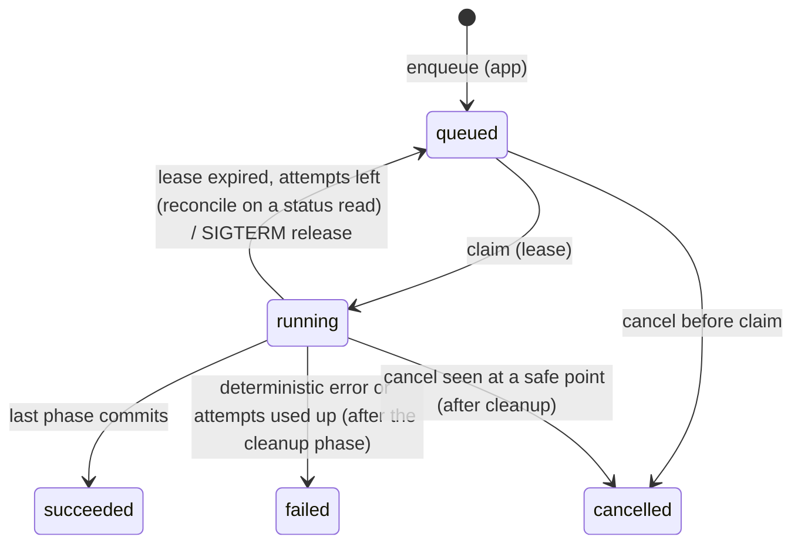
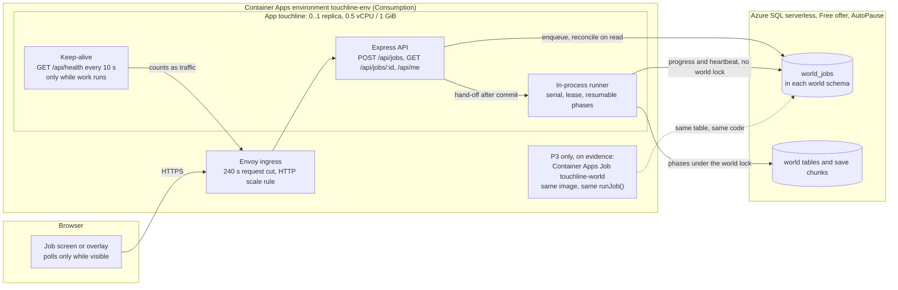
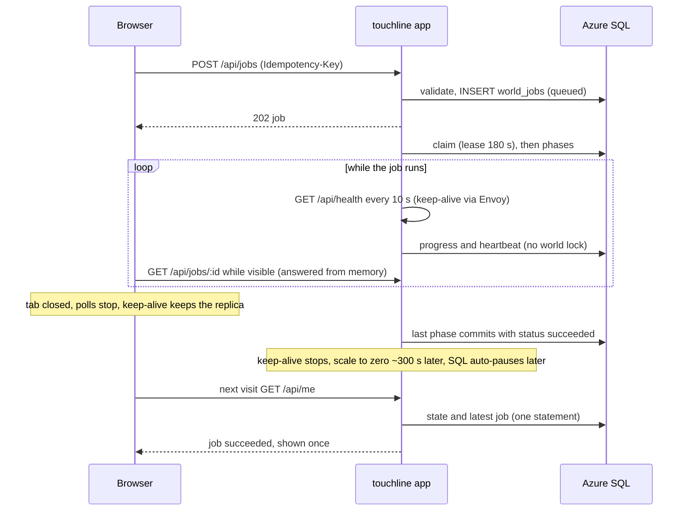
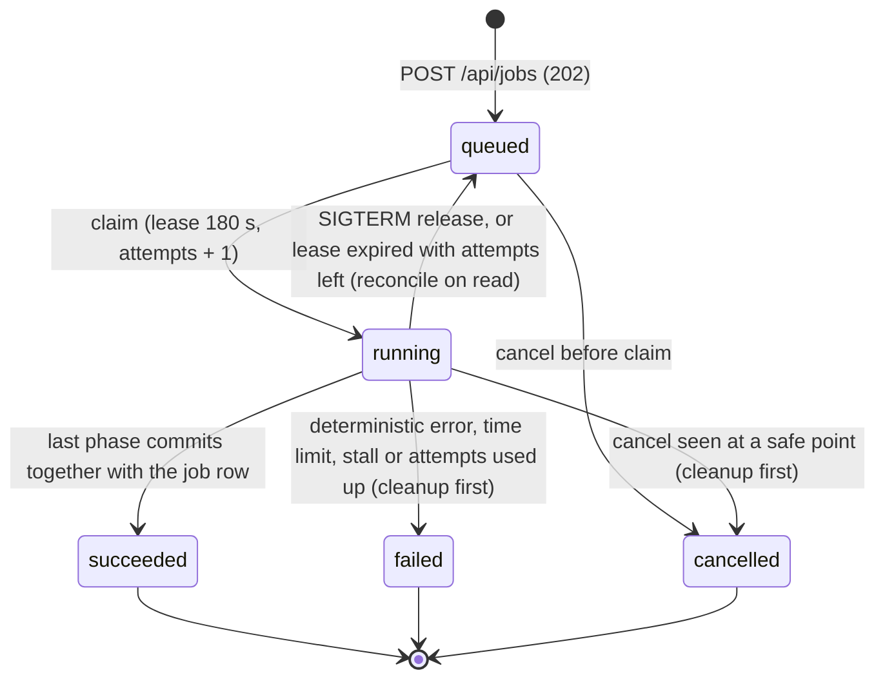
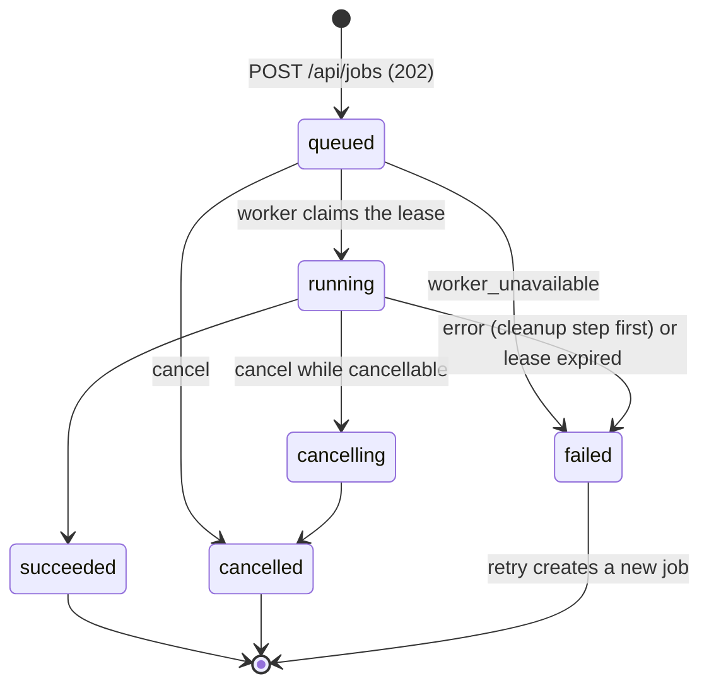

# Squad Decisions Archive

Full text of decisions moved out of `decisions.md` and `decisions/inbox/`. `decisions.md` keeps a short summary of each entry that points here. Append-only; entries are never edited after archival.

## Archived Entries

### 2026-09-25T17:59:53+0200: User directive + autonomous decisions — full world/database rebuild (copilot-world-rebuild-directive.md)
<!-- archived-from: decisions/inbox/copilot-world-rebuild-directive.md -->
**By:** Carlos Sardo (via Squad). Carlos was then unavailable ("work autonomously and make good decisions"), so the Coordinator chose the recommended option for every open question below.

**What (user directive, lightly paraphrased):**
- Completely rebuild the database/world (it has become too big). Permission granted to delete the current saves/database for the rebuild.
- Countries and domestic league counts (no number = 1 league):
  - UEFA: Spain 4, France 3, England 6, Portugal 3, Belgium 2, Netherlands 2, Germany 3, Croatia 2, Italy 3, Switzerland 2, Türkiye, Denmark, Austria, Ukraine, Sweden 2, Norway, Poland, Serbia 2, Scotland, Czechia, Hungary, Russia, Greece 2, Romania, Slovakia, Slovenia, Wales, Republic of Ireland, Bosnia and Herzegovina, Northern Ireland, Georgia, Finland, Albania, Iceland, Bulgaria 2, Montenegro 2, Kosovo, Armenia, Belarus, Luxembourg 2, Moldova, Estonia, Cyprus, Kazakhstan, Latvia, Lithuania, Andorra, Malta, Gibraltar, Liechtenstein, San Marino.
  - CAF: Morocco, Senegal, Egypt, Nigeria 2, Algeria, Côte d'Ivoire, Tunisia, Cameroon, DR Congo 2, South Africa, Ghana, Cape Verde, Angola, Mozambique, Equatorial Guinea, Zimbabwe, Congo, Guinea-Bissau, Ethiopia.
  - AFC: Japan, Iran, Korea Republic, Australia, Saudi Arabia, Qatar, Uzbekistan, Iraq, United Arab Emirates, China PR, Vietnam, Thailand, India, Indonesia, Philippines.
  - CONCACAF: Mexico 2, United States 3, Canada 2, Panama, Costa Rica, Jamaica, Honduras 2, Haiti, El Salvador, Guatemala, Dominican Republic, Puerto Rico.
  - CONMEBOL: Argentina 2, Brazil 3, Colombia 2, Uruguay 2, Ecuador 2, Paraguay, Chile, Peru, Venezuela, Bolivia.
  - OFC: New Zealand. No OFC continental club competition.
- Every club has U19 and U17 teams. Include cups, leagues and B-teams as each country really has them, plus the existing youth tournaments. The youth system is important.
- Every FIFA member has a national team. Nations without a domestic league still have players, playing in professional leagues abroad where appropriate.
- Continental competitions as realistic as possible, including qualification. Realistic coefficient lists per confederation that actually drive qualification.
- Realistic league names and club names: many different real cities/towns, country-appropriate prefixes/suffixes/conventions, not random-feeling. Realistic club wage/transfer budgets and reputations.
- Player names realistic per country with large first/last name variety. Dual/multiple nationality around 20–30%+ depending on the country, based on plausible background.
- Squad minimums per club: 25 first team, 20 U19, 20 U17. B-teams only for big clubs in pro leagues, with at least 20 players.
- Shortlist tab more organized. Every relevant player table (shortlist, squad, academy, etc.) sortable by clicking a column header, with a second click reversing the order.
- Players' height and weight change realistically, especially while young players develop.
- Youth intake: every club gets 5–12 new youth players per year, generally aged 14–15. Intake varies by club, academy quality, country, recruitment and other factors, and intake players are integrated into nationality, development, registration and team placement.
- Audit and fix U18 rules and affiliate clubs: registration, eligibility, transfers, loans, movement between clubs/teams. Nationality and ancestry must matter.
- After the rebuild, test thoroughly and fix glitches. Focus areas: player interest, simulation, transfer values, wage values, affiliates, U18 rules, player and youth registration, B-team rules, transfers, promotion/relegation, continental qualification, plus any other database-related glitches. Multi-season simulation is required, not just "the game starts".
- Don't rewrite things that already work. Keep existing systems intact where possible.
- Ship: switch the Azure CLI to <owner-email>, deploy, open a PR and merge to main. Fan out as much as possible.

**Autonomous decisions (Coordinator, the recommended options):**
1. Wipe scope: everything on Azure (legacy dbo world + snapshots, every account world including guests) and locally. Everyone starts a new career on the new world.
2. First keep a final compressed backup of the current Azure data on local disk. Azure point-in-time restore is an extra safety net. If the snapshot volume is too large for local disk or time, back up the active worlds and rely on PITR for old snapshots (deviation 2).
3. Azure SQL Free: check the remaining vCore allowance first. Never allow paid overage. If too little is left, ship the app and schedule the Azure wipe/rebuild for when the allowance resets on 1 Oct.
4. League counts = tiers, one national league per tier. Regionally split real tiers are modeled as one national division, so the counts are exact.
5. Clubs are realistic generated clubs from real cities/towns with country-appropriate naming. No actual real club names. Leagues and cups use their real names.
6. Model real cross-border setups where they exist: Welsh clubs in the English pyramid, FC Andorra in Spain, Liechtenstein clubs in the Swiss pyramid, Derry-style NI club in Ireland, Canadian MLS clubs in the US league, etc.
7. Liechtenstein: realistic. Its clubs play in the Swiss pyramid, and the Liechtenstein Cup winner gets the UEFA spot. No fictional Liechtenstein league.
8. Russia's UEFA/FIFA suspension applies: Russian league only, no UEFA/FIFA competition entries.
9. Nations without a league: a home-based player pool per nation (scoutable, signable, used by national teams), plus realistic numbers of their players at clubs abroad.
10. Add real promotion/relegation play-offs and league splits where the engine supports them. Keep one shared July–June season. No Apertura/Clausura or calendar-year seasons.
11. Keep the DB small: prune retired players and released youths who leave football at season end (keep a short career summary), cap autosaves per career, and verify DB growth per season.
12. Only the 211 FIFA members exist. Each has senior + U20/U19/U17 national teams. Non-FIFA associations are removed.
13. The Expand career world / classic-vs-expanded option is removed. There is one curated world.
14. Real league sizes and promotion/relegation counts. Closed leagues stay closed: MLS/USL, A-League, and Liga MX while relegation is suspended.
15. B-teams only for big clubs in countries where reserve sides really play (e.g. Spain, Portugal, Germany 3. Liga, Netherlands, Italy Serie C, Belgium). Never in or above the parent's division. Minimum 20 players. England etc. get none.
16. If a club's U17/U19 falls below 20, it tops up through youth recruitment (free agents, other clubs, local grassroots signings). This is separate from the 5–12 academy intake.
17. Continental club competitions:
    - UEFA: CL/EL/UECL, Youth League, Super Cup.
    - CONMEBOL: Libertadores/Sudamericana, U20 Libertadores, Recopa.
    - AFC: ACL Elite/ACL Two/Challenge League.
    - CAF: CL/Confederation Cup.
    - CONCACAF: Champions Cup, including its Central American/Caribbean/Leagues Cup routes.
    - No OFC club competition, no FIFA Club World Cup/Intercontinental Cup.
    - Coefficients are seeded from realistic recent history.
18. Player names are fictional, generated per country from large pools. Dual nationals are about 20–35% depending on the country, based on real migration/ancestry links.
19. Height/weight change through natural development (growth curves for youths, small adult changes). No manual editor.
20. The game still starts on 1 July 2026.
21. Verification (deviation 1): local Docker is inaccessible (socket ACL reset; fixing it needs sudo the user must run). SQL-backed tests, world checks, multi-season simulation and e2e therefore run in a GitHub Actions workflow against a throwaway SQL Server container. Local runs cover lint, build and pure tests.

**Why:** User request. Open questions were resolved autonomously because the user was unavailable and explicitly asked for autonomous decisions. Every choice favors realism, the existing systems, and a smaller database.

### 2026-09-25T17:59:53+0200: World rebuild — architecture and Phase 1 contract (world version 4) (lead-world-rebuild-architecture.md)
<!-- archived-from: decisions/inbox/lead-world-rebuild-architecture.md -->
**By:** Lead (Game Systems Lead), Phase 0, requested by Carlos Sardo
**What:**

#### 0. Rulings (read first)
1. **Liechtenstein has 0 own tiers.** Decision 7 (no fictional LI league, LI clubs play in the Swiss pyramid, LI Cup winner takes the UEFA place) overrides the "no number = 1 league" default. The catalog has **107 nations with own leagues and 146 own tiers**, plus LI as a club nation hosted in CH, so 108 club nations. `CATALOG_ASSIGNMENT` in `shared/world-catalog/validate.ts` encodes every nation's file and exact tier count.
2. **Every first-team club has U19 and U17 squads. B-teams do not**: they use the parent's academy. This saves about 4,400 youth players and matches reality.
3. **Home-based pools** (every nation without an own league, including LI) are club-less players (`club_id NULL`) flagged with `profile.homeBased`. There are no pseudo-clubs and no new tables. National teams already select by `players.country_id`.
4. **No SQL schema change is needed.**
   - Static nation facts (EU/EEA, citizenship, suspension, names, heritage links, cities, physique) are read from the catalog by `countries.code` at runtime.
   - Structural rules are snapshotted into `league.data` and `club.data` at generation (section 4).
   - `WORLD_VERSION` becomes 4.
5. Movement only exists between modeled tiers. Single-tier nations have no promotion or relegation. The top tier has no promotion and the bottom tier has no relegation.
6. **Cross-border list (decision 6).** The host tier `size` includes these clubs.

| Home → host | Clubs, start tier | Cities (home `cities.major`) | cups | continental | youth | registration |
|---|---|---|---|---|---|---|
| WAL → EN | 4: T2, T2, T3, T4 | Swansea, Wrexham, Cardiff, Newport | host | host | host | host |
| NIR → IE | 1: T1 | Derry | host | host | host | host |
| AD → ES | 1: tier per 2025/26 (author verifies) | Andorra la Vella | host | host | host | host |
| LI → CH | 1: T2 | Vaduz | home (Liechtenstein Cup) | home | host | host |
| CA → US | 3: T1 ×3 | Toronto, Vancouver, Montréal | home (Canadian Championship) | home | host | host |
| NZ → AU | 2: T1 ×2 | Wellington, Auckland | none | none | home | host |

CA's II teams play in the US reserve league: `reserves.mode = "reserve-league"` with `reserveLeague.host = "US"`.

7. Liechtenstein Cup with a single LI club: the club wins by walkover and is recorded as champion, so qualification history exists.

#### 1. Catalog — `shared/world-catalog/`
- `types.ts` holds the contract, types only.
- `validate.ts` holds `CATALOG_ASSIGNMENT` (211 codes, file, confederation, tiers), `validateCatalog(catalog, { scope })`, `assertValidCatalog`, `summarizeCatalog` and `tierMatchdays`.
- `index.ts` aggregates the files and exposes the lookups:
  - `nationByCode`, `requireNation`, `allNations`, `nationsIn`;
  - `leagueTiers`, `hasOwnLeague`, `isClubNation`, `hostedClubsIn`, `namePool`;
  - `citizenshipGroup`, `permitsDualNationality`, `hasEuEeaNationality`, `isSuspended`, `continentalCompetition`;
  - the key builders `leagueKey`, `reserveLeagueKey`, `youthLeagueKey`, `clubKey`, `hostedClubKey`, `reserveClubKey`;
  - `CATALOG_VERSION = 1`.
- `catalog.test.ts` is a pure test with no SQL: `CATALOG_SCOPE=<file>[,<file>] npx vitest run shared/world-catalog`.
- The data stubs export empty data: `uefa-west.ts`, `uefa-north.ts`, `uefa-central.ts`, `uefa-east.ts`, `caf.ts`, `afc.ts`, `concacaf-ofc.ts`, `conmebol.ts`, plus `continental.ts` for continental competitions and access lists.

**Nation split** (balanced by tiers and effort):
- uefa-west: ES PT FR IT GR CY AD SM MT GI (10 nations, 20 tiers)
- uefa-north: EN SCO WAL NIR IE IS FO NO SE DK FI EE LV LT (14 nations, 19 tiers)
- uefa-central: DE NL BE LU CH LI AT PL CZ SK HU SI HR (13 nations, 19 tiers)
- uefa-east: TR UA RU BY MD GE AM AZ KZ RO BG IL RS BA ME XK AL MK (18 nations, 18 tiers)
- caf: 54 nations (19 with leagues, 21 tiers)
- afc: 46 nations (15 with leagues, 15 tiers)
- concacaf-ofc: 35 + 11 nations (13 with leagues, 18 tiers)
- conmebol: 10 nations (16 tiers)

**Schema (NationSpec):**
- `code`, `iso2` (GB for EN/SCO/WAL/NIR, XK for Kosovo), `name`, `confederation`, `continent`, `capital`, `latitude`.
- `languages[]` (weighted; the first is primary).
- `reputation { national, league }`, `euEea`, `suspended?` (RU only).
- `physique? { height, heightSd }`.
- `names` (NameConfig) and `nationality`:
  - `multipleRate`, `tripleRate`, `bornAbroadRate`, `diasporaPull`;
  - `links[]` = weighted heritage/migration corridors with a context;
  - `citizenship { group, dual: allowed|restricted|partners, partners }`.
- `cities { major[] {name, size, region, maxClubs?, districts?}, extra? {admin1?, exclude?, max?} }`.
- `football?` (DomesticFootballSpec), `hostedAbroad?[]` (CrossBorderSpec), `homePool? {seniors, youth}`, `abroad? {seniors, youth, destinations[]}`.

**DomesticFootballSpec:**
- `leagues[]` (LeagueTierSpec):
  - `tier`, real `name`, `shortName`, `size`, `status`, `reputation`, `closed?`;
  - `roundRobins?` 2/3/4, `conferences?`, `split?` (groups, positions, roundRobins, points full/halved);
  - `championship?` (title play-offs), `bTeams?` (B-teams placed at start);
  - `clubs` (TierClubModel): reputation span, giants, capacity, facilities, academy, wageBill (GBP/yr), transferBudget (GBP), foreignShare, squadSize.
- `movement[]` (TierBoundarySpec): `upper`, `promoted`, `relegated`, `playoffs[]`, where a play-off is one of:
  - promotion (`positions`, `places`);
  - relegation play-out;
  - cross-tier (`upperPositions`, `lowerPositions`).
  
  Balance: `promoted + Σpromotion.places = relegated + Σrelegation.places`.
- `cups[]` (CupSpec): `kind` national/league/super, real `name`, `tiers`, `maxEntrants`, `seededEntry`, `rounds`, legs, super-cup `participants`, `continental` flag, `start`.
- `youth { U19, U17 }`: divisions `{name, parentTiers, groupSize ≤ 16, groupNames}` covering every own tier once, plus an optional `cup`.
- `reserves` (ReservePolicySpec):
  - `mode` none/pyramid/reserve-league and `nameTemplate` ("{club} B", "Jong {club}"…);
  - `eligibility { parentTiers, minReputation, maxTeams }`;
  - `pyramid { highestTier ≥ 2, minGapBelowParent, maxPerTier }` or `reserveLeague { name, shortName, host?, roundRobins, conferences, reputation }`;
  - `ageRule`, `squad [≥20, ≤32]`.
- `clubNaming`: weighted templates with tokens `{city} {region} {founded} {founded2}`, regional variants, `founded` ranges, shortName style, colors.
- `importSources[]` (sporting nationalities of foreign players).
- `coefficients.association[5]`: seasons 2021–2025, points per entrant with the UEFA method; required outside OFC.

**Author conventions:**
- Real names without sponsors, 2025/26 season structure.
- Regional real tiers are merged into one national division (decision 4) with a playable size: ≤ 24, or `conferences` above 24 (the MLS/Argentina style). Each tier needs ≤ 46 matchdays, which the validator computes.
- Money is GBP. Rates are 0–1.
- Names:
  - Faker locales are restricted by type to Latin-script locales that have person names (verified: en_GB/en_US/en_IE/fr_LU/cy have none; ru/uk/el/ja/ko/zh/ar/fa/he/hy/ka/mk/th are non-Latin).
  - Curated pools are romanized and have ids `"<file>/<name>"`. Any nation may reference any pool.
  - Minimum variety: league nations ≥ 60 given and ≥ 100 family names; others ≥ 30/40.
- Heritage names use the heritage nation's own `names`, so a French player with Senegalese roots can get a Senegalese family name.
- Port the curated data already in `server/world-names.ts` instead of reinventing it: `custom` pools, `places`, `clubForms`/`countryClubForms`, `familyLinks`, the citizenship sets. Drop non-FIFA territories.
- Coefficients: UEFA uses real association season points. Other confederations keep their official 5-year ranking order, scaled to the same range (top about 12–20 per season, minnows about 1–4).
- The **only** editors of `types.ts`/`index.ts`/`validate.ts`/`catalog.test.ts` after Phase 0 are Lead-core (on request via the Coordinator) and Lead-competitions (`continental.ts`). Authors edit their own file only.
- `src/` must never import `shared/world-catalog` (bundle size). The UI gets catalog facts through API reads.

#### 2. Generation pipeline — `generateWorld` (Lead-core)
1. `assertValidCatalog(WORLD_CATALOG, { scope })`, relaxed for a `nations` subset.
2. **Countries**: 211 rows.
   - EN first, then league nations by `reputation.league` descending, then the others by `reputation.national` descending.
   - Columns: `code`, `name`, `continent`, `confederation`, `reputation = reputation.league`, `language = languages[0]`, `region = capital`.
3. **Senior leagues**: one row per own tier, with the snapshot in `league.data` (section 4) and `format` as a readable string.
4. **First-team clubs** per tier: `size − bTeams − hosted-in` slots.
   - Reputation: giants first (count, top..bottom), then the rest interpolated from `reputation.top` to `.bottom` with ±2 seeded jitter.
   - Cities: biggest club to biggest city up to `maxClubs`. Extra clubs in a city take `districts` identities. When curated cities run out, towns come from cities.json (`country = iso2`, `admin1` filter for UK nations, excluding used and `exclude` names, ≤ 30 chars, seeded shuffle).
   - Names from weighted templates, with regional templates when the city's region matches. Names are unique per nation: retry templates, then districts.
   - Founded year is interpolated from the tier ranges.
   - `club.data`: `worldKey = clubKey(code, tier, slot)`, `worldVersion: 4`, `founded`, `catalogTier`, plus the existing fields (youthDNA, ultras, boardPersonality, mediaBias, ticketPrice, sponsors, relationship…).
5. **Hosted clubs**: generated by the home nation (`country_id = home`, home naming and cities) and placed in host-tier standings (`league_id` = host league).
   - `club.data.hosted = { host, cups, continental, youth, registration }`.
   - `worldKey = hostedClubKey(home, i)`.
6. **B-teams (pyramid mode)**:
   - Parents are the strongest clubs in `eligibility.parentTiers` with reputation ≥ `minReputation`. There are exactly `Σ tier.bTeams` B-teams, placed top-down respecting `highestTier`, `parent tier + minGapBelowParent` and `maxPerTier`.
   - Each B-team: `type bteam`, `parent_id`, name from `nameTemplate`, parent's city/colour/academy/facilities, reputation parent − 25…30.
   - Finances come from the host tier's bottom span. B-teams get no staff and no U19/U17.
   - `club.data`: `reservePolicy` snapshot, `noSameDivision: true`, `worldKey = reserveClubKey(parentKey)`.
7. **Reserve leagues (reserve-league mode)**: one league (`tier 0`, `data.reserveOnly = true`, `catalogKey = reserveLeagueKey(host)`, `country_id = host`). It holds `eligibility.maxTeams` B-teams of the host plus guests (CA → US).
8. **Youth leagues**: per nation, age and division.
   - Clubs: first teams whose own tier is in `parentTiers`, plus clubs hosted here with youth "host" (by host tier), plus own clubs hosted abroad with youth "home" (top division).
   - Order by city region, then reputation. Group with `youthGroups(clubs, groupSize)`; names are `division.name` plus ` - {groupName}` when there is more than one group.
   - `tier 0`, `data { worldVersion, catalogKey: youthLeagueKey(...), youth: true, division, parentTiers, promotion: 0, relegation: 0 }`.
9. **National teams**: 211 × Senior/U20/U19/U17 (844 rows, `type national`, `league_id NULL`).
   - Reputation: `reputation.national` (youth teams −3/−5/−6).
   - Russia exists but is excluded from UEFA/FIFA entries.
10. **Players** (people API):
   - First teams: `squadSize` (default 25–30), youth 20–24 per age group, B-teams `reserves.squad`.
   - Goalkeepers: ≥ 2 per team and age group (first teams get 3).
   - Foreign first-team slots (`foreignShare`): first the `abroad` allocations of every nation (pushed), then the club nation's `importSources` (pulled).
   - Youth foreign share = `foreignShare × 0.35`, mostly EU/EEA 16+ or family moves.
   - Home pools: `homePool` counts, ability from `reputation.league` (the home level).
11. **Staff**: 8 roles per first-team club as today. No staff for B-teams or national teams. About 5% of the club count as free staff. Names come from `personName` (nation culture).
12. `ensureClubSupport(store)` (unchanged call; Lead-systems owns its rules) and `seedAssociationCoefficients(store, 2026)` (Lead-competitions).
13. **meta**:
   - `world = { seed, generated: START_DATE, version: 4, catalogVersion, nations, clubs, bTeams, nationalTeams, players, homeBased }`, with no `expanded` flag;
   - `state` and `settings` as today;
   - `state.clubId = 1` = the top EN tier-1 club.

**Module fate:**
- `server/world.ts`: rewritten by Lead-core.
  - Deleted: `countryDefinitions`, reputation/city/name tables, expanded branches, `buildWorldStructure`, the legacy `makeProfile` identity/body code.
  - Kept: `generateWorld` and `personName`. world.ts keeps the legacy `personName(random, language | Country)` shim, because simulation.ts:1449 and club-support.ts:96 pass a *language*. Lead-systems migrates both call sites to `people.personName(random, nationCode)`, then the shim goes.
  - `generatePlayers` and `ensureClubRosters` stay as thin shims until Lead-systems' youth.ts replaces the simulation.ts calls, then Lead-core deletes them.
- `server/world-names.ts`: its data moves into the catalog and its functions into `server/people.ts`. Deleted at integration. `world-names.test.ts` is replaced by `people.test.ts`.
- `shared/world-rules.ts`:
  - Kept: `WORLD_VERSION = 4`, `SQUAD_MINIMUMS = { Senior: 25, U19: 20, U17: 20, BTeam: 20 }` plus a `MIN_GOALKEEPERS = 2` export, `youthGroups`, `reserveTeamName`.
  - `reservePolicy`, `associationNotes`, `associationRuleAudit` and `minimumReserveTier` keep their names but are backed by the catalog, so queries.ts and calendar.ts keep working.
  - Deleted: `footballConfederation`, `pyramidSizes`, `pyramidTitles`, `smallAssociations`, `closedPyramids`, `domesticPyramid`, the reserve tables and the historical lists.
  - `planPyramidMoves` is deleted once Lead-competitions' `shared/league-rules.ts` replaces its only caller.
- `server/world-expansion.ts`: deleted by **Data**, atomically with its only importer (`saves.ts` `expandWorld`), the `/api/world/expand` route and the `expand_world` operation.
- `server/check-world.ts`: rewritten by Lead-core with the section 9 invariants, the catalog summary and per-table sizes.

**Targets:**

| | Old basic (v1) | Old expanded (v3) | New curated (v4 target) |
|---|---|---|---|
| Nations | 243 associations | 243 | 211 FIFA members |
| Senior tiers / all domestic leagues | 729 / 1,215 | — / 2,647 | 146 (+1–2 reserve) / ≈ 550 |
| Clubs (non-national) | 6,040 | 11,882 | ≈ 2,250 first teams + ≈ 100 B-teams |
| National teams | 972 | 972 | 844 |
| Players | 160,000 | 689k–834k | ≈ 175k (62k first team, 50k U19, 50k U17, 2.5k B, 10k home-based) |
| Staff | 54,416 | 106,578 | ≈ 20,000 |
| Annual intake | 15,000 fixed | 15,000 + top-ups | ≈ 18,000 (5–12 per club) + top-ups + ≈ 1,000 pool youths |
| SQL reserved size | ≈ 1.5–2 GB (est.) | multi-GB | budget ≤ 1.6 GB initial, ≤ 300 MB/season after retention |

`summarizeCatalog` warns when there are more than 2,600 first teams, 150 B-teams or 210k estimated players.

#### 3. APIs other agents code against (exact signatures)

**`server/people.ts` — Lead-core.** Pure except `insertPlayers`; deterministic for a given Rng.
```ts
import type seedrandom from "seedrandom";
export type Rng = seedrandom.PRNG;
export interface PeopleContext { countries: Country[]; byId: Map<number, Country>; byCode: Map<string, Country> }
export function peopleContext(countries: Country[]): PeopleContext;
/** Name in the culture of nameCode (catalog NameConfig); givenCode optionally supplies the given-name culture (diaspora). */
export function personName(random: Rng, nameCode: string | Pick<Country, "code">, options?: { givenCode?: string }): string;
export interface IdentityRequest {
  representCode: string;   // sporting nationality wanted (players.country_id)
  contextCode: string;     // nation where the person grew up / is generated (club nation or pool nation)
  birthDate: string; date: string; position: Position;
  allowSwitch?: boolean;   // may pick another held nationality (catalog diasporaPull, ability); default false
  bornIn?: string;         // force birth country code
}
export interface Identity { name: string; countryId: number; nationality: string; identity: PlayerProfile["identity"] }
export function createIdentity(random: Rng, people: PeopleContext, request: IdentityRequest): Identity;
/** Biography sentences derived on read (never stored). */
export function describeIdentity(identity: PlayerProfile["identity"], people: PeopleContext): string[];
export interface PlayerSpec {
  club: Pick<Club, "id" | "country_id" | "reputation" | "academy" | "balance" | "philosophy" | "type"> | null; // null = home-based
  representCode: string; contextCode: string; ageGroup: "Senior" | "U19" | "U17"; position: Position;
  birthDate: string; date: string; ability: number; potential: number; leagueReputation: number;
  wageScale?: number;      // payroll calibration factor, default 1
  contract: "professional" | "amateur" | "pool";
  role?: string; allowSwitch?: boolean;
  intake?: NonNullable<PlayerProfile["intake"]>; familyMove?: PlayerProfile["familyMove"];
}
export type PlayerRow = Record<string, string | number | null>; // players columns without id
export function createPlayer(random: Rng, people: PeopleContext, spec: PlayerSpec): PlayerRow;
export function birthDateForAge(random: Rng, age: number, date: string): string;
export async function insertPlayers(store: Store, rows: Iterable<PlayerRow>): Promise<number>;
```
Identity rules (from the catalog):
- Heritage roots come from `multipleRate`/`tripleRate` over `links`.
- Nationalities: `permitsDualNationality`, with shared groups not counted twice.
- The name origin is weighted by heritage.
- Birthplace: a heritage country with probability `bornAbroadRate`, else the context nation. The city is weighted by size, with extra towns included.
- Languages come from birth country and roots.
- `height`, `weight`, `bodyType` and `growth` come from `initialBody`.

**`server/growth.ts` — Lead-systems.** Pure.
```ts
export type BodyGrowth = NonNullable<PlayerProfile["identity"]["growth"]>; // { adultHeight, adultWeight, maturation: -1 early … 1 late }
export function initialBody(random: Rng, input: { nationCode: string; position: Position; birthDate: string; date: string }):
  { height: number; weight: number; bodyType: string; growth: BodyGrowth };
export function growBody(body: { height: number; weight: number; growth: BodyGrowth },
  input: { birthDate: string; from: string; to: string; random: Rng; physicalTraining?: boolean }): { height: number; weight: number };
```
Growth model:
- Boys' curve with peak velocity at about 13.5–14.5, shifted by `maturation`. Height is near-final by 17–19 with small gains to about 21.
- Weight tracks height plus muscle gain to about 25, then small adult drift of ±2 kg/yr.
- Nation mean height comes from `physique` (default 181, sd 6.5), adjusted by position.

**`server/youth.ts` — Lead-systems.**
```ts
export function intakeSize(club: Pick<Club, "academy" | "facilities" | "reputation">,
  context: { nationLevel: number; headOfYouth: number; recruitment: number }, random: Rng): number; // always 5..12
export async function runYouthIntake(store: Store, season: number, date: string, random: Rng):
  Promise<{ academy: number; topUps: number; pools: number }>; // replaces generatePlayers(annualRegens)+ensureClubRosters in seasonRollover
```

**`server/retention.ts` — Data.**
```ts
export async function pruneSeason(store: Store, finishedSeason: number, date: string):
  Promise<{ players: number; fixtures: number; rows: number }>; // called once at the end of seasonRollover
```

**Coefficients — Lead-competitions, in `server/qualification.ts`.**
```ts
export async function seedAssociationCoefficients(store: Store, firstSeason: number): Promise<number>; // idempotent; seasons firstSeason-5..-1
```

**`server/world.ts` — Lead-core.**
```ts
export interface WorldOptions {
  seed?: string;
  nations?: string[];                 // subset for tests/tools; hosted clubs of excluded home nations become local clubs
  squads?: "full" | "minimum";        // "minimum" = exact minimums (tests)
  structureOnly?: boolean;            // leagues, clubs, national teams; no players/staff (calendar tests)
  /** @deprecated Phase 1 shim: first N club nations in catalog order. */ countryLimit?: number;
  /** @deprecated ignored */ seniors?: number; /** @deprecated ignored */ youth?: number; /** @deprecated ignored */ expanded?: boolean;
}
export async function generateWorld(store: Store, options?: WorldOptions): Promise<void>;
```

**`shared/types.ts` additions — Lead-core, first action, `PlayerProfile` only:**
- `identity.growth?: { adultHeight: number; adultWeight: number; maturation: number }`
- `homeBased?: { countryId: number; since: string }`
- `intake?: { season: number; source: "academy" | "grassroots" | "trial" | "top-up" | "pool" }`
- `retirement?: { season: number; date: string; reason: "retired" | "left-football" }`

`identity.biography` stays optional and is no longer stored for new players.

#### 4. Competition interfaces (decisions 7, 8, 10, 17)
**Snapshot contract (written by the generator, read by calendar, qualification and simulation; never re-derived from the catalog mid-career):**
- **Senior league `league.data`**:
  - `worldVersion: 4`, `catalogKey` (`L:ES:1`), `shortName`, `status`, `roundRobins`, `conferences?` (the standings `group_name` holds each club's conference), `split?`, `championship?`, `closed`;
  - `promotion` / `relegation`: total places up and down, kept numeric for compatibility and UI zones;
  - `movementUp` / `movementDown`: the TierBoundarySpec with the tier above/below, or null;
  - `bTeamsAllowed`, `targetFirstTeams`, `tiebreakers`.
- **Reserve league**: `reserveOnly: true`, `catalogKey: R:US`, `shortName`, `roundRobins`, `conferences?`, `promotion: 0`, `relegation: 0`.
- **Youth league**: `youth: true`, `catalogKey`, `division`, `parentTiers`.
- **`club.data`**: `worldKey`, `catalogTier`, `hosted?`, `reservePolicy?`, `founded`.

**Seasonal competitions are instantiated each season in `createCalendar` from the catalog by nation code:**
- The national cup is the real name.
  - Entrants: own first teams (not B-teams), minus clubs hosted abroad whose cups ≠ "home", plus clubs hosted here with cups "host".
  - Filtered by `tiers`, capped by `maxEntrants` (default 64: strongest tier first, then reputation), with seeded entry when set.
- League cup and super cup use `participants` from last season's history; a duplicate is replaced by the runner-up.
- Youth cups use the nation's youth divisions.
- **The Liechtenstein Cup** is contested by LI clubs wherever they are hosted.

**Formats (decision 10)**:
- base round-robins within conferences;
- split groups after the base schedule, with points full or halved and group order fixed in the final ranking;
- title play-offs: the champion is the play-off winner, while "league" access sources use the regular table;
- movement play-offs are scheduled after the regular season and split (late May to June) and resolved before rollover;
- one July–June season, at most 46 league matchdays.

`seasonRollover` applies the movement plan from the pure `shared/league-rules.ts`:
- hosted clubs move within the host pyramid;
- B-teams are never at or above the parent's division, pushed down when the parent is relegated (no "Development League" fallback);
- closed tiers never move.

**Coefficients:**
- History rows use `entity_type = 'associationCoefficient'`, `entity_id = country id`, `data { points, participants, basis, seeded? }`.
- They are recorded every rollover for each of `CONTINENTAL.coefficientConfederations` (UEFA, CAF, AFC, CONCACAF, CONMEBOL; never OFC).
- Ranking = 5-season sum per confederation. Suspended nations are excluded.
- Seeds: 5 rows per coefficient nation from `football.coefficients` for seasons 2021–2025 (`seeded: true`), written by `seedAssociationCoefficients` at generation.
- Club coefficients are optional (`entity_type 'clubCoefficient'`, continental clubs only); fallback is reputation.

**Access lists**: `CONTINENTAL.access` (AccessRule):
- `association-rank` bands for UEFA, AFC and CAF; `fixed` per-nation entries for CONMEBOL and CONCACAF;
- sources: `league` position (final combined table), `champion`, `cup-winner`, `league-cup-winner`, `u19-champion`, `u20-champion`;
- `stage` (main/playoff/q1–q4), `path` (champions/league);
- competitions carry `titleholders`, `feeds` (Central American/Caribbean Cup → Champions Cup, Leagues Cup routes) and `zones` (AFC East/West).

**Decision 17 set**:
- UEFA: CL/EL/UECL, Youth League, Super Cup.
- CONMEBOL: Libertadores, Sudamericana, U-20 Libertadores, Recopa.
- AFC: ACL Elite/ACL Two/Challenge League.
- CAF: CL, Confederation Cup.
- CONCACAF: Champions Cup incl. its regional routes.
- **No OFC club competition, no Club World Cup/Intercontinental.** National-team competitions stay (OFC national events included). Russia is excluded from all UEFA/FIFA club and national entries (decision 8).

#### 5. Budgets, reputations, values (existing formulas kept)
- `reputation` from the tier span/giants; `academy` and `facilities` interpolated by rank ±6/±5; `capacity` interpolated (log scale) ±10%.
- `wage_budget` = interpolated `wageBill` / 52 (weekly); `transfer_budget` = interpolated `transferBudget` (geometric).
- `balance = max(initialClubFinances(...).balance, 1.25 × transfer_budget)`. finance.ts is unchanged.
- `sponsors`, `ticketPrice` etc. use today's formulas.
- **Player wages:**
  - Base is today's formula `round((ability/100)^7 × 190,000 × (youth ? 0.08 : 1) / 10) × 10 + 50`.
  - Per club, professional wages are scaled by `s = clamp(0.88 × wage_budget / Σbase, 0.25, 4)`, so payroll is about 88% of budget. Amateur allowances are unchanged.
- **Values**: `valuation()` in `shared/rules.ts` is unchanged, with `leagueReputation` = the club's league reputation. Home-based players use `reputation.league`.
- Ability keeps today's anchor (club reputation × 0.66 + 22 ± noise, age-adjusted), so realistic club reputations produce realistic abilities.

#### 6. Keeping the DB small (decision 11) — owner **Data**
- Structural savings: no schema additions, no stored biographies, no B-team academies, youth squads capped (U17/U19 ≤ 26, AI first teams ≤ 32; Lead-systems enforces).
- Retention (`server/retention.ts`, called from `seasonRollover`):
  - Lead-systems marks leavers: `role 'Retired'`, `club_id NULL`, `profile.retirement` with reason retired or left-football. Left-football covers released youths and free agents unsigned for a full window, aged ≥ 18 and below the ability threshold.
  - Data prunes leavers one season later, writing `history 'careerSummary'` and deleting FK rows. Players with outstanding `transfer_payments` or active clauses are skipped. Home-based players are never pruned while under 36.
- Fixtures: compact finished seasons' non-user fixtures (keep score, xG and scorers summary; drop events, momentum, players and snapshot). Aggregate old non-user `player_match_appearances` into `player_season_stats`. Cap news and `history 'appearance'`.
- Lead-systems caps `profile.development.history` (keep ≤ 24 points).
- Saves: 3 autosaves per career (exists) and 10 manual saves per career.
- CI footprint report after generation and after each simulated season. Budgets: ≤ 1.6 GB initial, ≤ 300 MB/season, compressed checkpoint ≤ 300 MB. Over budget means escalate with the lever used.

#### 7. Phase 1 task split (13 agents, conflict-free)
**Shared-file regions:** only these named owners, only these regions, targeted replacements only. Re-read before every edit; never reformat or rewrite a whole shared file.
- `server/simulation.ts`:
  - **Lead-competitions**: `seasonRollover` from `await recordAssociationCoefficients(` through the per-country promotion/relegation loop and reputation drift, up to the standings reset; plus a play-off progression call site if needed.
  - **Lead-systems**: `developPlayers` growth and history block; `seasonRollover` from the players `age_group` UPDATE to the end; the world.ts imports; the weather `latitudes` line; the manager-replacement `personName` call in `weeklyStaffAndPolitics`; `worldTransfers` pool signings.
  - **Data**: the single `await pruneSeason(...)` line at the very end of `seasonRollover`; the `playFixture` payload/appearance region only if the budget requires it, agreed with Lead-systems.
- `server/queries.ts`:
  - **Lead-core**: player-detail read (fill `identity.biography` via `describeIdentity`).
  - **Product**: player search `sort`/`direction` schema and ORDER BY mapping.
  - **Lead-competitions**: competition read functions only.
- `shared/types.ts`: **Lead-core** only (additions above).
- `server/sql-schema.ts`: **Data** only (indexes, if any).
- `server/app.ts`: **Data** only (delete the expand route).
- `shared/api.ts`: **Data** only (remove `expand_world`).
- `shared/rules.ts`: **Lead-core**, `WORLD_COUNTS` block only.

**Contract-first order:** each agent's first edit publishes its signatures (stub bodies allowed):
- Lead-core: `people.ts` and the `shared/types.ts` fields;
- Lead-systems: `growth.ts` and `youth.ts`;
- Data: `retention.ts`;
- Lead-competitions: `seedAssociationCoefficients` stub and `shared/league-rules.ts`.

World.ts compatibility shims stay until integration. **No git mutations by anyone. SQL-backed checks run in CI.** Verify locally with `npx tsc -p tsconfig.server.json`, `npx tsc -b` (src), `npm run lint` and pure vitest files.

The `CATALOG_SCOPE` command and the port-from-`server/world-names.ts` rule are in section 1; the rows below use them.

| # | Agent | Owns (exclusive) | Deliverable | Acceptance |
|---|---|---|---|---|
| 1 | Catalog author uefa-west | `shared/world-catalog/uefa-west.ts` | ES PT FR IT GR CY AD SM MT GI, complete per the section 1 conventions. **Priority PT, ES.** ES hosts AD (size includes it). B-teams where real: ES Primera/Segunda Federación, PT Liga 2/Liga 3, IT Serie C U23 sides, GR Super League 2 if real; FR none (reserves play tier 5+). Real cups (Copa del Rey, Supercopa, Taça da Liga…) and youth names (División de Honor Juvenil, Campionato Primavera…). | `CATALOG_SCOPE=uefa-west` test: 0 errors. All 10 nations present. Merged regional tiers carry a one-line comment giving the real structure. Nothing edited outside the file. |
| 2 | Catalog author uefa-north | `uefa-north.ts` | EN SCO WAL NIR IE IS FO NO SE DK FI EE LV LT. **Priority EN, WAL, SCO.** WAL `hostedAbroad` EN ×4 and NIR → IE ×1 per the section 0 table (EN T2/T3/T4 and IE T1 sizes include them). England and Scotland: reserves none. FO: home pool plus abroad. Real cups (FA Cup, EFL Cup, Community Shield, Scottish Cup/League Cup…) and youth (U18 Premier League/EFL Youth Alliance, FA Youth Cup…). | Scoped test 0 errors. All 14 present. Nothing edited outside the file. |
| 3 | Catalog author uefa-central | `uefa-central.ts` | DE NL BE LU CH LI AT PL CZ SK HU SI HR. **Priority DE, NL, LI, CH.** LI: 0 tiers, `hostedAbroad` CH T2 (Vaduz, cups home, continental home), Liechtenstein Cup, home pool. B-teams: DE 3. Liga II sides, NL Jong in the Eerste Divisie, BE U23/Futures in the Challenger Pro League. Others only if their reserves play in a modeled tier. | Scoped test 0 errors. All 13 present. Nothing edited outside the file. |
| 4 | Catalog author uefa-east | `uefa-east.ts` | TR UA RU BY MD GE AM AZ KZ RO BG IL RS BA ME XK AL MK. **Priority TR, RU, RS.** RU `suspended { club: true, national: true }`. AZ, IL, MK: home pool plus abroad. Romanized pools for RU/UA/BY/GE/AM/BG/MK/IL/KZ (no Cyrillic, Georgian or Armenian script). | Scoped test 0 errors. All 18 present. Nothing edited outside the file. |
| 5 | Catalog author caf | `caf.ts` | 54 CAF members (19 league nations, 21 tiers; NG and CD have 2). **Priority MA, NG, EG.** 35 home pools with realistic `abroad` destinations (FR/BE/PT/ES/IT/TR/SA…). Port the `custom` pools from world-names.ts. | Scoped test 0 errors. All 54 present. Nothing edited outside the file. |
| 6 | Catalog author afc | `afc.ts` | 46 AFC FIFA members (15 league nations). **Priority JP, AU, SA.** The AU A-League size includes NZ ×2. Romanized JP/KR/CN/IR/Arab/TH pools (faker ja/ko/zh/ar/fa/th are not allowed). 31 home pools. | Scoped test 0 errors. All 46 present. Nothing edited outside the file. |
| 7 | Catalog author concacaf-ofc | `concacaf-ofc.ts` | 35 CONCACAF + 11 OFC members (13 league nations, 18 tiers). **Priority US, CA, MX, NZ.** US: MLS 30 incl. CA ×3 with 2 conferences plus title play-offs, all tiers closed, reserve league "MLS NEXT Pro" with conferences. CA: CPL + League1 Canada (closed), `hostedAbroad` US ×3, reserve league host US. MX: Liga MX + Expansión, closed. NZ: 1 tier + AU ×2 (cups none, continental none, youth home), no coefficients. | Scoped test 0 errors. All 46 present. Nothing edited outside the file. |
| 8 | Catalog author conmebol | `conmebol.ts` | AR BR CO UY EC PY CL PE VE BO. **Priority BR, AR.** AR Liga Profesional 30 in 2 zones with title play-offs; Primera Nacional 36 in 2 zones. Real cups (Copa Argentina, Copa do Brasil, Supercopa…). U20 youth competitions feed U-20 Libertadores (youth `cup` names). No Apertura/Clausura (decision 10). | Scoped test 0 errors. All 10 present. Nothing edited outside the file. |
| 9 | Lead-core | `server/world.ts`, `server/people.ts` (new), `server/world-names.ts` (delete), `server/check-world.ts`, `shared/world-rules.ts`, `shared/world-catalog/{types,index,validate,catalog.test}.ts`, `server/world.test.ts`, `server/people.test.ts` (new; replaces world-names.test.ts). Shared regions: `shared/types.ts` additions, `shared/rules.ts` WORLD_COUNTS, queries.ts player detail. | Catalog-driven `generateWorld` per section 2. People API with the exact signatures. world-rules re-backed by the catalog. check-world v4. `nations`/`squads`/`structureOnly` options, with the deprecated options as no-ops until integration. Develops against priority nations first; tolerates missing nations only when `nations` is given. | tsc and lint clean. Pure people tests: heritage name culture, dual rate ≈ multipleRate × permits, Latin-only names, determinism. Subset world tests assert the section 9 structure and squad invariants. CI `world:check` on the full catalog passes, with totals within ±10% of `summarizeCatalog` and generation time and table sizes reported. |
| 10 | Lead-competitions | `server/calendar.ts`, `server/qualification.ts`, `server/draw.ts`, `shared/competition-rules.ts`, `shared/league-rules.ts` (new, pure movement/play-off/split planning), `shared/world-catalog/continental.ts`, `server/calendar.test.ts` plus new tests. Shared region: the simulation.ts movement block. | Section 4 in full:<br>• catalog cups, league/super/youth cups and the LI Cup<br>• formats: round-robins, conferences, splits, title play-offs<br>• movement play-offs, B-team ceilings, hosted clubs<br>• decision 17 competitions with real names and OFC club competition removed<br>• coefficients for 5 confederations with seeds; access lists<br>• Russia exclusion (club and national)<br>• `seedAssociationCoefficients` | Pure league-rules tests (balance, every play-off type, splits, conferences, B-team ceilings). Calendar tests on `structureOnly` worlds. 3-season CI run:<br>• entrants per access list<br>• 0 RU entries, no OFC club competition<br>• LI cup winner in UECL qualifying<br>• league sizes constant, play-off counts exact<br>• no 48 h collisions, all dates inside July–June |
| 11 | Lead-systems | `server/youth.ts` (new), `server/growth.ts` (new), `server/recruitment.ts`, `server/registration.ts`, `server/club-support.ts`, `server/systems.ts`, `server/finance.ts`, `server/check-simulation.ts`, the simulation/registration/club-support/systems/finance tests. Shared regions: simulation.ts as listed above. | • Intake 5–12 per club per year, aged 14–15, varying by academy, facilities, head-of-youth, nation level, recruitment and reputation<br>• separate U17/U19 top-ups to 20 (grassroots, free agents, other clubs)<br>• progression, squad caps, releases and left-football marking<br>• home-pool intake and AI/user pool signings<br>• growth model wired weekly; old one-off spurt removed; development-history cap<br>• U18 routes by nationality and ancestry via `euEea`/`citizenshipGroup`/family moves; quotas using all nationalities<br>• B-team movement and `ageRule`; affiliate audit including starter-affiliate realism from heritage links<br>• weather latitude from the catalog | Pure tests: intake bounds, growth curves (plateau by about 19–21), minor routes by nationality. SQL tests updated. 3-season CI, every season:<br>• each club 5–12 intake aged 14–15<br>• U17/U19 ≥ 20 with ≥ 2 GK; first team ≥ 25; B ≥ 20<br>• population within ±10%<br>• no illegal U18 international move<br>• youth heights non-decreasing and within bounds |
| 12 | Product | `src/**`, `e2e/**`. Shared region: queries.ts player search sort. | • Sortable column headers on every player table (shortlist, squad, academy, database/search, loans, scouting, transfers): first click sorts, second click reverses, `aria-sort` set; server-side sort for paginated tables<br>• shortlist reorganized (grouping, status, filters)<br>• "Expand career world" UI removed<br>• pruned-player links degrade gracefully<br>• home-based label; long real competition names fit | Lint and build clean. Playwright sort asc/desc on ≥ 3 tables incl. a paginated one. Shortlist at 1440/390/320 without overflow. No `src` import of `shared/world-catalog`. |
| 13 | Data | `server/saves.ts`, `server/save-format.ts`, `server/db.ts`, `server/sql-schema.ts`, `server/retention.ts` (new), `server/world-expansion.ts` (delete), `scripts/**` (db-seed, e2e-server, career-delete, new world-reset and footprint scripts), `.github/workflows/verify.yml` and `.github/actions/disposable-sql` (created in parallel under decision 21: extend them, don't duplicate), the app/saves/db/accounts tests. Shared regions: app.ts expand route, shared/api.ts op, simulation.ts `pruneSeason` line. | • Expand-world path removed<br>• new career uses `generateWorld({ seed })`; startCareer club mapping via `worldKey`<br>• import/restore rejects `meta.world.version < 4` with a clear message<br>• autosave 3 and manual 10 caps<br>• retention per section 6<br>• fast whole-database reset tool: schema or all account schemas, local and Azure, dry-run by default, `--apply` required<br>• footprint report<br>• extend `verify.yml` (SQL Server containers): add the catalog test, v4 `world:check`, `simulation:check --seasons=3` on a subset every run, full-world 3 seasons via `full_world`, footprint output; e2e smoke | v4 save and restore round-trip. v3 snapshot import refused. Retention tests: no orphan FKs, summaries written, payments block pruning. CI green. Footprint within budget or flagged. |

#### 8. Final verification invariants (Phase 2 gate, in CI)
1. **Structure**:
   - 211 countries; per-nation senior tiers = catalog; every tier's first-season standings count = `size`;
   - no club in two senior leagues; hosted clubs in host leagues;
   - B-teams only where the policy allows, never at or above the parent's tier;
   - every first team (no B-team) in exactly one U19 and one U17 league, youth groups of 2–16;
   - 844 national teams.
2. **Squads** at world start and after every rollover: first team ≥ 25, U19 ≥ 20, U17 ≥ 20, B ≥ 20, ≥ 2 GK per team and age group; AI squads within caps.
3. **No orphans**:
   - players → clubs, parent_club_id, loans, negotiations, partnerships (club types only);
   - staff → clubs, standings → leagues and clubs;
   - no contracted players at national teams; no dependent rows for pruned players.
4. **Registration**:
   - one registration club per player; U18 international moves only via allowed routes (nationality and ancestry aware);
   - B-team `ageRule` respected; foreign quotas computed from all nationalities.
5. **Values**:
   - player value 100 to 250M; wage ≤ 1.2M/week; no NaN or negatives;
   - payroll ≤ 1.1 × wage_budget for ≥ 95% of clubs; transfer fees within a sane band of value.
6. **Movement**: league sizes constant after rollover including play-offs; closed tiers unchanged; promoted and relegated counts equal the spec.
7. **Qualification**: entrants match access lists and specs; 0 Russian entries; no OFC club competition; LI via cup; no club in two continental competitions in one season.
8. **Multi-season**: 3 seasons without errors; population ±10%; intake 5–12 per club; per-season DB growth within budget; autosaves within caps.

#### 9. Top risks
1. **Simulation volume.** Every club fields U19 and U17 league teams, so there are about 110k fixtures per season, about 60% youth. That is CPU load on ACA 0.5 vCPU, SQL Free vCore usage and DB growth.
   - Mitigation: compact non-user storage at play time and measure season time in CI early.
   - Fallback: a lighter result model for AI youth fixtures.
2. **Parallel edits in one working tree** (simulation.ts, queries.ts). Mitigation: named regions, contract-first stubs, targeted edits, shims.
3. **Consistency across 8 catalog authors** (hosted sizes, pools, realism). Mitigation: the validator, scoped tests and Fact Checker sampling of priority nations.
4. **Competition calendar complexity**: play-offs, splits and conferences inside 46 dates and one July–June season.
5. **Test migration**: about 12 test files use legacy `generateWorld` options and the club-1 layout. Mitigation: shims plus owner updates.
6. **Liechtenstein ruling** (146 vs 147 tiers) needs Carlos's confirmation.
7. **Home-based pool players are technically free agents.** Expiry sweeps, the assistant shortlist and valuation must treat them correctly (Lead-systems).
8. **Azure**: SQL Free allowance and wipe timing (decision 3). A new-career build of about 175k players inside one request needs its time measured (Data/Cloud).
9. **All pre-v4 saves become unloadable** by design (decision 1). The message must be clear.
10. **Name realism** for non-Latin cultures depends on curated romanized pools.

**Why:** One explicit, validated catalog replaces the generated 243-association world and the expansion path. Structure is snapshotted per world and static nation facts are looked up by code, so no schema change is needed. Every Phase 1 agent gets exclusive files, named shared-file regions and published signatures, so 13 agents can work in parallel without conflicts. Existing systems (finance, valuation, match engine, club support, saves) are kept wherever they work.

### 2026-09-25T18:40:00+0200: Cloud — verify.yml CI + Phase 0 Azure facts for the world rebuild (cloud-phase0-verify-ci-and-sql-budget.md)
<!-- archived-from: decisions/inbox/cloud-phase0-verify-ci-and-sql-budget.md -->
**By:** Cloud (requested by Carlos Sardo via Squad)
**What:**
- New `.github/workflows/verify.yml` plus the composite action `.github/actions/disposable-sql`. The composite is the CI twin of `scripts/test-local.ts`: SQL Server 2022 Developer on 127.0.0.1:14330 as `sa`, with a random in-job password, `touchline_checks` and the identical SQL_* env.
  - Triggers: `workflow_dispatch` (inputs `suites` = all | static,backend,world,e2e; `seasons` 1–20; `full_world`) and non-draft `pull_request` to main.
  - No push trigger, no secrets, `contents: read`, SHA-pinned actions.
  - SQL jobs are skipped when lint/build/pure tests fail.
- Keep port 14330 + `sa`: `server/accounts.test.ts` throws otherwise. Pure tests = test files containing no `Store`/`createApp(`; the backend job still runs the full `npm test`.
- Azure SQL budget: ~25,196 vCore-s left for September; the allowance resets 1 Oct.
  - One wake ≈ 450–600 vCore-s (the DB paused ~15 min after the last disconnect).
  - The wipe must use DROP/TRUNCATE per schema, not `career:delete` (~49 min row-by-row ≈ 5.9k vCore-s).
  - Run the backup and the wipe in ONE wake window.
- No second free DB: the subscription is an Azure Free Trial, `FreeLimitQuota` is 1/1 in every region. A PITR restore can't become a free DB, so the local backup is the primary safety net.
**Why:** Local Docker is unavailable (decision 21). The SQL budget and free-DB capacity determine decisions 2–3.

### 2026-09-25T19:36:44+0200: User directive — real life wins; as good and fast as possible (copilot-directive-2026-09-25T19-36-realism.md)
<!-- archived-from: decisions/inbox/copilot-directive-2026-09-25T19-36-realism.md -->
**By:** Carlos Sardo (via Copilot)
**What:**
- Where Carlos's list or the plan conflicts with real-world football, do what is true in real life.
- Liechtenstein ruling confirmed: 0 own tiers. Its clubs play in the Swiss pyramid and the Liechtenstein Cup winner takes the UEFA place, so the catalog has 146 own tiers.
- "Do whatever you need to do to make it as good and fast as possible": the team decides implementation details on its own and maximizes parallel work.
- Carlos wants a rough 0–100% progress figure regularly.
**Why:** User request — captured for team memory

### 2026-09-25T19:36:44+0200: AFC catalog (shared/world-catalog/afc.ts) — facts and contract requests (lead-catalog-afc.md)
<!-- archived-from: decisions/inbox/lead-catalog-afc.md -->
**By:** Lead (catalog author "afc"), requested by Carlos Sardo
**What:**
- **A-League Men (AU tier 1) = 12 clubs in 2025/26**, including New Zealand's Wellington and Auckland (Western United sat out 2025/26), so 10 Australian clubs. concacaf-ofc must declare `NZ.hostedAbroad = [{ host: "AU", tiers: [1, 1], cities: ["Wellington", "Auckland"], cups: "none", continental: "none", youth: "home", registration: "host" }]`. The A-League is `closed`, with a top-6 finals series (`championship`).
- **15 single-tier AFC leagues** (2025/26 sizes): J1 20, Persian Gulf Pro League 16, K League 1 12 (33 rounds + Final A/Final B split = 38), A-League 12, Saudi Pro League 18, Qatar Stars League 12, Uzbekistan Super League 16, Iraq Stars League 20, UAE Pro League 14, Chinese Super League 16, V.League 1 14, Thai League 1 16, Indian Super League 14 (top-6 play-offs), Super League (Indonesia, renamed from Liga 1 in 2025) 18, Philippines Football League 12. No B-teams anywhere (reserves play below the modeled tier).
- **AFC coefficients** are seeded for the 15 league nations only (official ranking order scaled: SA, JP, KR, QA, AE, IR, UZ, TH, CN, AU, IQ, VN, IN, ID, PH). The 31 other AFC members have home pools and no ranking.
- **For Lead-competitions (continental.ts zones):** AFC West = SA IR QA AE IQ UZ IN (plus JO KW BH OM SY LB PS YE AF TJ TM KG BD MV NP LK BT PK); AFC East = JP KR AU CN VN TH ID PH (plus MY SG HK MO TW KP MN KH LA MM BN TL GU). India plays in the West region.
- **Requests for Lead-core (contract):**
  1. `NameConfig.paired?: boolean` — when true, `personName` draws the family source with the same roll as the given source; the validator checks that `given` and `family` list the same pools in the same order. Multi-ethnic nations (IN, MY, SG, LK, IQ) are authored this way already. Without it, Mizo given names get Bengali family names and Malay given names get Hokkien surnames.
  2. `ClubNamingSpec.avoid?: string[]` — real club names the generator must never produce (retry the next template). Generic real conventions (`{city} FC`, `Al-{city}`, `{city} United`) otherwise recreate real clubs such as Sydney FC, Al-Riyadh, Al-Rayyan, Suwon FC or Chonburi FC. Decision 5 forbids real club names, and the validator can't see this.
- **Home-pool members (31):** big non-modeled leagues get bigger pools: MY 120 and JO 110 seniors, KP, OM and SY 90. The minimum is 40 senior players in total (home pool plus abroad). BN and MO have no abroad block.
- **HK and MO** use citizenship group `CN` (restricted), so a HK/CN pairing never counts as dual. **GU** uses group `US` (allowed).
- **Citizenship partner lists:**
  - PK uses its official dual-nationality country list.
  - BD allows most non-South-Asian countries.
  - KG and TJ allow dual citizenship with RU only.
- **Five warnings are deliberate:** TH, KH, TW, MV and YE allow dual citizenship but have few players with foreign roots, so their multipleRate stays below 0.15.
- **Size:** AFC totals 46 nations, 15 tiers, 230 first-team clubs and about 19,900 estimated players.
**Why:** Keeps the AFC world realistic (2025/26 structures, real cup and youth names) and closes two gaps the current contract can't express.

### 2026-09-25T19:36:44+0200: uefa-east catalog conventions (world rebuild) (lead-catalog-uefa-east.md)
<!-- archived-from: decisions/inbox/lead-catalog-uefa-east.md -->
**By:** Lead (catalog author uefa-east), requested by Carlos Sardo
**Scope:** shared/world-catalog/uefa-east.ts — TR UA RU BY MD GE AM AZ KZ RO BG IL RS BA ME XK AL MK

**What:**
- **Reference season 2025/26.** Formats model the 2025/26 structure. Nations with calendar-year seasons (GE, KZ, BY) use their 2025 format, played August–May.
- **Coefficient seeds.** `coefficients.association` holds UEFA association season points, oldest first: index 0 = 2020/21 … index 4 = 2024/25. RU is [4.416, 3.8, 0, 0, 0] because of the suspension. Some values are estimates made from memory and have not been checked against UEFA's tables.
- **Continent (UN geoscheme).** TR, GE, AM, AZ, KZ and IL are "AS". RU, UA, BY, MD and all Balkan nations are "EU".
- **Competition naming.** Latin-script nations use local names (Süper Lig, Superliga Srbije, Liga I, Kategoria Superiore, Cupa Moldovei). Cyrillic, Georgian, Armenian and Hebrew nations use English names (Russian Premier League, Georgian Cup, Armenian Supercup).
- **Romanization.** No Cyrillic, Georgian or Armenian script appears anywhere.
  - Belarus uses the passport style (Dzmitry, Siarhei, Kazlou).
  - Georgia uses the 2002 national romanization.
  - Azerbaijan uses native Latin script (Məmmədov).
  - Azerbaijan's capital is written "Bakı" and Russia's "Moskva".
- **No own league: AZ, IL, MK.** These use a home pool plus abroad players. IL's capital is recorded as "Jerusalem", the capital Israel designates.
- **Dual citizenship.**
  - Allowed: BA, TR, RS, AL, XK, MK, AM, MD, IL, BG, RO. For BA, the law requires an agreement state, but children of the diaspora hold both passports from birth.
  - Partners (EU/EEA plus CH, GB, US, CA, AU, NZ, JP, MD): UA, following its 2025 multiple-citizenship law.
  - Restricted: RU, BY, KZ, AZ, GE, ME.
- **Formats with known approximations.**
  - BG: modeled as 2 promoted, 2 relegated and 2 play-offs, although 2025/26 is a transition season (16 clubs going to 14 in 2026/27).
  - MD: 7th and 8th really join the Liga 1 second phase; this is modeled as a play-out.
  - AM: 10 clubs, three round robins; the format is uncertain.
  - TR: the Süper Kupa is modeled with 4 teams, which I believe is the 2025/26 format (not verified).
  - Relegation play-offs against lower tiers that are not modeled (GE, XK, AL, KZ, BY, ME) are omitted.
- **Club naming.**
  - Capitals get regional template rules that avoid famous real club names: İstanbul, Moskva, Beograd, Kyiv, Sofia, Sarajevo, Podgorica, Prishtina, Tiranë, Tbilisi, Yerevan, Astana, Almaty, Minsk, Chișinău.
  - Generic "FK/FC {city}" names will sometimes coincide with small real clubs (for example FK Gomel or FC Aktobe). This is accepted as residual risk.

**Why:** These give one consistent convention for downstream owners (Lead-core generation, Lead-competitions coefficients) and follow Carlos's "real life wins" directive.

### 2026-09-25T19:36:44+0200: Catalog uefa-north: generator and contract requests (lead-catalog-uefa-north.md)
<!-- archived-from: decisions/inbox/lead-catalog-uefa-north.md -->
**By:** Lead (catalog author "uefa-north"), requested by Carlos Sardo
**What:** `shared/world-catalog/uefa-north.ts` is complete for EN SCO WAL NIR IE IS FO NO SE DK FI EE LV LT. `CATALOG_SCOPE=uefa-north` reports 0 errors and 0 warnings. The file cannot express the points below, so they need Lead-core (generator, contract) or Lead-competitions (movement).

#### For Lead-core (generator / `types.ts` / `validate.ts`)
1. **Finance interpolation.** Interpolate `wageBill`, `transferBudget` and `capacity` geometrically. Use the club's reputation position within `giants.top … reputation.bottom`, not its rank. Rank interpolation cannot show the Old Firm gap: Celtic about £78M against Hearts about £13M. It also overstates PL ranks 7–10.
2. **Real club names.** Decision 5 says no real club names. `uefa-north.ts` exports `UEFA_NORTH_REAL_CLUB_NAMES` (per nation code).
   - Skip a generated name when it matches an entry. Compare case- and diacritic-insensitively, and treat a leading "AFC "/"FC " or a trailing " FC"/" AFC" as optional.
   - Preferred contract: `ClubNamingSpec.reserved?: string[]`. I will then move the lists inline.
   - Without this check, templates such as "{city} Town", "FC {city}" and "{city} FF" reproduce Luton Town, FC København, Malmö FF and similar.
3. **`maxClubs` counts the whole pyramid.** Example: London 16 across tiers 1–6.
   - Spread a city's clubs across tiers, with the chance weighted by size × remaining capacity. Don't fill greedily: that would put 16 London clubs at the top of the Premier League.
   - Hosted clubs must count against their home city (WAL Swansea/Wrexham/Newport/Cardiff, NIR Derry).
4. **Tier size cap.** The real National League North and South have 24 clubs each (48). The validator caps a tier at 40, so EN tier 6 is 2 × 20. Allowing 48 with conferences keeps the 46 matchdays.
5. **UK home-nation eligibility.** EN/SCO/WAL/NIR share citizenship group GB, so `createIdentity` never holds two of them. English-born players with Scottish or Welsh roots can therefore never switch. Sporting switches inside the GB group should use heritage roots (birth, parent or grandparent), not held passports.
6. **Youth group names.** They assume geographic ordering: EFL Youth Alliance North West/North East/South West/South East, U18 Premier League North/South, P19 Allsvenskan Norra/Södra. The same applies to EN tier 6 conferences (North/South). Please order clubs by latitude, not by region name.

#### For Lead-competitions (`league-rules`)
7. **Movement on a conference tier (EN 5↔6).** Positions are currently the combined table: 2 automatic plus a promotion play-off over positions 3–14 with 2 places. The real rule is per conference: each champion goes up, and one winner of the 2nd–7th play-off per division. Suggest `perConference?: boolean` on `TierBoundarySpec` and its play-offs. The CONMEBOL Primera Nacional has the same need.

#### Not representable
- EFL Trophy, FA Trophy and FA Vase: the contract allows one national cup and one league cup.
- Semi-finals that are two-legged while the rest of the cup is single-leg (EFL Cup).
- Merthyr Town (Welsh club, English Southern League/National League South): not added, because the section 0 table fixes WAL → EN at 4 clubs.

#### For Fact Checker (unverified names)
- Youth leagues: WAL Welsh Premier Academy League U19/U17; NIR "NIFL U18/U16 League"; SCO Club Academy Scotland Elite U18/U16; NO "G19/G17 Elite" and "Junior-NM"; EE "Noorte Meistriliiga"/"U17 Eliitliiga"; LV and LT youth names; the England U17 division names (descriptive, as there is no national U17 league).
- Competition names: Norway's cup as "Norgesmesterskapet"; the split names for Finland ("Ylempi/Alempi jatkosarja") and NIFL ("Section A/B").
- Association coefficient seeds for 2021–2025 are approximations, except England's: 24.357, 21.0, 23.0, 17.375, 29.464.
**Why:** Keeps the uefa-north data realistic once the generator consumes it. Items 1–3 affect every catalog file, not just this one.

### 2026-09-25T21:46:00+0200: CAF catalog (shared/world-catalog/caf.ts) — facts, approximations and requests (lead-catalog-caf.md)
<!-- archived-from: decisions/inbox/lead-catalog-caf.md -->
**By:** Lead (catalog author "caf"), requested by Carlos Sardo
**What:**
- **Scope:** 54 CAF nations, 19 league nations, 21 tiers, 361 first-team clubs, 3,387 home-based players, about 29,500 estimated players. `CATALOG_SCOPE=caf` validates with 0 errors and 0 warnings.
- **No B-teams in CAF.** South Africa's Diski Challenge is a U23 reserve league, so it is excluded like England's PL2 (decision 15, B-team budget). Every nation uses `reserves.mode: "none"`.
- **2025/26 league formats and how they are modeled:**
  - **EG:** 21 clubs play one round-robin, then championship and relegation groups. The contract only allows `roundRobins` ≥ 2, so this is a double round-robin of 21 clubs (42 matchdays including byes).
  - **NG:** NPFL 20 clubs. The NNL has four regional groups plus a Super Eight, merged into 2 conferences of 12. Movement is 4 up/4 down with `perConference` (2 per conference).
  - **CD:** Linafoot is 2 geographic groups of 10 followed by an 8-club title play-off. The real play-off is a mini-league; here it is a two-legged knockout with `perConference`. Ligue 2 is 2 zones of 12. Movement is 4/4 with `perConference`.
  - **CV:** 12 island champions in 2 groups of 6, then two-legged semi-finals and final.
  - **GQ:** the real island and mainland groups are one national table of 14. The generator would not split them geographically, because the real group names carry no compass words.
  - **MZ, ZW, ET:** calendar-year leagues, played in the shared July–June season (decision 10).
- **Cup names:** South Africa's and Zimbabwe's cups have never had a sponsor-free name, so their official names are used: Nedbank Cup, MTN 8 (league cup, top 8, `maxEntrants: 8`), Chibuku Super Cup. Every national cup has `continental: true`.
- **Coefficient seeds**, 5-year totals in descending order: EG 95, MA 91.5, ZA 64.5, TN 63.5, DZ 60.5, AO 42, CD 37.5, CI 34, NG 29, CM 23, GH 19, SN 18, CG 14, MZ 12, ET 11, CV 9.5, GQ 8.5, ZW 8, GW 6.5.
- **Citizenship:**
  - **restricted:** CM, CD, ET, TD, TZ, LY, BW, LS.
  - **partners:** GQ with ES only (Spanish treaty).
  - **allowed:** all other CAF nations.
- **Diaspora-heavy profiles:** KM 0.55, CV 0.45, GW 0.40, ST 0.40, DZ 0.36, MA 0.34, ML/GN/CF/GA/SS 0.35.
- **Culture pools** (ids `caf/<name>`) are shared by nation. The given-name-only pools are `anglophone`, `francophone`, `lusophone`, `west-african`, `congolese` and `equatoguinean`. `mande`, `fula`, `ndebele` and `sotho-tswana` carry both sides, so Lead-core's source coupling keeps Mande, Fula and Ndebele names consistent.
- **Real club names** are listed in each nation's `clubNaming.avoid` (every modeled 2025/26 top-flight club plus well-known historical and lower-league clubs).

**Requests:**
1. **Lead-competitions (CAF access):** the real CAF top 12 (2 CL + 2 CC entries) includes TZ, LY, SD, ML and GN, which have no clubs here. Rank bands should be computed over the 19 modeled associations, for example EG–GH as ranks 1–11 with 2+2 entries, the rest 1+1. Otherwise those slots go unused.
2. **Lead-core (contract, optional):**
   - `roundRobins: 1` combined with `split`, for Egypt-style one-round-plus-groups leagues.
   - A round-robin format for `championship`, for the Linafoot and Cape Verde play-off leagues.
3. **Generator:** East African players (KE, TZ, UG, RW, BI) can only be placed abroad in leagues that exist here. Their real Tanzanian and Kenyan club routes therefore become home pools and South African, Egyptian and Ethiopian clubs.
**Why:** Documents the real-life-first choices and the places where the contract forced approximations, so downstream owners can reproduce or improve them.

### 2026-09-25T21:46:00+0200: Catalog concacaf-ofc: facts and requests for other owners (lead-catalog-concacaf-ofc.md)
<!-- archived-from: decisions/inbox/lead-catalog-concacaf-ofc.md -->
**By:** Lead (catalog author "concacaf-ofc"), requested by Carlos Sardo
**What:** `shared/world-catalog/concacaf-ofc.ts` is complete: 46 nations (35 CONCACAF + 11 OFC), 13 league nations, 18 tiers, 308 first-team clubs incl. 5 hosted (CA ×3 in MLS, NZ ×2 in the A-League), 2 Liga de Expansión B-teams, 27 MLS NEXT Pro sides (25 US + 2 CA guests), about 24,950 estimated players. `CATALOG_SCOPE=concacaf-ofc` reports 0 errors and 0 warnings. Real club names are in the file's `realClubNames`.

#### For Lead-core (generator / contract)
1. **City coordinates are resolved by name only (HIGH, affects MLS/USL/MLS NEXT Pro conferences).** `nationPlaces` takes the first cities.json entry with the name. 27 US cities resolve to the wrong state: Houston→MO, Dallas→GA, Philadelphia→MS, Boston→GA, Phoenix→IL, San Diego→TX, Denver→NC, Minneapolis→KS, San Antonio→FL, Portland→TN, Austin→AR, Columbus→GA, Nashville→AR, Louisville→GA, Memphis→FL, Jacksonville→AL, Hartford→AL, Richmond→IN, El Paso→IL, Oakland→FL, Raleigh→MS, Madison→AL, Greenville→AL, Knoxville→GA, Charleston→AR, Lexington→GA, Fresno→TX. `conferenceOf` sorts East/West by these longitudes, so Portland, Phoenix, Denver or Dallas clubs can land in the Eastern Conference. Fix options: prefer the entry whose `admin1` matches the city's region (US postal codes ↔ state names), or add `CitySpec.admin1?: string` (I will fill the codes). Same bug elsewhere: CR San José→Guanacaste; MX Monterrey, Chihuahua, Saltillo, Mazatlán, La Paz. I replaced Canada's Windsor, Kingston and Victoria (wrong provinces) and dropped two Honduran towns.
2. **One unlocated club disables geographic conferences for the whole tier** (`located` must hold for every club, else reputation snake). HN Liga de Ascenso: Choluteca and Puerto Cortés are not in cities.json under those names. Suggest placing unlocated clubs at their region's mean coordinates.
3. **Mexico has no national cup in 2025/26** (Copa MX last played 2019-20). The validator requires exactly one, so `Copa MX` is a placeholder without a continental slot (like afc's Piala Indonesia). Request: allow zero national cups or `CupSpec.dormant?: true`.
4. **Doubled words:** the US `clubNaming.avoid` blocks "New York City City" and three similar names. A generator rule that skips a template whose suffix word already ends the city name would be cleaner.
5. **Hosted parents' reserves:** Wellington Phoenix and Auckland FC reserves play in NZ's own National League, which pyramid mode cannot express in a single-tier nation. CF Montréal has no MLS NEXT Pro side; CA `maxTeams: 2` takes the two highest-reputation hosted clubs, which may not be Toronto and Vancouver.
6. **Schedules:** MLS plays 34 games across conferences; the contract offers 2 round-robins inside the 15-team conferences (28). USL Championship uses 3 (33 v 30 real). The Central American Apertura+Clausura seasons are 4 round-robins (CR, SV, GT 44; HN 36).

#### For Lead-competitions (continental.ts)
7. **Coefficient order** (5-season sums): MX 86.0, US 71.0, CR 37.0, CA 36.0, HN 29.0, PA 24.5, GT 22.5, SV 16.5, JM 14.0, DO 11.2, HT 9.8, PR 6.6. None for NZ.
8. **Champions Cup routes:** US Open Cup and Canadian Championship are `continental: true`; Canadian MLS clubs use continental "home". Central American Cup league nations: PA CR HN SV GT. Caribbean Cup league nations: JM HT DO PR.
9. **Campeones Cup** (MLS Cup champion v Campeón de Campeones winner) is cross-border and not representable. It needs a cross-nation super cup, e.g. `kind: "super"` with sources `{ nation, participant }`. The file models "Campeón de Campeones" as MX champion v runner-up.

#### For Fact Checker (unverified)
- Sizes: Liga de Expansión MX 16 incl. 2 reserve sides; Liga de Ascenso de Honduras 24; LPF 12; LDF 12; Ligue Haïtienne 16; JPL 14; "Liga Puerto Rico Pro" 10 (name too); CPL 8 in 2025.
- Cups: Copa Panamá, Copa de Costa Rica, Supercopa de Costa Rica, Copa de Honduras, Copa El Salvador, Copa de Guatemala, JFF Champions Cup, Coupe d'Haïti, Copa Dominicana, Copa Luis Villarejo.
- Youth names: Liga MX Sub-19/Sub-17, USL Academy, League1 Canada U19/U17, Alto Rendimiento (CR), Liga Nacional de Reservas (HN, GT), Torneo de Reservas (SV), LPF Sub-20, JFF Under-20/Under-17 League, Championnat National U20/U17, LDF Sub-20, LPR Sub-19, NZ National Youth League / National Under-17 League.
- Citizenship: NI restricted after the 2025 constitutional reform; SR dual with NL only; PG approved-country list (AU FJ DE NZ WS GB US VU); BS restricted.
- Whether Wellington Phoenix and Auckland FC enter the Australia Cup (catalog: "none", per the architecture table).
**Why:** Keeps the North/Central American and Oceanian world realistic once the generator consumes it. Items 1–2 affect every catalog file.

### 2026-09-25T21:46:00+0200: Lead-core — catalog contract additions (world v4) for catalog authors (lead-core.md)
<!-- archived-from: decisions/inbox/lead-core.md -->
**By:** Lead (Lead-core, row 9), requested by Carlos Sardo
**What:** All additions are optional; existing region files keep validating.

##### Contract (`shared/world-catalog/types.ts`, enforced in `validate.ts` and the generator)
1. **`ClubNamingSpec.avoid?: string[]`**: real club names the generator never produces (decision 5).
   - Matching uses `clubNameKey()` (exported from `index.ts`): case, diacritics, punctuation and one leading or trailing affix (FC, AFC, CF, SC, AC, FK, SK, IF, FF, BK, IK) are ignored. "Malmö FF" therefore also blocks "Malmo" and "FF Malmö".
   - Generated names are also unique per nation under that key ("FC Luton" and "Luton FC" can't coexist).
   - Fallback order: weighted templates, then every template, then the city's unused `districts`, then "{name} {founded}".
   - File-level lists: `CatalogFileData.realClubNames?: Record<code, string[]>`. `index.ts` wires `UEFA_NORTH_REAL_CLUB_NAMES` this way. uefa-north may move the lists inline into `clubNaming.avoid`; if the export is then deleted, remove its import in `index.ts` in the same edit (Lead-core owns the file and agrees).
2. **Culture-consistent names by default.** Given and family names are drawn as a maximal coupling of the two weighted lists: when both lists name the same source, the family name keeps the given name's source as often as both weightings allow, and both marginal weightings stay exact.
   - Multi-ethnic nations (IN, MY, SG, LK, IQ, TR, RU…): list the same source ids on both sides.
   - Different pools of one culture are fine (KR `korean-top`/`korean-common`): the unkept share is drawn from the family weights.
   - **`NameConfig.mixRate?: number` (0–1)**: chance the family culture is drawn independently (melting-pot nations such as US, CA, AU, BR, AR). Default 0.
   - Diaspora returnees (players representing the family's nation after growing up abroad) always take the home culture's family name. Their given name comes from the country of upbringing 20% of the time, or 40% with one parent from there.
3. **`TierBoundarySpec.perConference?: boolean`**: movement per conference on whichever side has conferences (England 5↔6: `promoted: 2` = each champion, a promotion play-off with `places: 2` = one winner of positions 2–7 per conference).
   - The validator requires totals divisible by the conference count and positions within one conference. Cross-tier play-offs per conference are rejected.
   - Lead-competitions implements the movement in `shared/league-rules.ts`.
4. **Tier size 6–48**: above 24 teams needs conferences, at most 24 per conference (National League North/South = 48).
5. **Regional club-name templates replace the national templates** for every city whose `region` matches a rule (they are not merged). A rule's `tiers` filters apply inside the regional list; when no regional template fits a tier, the whole regional list is used, never the national one. Put any generic pattern a region should keep into the regional list.

**Why:** Requests from uefa-north, uefa-east and afc (`lead-catalog-*.md`): real club names were unenforceable, mixed-culture names looked wrong, and England tier 6 needs 48 clubs with per-conference movement.

##### Generator rules (world v4, `server/world.ts`, `server/people.ts`)
- **Seed-independent structure.** League, club, city and name choices are seeded per nation, not by the career seed, so a `worldKey` names the same club in every career. Players and staff vary with the seed.
- **Budgets by reputation.** `wageBill`, `transferBudget` and `capacity` are interpolated geometrically by the club's reputation position within `giants.top … reputation.bottom`, not by rank.
  - `wage_budget` never falls below the expense allowances of a full registered squad.
  - The payroll scale is `clamp(…, 0.02, 4)` rather than 0.25–4, so payroll ≤ 1.1 × budget (invariant 5) also holds for thin budgets. Stored values are floored at 100.
- **Cities.** Draw weight = place weight^(1 + 3·prestige²) × remaining `maxClubs`^0.75. Place weights are mega 1, large 0.8, medium 0.35, small 0.12 and town 0.04; prestige is the club's reputation position within its nation. Giants therefore sit in big cities, while London still spreads its 16 clubs over tiers 1–4 (about 7/5/3/1). Extra cities.json towns are used only once curated capacity is exhausted.
  - Cross-border clubs are reserved against their home city before any club is placed. The first club created in a city carries its name; later clubs use `districts`.
- **Geography.** Conferences and youth groups whose names carry a compass sense are filled by coordinates: North/South, East/West, the quadrants NW/NE/SW/SE and North/Central/South. Other youth groups are sorted north to south. A club whose city is missing from cities.json takes the coordinates of a located city in the same region.
- **Identity.**
  - Home-nation switches (EN/SCO/WAL/NIR) use birth or parentage within the shared citizenship group; no second passport is recorded.
  - Home-pool players never switch; `homeBased.countryId` is the pool nation.
  - Academy players raised in the club nation are born there. Host-nation academy players at cross-border clubs are born in the club's home nation.
- **`world:check`** takes `--nations=A,B`, `--seed=` and `--squads=minimum`. With no arguments it checks the full catalog. It prints the catalog summary, totals (±10% of the summary), generation seconds and per-table reserved MB.
- **U18 rule used by the check (FIFA Art. 19).** A player of another sporting nationality needs one of: that nation's citizenship group, birth there, a family move there, or the EU/EEA route at 16+. A cross-border club counts as local to both its home nation and its registration association.
- **Estimated generation time.** 63 µs of CPU per player (100k players in 6.3 s for the 102 nations authored so far). A full 175k-player world should take about 15 s of CPU plus about 400 MB of bulk-inserted rows (≈2.3 KB per player). That is roughly 1–2 minutes on Azure SQL Free (log-rate bound) and under 40 s on a local container.

##### Requests for other owners
- **Lead-competitions:**
  - Implement `TierBoundarySpec.perConference` in `shared/league-rules.ts`. `league.data.movementUp/Down` already carry it.
  - Tiers may now hold 48 clubs (2 × 24 conferences, 46 matchdays).
  - `server/world.ts` imports `seedAssociationCoefficients` statically, so keep that export.
  - `index.ts` now exports `CONTINENTAL`.
- **Lead-systems:**
  - Migrate `simulation.ts` and `club-support.ts` from the world.ts `personName(language)` shim to `people.personName(random, nationCode)`, and replace `generatePlayers`/`ensureClubRosters` with youth.ts. Lead-core then deletes the shims.
  - Registration and eligibility should mirror the rules above: home-nation switches by heritage, and cross-border clubs local to both nations.
  - Weekly revaluation must keep `value ≥ 100` (invariant 5).
- **uefa-north (optional):**
  - England tier 6 can become 48 clubs with `perConference` movement.
  - Inline `UEFA_NORTH_REAL_CLUB_NAMES` into `clubNaming.avoid` whenever convenient.

#### 2026-09-26T01:18:00+0200: Lead-core — city disambiguation and {demonym} (catalog contract, all optional)
**By:** Lead (Lead-core, row 9), requested by Carlos Sardo
**What:**
1. **`CitySpec.admin1?`** (cities.json admin1 code: US postal codes, GeoNames codes elsewhere, e.g. AR "01" Buenos Aires, CO "23" Quindío) pins a curated city to that state/province. **`CitySpec.lat?/lng?`** (both or neither) locate a city missing from cities.json (Luque, El Alto, Durán, Florencio Varela can now be added).
2. **Default resolution without admin1:** when a name exists in several provinces, the generator takes the entry nearest the centre of the same-region curated cities that resolve unambiguously; with no such cities it keeps the first entry. Authors should still set `admin1` for any big city whose region has no other curated city (US: done for 30 cities; MX Monterrey, La Paz; CO Armenia; PE Cusco; BR Boa Vista).
3. **Unlocated clubs** take a located city of their region, else the nation's centre of located curated cities, so a tier never falls back to reputation-snake conferences because of one missing town.
4. **`{demonym}` token** with **`CitySpec.demonym?`** ("Ituano"): templates using it are skipped for cities without a demonym; every national and regional template list needs at least one template without it (validator).
**Why:** concacaf-ofc #1–2 and conmebol #1–2: first-match lookup put 27 US cities and several Latin American ones in the wrong state, which broke MLS/USL/MLS NEXT Pro conference splits.
- **Player-detail value** (`server/queries.ts`) now uses the club's league reputation (`COALESCE(leagues.reputation, clubs.reputation)`) and, for club-less players, `countries.reputation` of `homeBased.countryId` → `registration.lastAssociationId` → `country_id`, with balance 0, no philosophy, crisis 0 and hype 0 (Lead-systems request).
- **Open requests:** `countryLimit` is still used by calendar, club-support, finance, registration and simulation tests and `scripts/db-seed.ts`; please switch to `nations`. The world.ts Phase 1 shims (`personName`, `generatePlayers`, `ensureClubRosters`, L1610–end) are unused and will be deleted next session.

#### 2026-09-26T02:06:00+0200: Lead-core — naming tokens and regional name cultures (catalog contract, all optional)
**By:** Lead (Lead-core, row 9), requested by Carlos Sardo
**What:**
1. **`{of}` token with `CitySpec.preposition?`** (one lowercase word): the form of "of" before the city name ("do Porto", "da Maia"). Districts and unlisted towns take "de".
   - PT templates now read "União {of} {city}", "Sporting {of} {city}" etc. Porto, Funchal, Barreiro, Seixal and Montijo take "do"; Amadora, Maia, Covilhã, Guarda, Póvoa de Varzim, Figueira da Foz and Marinha Grande take "da". "Sporting da Covilhã" is in `avoid`. uefa-west A may now raise those template weights.
2. **`{cityAdj}` token with `CitySpec.adjective?`** ("Debreceni", "Győri"): skipped for cities without an adjective, like {demonym}, and for district clubs (Kispest, Újpest keep their own name). Every template list needs one template without {demonym} and {cityAdj}.
   - 23 HU cities carry adjectives. HU gains nine `{cityAdj}` templates (TE, FC, VSE, SE, VSC, MFC, AK, Bányász, EAC) weighted to about 56% of city names (7 of 12 NB I clubs use the form), and six more real names in `avoid`.
3. **`NameConfig.regional?: { regions; given?; family? }[]`**: people born in a listed region (CitySpec.region) draw from these lists instead of the national ones; an omitted side keeps the national list. The validator requires each region to exist among the nation's cities.
   - ES: Cataluña; País Vasco + Navarra; Galicia; Comunidad Valenciana + Illes Balears. The national list keeps small regional shares.
   - BE: Flemish provinces, Walloon provinces and Brussel. **faker `fr_BE` family names are faker `fr`'s 150 plus about 465 English placeholders (Abbott, Altenwerth, Ankunding)**, so BE family lists now use `faker:fr`; the validator warns on `fr_BE` family sources. Given names stay `fr_BE` (modern French plus English given names, closer to Belgian usage than faker `fr`'s archaic saints' names). A scan of every Latin faker locale against faker `en` found no other contaminated family list (en_AU/en_ZA overlap is the same culture).
   - **CH (uefa-central A):** please add German, French and Italian language regions this way.
   - The generator now draws the birthplace before the name, so every seeded player's name and birthplace changes once. Regional lists apply only when the name's nation is the birth nation.
4. **League snapshot** carries `interConference`. `leagueFormat` labels one round robin as "Single round-robin" and adds "plus N inter-conference matches".
5. **`ReservePolicy`** lives in `shared/types.ts` (world-rules re-exports it). `shared/api.ts` imports it from types.ts, so the client program no longer loads the catalog.
6. **Shims deleted:** world.ts `personName`, `generatePlayers` and `ensureClubRosters`. `server/world-names.ts` stays until uefa-central A is done.
7. **conmebol:** Luque, El Alto, Durán and Florencio Varela are curated with coordinates.
**Why:** Requests in the lead-competitions, lead-catalog-uefa-west, lead-catalog-uefa-central-b and product-world-rebuild notes.

#### 2026-09-26T02:42:00+0200: Lead-core — integration, Phase 2 start (world:check v4 output)
**By:** Lead (Lead-core, row 9), requested by Carlos Sardo
**What:**
1. **Deleted** `server/world-names.ts` and `server/world-names.test.ts` (no importers left). The REQUIREMENTS.md identity bullet now points to `createIdentity` in `server/people.ts`.
2. **`npm run world:check`** prints one JSON line `{ ok, problemCount, worldVersion, catalogVersion, nations, generationSeconds, reservedMb, catalog, totals, tables, schemaName, problems }` and exits 1 on any violation (CI fails through `pipefail`).
   - Full-catalog runs match `summarizeCatalog` exactly for countries, senior leagues, first teams, hosted clubs, B-teams and national teams; players within ±10%.
   - New checks: B-teams per league = `tier.bTeams`; pyramid B-teams only in pyramid-mode nations; reserve-league B-teams only in the (host's) reserve league and ≤ `maxTeams`; hosted clubs' youth teams in the host nation (youth "host") or the home nation; Senior/U20/U19/U17 national teams per country; no player, loan, negotiation or partnership references a national team; squad maxima are the runtime caps (`firstTeamCap`, youth 26, B-team 30).
   - `WorldReport.problemCount` counts every problem; `problems` keeps the first 250.
3. **Catalog totals:** 211 nations, 107 with leagues, 146 tiers, 2,423 first teams (13 hosted), 96 B-teams (39 pyramid; reserve leagues US 25, CA 2, AR 30), 9,849 home-based, about 185,500 players. All within budget; the catalog test now also asserts ≤ 150 B-teams.
4. **Payroll fix (invariant 5).** A pure full-catalog plan (`planWorld` + `worldPlayers`, no SQL) had payroll ≤ 1.1 × wage budget at only 2,217 of 2,519 clubs (88%). Thin budgets could not cover the 50/week professional minimum (CA2, NZ1, CD2, HN2, NG2, HT1, CM1, the CA reserve-league B-teams…).
   - `clubPlayers` now calibrates the wage scale against the real rounded payroll, and lowers the professional minimum (`PlayerSpec.wageFloor`, 10–50/week) where the budget is thin. `people.professionalWage()` is the shared formula.
   - Catalog authors: those tiers' `wageBill` bottoms imply professionals on 10–40/week. Raise them if that is too low for the league.
**Why:** Readiness for the first CI run with SQL (section 8 invariants).

#### 2026-09-26T04:08:00+0200: Lead-core — CI run 36207864844 fixes (world generation)
**By:** Lead-core (requested by Carlos Sardo)
**What:**
1. **Duplicate standings (PK__standing).** Not generation: the pure plan of every failing subset (SCO; SCO,IE; EN,ES; the calendar and registration subsets) and of the full world has no duplicate rows (7,365, same as the CI world:check). The duplicate came from `setupContinental` (calendar.ts): with no playable qualifying ties, `advanceQualifying` started the main phase at once (its own standings), then the "Qualified" rows for direct entrants were inserted again. All 5 CI keys fit this path (UEL main with the first direct entrant; UCL main, club 1, in the 2029 registration test). Another owner has already moved that insert before qualifying in the working tree. Guard on my side: `planWorld` now asserts each club stands once in its own senior league and at most once per youth age group (`assertPlanStandings`), with a pure test.
2. **`db:seed --nations FO`.** A home-pool-only world has no club, so the director starts at the senior national team, which has no staff; `initialInbox` read `scout.name` of undefined. `initialInbox` (systems.ts) now works without a scout.
3. **Structure-only SQL test.** SCO and IS each have one senior division in v4 (24 clubs + 8 national teams = 32), so `> 32` could not pass. The test now compares clubs and standings with the pure plan and checks staff = 0.
4. **World meta records its options.** `meta.world.options = { nations?, squads, structureOnly? }`; saves.ts `regenerationOptions` already reads `options.nations`/`options.squads`, so regenerating a subset world keeps the subset.
5. **Real names.** `personName` redraws (up to 20 times) any name `isRealPersonName` matches; club naming also refuses near-copies of avoided real clubs (`looseClubNameKey` in index.ts: connectors dropped, final "o" trimmed, as in real-names.test).
6. **world:check** `reservedMb` was 1.6e67: bigint sizes arrived as strings and were concatenated. `tableSizes` now returns numbers.
**Why:** Green CI run 2 for PR #7.
**Open:** SCO has only the Premiership in the catalog (catalog owner to confirm this is intended).

#### 2026-09-26T04:34:00+0200: Lead-core — CI runs 36211016732/36212043932 (world fixes)
**By:** Lead (Lead-core), requested by Carlos Sardo
1. **Structure-only worlds have no staff.** `generateWorld` skipped players but still ran `ensureClubSupport`, which hires one director assistant per first team (24 for SCO+IS). It now runs only for worlds with people; no structure-only test uses club support.
2. **app.test v4 fixture (SCO, IE; country 1 = Scotland, one senior division each).** Secondary-nationality dossier now expects "No FA endorsement required" (the FA GBE applies only to English destinations); the division filter uses tier 1.
3. **Not world bugs (owners):** the RangeError is `scheduleKnockout` pairing a club with itself (Lead-competitions, fix in progress); simulation.test rulesVersion/`id` read compact fixtures (fix in progress); app.test 1430/2700 checkpoint (fix in progress); minor-application test needs two EU/EEA nations, the fixture has only IE (Lead-systems); `/api/me` spy (Data); youth caps (Lead-systems).
**Open:** simulation.test "develops players" reads player 1 = club 1's top senior (24, ability 95), whose potential `potentialFor` clamps to 99: 33 players sit at 99 v 6 at 98 in EN+ES. The test should pick an uncapped player; the 99 pile-up is a realism follow-up for Lead-core.

#### 2026-09-26T06:34:00+0200: Lead-core — market value factor in the player-detail breakdown (PR #7)
**By:** Lead (Lead-core), requested by Carlos Sardo
1. **Player detail:** `playerDetail` (queries.ts) now passes `marketFactor` to `valuation()`. The market query also returns the league nation code: `COALESCE(leagues.country_id, clubs.country_id)` for club players, the nation itself for club-less players. These are the same inputs as `simulation.developPlayers`. The context comes from the exported pure `playerValueContext(market, club | null, date, inflation)`. For club-less players the fallback reputation is now 30, as in the weekly revaluation (before, it was the user's club reputation). JP/KR/MA players no longer show up to 4× their stored value.
2. **Other value paths (checked, no change needed):**
   - `valuation()` callers all pass the factor: `createPlayer` (world generation `marketCode: club.market`; youth intake `club.league_code ?? club.code`), the weekly revaluation, and now the detail.
   - These use the stored `players.value`, so they follow automatically: asking prices, loan fees and options, the scout report's resale estimate (systems.ts), AI fees (simulation.ts) and media fee checks.
   - The client only renders the API layers; the factor is folded into "League reputation", so `src/` needs no world-catalog import.
3. **Pure test:** people.test.ts "player values". For JP, BR and EN club and club-less players, the detail breakdown reproduces `createPlayer`'s stored value on day one. Without the factor, a J1 player would show more than 3.5× its value.
**Suggestions (Lead-systems):**
- `simulation.developPlayers` could call `playerValueContext` instead of its inline context, so both paths share one definition.
- `valuation()` could list the factor as its own layer ("League market"). The breakdown would then explain why a J1 player's "League reputation" reads 0.19×.
**Checks:** server tsc 0 errors. `npm run lint` exit 0 (existing warnings only). vitest people.test.ts 15/15. Finance valuation tests and src/import-boundary pass; the finance SQL suite needs a local SQL Server and was not run.

#### 2026-09-26T09:15:00+0200: Lead-core — club identity and realistic name forms (squad/world-rebuild-2)
**By:** Lead (Lead-core), requested by Carlos Sardo
1. **Identity (`clubCoreKey`, index.ts).** Only legal forms are ignored (FC, AFC, CD, UD, SV, 1. FC, AC, AS, Calcio, SK, FK, IF, Boldklub…). Distinctive words (Town, City, United, Rovers, Athletic, Real, Racing, Stade, Dinamo, Kickers, Belediye…) now belong to the identity. Spellings fold (Atlético ~ Athletic, Real ~ Royal, Dinamo ~ Dynamo), and "-er" city forms map to the city (Stuttgarter → Stuttgart).
2. **`copiesRealClub(code, name, place?)`** blocks: the exact identity; the identity with a spelled-out initial (RCD Mallorca → Real Mallorca, SC Braga → Sporting Braga, RC Lens → Racing Lens); the identity less one word (Hove Albion); a bare place a real club is known by (Birmingham FC, Preston FC). Birmingham Town, Leeds Rovers and Racing Valencia are allowed. ES `avoid` gains "RC Deportivo de La Coruña" (blocks Real Coruña).
3. **Form shares (world.ts).** A template may exceed its weight share of the nation's names by 1.25× plus one. Past it, the club takes a district or a nearby town with a usual form; only then any form, least-used relative to weight first. Catalog template weights are therefore the realistic distribution: authors tune shares there.
4. **Youth birth dates.** World-start U17/U19 players (clubs and home pools) are born on or after `youthBirthCutoff(group, 2026)`; over-age draws move to January–June of the cutoff year.
5. **Tests:** world-club-names.test.ts (identity, copies, zero copies in the full world, England suffixes, no form above max(4, 35%) per nation except the Club Atlético convention in AR/UY/DO/PR/AD); world.test.ts youth cutoff.
**Catalog follow-ups (owners):** Denmark and Sweden have only bare templates and every curated city has a real club, so their clubs move to nearby towns (Galten, Krokek); a "FC {region}"-style or district template would help. IT Virtus/Pro and ES Atlético sit near their weight caps.

### 2026-09-25T23:22:00+0200: Catalog conmebol: facts and requests for other owners (lead-catalog-conmebol.md)
<!-- archived-from: decisions/inbox/lead-catalog-conmebol.md -->
**By:** Lead (catalog author "conmebol"), requested by Carlos Sardo
**What:** `shared/world-catalog/conmebol.ts` is complete: AR BR CO UY EC PY CL PE VE BO, 16 tiers, 294 first-team clubs, 30 Argentine reserve sides (Torneo de Reserva, reserve-league mode), about 22,100 estimated players. `CATALOG_SCOPE=conmebol` reports 0 errors and 0 warnings. Real club names are in the file's `realClubNames`. One July–June season everywhere: Apertura/Clausura leagues become one table (PY keeps its 44 games with 4 round-robins) plus the real title play-off where one exists (AR, CO, VE: top 8; UY: semi-final plus final against the leader; PE: final).

#### For Lead-core (generator / contract)
1. **City resolution by name (same bug as concacaf-ofc #1).** First cities.json match is in the wrong region for AR Avellaneda (Santa Fe) and Maipú (Buenos Aires), CO Armenia (Antioquia) and PE Cusco (San Martín). Ambiguous: BR Campinas, Campo Grande, Santa Maria, Cascavel, Palmas, Novo Horizonte. Not in cities.json, so not listed: PY Luque, BO El Alto, EC Durán, AR Florencio Varela.
2. **No demonym token.** Brazilian, Argentine, Paraguayan and Chilean clubs often use demonyms (Novorizontino, Ituano, Luqueño, Ñublense). A `CitySpec.demonym?` plus a `{demonym}` template token would add realism.
3. **Small title play-offs.** UY uses `championship.positions [1, 3]` (semi-final, then final against the leader) and PE `[1, 2]` (final only); the bracket code must handle byes.
4. **Exactly one national cup is required.** PE (no cup since the 2021 Copa Bicentenario), VE (Copa Venezuela irregular) and BO (none) use placeholders without a continental slot. Same request as concacaf-ofc #3: allow zero or `CupSpec.dormant`.

#### For Lead-competitions (continental.ts)
5. **Coefficient order** (5-season sums, approximations): BR 96.3, AR 69.7, EC 54.1, CO 44.6, UY 40.7, PY 38.1, CL 29.3, PE 18.8, BO 15.8, VE 14.7.
6. **Cup winners with `continental: true`:** Copa do Brasil, Copa Argentina, Copa Colombia, Copa Ecuador, Copa Paraguay, Copa Chile. Copa AUF Uruguay is `false`.
7. **U-20 Libertadores sources** (U19 slot): Brasileirão Sub-20 (+ youth cup Copa do Brasil Sub-20), AR Cuarta División (the real entrant may come from the Torneo de Reserva), UY Formativas Sub-19 A, CO Torneo Nacional Sub-20, EC/PY Formativas Sub-19, CL Fútbol Joven Sub-18, PE Torneo de Promoción y Reserva, VE Liga FUTVE Junior, BO Campeonato Nacional Sub-20.
8. **Primera Nacional movement** uses the combined 36-club table: 1 automatic place plus a 2nd–16th "Reducido" for the second. In reality the zone winners play a final and the loser joins the 15-team Reducido; `perConference` cannot express this.
9. **Super cups:** Supercopa do Brasil, Supercopa Argentina, Supercopa Ecuador, Supercopa Paraguay and Supercopa de Chile are champion v cup winner. Superliga de Colombia is champion v runner-up (really the two tournament champions). Supercopa Uruguaya is champion v Torneo Intermedio winner, and the Intermedio is UY's league cup.

#### For Fact Checker (unverified)
- LigaPro 2025 second stage (modeled: top-six hexagonal plus a single-round phase for 7–16); Serie B of 10 clubs over 4 round-robins.
- UY: 3 relegated, champion and runner-up up plus a 3rd–6th play-off; Segunda of 14 clubs; whether the Copa AUF Uruguay has continental access.
- CO Primera B promotion (modeled: best record plus a 2nd–9th play-off); PE Liga 1 at 18 clubs; BO at 16 clubs with one double round-robin.
- Descriptive youth names: BR "Estaduais Sub-20/Sub-17" merges the state U-20/U-17 championships of Série B/C academies (no senior state championships are modeled); AR "Primera Nacional Sub-20/Sub-17"; CO, EC, PY, BO, VE U-17 names.
- Club money per tier (GBP), e.g. Flamengo's wage bill of about £95M and Série C clubs at about £0.35–2.6M.
**Why:** Keeps the South American world realistic once the generator consumes it. Items 1 and 4 affect several catalog files.

### 2026-09-25T23:22:00+0200: Lead-systems (row 11) — youth, growth, registration, values (lead-systems.md)
<!-- archived-from: decisions/inbox/lead-systems.md -->
**By:** Lead (Lead-systems), requested by Carlos Sardo
**What:**
1. **Age groups = age at the season start (1 July)**: U17 below 17, U19 below 19, as world.ts generates them. Used by the rollover `age_group` UPDATE (birth-date cut-offs, not the weekly `players.age`), `youth.ageGroupFor(birthDate, date)` and `squadDestinations`.
2. **seasonRollover** calls `runYouthIntake(store, newSeason, date, random)`: it now owns retirements (with `profile.retirement`), left-football marking, AI renewals/releases, B-team age rules, caps, academy intake, top-ups and home pools. `meta.lastIntake` = `{ date, count (players created), academy, topUps, pools, retired, leftFootball }`.
3. **Growth** (`growth.developBody`) runs in `developPlayers`: weekly for the user's squads, every 4 weeks for everyone else (the weeks their profiles are rewritten anyway), on its own RNG stream `${seed}:body:${week}`. `development.growthSpurt` now means "in the adolescent spurt now" (UI wording already matches). The old one-off spurt is gone; `development.history` keeps 24 points.
4. **Club-less valuation**: free agents and home-based players are priced with their nation's league reputation (`homeBased.countryId`, else `registration.lastAssociationId`, else `country_id`), neutral club context.
5. **Transfers/loans** clear `squad_club_id` (a renewal keeps it), drop `profile.homeBased`, and record the registering association (`registrationAssociationId`, host for cross-border clubs) as `lastAssociationId`.
6. **Starter affiliates** (`ensureClubSupport`): first teams only (no B-team links or assistants); domestic partner about a level below, and about 30% of top-flight clubs with reputation ≥ 60 partner a top-two-tier club of a heritage-linked nation (catalog `nationality.links`).
7. **Squad moves**: B-teams offer only their senior squad and enforce `reservePolicy.ageRule` (over-age slots) at the season-start age.
8. **Values** (`valuation`, shared/rules.ts) recalibrated to 2025/26 levels: mid-table Premier League squad player (ability ≈ 74, league 92) ≈ £11M, starter ≈ £18M, stars (88–94) £78–165M, Championship ≈ £2M, League One ≈ £0.5M, League Two ≈ £0.18M, Luxembourg-level ≈ £45k. Young players are priced on half their projected upside (≤ 15 points, fading out by 24); the league premium is milder (0.3–1.1) because ability already separates leagues. Every value is clamped to `VALUE_RANGE` 100–250M, so expired contracts and free agents are worth 100, never 0.
9. **Wages**: `finance.payrollScale` clamps 0.02–4 like the generator; `marketWage` floors at 50. Club-less players (free agents, home pools) expect the destination's going rate (`baseWage × wageScale(buyer)`); contracted players keep `max(wage, baseWage)`.
10. **Market**: AI sellers keep ≥ 25 seniors (was 18). `youth.signClublessPlayers` (called by `worldTransfers`): fee-free AI signings of club-less adults (free agents and home-based pool players) at clubs of their level with fewer than 26 seniors, wage room and a valid registration.
11. **Contract-expiry sweep** (simulation.ts daily loop, unowned region, one statement): sets `value = 100`, clears `squad_club_id`, `listed`, `available_loan`, and records the registering association (host for cross-border clubs) as `lastAssociationId`.
12. **Player interest**: a destination is "familiar" through any held nationality or shared passport group (EN/SCO/WAL/NIR are one group), the birth country or the current club's country.
13. **Squad caps**: U17/U19 ≤ 26 and first teams ≤ 32 are enforced for AI clubs only. The user's squads are topped up to the minimums but never auto-released.
14. **`npm run simulation:check -- --seasons=N [--full-world] [--nations=A,B]`**: the default subset is PT, IE, NIR, SCO and FO. Each season stops on 1 July and checks: intake 5–12 per first team, academy players aged 14–15; squads (first team ≥ 25, U19/U17 ≥ 20, B ≥ 20, ≥ 2 GK, AI caps); active population within ±10% of the start; values 100–250M and wages ≤ 1.2M; every minor's registration legal under Art. 19 (`minorPresenceLegal`); heights of players under 21 in 125–210 cm and non-decreasing.
15. **Academy intake sizes** are drawn before the squad cycle, so AI U17 squads release weaker players to leave room for the intake (U17 ≤ 26 after it). Youth top-ups count the intake already created. Club-less players develop in a modest amateur context, not with the first club's staff.
16. **Home nations**: EN/SCO/WAL/NIR share one passport group, so registration, quotas, minor routes and familiarity treat them (and heritage within the group) alike. There is no in-game switch of sporting nationality; switches happen at generation (Lead-core).

**Requests for other owners:**
- **Lead-core:** nothing calls the world.ts `generatePlayers`, `ensureClubRosters` or `personName(language)` shims any more, so they can be deleted. My SQL tests (simulation, registration, club-support, finance) still pass `countryLimit/seniors/youth`. When those shims go, map `countryLimit: N` to the first N `orderNations` codes (2 = EN, ES); systems.test.ts already uses `nations: ["EN", "ES"]`.
- **Lead-core (queries.ts player detail):** the `value` breakdown passes `leagueReputation: club.reputation` and, for club-less players, the user's club. It should match the weekly value: the league reputation of the player's club (`coalesce(leagues.reputation, clubs.reputation)`), and for club-less players the nation's `countries.reputation` (`homeBased.countryId`, then `registration.lastAssociationId`, then `country_id`) with balance 0, no philosophy, crisis 0 and hype 0.
- **Data:** verify.yml may pass `--nations=` to `simulation:check`. `meta.lastIntake` now also holds academy/topUps/pools/retired/leftFootball. `profile.retirement.season` is the finished season.
- **Lead-competitions:** B-team league ceilings (never at or above the parent's tier) stay in league-rules; the player-level age rule is enforced here.
- **Product:** reserve teams offer only "Reserve team" in squad moves, and the age reasons now read "U17 is for players under 17 at the start of the season". `development.growthSpurt` means "in the spurt now". Values reach £250M. The "Potential value" layer can exceed 5 for elite prospects.

**Why:** Directive items 16, 19–23 and architecture row 11.

#### 2026-09-26T02:06:00+0200: Lead-systems (row 11) — follow-up: footprint, compaction review, caps, systems re-check
**By:** Lead (Lead-systems), requested by Carlos Sardo
**What:**
1. **`simulation:check` prints the DB footprint** (`reportFootprint`, same `databaseFootprint` as `npm run db:footprint`) after generation and after every rollover: world MB, rows, growth this season and the four largest tables. A season adding more than `FOOTPRINT_BUDGET.seasonMB` (300) is flagged (GitHub `::warning::`), not failed. The soak result carries `generatedWorldMB` and per-rollover `worldMB`/`seasonMB`.
2. **Compaction review (playFixture): approved with one fix.** Full detail stays for fixtures of the user's club, B-team and youth sides. Appearance stats of loaned players were kept in full for every active loan in the world; now only loans owned by the user's club family (`loans.parent_id` or its parent) keep full stats and full appearance history. AI loans keep compact stats and slim history (`minutes, rating, goals, assists, fixtureId, position, clubId` — what `reviewLoans`/`expireLoans` read).
3. **Tests** (club-support, finance, registration, simulation) use `nations` instead of `countryLimit/seniors/youth`: 1 → EN, 2 → EN+ES, 3 → EN+ES+DE, 6 → EN+ES+DE+IT+FR+PT. Note: `countryLimit: 2` currently resolves to EN+DE (DE and ES tie on league 91; name tiebreak).
4. **AI first-team cap = max(32, tier `squadSize` max)** (`youth.firstTeamCap`, used by rollover releases, `squadTarget` and `checkSquads`). Six tiers author more than 32: J1 [28,34], K League 1 [28,36], ISL [27,35], Série A [28,34], Série B [27,33], LPF [28,34] — real squad sizes, so the catalog value wins; every other tier keeps 32.
5. **GBE ranking proxy** (`assessRegistration`): ranked by senior national-team reputation, since `countries.reputation` is league strength in world v4 (a nation missing a national team ranks last).
6. **Player interest:** a buyer's league nation (host league of cross-border clubs: Derry, Toronto, Monaco) counts as familiar, by nationality group or the seller's country.
7. **Re-checked, no change needed:** transfer values (club league reputation, club-less nation reputation, ≥ 100 except retired players at 0), wages (`wageScale`, club-less going rate), affiliates (starter links, board requests), U18 routes (adults only in AI markets; cross-border clubs local to both nations), youth registration/applications, B-team squad moves and age rules, AI transfers (`squad_club_id` cleared, registration checked).
**Requests for other owners:**
- **Lead-competitions:** `calendar.test.ts` still passes `countryLimit/seniors/youth`.
- **Data:** `scripts/db-seed.ts` still maps `--countries` to `countryLimit`.
- **Product:** compact appearances store `stats = {}`; PlayerSheet shows xG/xA 0.00 for them (prefer "—").
**Why:** Data's and Lead-core's requests; architecture row 11.

#### 2026-09-26T02:42:00+0200: Lead-systems (row 11) — follow-up: Article 19 presence check (Fact Checker section 4)
**By:** Lead (Lead-systems), requested by Carlos Sardo
**What:**
1. **UK home nations use the same-country route without a British passport.** `minorPresenceLegal({ age, nationalities, destination, residence })`: at 16–17, a player at a club registered in a UK home nation is legal when the family lives in a UK home nation and could have been registered there first (≥ 5 years' residence or a verified non-football family move). British nationals pass as nationals, as before. Irish and EU nationals aged 16–17 at UK clubs stay blocked unless the family lives in the UK. Transfers (`minorRoute`) were already right.
2. **Bug fixed: verified family moves were ignored by the presence check.** `checkMinors` (`simulation:check`) and intake `legalizeMinor` never passed the family move, so a foreign minor whose family moved less than 5 years ago (world.ts dates moves 1–5 years back) failed the check. The check now reads `residence` (`familyResidence`: the recorded move once made, else the birthplace; years there; verified non-football move) and derives the 19.3 residence years and the 19.2(a) parents' move from it.
3. **Cross-border clubs:** a family residence in the home or the registering nation counts as local (Swansea/Merthyr: WAL or EN; Derry: NIR or IE), like nationality in `minorRoute` and `check-world` `localNations`. world.ts records family moves of hosted clubs' foreign youth to the host market (EN for Welsh clubs).
4. `residenceYears` shares the same residence logic (behaviour unchanged).
**Open (not changed):**
- 🔍 Whether 19.3 residence and 19.2(a) parents' moves count UK-wide (the RSTP says "country", and nationality is already judged UK-wide). The model keeps them per home nation, so moves between home nations under 16 stay blocked.
- 🔍 EU/EEA national moving from a non-EU/EEA club: still blocked (literal "within the territory" reading).
- ⚠️ B-team `ageRule` values (catalog owners): Wikipedia "German reserve football teams" describes no over-age cap for II teams (the U23 exception concerns moving players between the first and second team), so DE "U23 + 3" looks unsupported. ES, PT, IT and AR are not checked. Enforcement reads whatever the catalog sets.
**Why:** Fact Checker catalog review, section 4.

#### 2026-09-26T03:41:00+0200: Lead-systems — PR #7 CI run 36207864844 fixes
**By:** Lead (Lead-systems), requested by Carlos Sardo
**What:**
1. `checkMinors` alias `AS identity` → `AS [identity]` (T-SQL reserved word; it stopped `simulation:check` right after generation). No other reserved aliases in server/ or scripts/.
2. systems.test "can decline personal terms…": club 2's first senior is now an elite player (ability 92, value ≈ £97M, asking ≈ £107M), above the test's fixed £100M budget. The fee isn't under test: the buyer's budget is raised to 2 × the asking price.
3. systems.test "does not grant English registration…": the first Spaniard in the v4 EN+ES world has an English parent (dual EN nationality → domestic work rights), so the permit was correctly granted. Not the national-team ranking change. The test now picks a Spaniard without GB/IE citizenship.
4. registration.test "retains scheduled deals…" and simulation.test "connected simulation": the errors are the duplicate `standings` PK (cascade of Lead-core's bug), not budgets.
5. `expected 32 > 32` is world.test "structure-only worlds": v4 models SCO and IS with one senior division each (24 clubs + 8 national teams = 32). The test now expects the planned club count.
6. RAI: `createPlayer` never gives under-18s "nightlife" or "luxury-obsessed" (one RNG draw either way, so seeds keep their sequence). Covers generation and youth intake.
7. Rollover wages: `professionalWageFloor` in finance.ts (the generator's 10–50/week floor) is used by the youth.ts rollover `wageFor` and by trial signings, instead of a fixed 50.
**Open:** the rollover still uses `wageScales` (88% of budget / base), which ignores amateur allowances. After the standings fix, the hidden simulation/rollover tests will run for the first time on v4.

#### 2026-09-26T04:15:00+0200: Lead-systems — continental names, rollover wage calibration
**By:** Lead (Lead-systems), requested by Carlos Sardo
**What:**
1. `registration.ts` `continentalBand` (now exported) uses the catalog names, exactly as Lead-competitions requested: UEFA Champions League and CONMEBOL Libertadores (not Sub-20) band 1; UEFA Europa League, UEFA Conference League and CONMEBOL Sudamericana band 2; everything else band 3. `"{name} Qualifying"` gets its parent's band. Pure test: every `CONTINENTAL.competitions` name and its Qualifying league get the expected band, and the five band-1/2 names must stay in the catalog.
2. My other continental matches agree with the catalog and calendar: `NOT LIKE '%Qualifying'` and fixture stage `Qualifying`, knockout stages (`Round of 32` is the league-phase play-off round), finance.ts UEFA rules by `leagues.confederation = 'UEFA'`, recruitment.ts by `kind = 'continental'`. No stale names (Copa …, "AFC Champions League", Europa Conference) left in server/, src/, scripts/, e2e/ or shared/.
3. Rollover wage scale fixed (closes the open item above): `payrollScale(budget, base, allowances)` = (0.88 × budget − amateur allowances) / base, clamped 0.02–4. `wageScale`/`wageScales` count youth professionals at 8% (`professionalBaseWage`) and the amateurs' wages as allowances, as world.ts does. Used by rollover contracts (`wageFor`) and club-less going rates (recruitment.ts, `signClublessPlayers`). The generator's extra scale reduction for thin budgets is not repeated; the 10–50 floor is.
**Open:**
- The new `wageScale`/`wageScales` SQL runs only in CI (not run locally).
- Band membership (Libertadores 1, Sudamericana 2) is unchanged, not re-checked against the FA tables. Qualifying for an AFC/CAF/CONCACAF main phase still counts as "band2-league" in final league position points.
- recruitment.ts "Continental football" counts any Senior continental entry, so every MLS/Liga MX club (Leagues Cup) qualifies.

#### 2026-09-26T04:34:00+0200: Lead-systems — PR #7 CI runs 36211016732 / 36212043932 fixes
**By:** Lead (Lead-systems), requested by Carlos Sardo
**What:**
1. Youth caps after rollover (`club 70 U19: 28 over the youth cap`, U17 27): the cap step in `runYouthIntake` capped U17/U19 at 26 (U17 minus the intake), then the top-ups still added the missing goalkeepers (`missingPositions` always fills the GK gap). The cap now also reserves room for that gap, so capped squads end at ≤ 26 with ≥ 2 GK. Promotions to seniors take a youth out before the top-up adds one back, so they stay within the cap.
2. simulation.test "develops players": player 1 is now an elite player at the 99 potential ceiling, where upward drift is clamped away. The test samples 40 club players aged ≤ 21 below 95 potential and expects one to change.
3. app.test "validates minor application evidence…": the v4 fixture (SCO, IE) has no ES/DE clubs, and no club pair allows the EU/EEA route (Scotland is outside the EU). The test now uses an Irish club and a club-less, never-registered Scottish-Spanish 17-year-old (the EU/EEA 16-17 first-registration route), and restores the player's club afterwards. Same checks: consent required, one pending application, age 15 blocked, request family move ignored.
**Not mine (already edited in the tree by others):** work rights label, division pagination, checkpoint player count, structure-only staff (world.ts skips `ensureClubSupport`).
**Open:**
- 🔍 Scotland: the model shows "No FA endorsement required" for SCO clubs, but the Scottish FA runs its own GBE points system for non-UK/Irish players. Not modelled.
- `checkMinors` in the rollover test runs for the first time on v4 once the squad check passes (not run locally: no Docker access for local SQL).

#### 2026-09-26T05:46:00+0200: Lead-systems — v4 realism audit (pure plan, no SQL)
**By:** Lead (Game Systems Lead), requested by Carlos Sardo
**Method:** `planWorld` + `worldPlayers` (19-nation plan: 70,273 players, 7 s; full world for nationality: 185,745 players, 16 s), `worldStaff` + `intakeSize`, `initialBody` + weekly `growBody` 14→21 (300 youths × 5 positions × 8 nations). Probes in /tmp. **No code changed:** nothing found is a small, safe, owned-code bug.

**1. Senior first teams, GBP (value median / mid-table regular starters / top-10 max..10th; weekly wage same):**
- EN: PL 10.9M / 23.8M / 172M..103M; 80k / 125k / 465k..364k. Champ 0.74M / 2.6M / 20M..10M; 16k / 29k / 112k..92k. L1 186k / 419k; 4.4k / 7.5k. L2 80k; 2.0k. NL 45k; 810. NL N/S 16k; 320.
- ES1 4.1M / 7.2M / 174M..86M; 27k / 41k / 531k..287k. DE1 6.4M / 17.1M / 173M..76M; 28k / 45k. IT1 4.5M / 11.0M / 141M..66M; 31k / 49k. FR1 2.6M / 7.9M / 143M..35M; 27k / 46k. PT1 1.6M / 5.3M / 52M; 6.1k / 11k. NL1 1.7M / 4.1M / 65M; 7.6k / 11k. BR1 1.6M / 3.6M / 45M; 8.6k / 14k / 111k. US1 0.5M / 1.5M / 17M; 7.4k / 14k / 47k..33k. SA1 0.9M / 2.5M / 52M; 14k / 23k / 296k. JP1 0.8M / 2.7M / 22M..14M; 5.9k / 9.8k / 37k. MA1 0.28M / 0.73M / 13.4M; 1.1k / 2.0k.
- Lower tiers plausible (ES4 130/wk, IT3 1.1k, DE3 1.8k, FR3 740, US3 240, BR3 400).
- ⚠️ **Wages 1.5–3× high** (values fine): PL mid-table regular 125k vs target 30–80k, all-senior median 80k vs ~50k real; SE1 median 3.4k/wk (≈ SEK 2.3M/yr vs ~1M real), top 31k..23k (≈ 3× real); wage/value per year: SE 93%, CH 52%, BE 44%, FR 30%, EN 27% (NL/PT/AR/MA 11–14%). Cause: catalog `wageBill` spans are total staff costs (EN1 420M–72M matches Deloitte; a mid club ≈ £126M), and 88% of that becomes base wages. Reported base salaries are ≈ 55–65% of staff costs (bonuses, employer NI/social charges, non-player staff). **Change needed (economy-wide, not done):** `clubEconomy` wage_budget = wageBill × ~0.62 / 52 for professional tiers (keep thin bottoms: they already force 10–50/wk floors), plus matching finance cost assumptions; needs a finance rebalance and a CI simulation run.
- ⚠️ **Non-European values 2–5× market:** JP1 top 22M..14M, median 0.8M (real top ~€3–5M, median ~€0.4M); MA1 top 13.4M (~€2.5M); KR1 13.8M (~€2–3M); MX1 25M (~€12M); CH1 22M (~€12M); NL1 65M (~€35M). Cause: `valuation`'s league layer uses league reputation only (0.3 + 0.8·r²), so J1 (rep 70) prices like the Championship (74). **Change needed:** a per-nation market factor in the catalog (e.g. JP/KR/CN ≈ 0.35, North Africa ≈ 0.3, MX ≈ 0.55, CH/Nordics ≈ 0.7, NL/PT/BE ≈ 0.8, big five 1) multiplied into that layer. A steeper curve alone (r⁴) would halve EN L1/L2 values too, so not applied.
- ⚠️ IT1/FR1 top values ~1.5× (141M/143M vs ~€90–100M real): top-club reputations (IT r91) drive abilities; catalog giants. MLS top wages 47k..33k: salary-cap budgets have no designated-player allowance.

**2. Budgets and reputations (top club: rep, wage budget/yr, transfer, balance):** EN r94 £406M, T£192M, B£240M; top 5 £270–406M ✓. ES r95 £437M, #2 £286M, #3 £192M ✓. DE r96 £307M ✓, but #2 r87 £125M / T£36M vs Dortmund ≈ £200M+ (DE1 giants cover one club). IT r91 £239M ✓. FR r93 £593M (PSG ✓), #2 £177M (~1.4×). PT r85 £94M ✓. NL r87 £78M ✓. BR r80 £78M ✓. US r72 £33M ✓. SA r84 £192M, T£104M ✓ (rep ≈ PT top: generous). JP r74 £28.5M (~1.5× Kobe). MA r73 £10M ✓. TR r83 ✓. KR r68 ✓.

**3. Multiple nationality, full world (represented nation | playing in own league | catalog multipleRate %):** EN 19.6 | 18.4 | 34; FR 27.4 | 20.4 | 38; DE 23.4 | 18.6 | 30; NL 24.0 | 19.1 | 33; BE 27.2 | 20.9 | 33; CH 30.6 | 23.4 | 35; SE 24.5 | 21.8 | 33; ES 18.6 | 14.6 | 26; IT 20.9 | 15.6 | 24; PT 27.3 | 17.5 | 30; US 31.9 | 24.8 | 34; BR 24.1 | 16.8 | 24; AR 29.4 | 23.0 | 32; MX 21.1 | 15.7 | 20; MA 48.1 | 28.8 | 34; TR 32.2 | 18.6 | 24; JP 0 (restricted, roots 5.9); KR 4.1 (partners); SA 0 (restricted, roots 6.9). Direction is right (immigration nations lose duals to origin nations; MA/TR gain diaspora). EN sits at the low edge of 20–35%: raise EN `multipleRate` to ~0.42 if ~25% is wanted. Measure only on the full world: subset plans drop links to absent countries (MA 0.4%, MX 0% in a 6-nation plan).

**4. intakeSize (947 first teams):** min 5, median 9, mean 9.2, max 12; histogram 5..12 = 1/15/84/178/298/227/112/32. Academy <30 → 7.4 (5–10), 50–69 → 9.4, 85+ → 10.8 (8–12); tier 1 9.9 → tier 4+ 8.0. ✓ Optional: `quality ** 0.9` rarely gives 5–6 (1.7%); an exponent of ~1.3 would put weak semi-pro academies at 6–7.

**5. growBody:** 0 height decreases in 12,000 youths. EN CM 164.0 / 175.5 / 178.5 / 178.8 cm at 14/16/18/21 (adult 178.9: 91.7% / 98.1% / 99.8%), 53.8 → 72.1 kg (BMI 20.0 → 22.6). EN GK 172.7 → 188.7; NL CM 167.1 → 182.4; JP CM 160.7 → 175.3; SA CM 159.4 → 174.3. ✓

#### 2026-09-26T05:49:00+0200: Lead-systems — population balance (CI run 4) and economy calibration
**By:** Lead (Lead-systems), requested by Carlos Sardo
**What:**
1. **Population root cause** (`Population 6998 … initial 6342`, +10.3% at the first rollover of the PT/IE/NIR/SCO/FO soak): entrants had no matching exits. Pure plan of that world: 86 first teams, 763 academy intake + ~200 top-ups per rollover, but only 191 seniors aged 33+ (≈ 60 retirements). The 873 U19s turning 19 (309 professional) were absorbed: AI first teams kept contracted surplus up to the 32 cap (median 27), released graduates above the ability threshold stayed free agents for up to two seasons, released minors for one.
2. **Fix** (`youth.ts` `runYouthIntake`):
   - AI first teams keep their catalog target (`squadTarget`), not the cap. Surplus goes to the B-team or is released.
   - Released players that no other club re-signs in the same rollover leave football at once (`left-football`, for Data's retention) unless `freeAgentChance` keeps them on the market: 0 at or below the association's `leaveThreshold`, rising to 0.9 at 25 points above, halved from 32; released under-18s only as prospects (potential ≥ threshold + 20), at 25%.
   - Club-less players unsigned through a transfer window (contract ended before 1 January) leave; before, only if below the threshold or unsigned for a year. Home-based pools unchanged.
   - Retirements, intake 5–12, minimums and caps unchanged. "Active" stays `role != 'Retired'` (clubs, free agents, home pools), as the architecture intends.
   - Synthetic league (30 clubs, same pure rules, `youth.test` "population balance"): old rules +9.4% after one rollover, +27.5% after six; new rules +3.8 / +8.0 / +6.4 / +5.4 / +5.0 / +5.9%.
   - `checkRollover`'s population assert prints the rollover flows (created, retired, left football).
3. **Wages:** `clubEconomy` `wage_budget` = 62% of the catalog wage bill / 52 (catalog bills are total staff costs). Payroll stays 88% of the budget (≈ 55% of the bill); `payrollScale`, `professionalWageFloor` and the rollover `wageScales` read the stored budget, so generation and rollover agree. Weekly finances unchanged.
4. **Values:** `shared/world-catalog/market.ts` `MARKET_VALUE_FACTOR` (21 nations, unlisted = 1, big five and PT at 1) multiplies valuation's league layer via `context.marketFactor` (clamped 0.1–1.5). The factor is passed as a number, so `shared/rules.ts` stays outside the client's world-catalog boundary. Callers: `createPlayer` (new `PlayerSpec.marketCode` = league nation; world.ts passes `club.market`, youth.ts `league_code`) and `developPlayers` (club's league nation; club-less players: the home-pool, last-association or nationality nation, as for their league reputation).
5. **Before → after**, tier-1 seniors, median value / median weekly wage (before = 19-nation audit plan, after = 9-nation plan, same seed): EN 10.9M/80k → 11.3M/50k; ES 4.1M/27k → 4.9M/17k; DE 6.4M/28k → 5.7M/16k; BR 1.6M/8.6k → 1.3M/5.6k; US 0.5M/7.4k → 0.57M/4.6k; SA 0.9M/14k → 0.59M/8.1k (top 52M → 42M); JP 0.8M/5.9k → 0.20M/3.5k (top-10 22M..14M → 4.9M..3.3M); MA 0.28M/1.1k → 0.09M/640 (top 13.4M → 4.0M); SE 3.4k wage → 0.17M/2.0k (value factor 1: top-10 5.3M..2.3M, near market). Other calibrated top-10 maxima: NL 51M, BE 24M, CH 11M, TR 34M, MX 12M, KR 3.3M, PT 60M (unchanged). Payroll ≤ 1.1 × budget for 100% of clubs (ratio 0.88); values 100..165M; max wage 304k.
**Outside my files (targeted, Lead-core not running):** `server/world.ts` wage-budget line and `marketCode: club.market`; `server/people.ts` `marketCode` spec field, import, and `marketFactor` in `createPlayer`'s valuation.
**Requests:**
- **queries.ts owner:** the player-detail `valuation(...)` should pass `marketFactor: marketValueFactor(code)` (league nation of the player's club; for club-less players the nation behind `market.reputation`). Until then the breakdown shows up to 4× the stored value for JP/KR/MA players.
- **Data / Cloud:** a CI `simulation:check` run is the first SQL test of both changes.
**Risks / open:**
- Not run on SQL (no local SQL Server). The synthetic model is not the SQL rollover; season 2 (+8% synthetic) has the smallest margin because U17 squads fill to three intake cohorts.
- Player payroll falls ~30% while revenue, staff wages and running costs are unchanged. Tier-1 operating margin (pure estimate: `estimateClubRevenue` with 19 home matches − payroll − staff − running costs), median before → after: EN 45 → 65%, ES 73 → 83%, DE 76 → 85%, BR 81 → 88%, US 64 → 76%, SA 58 → 73%, JP 78 → 86%, MA 86 → 89%, SE 62 → 74%. Margins were already far above real clubs (wages ≈ 60–70% of revenue), so balances and rollover transfer budgets (`balance × 0.4`) grow faster than before. Suggested fix for the `weeklyFinances` owner (not my region): charge the rest of the catalog staff cost as weekly operating cost, `wage_budget × 0.38 / 0.62`, which restores the pre-change cost level; a real revenue recalibration needs a CI soak.
- Market factors are calibrated on tier-1 top-10 values of 25 nations; unlisted nations price at 1 (low-reputation leagues are already cheap).
**Checks:** `tsc -p tsconfig.server.json` 0 errors; oxlint clean on changed files; pure tests youth, finance (valuation, wages), people, world (plan) pass; SQL suites not run locally.

##### Note from Lead-performance (2026-09-26T05:49:00+0200)
- `server/check-simulation.ts` `seasonSoak`: I added `advanceSeconds` and a `timing()` helper. The quarterly "Soak" line now ends with matches/s, seconds per simulated week and a full-world estimate. The result object gains a `timing` field. The rest of the file (rollover and population checks, footprint output) is unchanged.
- AI fixtures now use a fast result model in a set-based batch (`playFixtureBatch` in simulation.ts). Player appearances, minutes, goals, assists, cards, ratings, form, fitness and potential bank still update, so development inputs keep flowing. See lead-performance.md.

#### 2026-09-26T06:45:00+0200: Lead-systems — non-player operating costs in weekly finances
**By:** Lead (Lead-systems), requested by Carlos Sardo
**What:**
1. `finance.weeklyOperatingCosts` (pure): facilities + academy upkeep (formula unchanged) plus non-player operations (non-player staff, matchday, commercial, admin) = (spend ratio − budgeted payroll share − up to 0.06 when cash < 10% of revenue) × expected revenue / 52, never below upkeep. Budgeted payroll share = 88% of the club's reference wage budget / expected revenue (`estimateClubRevenue`, fan mood 72, league home matches + 2), so wages above or below budget change profit, staff hires cost money, and gate/fan-mood swings still flow into profit.
2. `finance.spendRatio(clubId, tier)`: deterministic per club, 0.90–0.98 in top flights, 1.5 points lower per tier to tier 4 (staff wages take a larger share lower down).
3. `weeklyFinances` (simulation.ts, not my region, targeted edit): uses the above; `financial_periods.operating` = upkeep + operations (academy stays excluded investment); ledger "Club operations & academy" shows the total. The first week stores `clubs.data.operatingWageBudget` (the wage budget then), so transfer↔wage rebalancing (app.ts `budget`) cannot lower operating costs.
4. Why not a flat `wage_budget × 0.38/0.62`: on the 13-nation plan it leaves PT/NL/MA/JP/BR/DE top flights at 75–85% and pushes EN L1–National League North/South to −25..−91%, because `estimateClubRevenue` is not calibrated to the catalog wage bills (catalog bill / revenue, median: MA1 0.10, PT1 0.15, NL1 0.17, JP1/BR1 0.22, DE1 0.28, EN1 0.61, Championship 0.98, L1 1.32, National League 1.62).
**Season operating margin before transfers, pure plan, p10/median/p90 %, before → after:** EN1 54/66/74 → 3/6/9; Championship 8/46/63 → 2/6/9; L1 −6/21/39 → −6/1/6; L2 −19/−4/8 → −19/−6/4; National League −31 and N/S −10 medians unchanged (wages alone exceed revenue). ES1 64/83/88, DE1 75/85/89, IT1 64/79/88, FR1 48/75/86, PT1 76/90/95, NL1 79/89/92, BR1 73/88/91 → 2–3/6/9 each; JP1 → 2/5/8; MA1 → 1/4/7; SA1 → 1/5/9; US1 → 2/5/8. Second tiers: medians 0–6. Third tiers: medians −12 (PT3) to +1. Top three clubs of every top-two tier: 1–10%, except PSG −16% (catalog wage bill above formula revenue).
**Checks:** `tsc -p tsconfig.server.json` 0 errors; `npm run lint` exit 0 (only existing warnings elsewhere); finance.test "weekly operating costs" (5 pure tests, synthetic 20-club seasons) pass; SQL not run locally.
**Open / requests:**
- CI: the `clubs.data` JSON_MODIFY/JSON_VALUE and the new costs run first in `simulation:check`.
- Real fix, not done: a national market-size factor in `estimateClubRevenue`. Until then rich-revenue leagues show a large operations line (PT1 ≈ 85% of revenue) and EN tiers 4–6 keep structural losses.
- `assessFinances` earnings now include realistic operating costs, so UEFA acceptable-deviation checks can trigger for loss-making continental clubs (intended).
- Data: `clubs.data.operatingWageBudget` is new club state; anything that rebuilds `clubs.data` drops it, and the next week re-fixes it at the budget then.

#### 2026-09-26T08:15:00+0200: Lead-systems — PR #7 round: eligible youth squads, user B-team age rule, top-up quotas, club-less wage floor
**By:** Lead (Lead-systems), requested by Carlos Sardo
**What:**
1. **Youth eligibility = the lineup cutoff** (simulation.ts): U17 born on or after 1 January of season − 16, U19 of season − 18 (`youth.youthBirthCutoff`, `competitionGroup`).
   - Rollover: right after the simulation.ts age-group UPDATE, `runYouthIntake` moves over-age youths up (`moveOverageYouth`: U17 → U19, U19 → first team; loanees stay). AI over-age U19s then take the normal graduate path (kept and signed, B-team, or released). The user's club is included: moved up, never released, with a news note.
   - U17/U19 top-ups, the cap step's goalkeeper gap and the surplus pool count only eligible players. Club-less candidates must belong to the group by cutoff. Created youths are born on or after the cutoff.
   - In season: `maintainYouthSquads` (at most every 7 days, called at the start of `signClublessPlayers`, so every transfer-window day including a new world's first day) moves AI clubs' over-age youths up and registers grassroots trialists (amateur) where an AI U17/U19 squad has fewer than 20 eligible players or 2 eligible goalkeepers. This fixes generated worlds on day 1 (world.ts ages leave ~20% of each youth squad born before the cutoff) and repairs erosion in the winter window. The managed club's squads are not touched in season (simulation.test "no automatic moves from the managed club"); the rollover covers them.
2. **User B-team age rule** is enforced at the rollover like AI B-teams: surplus over-age players (beyond `ageRule.overage`, lowest keepScore first) join the first team; news note.
3. **Top-up quotas:** `take` counts every senior already registered with the club against `foreignQuota` on all his nationalities (sporting + `identity.nationalities`, via `countsTowardQuota`: EU/EEA, ACP, passport groups). A full quota blocks quota-counting candidates; the old "one quota place per rollover, own foreigners not recounted" rule is gone. Released players carry all nationalities (was the primary one only). Quotas bind senior registrations only.
4. **Club-less wage expectation** (recruitment.ts `clublessWageExpectation`): max(buyer's going rate, 75% of the average wage of professional seniors within ±2 ability in the buyer's league nation — 60% at 20 or younger and from 33 — and 50). Values and the AI `signClublessPlayers` wage (clubs of the player's level) are unchanged.
**Requests:**
- **simulation.ts owner:** call `maintainYouthSquads(store, state)` in the daily loop (it self-throttles to weekly) so erosion between windows is repaired, e.g. the crisis-club promotion, which moves one U17/U19 player per run to the seniors; then drop the call in `signClublessPlayers`. The crisis promotion could also skip squads at 20 eligible or fewer.
- **Lead-core (world.ts):** generate youth birth dates on or after the cutoffs (U19 born ≥ 1 Jan season − 18, U17 ≥ 1 Jan season − 16), so day 1 needs no moves.
- **Product / systems.ts owner:** youth competitions go by birth year; `squadDestinations` and the "under 17 at the start of the season" copy still use 1-July ages.
- **Lead-competitions (check-simulation.ts):** `checkSquads` can count eligible players (born on or after the cutoff) for U17/U19.
**Open:** the SQL paths (over-age moves, in-season check, quota counts, wage-floor query) run only in CI. In the first season, moved-up youths can put an AI U19 squad above 26 or a first team above its target until the next rollover caps them.

#### 2026-09-26T09:12:00+0200: Lead-systems — population balance and in-season squad check (2c01f1b)
**By:** Lead (Lead-systems), requested by Carlos Sardo
**Before (CI 36223574096, PT/IE/NIR/SCO/FO, 6,342 players):** in season +499 (grassroots trialists: +249 in the first window from world-start over-age youths, +119 by March, +131 in the 15–30 June window for a season about to end), rollover −113 (769 academy) → 6,728 (+6.1%). Crisis promotions (weekly, one youth to the first team per crisis club) drive the winter/June trialists; released graduates at 0.9 free-agent chance drove the rollover's +3.7% at 3856d80.
**What:**
1. `maintainSquads` (was `maintainYouthSquads`), called from the daily loop before `worldTransfers` (self-throttled to 7 days; no longer from `signClublessPlayers`). AI first teams, B-teams, U19 and U17 keep `IN_SEASON_MINIMUM` 20 eligible players with 2 eligible GK. Routes, no transfers: own U19 players aged 17+ while the U19 can spare them → free agents at the club's level (in a window any; outside only those out of contract before the last window closed, FIFA RSTP Art. 6.1; wage room and `assessRegistration`) → own U19 anyway; U19 from spare U17 players; then grassroots trialists (youth only). Nothing from 1 June (the rollover rebuilds squads). Skips the user's club family. `meta.youthSquadCheck.totals` = season totals {moved, left, promoted, signed, registered}.
2. Free agents still unsigned when a window closes leave football (`leavesFreeAgency`, `profile.retirement` reason `left-football`, season = current): below the weakest club's level + 10, from 32, minors without prospect potential, or 180+ days unsigned.
3. Rollover: `retirementChance` onset 31 (ability ≤ 50) to 34 (≥ 80); released graduates (≤ 21) keep 35% of the free-agent chance; AI youth squads trimmed to `AI_YOUTH_TARGET` 24 (was cap 26; U17 minus intake) and B-teams to the policy range midpoint (was the cap). Intake 5–12, minimums and caps unchanged.
**Projection (youth.test, pure, 30 clubs, generated squads with birth-half eligibility, crisis promotions, weekly checks, window closes, rollovers):** 2,142 → 2,167 / 2,150 / 2,142 / 2,147 / 2,135 / 2,131 (+1.2, −0.8, −0.4, +0.2, −0.6, −0.2%); inflow 367–487 per season (trialists 66–169, intake + top-ups ~300), outflow 375–462 (retired 14–34, left football 360–428).
**Requests:**
- **Lead-competitions (check-simulation.ts):** print `meta.youthSquadCheck.totals` with the rollover flows; consider a quarterly in-season `checkSquads` sample (AI squads ≥ 20 eligible, 2 GK); tighten the population bound to ±5% per season once a CI soak confirms.
- **weeklyStaffAndPolitics owner:** crisis promotions only from youth squads above 20 eligible players.
- **Lead-core:** world.ts youth birth dates on/after the cutoffs (still ~240 first-window trialists on the subset).
**Open:** SQL paths (promotions, free-agent signings/departures, totals meta) run only in CI. SQL tests that keep a club-less player past 1 September/31 January may now see him leave football.

#### 2026-09-26T10:50:00+0200: Lead-systems — squad minimums at all times (first team 25)
**By:** Lead (Lead-systems), requested by Carlos Sardo
**What:**
1. `maintainSquads` keeps AI first teams at `SQUAD_MINIMUMS.Senior` 25 (B-team, U19, U17 20; 2 GK each; `IN_SEASON_MINIMUM` removed). First-team routes in order: B-team players (re-registered with the parent) and U19 players aged 17+ while those squads stay above 20 / 2 GK; free agents at the club's level (outside a window only those out of contract before it closed); home-based pool players (windows only); U19 players anyway (youth refilled by spare U17 players, then grassroots trialists). Pool signings count in `totals.signed`.
2. Rollover top-ups (AI): same order — B-team call-ups (B-team above its top-up floor), U19 only while it keeps 20 eligible / 2 GK, free agents before pool players, trial signing last. The user's club keeps its previous path.
3. `worldTransfers` sale guard counts the player's own squad (`playing_club_id`, running contract or on loan): first team 25 without B-team or youth players, B-team 20, 2 GK. Players of the user's B-teams are no longer auto-sold (was: user's first team only).
4. Parked B-teams (`clubs.data.parkedLeagueId`): rollover top-ups and first-team surplus moves stop at 20; in season B-teams are only topped up to 20 anyway.
**Projection (youth.test, 30 clubs, now with 6–9 season-long loans to the user's club per season and per-week minimum asserts):** 2,142 → 2,150 / 2,150 / 2,139 / 2,122 / 2,120 / 2,121.
**Open:** SQL paths run only in CI (soak `checkInSeasonSquads`).

### 2026-09-26T01:18:00+0200: Data — world rebuild row 13 (saves, retention, CI) status and requests (data-world-rebuild.md)
<!-- archived-from: decisions/inbox/data-world-rebuild.md -->
**By:** Data (row 13), requested by Carlos Sardo
**What:**
- Expand-world path removed: `server/world-expansion.ts`, `Saves.expandWorld`, `POST /api/world/expand`, `expand_world` op. New careers call `generateWorld({ seed })`; `startCareer` maps the chosen club by `club.data.worldKey` and refuses clubs without one. Regeneration keeps the old world's `nations`/`squads` options (read from `meta.world.options` or `meta.world.nations`).
- Import/restore refuses `meta.world.version < 4` (`MIN_WORLD_VERSION = 4` in `saves.ts`) before the rest of the file is read. Save format otherwise unchanged.
- Caps: `SAVE_SLOT_LIMITS = { automatic: 3, manual: 10 }` per career, oldest first; imported saves never rotate.
- `server/retention.ts`: `pruneSeason(store, finishedSeason, date)` (leavers pruned one season after `profile.retirement.season`, `history 'careerSummary'` written, FK rows deleted, skips outstanding `transfer_payments`/active clauses, never home-based under 36, never the max-id row), play-time compaction helpers `storedMatchData`/`storedAppearanceStats` (non-user fixtures keep score/xG/scorers only), `databaseFootprint`, `databaseSpace`, `FOOTPRINT_BUDGET`.
- `npm run db:footprint [-- --all | --schema X]`: read-only per-table report; worlds over 1.6 GB are flagged (GitHub `::warning::`).
- `verify.yml` world job: catalog test step, v4 `world:check`, subset soak `--seasons=N --nations=PT,IE,NIR,SCO,FO` every run, full-world soak as an extra step when `full_world`, footprint step + step summary.
**Requests:**
- **Lead-core:** `generateWorld` should write `meta.world = { version: 4, options: { nations, squads } }` so regeneration keeps a subset world. A full-world build inside one `Store.transaction` (~400–600 MB log) can exceed Azure SQL Free log limits: please expose a batched insert/commit mode (or confirm it runs outside the request transaction); `Saves.startCareer` calls it inside `store.transaction` and `prepare` outside one.
- **Lead-systems:** `check-simulation.ts` should print `databaseFootprint(store)` after generation and after each season (budget ≤ 300 MB/season) — the helper is ready in `retention.ts`.
- **Product/queries owner:** `matchDetail` must tolerate compacted non-user fixtures (no `snapshot`/`players`/`events`/`momentum`).
**Not done yet (Data):** `scripts/world-reset.ts` (DROP/TRUNCATE per schema, dry-run default, `--apply`, keeps account identities), `data-export --everything`, `server/retention.test.ts` (orphan FKs, summaries, payments block pruning).

#### 2026-09-26T02:06:00+0200: Data — run 4 (reset, full backup, retention tests, batched world builds)
**By:** Data (row 13), requested by Carlos Sardo
**What:**
- `npm run world:reset -- (--schema NAME ... | --all) [--apply --yes]`: dry-run by default (per-schema rows, snapshots, FK count, untouched worlds; account schemas masked). Apply = one transaction per schema under the world writer lock: drop that schema's FKs, TRUNCATE every world/snapshot/chunk table (identities restart), delete meta except `appearanceIndexVersion`, re-add identical FKs WITH CHECK, verify empty + trusted, else roll back. Tables, `schema_migrations`, the reseed procedure and all runtime grants stay; `accounts.users` is never modified. `--all` = dbo + registered account worlds. Test/e2e schemas only on a local server. Tests: `server/world-reset.test.ts`.
- `npm run data:export -- --everything --out-dir DIR [--skip-snapshots]`: every world schema's live world, every complete snapshot (SHA-256 checked against the catalog) and the registry (`accounts-users.json`, personal data, 0600) with `manifest.json` + `RESTORE.txt`; re-running resumes. Restore needs the pre-rebuild build (world v3; the new build refuses v<4).
- `server/retention.test.ts`: summaries, no orphans, unpaid payments / active sell-on clauses block pruning, home-based under 36 kept, max id kept.
- Batched world builds: `Store.batched()` holds the world writer lock in one idle transaction while each statement commits on its own. `prepareCareer` and `startCareer` regeneration build this way; meta `worldBuild` marks an unfinished build (`currentState()` is null while it exists); failures and interrupted builds are discarded (meta emptied last) before the next build. `generateWorld` unchanged.
- `matchDetail` returns no replay for compacted fixtures (compact data kept). `db-seed` takes `--nations` / `--squads`.
**Requests:**
- **app.ts owner:** `POST /api/careers/start` wraps `saves.startCareer` in `store.transaction` (app.ts ~1540); remove the wrapper so the regeneration path builds in batches (inside a transaction `batched()` falls back to one atomic transaction).
- **README owner:** `db:seed -- --expanded` no longer exists; use `--nations`.
- **Cloud (runbook):** backup `data:export --everything` → stop app → `world:reset --all` dry-run → `--apply --yes`, one wake window.
**Open risks:** `deleteActiveCareer`, the startCareer snapshot and `db-seed` still run as single transactions; SQL tests only run in CI.

#### 2026-09-26T02:42:00+0200: Data — run 5 (batched career start, Cloud R1/R2/R4, README)
**By:** Data (row 13), requested by Carlos Sardo
**What:**
- `POST /api/careers` no longer wraps `saves.startCareer` in `store.transaction`: the archive, the batched world build (meta `worldBuild` until done; a failed build is discarded) and the final atomic "career ready" transaction run separately. The mutation's `activity` stays set after the 240 s ingress cut, so `/api/me` polls keep answering busy until it finishes. An identical resent start within 15 min, while that career is unchanged, returns the first result (in-process).
- Behavior change: a failed regeneration keeps the old career's safety checkpoint but leaves no active career (previously rolled back). SQL tests in `saves.test.ts` updated; `app.test.ts` checks the replay.
- `clearWorld()` now uses `discardWorld()` (TRUNCATE where unreferenced and ALTER is granted, range deletes otherwise, meta last).
- `world:reset`: `--apply` needs `--yes` and refuses while other user sessions use the database (own pool excluded by host + PID; listed as `otherSessions` in the dry run; `--allow-sessions` overrides). Keeps `accounts.*` and `schema_migrations`.
- `data:export --everything --out-dir DIR` (flag is `--out-dir`, not `--out`): manifest items carry per-table `rows`; result prints `seconds` and `bytes`. `data:export -- --verify DIR` checks the manifest, every file's size and SHA-256 offline, exit 1 on any problem.
- verify.yml world job: seeds a small dbo world, runs backup → verify → reset dry run → apply → dry run, and fails if rows or snapshots remain.
- README: `--expanded` and "Expand career world" removed; reset/backup/footprint commands listed.
**Open risks:** interrupted builds are cleaned on the next prepare/start, not on boot (a boot sweep would wake the paused database); `deleteActiveCareer` and the start snapshot are still single transactions; the multi-account reset/export path is only exercised on dbo + one test schema in CI; SQL tests not run locally.

#### 2026-09-26T03:41:00+0200: Data — PR #7 CI run 1 fixes and review notes
**By:** Data (row 13), requested by Carlos Sardo
**What:**
- E2E server seeds a v4 subset, `EN,DE,LU` (EN hosts club 1; the association audit spec needs DE and LU), instead of the whole catalog. Playwright's webServer now pipes stdout (`stdout: "pipe"`), so the engine's setup error shows in the CI log instead of only "exit code 1".
- `db:seed`, `data:export` and `world:reset` print the stack for unexpected errors (TypeError, RequestError); plain refusals still print one line.
- `world:reset`: other sessions are only listed with VIEW DATABASE STATE (Azure SQL) or VIEW SERVER STATE (SQL Server). Without it the dry run says "not visible" and `--apply` refuses unless `--allow-sessions`. `--all` now also resets every unregistered Touchline world whose name passes the `--schema` checks (dry run shows `"registered": false`); other names are listed under `untouchedWorlds` with a reason.
- `data:export --everything`: a snapshot whose id is not a UUID is recorded in `failures` (backup incomplete, `--verify` fails) instead of being skipped silently.
- verify.yml smoke: seeds dbo, provisions a real account registry with `accounts:migrate` (legacy guest on dbo + a throwaway owner world), adds an unregistered `touchline_user_` world, deletes one backed-up file and checks the re-run redoes only that file, verifies, then `world:reset --all` dry run → apply → dry run.
**Depends on others:** the dbo seed (`--nations FO`) and the E2E world depend on Lead-core's FO crash and duplicate-standings fixes (app.test failures are the same PK error); `createCalendar` "no safe fixture slot" may also hit E2E. Not mine: `check-simulation.ts:256` aliases a column `identity` (T-SQL keyword, breaks simulation:check); `check-world.ts:416` sums BIGINT strings (`reservedMb` 1.6e67); the `{ status: 400 }` is the GameError from `systems.test.ts:192`.

#### 2026-09-26T04:15:00+0200: Data — offline `--verify` fixed and deepened; session refusal confirmed
**By:** Data (row 13), requested by Carlos Sardo
**What:**
- `data:export` flag check fixed: it compared `values.everything` (`undefined` when absent) with `Boolean(--out-dir)`, so `--verify`, `--out`, `--dry-run` and `--verify-staging` all exited 1 before doing anything (c9b3848 has the bug; CI run 2's world job fails at `data:export -- --verify` until this is committed). The rules now live in a pure `exportOptions()`: `--out-dir` only with `--everything`; `--everything --out` names `--out-dir`; `--account-schema` / `--skip-snapshots` only with `--everything`; `--verify` takes no `--database`.
- `--verify DIR` needs no SQL and no SQL_* settings. Besides the manifest (complete, no failures, at least one world) and each file's size and SHA-256, it now reads every file whose SHA-256 matches: world checkpoints end to end (gzip, digests, per-table row counts compared with the manifest's `rows`), snapshots through gunzip (CRC), and the registry's account count. Problems name the item with account schemas masked; exit 1 on any.
- Tests: `server/data-export.test.ts` (pure; `db.ts` is mocked to fail if touched) builds a tiny backup with real checkpoints and checks pass, tampered, incomplete (failures, truncated, missing, no world), bad gzip with a matching SHA-256, row/account count mismatch, `main(["--verify", dir])` exit codes, and the flag rules. The old string-file test moved out of `world-reset.test.ts`.
- `world:reset` VIEW DATABASE STATE refusal is already in c9b3848 (`sessionsVisible`, `--apply` refuses without it unless `--allow-sessions`); unchanged.
**Open risks:** `--verify` now parses each world checkpoint fully, so step 2 on the ~1.5 GB backup may take longer than the runbook's 3–5 min; time it in the P3 rehearsal. Snapshots get gzip + SHA-256 only, not a full checkpoint parse.

#### 2026-09-26T04:34:00+0200: Data — PR #7 CI runs 2 and 3 fixes
**By:** Data (row 13), requested by Carlos Sardo
**What:**
- `Saves.currentState()` is one `get` again (`state` only when no `worldBuild` marker, via `NOT EXISTS`); the `IN ('state','worldBuild')` `all` broke the "one plain read when idle" `/api/me` test.
- app.test catalog checkpoint: compares the player count at save time instead of 2700 (the v3 `seniors: 1800, youth: 900` fixture; v4 SCO+IE has 1430).
- simulation.test: play-time compaction keeps snapshots and full stats only for the user's fixtures, so the league-table test plays the user's first league fixture (standings by `fixture.league_id`) and the backfill test takes a fixture with a snapshot and deletes only appearances of fully detailed fixtures (compact ones cannot be rebuilt, by design).
- e2e-server cleanup drops `reseed_world_identity` before `DROP SCHEMA` (run 3 left the E2E schema behind).
- Run 3: the backup/reset smoke step passed (resume redid only dbo/world, `--verify` offline, `--all` saw the registry and the unregistered world, nothing left). Run 2's failure there was the fixed `--verify` flag bug.
**Not mine:** secondary nationality / career-club tiers / minor application (SCO+IE fixture; being adapted in app.test by another member), calendar.ts `addDays` Invalid time value (simulation check), youth caps, potential growth, structure-only world, e2e association "Reference source" link.

### 2026-09-26T01:18:00+0200: Catalog uefa-central B (BE LU PL CZ SK HU SI HR) (lead-catalog-uefa-central-b.md)
<!-- archived-from: decisions/inbox/lead-catalog-uefa-central-b.md -->
**By:** Lead (catalog author "uefa-central B"), requested by Carlos Sardo
**What:** `shared/world-catalog/uefa-central-b.ts` holds BE LU PL CZ SK HU SI HR and is spread into `UEFA_CENTRAL` (one import in `uefa-central.ts`). `CATALOG_SCOPE=uefa-central` reports 0 errors for these eight nations.

- **Pools:** `uefa-central/flemish`, `uefa-central/luxembourgish`, `uefa-central/slovene`. Belgium weights Flemish 0.58 and faker `fr_BE` 0.42 (faker `nl_BE` has only 32 family names). Luxembourg uses `mixRate: 0.2`.
- **Real life over the list:** the Belgian Super Cup has not been played since 2019, so it is omitted. The Czech, Slovak, Hungarian, Slovenian and Croatian super cups are also omitted (not currently contested, or unverified). Superpuchar Polski is kept.
- **Citizenship:** Slovakia is `restricted` (2010 law: voluntary foreign naturalization costs Slovak citizenship). The other seven are `allowed`. Luxembourg's `multipleRate` is 0.45, above the 20–35% guide, because about half its residents hold a foreign passport.
- **Approximations to verify (Fact Checker):**
  - BE: 2 up / 2 down, matching the 2025 exchange. The 2025/26 relegation play-off rules are unconfirmed.
  - BE B-teams: 3 sides in the Challenger Pro League, named "{club} U23". The real brands differ per club (Club NXT, Jong Genk, RSCA Futures).
  - LU: 14th against the Promotion d'Honneur's 3rd in a one-off play-off.
  - CZ: the 7th–10th knockout is modeled as a single round-robin group.
  - HR: Prva NL modeled as 12 clubs over three round robins, with no B-teams.
  - Youth names: Elite U18/U17, Juniors/Cadets National Division, Česká liga U19/U17, I. liga U19/U17, U19/U17 NB I, Mladinska/Kadetska liga, Prva HNL Juniori/Kadeti.
  - All coefficient seeds are estimates.
- **For Lead-core:** Hungarian clubs use adjectival city forms (Debreceni, Győri, Pécsi). `ClubNameTemplate` cannot express these, so HU uses "{city} FC"-style names. A `{cityAdj}` token or a `CitySpec.adjective` would fix this. Polish river names (Wisła, Warta, Odra) would likewise need city-bound templates.
**Why:** Keeps downstream owners (generator, competitions, Fact Checker) aligned with what the file encodes and where it deliberately departs from the brief.

### 2026-09-26T01:18:00+0200: Catalog uefa-west B (FR IT GR CY SM MT): conventions and open points (lead-catalog-uefa-west-b.md)
<!-- archived-from: decisions/inbox/lead-catalog-uefa-west-b.md -->
**By:** Lead (catalog author "uefa-west B"), requested by Carlos Sardo
**What:** `shared/world-catalog/uefa-west-b.ts` holds FR, IT, GR, CY, SM and MT. `uefa-west.ts` spreads its `nations` and `namePools`. `CATALOG_SCOPE=uefa-west` passes (5/5 tests). Real club names go in each nation's `clubNaming.avoid`; there is no file-level `realClubNames`. Pool ids: `uefa-west/greek`, `uefa-west/sammarinese`, `uefa-west/maltese`. Cyprus reuses the Greek pool.

#### Approximations (real life doesn't fit the contract)
- **IT Serie C**: really 60 clubs in Girone A/B/C of 20. Modeled as 3 × 16 under the 48-team cap, with the 3 group winners promoted. The real 4th promotion (the 28-team play-off) and the Serie B play-out are dropped, because 1 place can't split across 3 conferences. U23 sides: 3 (Juventus Next Gen, Atalanta U23, Inter U23), pyramid `highestTier 2`.
- **Italy youth**: Primavera 1 really has 20 clubs in one table. The 16-per-group cap splits it into 2 × 10.
- **FR National**: 17 clubs in 2025/26 (from memory). L1/L2 barrage and L2/National barrage are modeled as cross-tier play-offs.
- **GR Super League 2**: 20 clubs in North/South, with 3 B-teams. Both the count and the B-team list are unverified.
- **SM**: the real single-round first phase can't be expressed (`roundRobins ≥ 2`). Modeled as a double round-robin plus a 4-team title play-off.
- **MT**: 12 clubs plus a 6/6 split. The format is unverified.

#### For Fact Checker
- Coefficient seeds for all 6 nations are approximations.
- Youth names for GR, CY, SM and MT (Super League K19/K17, "Cyprus U19 League", Campionato Juniores/Allievi, "Malta U19 League").
- Super-cup dates, and whether a Greek Super Cup exists in 2025/26 (it is omitted).
- The Serie C U23 over-age rule (modeled as 4).

#### For Lead-core
- The Coppa Italia semi-finals are two-legged, and the contract can't express that.
**Why:** Downstream owners need to know where the catalog deliberately deviates from reality.

### 2026-09-26T01:18:00+0200: Catalog uefa-west (author A: PT ES AD GI) — conventions and requests (lead-catalog-uefa-west.md)
<!-- archived-from: decisions/inbox/lead-catalog-uefa-west.md -->
**By:** Lead (catalog author "uefa-west A"), requested by Carlos Sardo
**What:** PT, ES, AD and GI in `shared/world-catalog/uefa-west.ts` validate with 0 errors (`CATALOG_SCOPE=uefa-west`); only the expected microstate "fewer than 8 major cities" warnings for AD and GI.

- **Merged tiers.** PT Liga 3 = one 20-club table (real: Série A/B of 10, then promotion/relegation phases). ES Primera Federación = 2 × 20 conferences (real). ES Segunda Federación = 2 × 22 conferences (real: five groups of 18); movement keeps the real 10 up / 10 down.
- **B-teams (2025/26).** PT: Benfica B, Porto B, Sporting B in Liga 2; Braga B in Liga 3. ES: 1 filial in Segunda (Real Sociedad B), 6 in Primera Federación, 8 in Segunda Federación.
- **Andorra.** FC Andorra is hosted in ES tier 2 (promoted to Segunda for 2025/26); Andorran nationality law is modeled as `restricted`.
- **Spain dual citizenship = "allowed".** Nationals by origin keep a birth-acquired second nationality (e.g. ES–MA players); the naturalization renunciation rule (except Ibero-America, AD, PH, GQ, PT, FR) is not modeled.
- **Gibraltar** uses citizenship group `GB` (Gibraltarians are British citizens).

#### For Lead-core (generator)
1. Portuguese "de {city}" templates (União de, Sporting de, Académico de) are low-weight because a few towns take "do/da" (Porto, Amadora, Covilhã, Maia). A per-city preposition would fix it.
2. Spain: regional names only as weighted pools (Catalan, Basque, Galician); per-region name weighting would place them in their regions.

#### Not representable
- Two-legged semi-finals in single-leg cups (Taça de Portugal, Copa del Rey).
- Cross-group promotion play-off pairings in Primera Federación (modeled per conference).
- Reserve leagues for AD (Segona Divisió) and GI (Intermediate League): `reserves.mode = "none"`.

#### For Fact Checker
- Coefficient seeds: PT all five, ES 2024/25, AD and GI all are estimates.
- 2025/26 formats of Andorra's Primera Divisió and the Gibraltar Football League (modeled as 10 clubs, three round robins); AD/GI youth names are descriptive; ES U17 "División de Honor Cadete" is regional in reality; B-team counts and Braga B's tier.
**Why:** Keeps the Iberian data realistic and tells downstream owners what the file cannot express.

### 2026-09-26T01:18:00+0200: Product (row 12) — sortable player tables, shortlist, world-rebuild UI (product-world-rebuild.md)
<!-- archived-from: decisions/inbox/product-world-rebuild.md -->
**By:** Product, requested by Carlos Sardo
**What:**
1. **Sorting convention:** every player table uses `SortHeader` (`src/ui.tsx`) with `src/sort.ts` comparators. First click uses the column default (ability, potential, value, wage, form, apps, height, weight: descending; name, position, age, nationality, contract: ascending), a second click reverses, `aria-sort` is set, headers are buttons (keyboard). Position sorts in football order (`POSITIONS`), age breaks ties by birth date, missing values are last in both directions, ties fall back to name then id.
2. **Player search API (`GET /api/players`, queries.ts sort region):** `sort` also accepts `position`, `nationality`, `club`, `fitness`, `morale`, `appearances`, `contract`, `height`, `weight`. ORDER BY matches the client comparators (NULLs last, ties `name COLLATE Latin1_General_100_CI_AI`, then `id`). Rows now carry `height`, `weight` (current `profile.identity`) and `home_based` (1 for club-less `profile.homeBased`).
3. **Pruned players:** the client treats the exact error `"Player not found."` from the player detail route as a pruned record and shows a "no longer in the database" state. Keep that message stable or tell Product.
4. **Home-based players** are labelled "Home-based" (not "Free agent") wherever a club name is shown.
5. **Squad moves:** option labels stay short (`… (unavailable)`); the server `reason` texts are listed under the select.
6. **Shortlist** is its own component (`src/views/Shortlist.tsx`, scouting tab): grouping by position line / status / none, status chips (in talks, available, no fee, over budget, international U18, your squad), search, position, age band, maximum value and U18-route filters, bulk removal.
7. No `src` file imports `shared/world-catalog` or `server/` (`src/import-boundary.test.ts` checks direct and runtime-reachable imports).

**Requests for other owners:**
- **Data:** `shared/api.ts` references `import("./world-rules.ts").ReservePolicy`. It is type-only (not in the bundle), but it pulls `shared/world-catalog/*` into the client `tsc -b` program, so any unused local in a catalog file fails the client build. Please move `ReservePolicy` into `shared/types.ts` (or inline it) so the client program never loads the catalog.
- **Catalog owners:** `tsc -b` currently fails on unused locals in `uefa-west.ts` and `uefa-central.ts`.

**Why:** Architecture row 12.

#### 2026-09-26T02:42:00+0200: Product — follow-up: compacted stats, play-offs, world v4 UI checks
**By:** Product, requested by Carlos Sardo
**What:**
1. **Compacted fixtures:** an appearance whose `stats` has no `xG` key (`storedAppearanceStats` writes `{}`) shows "—" with a tooltip in the player's match log, not 0.00. The match centre shows "Result only" for a played fixture without a snapshot: stored `home_xg`/`away_xg` and the compact `scorers`, instead of "The match is still ahead".
2. **Play-offs:** a cup is a play-off when `data.playoff === true` (calendar flag); fallback `data.key` + `data.leagueId`, then a play-off/play-out `format`. The competition index labels them "Play-offs", the phase badge reads "Play-offs", the type filter reads "Domestic cups & play-offs" (`kind=cup` returns both).
3. **World v4 checks:** league names are shown as stored (stripping the `country_name` prefix turned "Qatar Stars League" into "Stars League"); the office table shows the user's conference or split group, and competition tables open on it; knockouts without a table say so; the qualification tab lists conferences, split groups and title play-offs; walkover champions are marked; reserve teams offer only the Senior age group in the squad view; club-less labels cover home-based players ("No club" in negotiations, filter "Free agents & home-based"); the office season label follows `state.season`.

**Requests for other owners:**
- **Lead-competitions:** the UI relies on `data.playoff: true` in every phase (today the completion updates spread `data`, so it stays). Keep it if play-off data is ever rebuilt.

**Why:** Lead-systems and Lead-competitions requests; directive realism items.

#### 2026-09-26T04:34:00+0200: Product — Playwright CI (runs 2 and 3, PR #7)
**By:** Product, requested by Carlos Sardo
**What:**
1. **Only one test failed in runs 2 and 3:** `game.spec.ts:54` (association rules). `game.spec.ts` is `mode: "serial"`, so the other 35 tests (including 910 and 1148) were skipped, not failed.
2. **Association rules:** world v4 gives every catalog nation `evidence: "documented"`, `verification: "secondary"` and an empty `source` (`shared/world-rules.ts` `catalogReservePolicy`). The UI correctly shows no "Reference source" link without a URL, and LU is "No reserve teams", not "Permission unverified". The spec now checks that every seeded association is documented, DE shows "Senior pyramid", LU "No reserve teams", both summaries, and a link only when `source` is set.
3. **Other v3 assumptions fixed before they surface:** world totals for the EN,DE,LU seed (was ≥ 200 countries / 160,000 players); the future-transfer test uses DE youth (FR is not seeded); world browsing and career creation pick a club from the API (was the v3 club "Kingsport City", id 2).

**Requests for other owners:**
- **Data:** the comment in `scripts/e2e-server.ts` (E2E_NATIONS) still says LU has "unverified" rules; in v4 it is documented.

**Why:** CI runs 36211016732 and 36212043932.

#### 2026-09-26T05:25:00+0200: Product — CI run 4 e2e: sort ties (PR #7, d8547d7)
**By:** Product, requested by Carlos Sardo
**What:**
1. **Root cause:** the academy and squad cohort specs rebuilt the expected order with bare `b.potential - a.potential` / `localeCompare`, so tied rows kept the API order. The UI breaks ties by name A–Z, then id. Run 4 failed on two potential ties (Jules Hodgson / Jarrod Jones, Logan Hancock / Martin Duffy). The squad spec had the same flaw with ability ties; it was skipped (serial).
2. **Tie rule, documented on `sortRows` in `src/sort.ts`:** the column's own secondary key (tuple values: age then birth date, goals then assists), then the table's tie-breakers in their own direction, ending with a unique key (players: `PLAYER_TIE_BREAKERS`, name A–Z then id). `useSortableRows` now requires `tieBreakers`, so no table can fall back to input order; match stats add id after name.
3. **Specs use the UI comparator:** both cohort specs call `sortPlayers` from `src/sort.ts` (column default direction plus the tie rule) instead of hand-written comparators. This also fixes the academy "Age" step, which still expected main's "Age: oldest first"; the branch's Age column defaults to youngest first like every table, and the direction button reverses it.
4. **Other sort specs checked:** database, squad-header and shortlist specs assert monotonic order (`expectOrdered`) or the server's own page order, so ties cannot fail them.

**Checks:** `tsc -b` exit 0; `npm run lint` exit 0 (4 existing warnings in untouched files); `vitest run src` 16/16, with a new input-order-independence assertion; `playwright test --list` loads the spec. The e2e run itself needs CI (SQL Server).

**Why:** CI run 4 e2e failure at `game.spec.ts:1388`.

#### 2026-09-26T06:40:00+0200: Product — CI run 5 e2e: busy-safe bootstrap reads (PR #7, 8dd1786)
**By:** Product, requested by Carlos Sardo
**What:**
1. **Root cause (spec race, not a UI bug):** `changeSettings` applies values optimistically, so `toHaveValue` passes before the PATCH ends. The spec's raw `GET /api/bootstrap` then landed inside the `update_settings` mutation and got `409 world_busy` (no `settings`). The TypeError thrown inside the `expect.poll` callback aborts the poll instead of retrying. It failed on the last poll (after "Reset accent color"); `Settings.tsx` and `game-context.tsx` are unchanged in this PR. The test had never run in this PR's CI before (runs 3 and 4 stopped earlier).
2. **Fix:** `bootstrapOf(request)` in `game.spec.ts` reuses `retryBusyResponse`. Every settings poll and every bootstrap read right after a UI save now uses it (21 sites: accent, theme, UI theme, currency, budget slider, affiliate balance, future-transfer budget, club picker and start-menu state). The mobile test's cleanup `PATCH /api/settings` is retried too, so a busy answer cannot leave dark/high contrast on.
3. **Skipped tests (17), v4 check:** `advancing the full world` expected more than 1,000 matches up to 12 July. In v4 the leagues start on 8 August, and on 11 July the 11 EN/DE/LU senior leagues play 126 pre-season friendlies (in-memory plan probe), so the bound is now more than 100. The other ids hold in v4: country 1 = EN, club 1 = Birmingham Town (user, Premier League), club 2 = Stoke United (EN), and the payments table is still the first `.data-table` on "Clauses & payments".
4. **Not verifiable without SQL (watch in run 6):** the `abilityMin=62&abilityMax=68&valueMax=12000000` search in the real-transfer test and the `minimum < 0` wage headroom in the budget test depend on the new wage and value model (363a523).

**Checks:** `tsc -b` exit 0; `npm run lint` exit 0 (4 existing warnings in untouched files); `vitest run src` 16/16; the e2e specs type-check with a throwaway DOM config (0 errors); `playwright test --list` loads 68 tests.

**Why:** CI run 5 e2e failure at `game.spec.ts:1708`.

#### 2026-09-26T08:10:00+0200: Product — confirm before a manual save replaces the oldest (PR #7 SHOULD)
**By:** Product, requested by Carlos Sardo
**What:**
1. **Rule mirrored in the client:** `src/save-rotation.ts` `savesReplacedByManualSave(slots, careerId)` returns the manual saves one more manual save deletes (same filter and order as `Saves.create`: this career, not automatic, not imported, newest first, beyond `SAVE_SLOT_LIMITS.manual - 1`). `MANUAL_SAVE_LIMIT = 10` must follow `SAVE_SLOT_LIMITS.manual`; tell Product if it changes.
2. **`GET /api/saves` now lists `imported: boolean`** (`ListedSaveSlot` in server/saves.ts, additive). Without it an imported save of the active career looks manual, so the client would warn wrongly and could name the imported save.
3. **Settings > Saves:** "Save career" first re-reads the catalog (another tab or device may have saved). Under 10 manual saves it saves at once; at 10 it opens "Replace your oldest save?", naming each save to be deleted (name, in-game date, save time). Cancel/Escape changes nothing and returns focus to the button; "Replace and save" saves. The dialog has `aria-describedby` on the warning (new optional `Modal` prop).
4. **Implicit archives rotate too:** loading another career or starting a new one saves the current career as a manual save. The Load dialog shows the same warning; Start career asks the same confirmation ("Replace and start") and its note says a save will be replaced.

**Requests for other owners:**
- **Data:** please move `imported?: boolean` into `SaveSlot` in `shared/api.ts` (I kept to saves.ts this round) and drop `ListedSaveSlot` / the client's `ListedSave` extension afterwards.
- **Data (bug, code reading, not run):** `/api/careers/load` archives the active career inside its transaction before `restore(file)`. If the target is the oldest manual save of the active career and that career has 10, the rotation deletes the target, `restore` throws 404 "Save slot not found." and everything rolls back, so that save can never be loaded. Suggest excluding the target from the rotation (e.g. `AND id <> ?` in the obsolete-slot query).

**Why:** Reviewer SHOULD item on PR #7: the 11th manual save silently deleted the oldest.

### 2026-09-26T02:06:00+0200: Cloud — world-rebuild ship runbook (single wake window) (cloud-ship-runbook.md)
<!-- archived-from: decisions/inbox/cloud-ship-runbook.md -->
**By:** Cloud (requested by Carlos Sardo via Squad)
**Status:** Ready for review. Nothing was deployed and no SQL connection was opened; only ARM reads were made (Azure CLI on the Touchline owner account).
**Updated 2026-09-26T02:42:00+0200:** `image.yml` added (approved); commands match Data's final `world:reset` / `data:export` and the deploy by digest; allowance re-read (unchanged, 24,452).
**Updated 2026-09-26T03:41:00+0200:** Lead's review (GO gate 0 = green CI on the release commit; `otherSessions: []` at the reset; unregistered worlds), Rai's review (the backup is personal data: encrypted disk checked, permissions, dated deletion), and every command re-checked against the current scripts (`data:export -- --verify` replaces the `sha256sum` check). Local read-only checks only; no Azure call.
**Updated 2026-09-26T07:40:00+0200:** Final pass against `origin/squad/world-rebuild` b53a2aa, where every release tool is now committed (PR #7 CI was still red on the world and e2e jobs at 07:12). Execution sheet added. Step 5b removed: `world:reset -- --all` now also empties unregistered Touchline worlds (`"registered": false`). The T-0 encryption check is replaced, because `lsblk -s <mapper>` prints nothing on this machine. `.env` now loads in step 6 only. GO gate 1 re-read from ARM: 23,532 → GO. ARM, GHCR and GitHub reads only; no SQL connection.
**Updated 2026-09-26T08:25:00+0200:** Unattended-wake root cause found (open risk 10) and an earlier-freeze option added to sheet B. `azure-deploy.sh` now masks per-user schema names (Rai). Tenant and subscription IDs shortened to prefixes; the full values stay in `scripts/common.sh`. Allowance re-read 06:17Z: 23,532, DB Paused since 04:45:03Z. ARM, metrics, activity-log and system-log reads only; no SQL connection. This file is local: `.squad/decisions/inbox/` is Git-ignored (`.gitignore:53`), Scribe merges it.
**Updated 2026-09-26T09:55:00+0200:** Execution sheet rewritten for today (PR #8 squash merge ~10:30, `image.yml` on `main`, wake window ~10:45). Lazy SQL (081cbd7): `/api/health` no longer proves SQL or the account registry, so the signed-in `/api/me` check in step 7 is mandatory (allow ≥ 120 s; the first signed-in request retries SQL for up to 90 s, then answers 503 `database_unavailable`); `azure-deploy.sh` changed to match (0cca28f on PR #8). Full-world soak deferred (Actions minutes). GHCR: the re-run of image run 36223894031 (attempt 2, 07:41Z) still failed with `permission_denied: read_package`. GO gate 1 re-read 07:43Z: 19,910 (metric) / ≈ 18,700 (billed CPU) → GO. ARM and GitHub reads only; no SQL connection.
**Updated 2026-09-26T11:25:00+0200:** GHCR grant verified: Carlos added Write at 11:06, and the re-run of image run 36223894031 (main@2614708) pushed at 09:14Z; sheet A's `I=` and `D=` lines work on that run (gh 2.46.0). GO gate 1 ran at 09:19Z (ARM only): 19,910 → GO. The DB has been Paused since 07:35:43Z: no wake since, and no unattended wake since the 08:25 RCA. Ingress still external, 0 replicas. Sheets A–C re-checked against PR #8 head 26c26f8: only `scripts/azure-deploy.sh` changed since the last check (ee43866 masks the legacy-guest guard message); flags, output lines, migrations (6, as live) and the backup path still match. Freeze timing follows the coordinator (T-0 only). GitHub and ARM reads plus the image re-run only; no SQL connection, no resource change.

#### Execution sheet (2026-09-26, PR #8)
Run top to bottom and stop at the first failed check. Reasons and review lists are in sections 3–4. The full-world soak (`verify.yml` dispatch with `full_world=true`) is deferred to save Actions minutes; open risk 1 covers what it would have measured.

**A. Merge and image (GitHub only).**
- GHCR grant: **done.** Carlos gave `CarlosSardo/touchline` the role **Write** under the `touchline` package's Manage Actions access at 11:06. The re-run of image run 36223894031 (attempt 3) then pushed `ghcr.io/carlossardo/touchline@sha256:e2f793af5d93c86b8906366a42bd17bd9a6dfa4b93a86d19a1d69af7f3029e0e` for main@2614708 at 09:14Z. That image predates PR #8 (no lazy SQL): never deploy it; the provenance check refuses it anyway, because its revision is not the release HEAD. The coordinator's `touchline-app` fallback (11:05) is not needed.
```bash
cd ~/Projects/sports-director-simulator && git fetch origin
H=$(gh pr view 8 --json headRefOid --jq .headRefOid); echo "$H"      # the head the checks ran on
gh pr checks 8                                                     # every check pass: none pending, failed or cancelled
git merge-base --is-ancestor origin/main "$H" && echo MAIN-IN-HEAD # then the squash commit's tree is the checked tree
```
- Carlos squash-merges PR #8 on GitHub (as PR #7); nothing else may land on `main` first. The push starts `image.yml`.
```bash
git fetch origin && SHA=$(git rev-parse origin/main) && echo "$SHA"
[[ $(git rev-parse "$SHA^{tree}") == $(git rev-parse "$H^{tree}") ]] && echo TREE-OK   # main holds exactly what CI checked
I=$(gh run list --workflow image.yml --commit "$SHA" --limit 1 --json databaseId --jq '.[0].databaseId'); echo "$I"   # empty: retry in a few s
gh run watch "$I" --exit-status                                    # ~2 min
D=$(gh run view "$I" --log | grep -oE "IMAGE=ghcr\.io/carlossardo/touchline@sha256:[a-f0-9]{64} REVISION=$SHA" | head -1 | sed -E 's/.*sha256:([a-f0-9]{64}).*/\1/'); [[ $D =~ ^[a-f0-9]{64}$ ]] && echo "DIGEST-OK $D"
```
- `image.yml` fails at the push (403 or `permission_denied`): the grant above was removed or lowered (it worked at 09:14Z). Restore **Write**, run `gh run rerun "$I" --failed`, then repeat the watch and `D=` lines. Only if it can't be restored: the `touchline-app` fallback, a workflow and `GHCR_IMAGE` change (new commit, so the checks and GO gate 0 start again; review the deploy's image checks first).
- Ignore the deploy line in the `image.yml` summary: v4 needs step 6 below (`--empty-worlds` and the floor).
- **GO gate 0:** `gh pr checks 8` all pass on `$H`, and `MAIN-IN-HEAD`, `TREE-OK` and `DIGEST-OK` were printed (the grep only matches `REVISION=$SHA`). Not met at 11:20: head 26c26f8 (`MAIN-IN-HEAD` printed); Plan, Lint, SQL-backed tests and e2e pass, the world job is pending. Every further push restarts the checks, so re-read them right before the merge.

**B. T-0 (workstation; ARM and GitHub reads, no SQL).** Same shell as A.
```bash
git worktree add --detach ../touchline-release "$SHA" && cd ../touchline-release && npm ci   # the path is free (checked 11:20)
git status --porcelain --untracked-files=no; [[ $(git rev-parse HEAD) == "$SHA" ]] && echo HEAD-OK   # nothing, then HEAD-OK
az account show --query tenantId -o tsv                                 # the Touchline tenant <tenant-id> (Carlos's personal Microsoft account)
S=$(bash -c 'source scripts/common.sh; printf %s "$AZURE_SUBSCRIPTION_ID"'); [[ $S == 3373* ]] || echo "WRONG SUBSCRIPTION: stop"
M=~/Projects/sports-director-simulator; stamp=$(date -u +%Y%m%dT%H%M%SZ)
BK="$M/.azure/backups/final-pre-v4-$stamp"; umask 077; mkdir -p "$M/.azure/backups" "$M/.azure/reports" && chmod 700 "$M/.azure" "$M/.azure/backups" "$M/.azure/reports"
d=$(readlink -f "$(findmnt -no SOURCE -T "$M/.azure/backups")"); d=${d##*/}; while :; do u=$(cat "/sys/block/$d/dm/uuid" 2>/dev/null); if [[ $u == CRYPT-LUKS* ]]; then echo "ENCRYPTED ($d)"; break; fi; s=$(ls "/sys/block/$d/slaves" 2>/dev/null | head -1); if [[ -z $s ]]; then echo "NOT ENCRYPTED: stop"; break; fi; d=$s; done
df -h --output=avail "$M/.azure"                                       # ≥ 20 GB (734 GB on 2026-09-26)
AZURE_SQL_MIN_FREE_VCORE_SECONDS=12500 bash -c 'source scripts/common.sh; verify_free_database'   # GO gate 1
az containerapp ingress enable -n touchline -g rg-touchline --subscription $S --type internal --target-port 3001 --transport auto -o none
az containerapp show -n touchline -g rg-touchline --subscription $S --query properties.configuration.ingress.external -o tsv   # false
az containerapp replica list -n touchline -g rg-touchline --subscription $S -o table   # repeat until empty (≤ 8 min)
```
- Freeze timing (coordinator decision 11:05): only at T-0, after GO gates 0 and 1, so a blocked release doesn't leave the site down. Ingress was still external at 09:18Z with 0 replicas; the DB has been Paused since 07:35:43Z and nothing has woken it since (last request 07:20Z). Two visits today (resume 06:18Z, 194 requests; resume 07:05Z, 24 requests) cost ~4,800 vCore-s and cut the gate-1 headroom from ~11,000 to ~6,200. One more visit like the first (~3,500) before T-0 still passes gate 1 (≈ 15,200–16,400 left); two would reach it (≈ 11,700–12,900). Undo of the freeze: the same command with `--type external`. ARM only, no SQL, no new revision.

**C. Wake window** (in `../touchline-release`, same shell; each floor is re-checked through ARM before SQL opens).
| # | Step | Floor | Pass |
|---|---|---|---|
| 1 | Full backup | 10,000 | `"complete": true`, `"failures": {}`; if it stops, rerun the same line (it resumes) |
| 2 | Offline verify (no SQL) | — | `"ok": true`, `"problems": []`, `gzip OK`, the `-perm` find prints nothing |
| 3 | **GO gate 2** | 7,000 | step 2 passed |
| 4 | Reset dry run | 6,000 | `otherSessions: []`, 3 accounts, no `refused` (review list in section 3) |
| 5 | 0 replicas, reset, dry run again | 5,500 / 4,000 | one `Reset …` line per schema; then `career: null`, `snapshots: 0`, `truncate: []` everywhere |
| 6 | Deploy by digest | 3,000 | `deploy exit 0`, `Deployed https://…`, `ownerSmokeVerified=false` and `Owner smoke NOT verified and REQUIRED now` (expected: no `AUTH_SMOKE_TOKEN`) |
| 7 | Owner smoke | — | **mandatory** signed-in `/api/me` 200 within 120 s (below), then the section 3 list; note the New career wall time |
| 8 | Hands off until pause | — | then the ARM reads in section 3 |
```bash
AZURE_SQL_MIN_FREE_VCORE_SECONDS=10000 bash scripts/azure-sql.sh -- npm run data:export -- --everything --out-dir "$BK"   # 1
npm run data:export -- --verify "$BK"; find "$BK" -name '*.gz' -exec gzip -t {} + && echo "gzip OK"; find "$BK" -perm /077 -print   # 2
AZURE_SQL_MIN_FREE_VCORE_SECONDS=7000 bash -c 'source scripts/common.sh; verify_free_database'   # 3
AZURE_SQL_MIN_FREE_VCORE_SECONDS=6000 bash scripts/azure-sql.sh -- npm run world:reset -- --all   # 4
az containerapp replica list -n touchline -g rg-touchline --subscription $S -o table   # 5: must be empty
AZURE_SQL_MIN_FREE_VCORE_SECONDS=5500 bash scripts/azure-sql.sh -- npm run world:reset -- --all --apply --yes   # 5
AZURE_SQL_MIN_FREE_VCORE_SECONDS=4000 bash scripts/azure-sql.sh -- npm run world:reset -- --all   # 5: nothing left
( set -a; . "$M/.env"; set +a; AZURE_SQL_MIN_FREE_VCORE_SECONDS=3000 bash scripts/azure-deploy.sh --yes --empty-worlds \
  --verification smoke --image "ghcr.io/carlossardo/touchline@sha256:$D" ) 2>&1 | tee "$M/.azure/reports/v4-release-$stamp.log"; echo "deploy exit ${PIPESTATUS[0]}"   # 6
cp -p --backup=numbered .touchline-deployment.json "$M/"   # after 6; keeps the old record as .~1~
```
- Stop before step 5 (gate 2 fails, or step 4 refuses or shows anything unexpected): nothing irreversible has happened; reopen ingress with `--type external` (section 3) and stop.
- Step 7 `/api/me` (browser, same session as the sign-in): nothing else proves that the new revision reaches SQL and a valid account registry, because SQL opens only on the first signed-in request (081cbd7). Sign in at `<origin>/.auth/login/aad`, open `<origin>/api/me`, wait up to 120 s.
  - Pass: 200 with `user.id` (a UUID), `hasWorld: false`, `activity: null`.
  - 503 `{"code":"database_unavailable"}` (`Retry-After: 5`) means the request did nothing. After ~90 s: SQL did not come up within the retry window; reload once after 5 s. Within seconds: a startup check (account registry, permissions) failed; do not retry.
  - Stop on a second 503, a 503 within seconds, 401/403, or no answer after 120 s: close ingress (the freeze command in sheet B) and follow Rollback → "Smoke fails after promotion".
- Second backup copy only to another LUKS disk (`cp -a`, then `--verify` there). If none is at hand, skip it.

#### 0. Hard rules
- Azure CLI must be on the Touchline owner account (tenant `<tenant-id>`, subscription `<touchline-subscription>`; full values in `scripts/common.sh`) before any step. SQL tokens follow the CLI default, not `--subscription`.
- Never allow paid overage on Azure SQL Free. Every SQL connection wakes the serverless DB; one wake costs ~700–1,000 vCore-s even for a short probe or visit, most of it the idle tail.
- Backup, wipe, deploy and smoke run in ONE wake window.

#### 1. Deploy path without local Docker
- **Chosen: GitHub Actions builds, GHCR stores, `azure-deploy.sh --image` ships.** No new Azure resource and no Azure cost. The Container App already pulls `ghcr.io/carlossardo/touchline` by digest with the GHCR pull token.
- **Rejected: `az acr build` / `az containerapp up --source`.** There is no ACR in `rg-touchline`. Both need a new registry (a paid resource on a Free Trial subscription) plus registry identity changes. Revisit only if GHCR stops working.
- **Image workflow (approved, added, uncommitted):** `.github/workflows/image.yml`. It builds `linux/amd64` on `push` to `main` and on `workflow_dispatch` (never on pull requests), passes `SOURCE_REVISION=${{ github.sha }}`, pushes `:sha-<commit>` with `provenance: false`, and prints the digest in the step summary. Permissions: `contents: read` for the workflow, plus `packages: write` on the build job only. The four actions are pinned by commit SHA; on 2026-09-26 each pin was re-resolved from its tag through the GitHub API, and each is the latest release (checkout v7.0.1, setup-buildx v4.4.1, login v4.6.0, build-push v7.4.0). actionlint 1.7.12 (tarball checksum matches the release) with ShellCheck 0.11.0: 0 findings on all six workflows.
  - One-time owner step: done 2026-09-26 11:06 (this repository has **Write** under the package's Manage Actions access; first successful push 09:14Z).
- **`Dockerfile`** (patched, uncommitted): `ARG SOURCE_REVISION` plus OCI labels `org.opencontainers.image.source` and `org.opencontainers.image.revision` on the runtime stage.
- **`scripts/azure-deploy.sh`** (patched, uncommitted):
  - `--image ghcr.io/carlossardo/touchline@sha256:<64 hex>` now ships gameplay only after `deployment_image_provenance` has read the manifest and config from GHCR with the pull token (Node `fetch`, no Docker). It checks every digest, requires exactly one linux/amd64 image, the Touchline source label, and `revision` == `git rev-parse HEAD` of a **clean tracked checkout**. `--hold-ingress` still needs a local build.
  - `--empty-worlds` is for the release right after the reviewed reset. It requires every registered world to be empty (no `meta` 'state', no clubs, no players) and prints its snapshot count. It skips the dbo pre-deploy export and runs `deployment_empty_smoke`: the internal app must answer `/api/health/details`, `/api/bootstrap` (`null`) and `/api/saves` with 200 and must not create a career. That app is the checkout's code on the workstation against Azure SQL, not the deployed revision.
  - With `--verification smoke`, `npm run build` runs before any Azure step, so ingress closes and SQL wakes later.
  - Unchanged guards: `--yes`, tenant check, Free offer + AutoPause, managed identity, private registry, ingress closed before SQL, dbo still bound to the legacy account, registered-world migrations + constrained grants, cold-candidate checks, `.touchline-deployment.json`.
  - 2026-09-26 (Rai): per-user schema names are masked with `maskSchema` (`scripts/career-delete.ts`) in every `[sql]` line and error, including the registry error's cause. `bash -n` and ShellCheck re-run: 0 findings.
  - 2026-09-26 (lazy SQL, 081cbd7): `/api/health` and the readiness probe are SQL-free, so neither proves SQL any more. The token-driven `/api/me` probe now waits up to 120 s per request and retries once on 503 `database_unavailable` (after `Retry-After`); the readiness and firewall messages no longer mention SQL startup; without `AUTH_SMOKE_TOKEN` the script ends with `Owner smoke NOT verified and REQUIRED now` and the `/api/me` URL. `bash -n`, ShellCheck 0.11.0 (`-x -S warning`: 0 findings) and `node --check` of the edited snippet pass.
- **`scripts/common.sh`** (patched this session): `verify_free_database` now also calls `verify_free_allowance`. It reads the `free_amount_remaining` metric for the current UTC month through ARM, so it never wakes the database. It refuses to continue below `AZURE_SQL_MIN_FREE_VCORE_SECONDS` (default 2000). With no data point yet this month (a new month or a new database) it assumes the reset allowance, so `azure-provision.sh` still works; an ARM error fails closed. Every `azure-sql.sh` call, the deploy and the rollback therefore re-check the budget before opening SQL.
- **Static checks:** `bash -n` passes on all five scripts. ShellCheck 0.11.0 (checksum-verified, `-x -S warning`): 0 findings on `azure-deploy.sh`, `azure-rollback.sh`, `azure-sql.sh`, `azure-provision.sh` and `common.sh`. Only info notes remain (intentional single-quoted Node code; sourced files). The allowance gate was exercised read-only against the live metric: 24,452 left, floor 2000 passes, floor 30000 refuses, a bad floor and an ARM error both fail closed.
- **Why `--verification smoke`:** `full` runs `npm run verify` inside `azure-sql.sh --tests`, i.e. the SQL-backed suite against isolated test schemas in the Azure database itself. That would spend a large share of the allowance. Certify the suite in CI instead: PR #8's `verify.yml` checks on the merged tree (GO gate 0); the full-world soak is deferred (P1).

#### 2. Cost and time of a new ~175k-player world per career
**Facts used** (ARM/metrics only, no SQL connection this session):
- SQL: `GP_S_Gen5_2`, min 0.5 / max 2 vCores, Free offer + AutoPause, 32 GiB max, 4.28 GiB used, 13.8 GiB allocated. Resource-limit docs: 9 MiB/s log-rate governor at 2 vCores, 640 data IOPS, 150 workers. With AutoPause, backup storage is free and PITR is 7 days.
- Billing is per second: max(CPU vCores, memory GB / 3), at least 0.5 while online.
- Sep 23 builds (1-min metrics): log_write 94–100% for about an hour, 6,900 vCore-s in 76 min online (≈ 91/min). CPU was only 9–31%, memory ~70%, so the build is **memory-billed and log-bound**. Data grew 3.2 → 10.6 GB (≈ 1.6 MB/s at the log cap). Container: 0.12–0.28 of 0.5 vCPU, peak 720 MiB of 1 GiB.
- Idle tail: pause came **15–17 min after the last activity** in both observed wakes (the configured `autoPauseDelay` is 60). The tail bills ~40/min after light work and ~100/min after heavy work (a warm buffer pool).
- A short user visit (Sep 25 18:40–19:07Z, 20 requests) cost **~1,010 vCore-s**. The Phase 0 probe cost ~700. The allowance is **24,452 vCore-s**. Re-read 2026-09-26T00:44Z: `free_amount_remaining` 24,452, `free_amount_consumed` 75,548; the DB has been Paused since 2026-09-25T19:07:16Z and has not resumed, so nothing has run since.
- `startCareer` runs inside one `store.transaction`. `clearWorld` DELETEs every world table (fully logged) when a world is replaced.

**Estimate per New career** (175k players, ~400 MB rows, ~600 MB log per Data):
| | Governor ideal | Realistic (Sep 23 efficiency) | Replacing a world (DELETE + insert) |
|---|---|---|---|
| SQL build time | ~70 s | 2–5 min | 4–10 min |
| vCore-s for the build | ~120 | 200–500 | 400–1,000 |
| vCore-s with the 15–17 min tail | 700–1,800 | 800–2,200 | 1,000–2,700 |
| Log / backup storage | ~0.6 GB log backups (free, 7 days) | same | ~1.1–1.4 GB |
- Container App: ~22 s of generation CPU at 0.5 vCPU (63 µs/player), then mostly waiting on SQL: ~150 vCPU-s and ~300 GiB-s per build, inside the monthly Consumption free grant.
- Storage: each world ≤ 1.6 GB (budget) plus ≤ 13 snapshots × ≤ 300 MB. Three accounts ≈ 16.5 GB worst case at season 0, under the 32 GiB cap.
- Budget meaning: a first visit with New career costs about 1–2% of a month's 100,000 vCore-s. What remains of September (≈ 18,700 on 2026-09-26 07:43Z) covers the ship window (section 3) plus about 3–9 visits at the measured 1,000–3,500 each.

**Ingress timeout risk.**
- ACA ingress cuts the POST at 240 s (504) and the EasyAuth sidecar at 600 s (499). The handler keeps running.
- A realistic build (2–5 min) will usually outlive the 240 s cut. The client treats 502/504 as "may still be running" and polls `/api/me`. That route is never gated, and each poll is a request that keeps KEDA's request-based scaler from scaling in.
- If the tab closes, the replica scales to zero ~6–8 min after the last request and is killed mid-transaction. The rollback is quick (ADR), but the vCore-s are spent and no career exists; a retry pays again.
- Memory: 1 GiB container. The full-catalog generation holds rows in the Node heap, and `cities.json` (~16 MB JSON, `createRequire`) stays cached. Unmeasured; an OOM kill looks exactly like the scale-in case.

**Mitigations** (in order):
1. Replace `DELETE` with `TRUNCATE` in `clearWorld` for unreferenced tables (the runtime identity already has `ALTER` on world tables). This halves the log when a career is replaced.
2. Bulk-insert the generated rows (tedious `BulkLoad`, or multi-row `VALUES` under 2,100 parameters) to approach the 9 MiB/s governor. The target is < 200 s, inside the 240 s ingress cut.
3. Batched commits only with a `building` marker that hides the world until it is complete, plus cleanup on boot (TRUNCATE) when the marker is found. A half world must never be playable.
4. UI copy while building: "Keep this tab open, about 5 minutes" (Product; polling already exists).
5. Do not raise max vCores (Free allows 4) on ship day. It doubles the log governor but also the memory-billing ceiling. Decide after the first measured build.
6. Measure the first real Azure build from ARM afterwards (`log_write_percent`, `app_cpu_billed`, `storage` at PT1M), not with extra SQL sessions.

#### 3. Single-wake-window ship runbook
**Preconditions (days before, no SQL):**
- P1. Release commit is on `main`: PR #8 squash-merged with every check green on its head and `TREE-OK` (sheet A; `main` 2614708 is an ancestor of the PR head, so the squash tree equals the checked tree). The full-world `verify.yml` dispatch (`suites=all`, `full_world=true`: footprint ≤ 1.6 GB, generation peak memory, R3) is deferred to save Actions minutes (~814 of 2,000 used this month); the first full-world build is measured in step 7 instead (open risk 1).
- P2. `image.yml` is green on that commit and `D` comes from its log with `REVISION` equal to the commit (sheet A, `DIGEST-OK`). Write for this repository under the package's Manage Actions access: granted 11:06, proven by the 09:14Z re-run.
- P3. Done on b53a2aa: `world:reset` (`--all` includes unregistered worlds; `--apply` needs `--yes` and refuses without VIEW DATABASE STATE or while other sessions are connected), `data:export -- --everything --out-dir` and the fixed offline `--verify` are committed. The `verify.yml` world job runs the whole path on a production-shaped registry: seeded dbo, a registered owner world, an unregistered world, a resumed backup, `--verify`, then the `--all` dry run, apply and dry run. It must be green in PR #8's checks (GO gate 0).
- P4. The 3 account holders know the time; old careers and saves will be deleted, and a local backup with their account data is kept until v4 sign-off, then deleted. Best case: all three start their new career inside the window, so the idle tail is paid once.
- P5. Read the tail of the latest `.azure/reports/*.log` and `.touchline-deployment.json` `recordedAt`, so an earlier resumed run is not repeated.

**T-0, workstation only (no SQL):**
```bash
cd ~/Projects/sports-director-simulator && git fetch origin
git worktree add --detach ../touchline-release "$SHA"        # $SHA from sheet A; clean checkout, the shared tree is dirty
cd ../touchline-release && npm ci
git status --porcelain --untracked-files=no                  # must print nothing
[[ $(git rev-parse HEAD) == "$SHA" ]] && echo HEAD-OK        # $SHA is the REVISION of digest D
# GO gate 0 (GitHub only): sheet A printed MAIN-IN-HEAD, TREE-OK and DIGEST-OK, and PR #8's checks all passed on $H.
gh run list --workflow image.yml --commit "$SHA" --json conclusion --jq '.[0].conclusion'   # success
az account show --query tenantId -o tsv                      # <tenant-id>; SQL tokens follow the CLI default
M=~/Projects/sports-director-simulator; stamp=$(date -u +%Y%m%dT%H%M%SZ)
BK="$M/.azure/backups/final-pre-v4-$stamp"                   # main checkout: ignored by Git, outlives the worktree
umask 077; mkdir -p "$M/.azure/backups" "$M/.azure/reports" && chmod 700 "$M/.azure/backups" "$M/.azure/reports"
d=$(readlink -f "$(findmnt -no SOURCE -T "$M/.azure/backups")"); d=${d##*/}; while :; do u=$(cat "/sys/block/$d/dm/uuid" 2>/dev/null); if [[ $u == CRYPT-LUKS* ]]; then echo "ENCRYPTED ($d)"; break; fi; s=$(ls "/sys/block/$d/slaves" 2>/dev/null | head -1); if [[ -z $s ]]; then echo "NOT ENCRYPTED: stop"; break; fi; d=$s; done   # 2026-09-26: ENCRYPTED (dm-0) = LUKS2 on nvme0n1p3; lsblk -s <mapper> prints nothing here
df -h "$M/.azure"                                            # ≥ 20 GB free (734 GB today)
# GO gate 1 (ARM only, does not wake SQL):
AZURE_SQL_MIN_FREE_VCORE_SECONDS=12500 bash -c 'source scripts/common.sh; verify_free_database'
```
- Freeze writers (ARM only; the old revision stays the traffic target):
```bash
S=$(bash -c 'source scripts/common.sh; printf %s "$AZURE_SUBSCRIPTION_ID"'); [[ $S == 3373* ]] || echo "WRONG SUBSCRIPTION: stop"
az containerapp ingress enable -n touchline -g rg-touchline --subscription $S --type internal --target-port 3001 --transport auto -o none
az containerapp show -n touchline -g rg-touchline --subscription $S --query properties.configuration.ingress.external -o tsv   # false
az containerapp replica list -n touchline -g rg-touchline --subscription $S -o table   # repeat until empty (≤ 8 min)
```

**Wake window (every step below uses SQL; run them back to back):**
| # | Step | Floor (vCore-s) | Wall | vCore-s exp / high |
|---|---|---|---|---|
| 1 | Full backup (`data:export -- --everything`) | 10,000 | 10–20 min | 1,200 / 2,000 |
| 2 | Verify the backup offline (`data:export -- --verify`, no SQL; DB idles; it parses every world checkpoint) | — | 5–15 min | 500 / 1,500 |
| 3 | GO gate 2 (before anything irreversible) | 7,000 | — | — |
| 4 | Reset dry run (`world:reset -- --all`); `otherSessions: []` required | 6,000 | 1 min | 100 / 200 |
| 5 | Reset (`--all --apply --yes`; `--all` also empties unregistered worlds), then the dry run again | 5,500 / 4,000 | 1–3 min | 200 / 400 |
| 6 | Deploy by digest (`--empty-worlds`) | 3,000 | 10–15 min | 900 / 1,500 |
| 7 | Owner smoke | — | 8–12 min | 800 / 1,500 |
| 8 | Idle tail until pause (do not probe SQL) | — | 15–17 min | 1,500 / 1,800 |
| | **Total** | | **~50–85 min** | **~5,200 / ~8,900** |
```bash
# Run in ../touchline-release, in the T-0 shell (M, stamp, BK, S). Each floor refuses before SQL opens.
# 1. Full backup. If it stops, rerun the identical command: the same --out-dir resumes and keeps finished files.
AZURE_SQL_MIN_FREE_VCORE_SECONDS=10000 bash scripts/azure-sql.sh -- npm run data:export -- --everything --out-dir "$BK"
# 2. Offline check (no SQL, not through azure-sql.sh): complete manifest, every file's size and SHA-256, every gzip, modes.
npm run data:export -- --verify "$BK"                        # "ok": true, "problems": []
find "$BK" -name '*.gz' -exec gzip -t {} + && echo "gzip OK"
find "$BK" -perm /077 -print                                 # must print nothing (files 0600, directories 0700)
# Second copy: only to a LUKS-encrypted disk (cp -a keeps the modes), then npm run data:export -- --verify <copy>
# 3. GO gate 2 (ARM only):
AZURE_SQL_MIN_FREE_VCORE_SECONDS=7000 bash -c 'source scripts/common.sh; verify_free_database'
# 4. Reset dry run (changes nothing). Review it (below): "otherSessions" must be [].
AZURE_SQL_MIN_FREE_VCORE_SECONDS=6000 bash scripts/azure-sql.sh -- npm run world:reset -- --all
# 5. Reset: still 0 replicas? Then apply. Never add --allow-sessions in this window.
az containerapp replica list -n touchline -g rg-touchline --subscription $S -o table   # must be empty
AZURE_SQL_MIN_FREE_VCORE_SECONDS=5500 bash scripts/azure-sql.sh -- npm run world:reset -- --all --apply --yes
# Then the dry run again: nothing may be left (--all also covers worlds nobody is registered for).
AZURE_SQL_MIN_FREE_VCORE_SECONDS=4000 bash scripts/azure-sql.sh -- npm run world:reset -- --all
# 6. Deploy by digest (D = the 64 hex from the image.yml log, execution sheet A). The secrets load in this subshell only.
( set -a; . "$M/.env"; set +a; AZURE_SQL_MIN_FREE_VCORE_SECONDS=3000 bash scripts/azure-deploy.sh --yes --empty-worlds \
  --verification smoke --image "ghcr.io/carlossardo/touchline@sha256:$D" ) 2>&1 | tee "$M/.azure/reports/v4-release-$stamp.log"; echo "deploy exit ${PIPESTATUS[0]}"
```
- Dry-run review (step 4, JSON). Anything not listed here: stop.
  - `otherSessions` is `[]`. Otherwise find out who it is: a replica (any internet request while scaled to zero starts one, see open risk 10; wait until the replica list is empty, then rerun step 4), a portal Query editor or another shell you opened (close it), anything else (stop). If the reset refuses because the login lacks VIEW DATABASE STATE, the CLI identity is wrong: stop.
  - `accountRegistry.accounts` is 3 with `modified: false`; `schemas` lists dbo plus each registered world with `registered: true`, its `career`, `snapshots`, `rows` and `truncate` list, and none has `refused`. Entries with `registered: false` are Touchline worlds nobody is registered for (e.g. a deleted account); `--all` empties them too. The backup covers them by construction: the export and the reset use the same schema-name rule, and the export skips only `touchline_test_*`.
  - `untouchedWorlds` (masked) holds only names the reset may not touch on Azure: `touchline_test_*` / `touchline_e2e_*` leftovers. They are synthetic CI data, and `--empty-worlds` checks registered worlds only. List them for Data to drop later.
  - `--apply --yes` prints `Reset <schema>: N rows, M snapshots, Ts.` per schema; the second dry run must show `career: null`, `snapshots: 0` and `truncate: []` everywhere.
- Two guards against a live writer: the freeze (0 replicas, re-checked right before `--apply`) and the reset's session guard (`--apply` refuses while `otherSessions` is not empty). The session guard only sees other sessions with VIEW DATABASE STATE, hence Data's refusal without it (P3).
- Backup handling (personal data, Rai):
  - `accounts-users.json` holds the three account holders' names, emails and Entra IDs, and the worlds and snapshots hold their careers. Treat all of `$BK` as personal data.
  - Disk, checked read-only 2026-09-26T03:42+0200 (`findmnt -T`, `lsblk -s`, `/sys/block/dm-*/slaves`): `$BK` is on `/` (ext4 on LVM), whose only backing device is the LUKS2 volume `dm_crypt-0` on `nvme0n1p3`. Swap (`/swap.img`) is on the same volume. **Encrypted at rest**: that protects a powered-off laptop, not an unlocked session. `/tmp` is tmpfs: never stage there.
  - The second copy goes only to a LUKS-encrypted disk: no FAT/exFAT media, no sync folder, never the repository (`.azure/` is Git-ignored).
  - Permissions: the export writes files 0600 and directories 0700, but `.azure/backups` was 0775 (umask 0002). Hence `umask 077` and `chmod 700` at T-0 and the `-perm /077` check in step 2.
  - Deletion: the dated step after sign-off, below.
- Floors are checked on every SQL call, including each call inside the deploy. The apply floor (5,500) covers the rest of the path at the high estimate (steps 5–8: 5,200). The later floors are lower on purpose, so a half-done deploy is never aborted for budget reasons; the two GO gates cover the path.
- The deploy writes `.touchline-deployment.json` and any `.azure/*.json` state in the release worktree. Copy them to the main checkout afterwards (P5 reads them there).
- Deploy secrets (step 6):
  - The release worktree has no `.env`. Steps 1–5 need no secret, and every `AZURE_*` / `GHCR_IMAGE` name in `.env` equals the script default (checked 2026-09-26). Step 6 loads the main checkout's `.env` in a subshell, so no other step inherits the secrets.
  - Names set on 2026-09-26: `GHCR_USER` (the repository owner), `GHCR_TOKEN`, `AUTH_CLIENT_ID` (UUID format), `AUTH_CLIENT_SECRET`. The pull check with them returned 200 and read the deployed digest; anonymous access returns 401 (private).
  - `GHCR_PULL_TOKEN` is not set, so the deploy falls back to `GHCR_TOKEN` and stores that push-capable token as the app's registry secret. Recommended before the window: a `read:packages`-only token as `GHCR_PULL_TOKEN`. `image.yml` pushes with `GITHUB_TOKEN`, so the local push token is not needed for this release.
  - `AUTH_SMOKE_TOKEN` and `ALLOWED_USER_OBJECT_IDS` are unset: the owner smoke stays manual (step 7), and the deployed guest list is kept.
  - Never paste values into chat or arguments.
- Owner smoke (step 7):
  - Already checked by the deploy: `/api/health` 200, and anonymous `/` and `/api/health/details` redirect to Microsoft sign-in. Since 081cbd7 `/api/health` is SQL-free and SQL opens on the first signed-in request, so none of this proves SQL, the firewall rules or the account registry; a broken registry shows only as a 503 there, not as a failed revision.
  - **Mandatory:** signed-in `/api/me` returns 200 within 120 s (`user.id` a UUID, `hasWorld: false`, `activity: null`). The server retries the SQL connection every 3 s for up to 90 s (a paused database needs about a minute to resume), then answers 503 `{"code":"database_unavailable"}` with `Retry-After: 5`; the request did nothing and the next one tries again. Reload once after a slow (~90 s) 503. Stop on an immediate 503 (a failed startup check: retrying won't help), a second 503, 401/403 or no answer: close ingress. If the allowance has run out, every signed-in request waits the full 90 s before its 503.
  - Sign in: no career is shown. Start a New career and keep the tab open. A 504 after 240 s is expected; the UI keeps polling until the career appears. Note the wall time.
  - Check the date is 2026-07-01, advance one week, save one manual slot and reload it.
  - Kiko and the guest start their careers now if they can (each ~800–1,000 vCore-s without an extra tail).
- After the pause, measure from ARM: `free_amount_remaining`, and `app_cpu_billed`, `log_write_percent`, `storage` at PT1M for the window. Record them in the orchestration log with the step-2 `--verify` summary (files, bytes) and the SHA-256 of `manifest.json`.

**Go/no-go rule.**
- GO gate 0 (T-0, GitHub only): PR #8's checks all pass on the merged head, `main` holds exactly that tree, and `image.yml` is green on `$SHA` with `DIGEST-OK` (sheet A). The full-world soak is deferred (P1). Otherwise nothing in sheets B–C runs, including the freeze (coordinator decision 11:05).
- GO gate 1 (T-0): ≥ **12,500** vCore-s left (window high estimate 8,900, which includes the owner's career, + two later first-career visits at ~1,500 + ~600 margin). Re-read 2026-09-26T07:43Z through ARM: metric **19,910** (07:30Z bucket), **≈ 18,700** once the billed CPU since 06:15Z (4,811 vCore-s) is counted; the metric lags and moved out of order today. **GO**, ≥ 6,200 above the gate. DB Paused since 07:36:20Z, `useFreeLimit` true, `AutoPause`, 32 GiB max, `GP_S_Gen5_2`, min 0.5 vCores. The drop since 06:17Z (23,532) came from two served visits on the current release: resume 06:18:37Z → pause 06:59:08Z, 194 requests, ~3,500 (≈ 1.6 vCores billed for 40 min); resume 07:05:51Z → pause 07:36:20Z, 24 requests, ~1,300. The first cost 3–4× the ~1,000 per visit assumed in section 2. Re-read 09:18Z: unchanged (no resume since 07:36:20Z; the only database writes since are the platform's own). The gate itself ran at 09:19Z from a `.env`-free copy of `common.sh`: `about 19910 vCore-seconds left this month (floor 12500 …)`, exit 0 → **GO**. Freeze at T-0 (sheet B).
- GO gate 2 (before the reset): backup verified and ≥ **7,000** left (the rest of the high estimate after step 2 is ~5,400, plus margin).
- NO-GO at gate 1: ship nothing to Azure SQL; keep serving the current release and run the window on or after **1 October** (100,000 vCore-s). Until the DB wakes in October there is no data point, and the gate assumes the reset allowance.
- NO-GO at gate 2: stop. Nothing irreversible has happened; reopen ingress with `az containerapp ingress enable -n touchline -g rg-touchline --subscription $S --type external --target-port 3001 --transport auto -o none`.
- Paid overage cannot happen while `freeLimitExhaustionBehavior=AutoPause` (checked before every SQL step). The real risk is an **auto-pause mid-window**, which would leave the app down until 1 October. The per-step floors are there to stop first.

**Rollback.**
- Before step 5: nothing to undo; reopen ingress (command above).
- Deploy fails (its exit trap leaves ingress internal): before the traffic switch, traffic stays on the old revision; from the public check on (`/api/health`, sign-in redirects, `/api/me` with a token), traffic is already on the new revision and the old one is still active. Keep ingress closed either way (the old code would create v3 careers that the next release refuses). Forward-fix: new commit → CI → image → step 6 again.
- Smoke fails after promotion (step 7, including `/api/me`): close ingress (internal, as in the freeze). A 503 from `/api/me` wrote nothing. Read the ARM side first (firewall rules `touchline-app-<ip>` against the app's outbound IPs, the allowance); the registry itself passed the operator check in step 6, so an immediate 503 points at the runtime identity's grants (Data). A smoke career is disposable: rerun steps 4–5 (`--all`), then step 6 with the fixed digest. This is a second wake unless it happens inside the same window.
- Old world wanted back: `azure-rollback.sh` refuses by design once `accounts` exists. Restoring the old revision is a manual traffic switch to `touchline--d20260923130534-911166` (schema 6, per-user isolated build) plus a Data-owned import of the step-1 backup into dbo. Budget ~3,500 vCore-s (the Sep 21 import) and Carlos's explicit approval.
- PITR (7 days, LRS) is the last resort. It cannot restore into a free database (FreeLimitQuota 1/1), so it would create a paid database. Carlos must approve it first.

**After v4 sign-off: delete the backup (dated).**
- At T-0, write `delete-by` = window date + 30 days in the orchestration log and a calendar reminder. Only Carlos can move it, in writing.
- Delete on the day Carlos signs off v4 (all three accounts play v4, no rollback wanted), and never after `delete-by`. Until then the step-1 backup is the only way back to the old world (PITR lasts 7 days).
```bash
B=~/Projects/sports-director-simulator/.azure/backups/final-pre-v4-<stamp>
rm -rf -- "$B" && ls -la ~/Projects/sports-director-simulator/.azure/backups   # final-pre-v4-<stamp> is gone
rm -f -- ~/Projects/sports-director-simulator/.azure/backups/pre-deploy-*.touchline.gz   # the two 2026-09-21 dbo exports (0600, ~110 MB each) hold the same old careers
# then the same on the second disk
```
- Record the deletion date, both locations and the step-2 file count in the orchestration log. No names, emails or schema names.
- No `shred`: on an SSD with ext4 it guarantees nothing, and freed blocks stay under LUKS. Azure's PITR copies age out 7 days after the reset by themselves.

#### 4. Requests, then open risks
**Status 2026-09-26T07:40+0200:** R1, R2 (with the fixed `--verify`) and R6 are committed on b53a2aa and reach `main` with the merge. R3–R5 not re-checked.
**Status 2026-09-26T03:41+0200:** R1 done: `--all` / `--schema`, `--apply --yes`, through `azure-sql.sh`, and the session guard (`otherSessions`; `--allow-sessions` overrides, not used here). Data is adding the refusal when the login lacks VIEW DATABASE STATE. R2 done, including the offline `--verify` that step 2 uses, but `--verify` is broken by an argument check today (P3; no test drives `main()` with it). R6 approved; `image.yml` added. R3–R5 not re-checked.
**R1 Data — `world-reset.ts` contract** (the deploy depends on it):
- Leave `accounts.*` untouched.
- In dbo and every registered schema: empty every world table and every save/snapshot table, and clear `meta` (`state`, `world`).
- Keep the table definitions and the `schema_migrations` rows. `deployment_schema_check` needs `MAX(version) ≥ 1` in each registered schema and dbo still bound to the legacy account. `--empty-worlds` then reads `meta`, `clubs`, `players` and `save_slots`.
- Use `TRUNCATE` where nothing references the table; otherwise delete in FK order.
- Refuse `--apply` while other user sessions are connected (`sys.dm_exec_sessions`), as a guard against an app replica left running.
- Output: the dry run and `--apply` print per-schema row counts and snapshot counts; a second dry run prints nothing to delete. Confirm it runs through `azure-sql.sh` and whether `--apply` also needs `--yes`.

**R2 Data — `data-export --everything`:**
- Include `accounts.users`, dbo, every registered world and every snapshot.
- Stream to the `--out` path on disk. `/tmp` is a 16 GB tmpfs, so never stage there.
- Write a manifest (per-table row counts, sha256 per file) and add an offline `--verify <path>` that needs no SQL.
- Print elapsed seconds and bytes. Expected size today is ~1.2–1.6 GB (snapshots ~1,044 MiB gzip).

**R3 Lead-core — full-catalog `generateWorld`:**
- Report peak `process.memoryUsage().rss` and `heapUsed` in `world:check`. It must stay under ~700 MiB for the 1 GiB container; V8's default heap limit there is well below 1 GiB. If it is higher, tell Cloud, and a `NODE_OPTIONS` heap setting goes into the Dockerfile.
- Report the career transaction's `database_transaction_log_bytes_used` in CI, so the Azure time can be predicted (log MB ÷ 9 MiB/s).
- Bulk-insert the rows (mitigation 2).

**R4 Data:**
- `clearWorld`: TRUNCATE instead of DELETE for unreferenced tables (mitigation 1; `db.ts` already has that comment).
- Batched career commits only with a `building` marker and cleanup on boot (mitigation 3).

**R5 Product:** "Keep this tab open, about 5 minutes" copy while a world is built.

**R6 Coordinator (approved 2026-09-26):** `.github/workflows/image.yml` is added, uncommitted. Carlos grants the package's Actions write access once.

**Open risks:**
1. **The full-world build has never run on Azure.** Time, log volume and memory are estimates; the first measurement is the owner smoke in step 7. If it takes more than ~8 min or is killed: close ingress and decide between a smaller world and raising max vCores to 4 (a resource change, Carlos approves).
2. **Post-ship deploy gate gap.** `azure-deploy.sh` knows two states: dbo holds a career (the legacy default) or every world is empty (`--empty-worlds`). Once Carlos or the guest has a v4 career but Kiko (dbo) has none, neither fits and deploys are blocked. Before the next release, Cloud should add an "empty or v4" gate (`club.data.worldVersion ≥ 4`); not done now because it can't be tested without SQL.
3. **Budget drain before the window.** Every casual visit costs ~1,000 vCore-s. A few days of play could drop gate 1 below 12,500, and then the window moves to 1 October.
4. **Idle-tail uncertainty.** Pauses came 15–17 min after the last activity in both observations, but `autoPauseDelay` is 60. If a heavy tail ran 60 min at ~100/min, the window would cost ~4,300 more (~12,200 high). That is still inside gate 1, but it uses up the first-career reserve.
5. **Untested code paths.** `deployment_empty_worlds_check`, `deployment_empty_smoke` and `deployment_image_provenance` have passed `bash -n` and ShellCheck only. The provenance fetch logic passed a harness against a public GHCR image; the SQL checks, the reset's session guard and the `--schema` path for unregistered worlds first run against Azure in the window.
6. **Release tools:** on `main` since PR #7 (2614708); PR #8 adds lazy SQL (081cbd7) and the `/api/me` change in `azure-deploy.sh`. Nothing ships until the PR #8 merge, GO gate 0 and `image.yml` on `main` (P1–P3).
7. **Resolved: GHCR push from Actions.** Run 36223894031 (main@2614708) failed twice at the push with `permission_denied: read_package` (the package granted this repository nothing). Carlos added the repository with Write at 11:06; attempt 3 pushed `sha256:e2f793af…9e0e` at 09:14Z. The merge's own image run still has to pass (GO gate 0).
8. **Session guard blind spot.** Without VIEW DATABASE STATE, `sys.dm_exec_sessions` shows only the reset's own session, so `otherSessions: []` proves nothing. Until Data's refusal is on the release commit (P3), the replica check before `--apply` is the only real guard.
9. **Personal data on the workstation.** `accounts-users.json` and every career stay in `$BK` until sign-off. LUKS2 protects them at rest only, and the deletion depends on someone doing the dated step on time.
10. **Unattended wakes (root cause found 2026-09-26).** HTTP requests reach the public ingress while the app is scaled to zero, wait in the envoy queue (`ResiliencyRequestsPendingConnectionPool`: 22 at 04:02Z, 23 at 04:06Z, 1 at 04:28Z) and are never served (`Requests` stays 0). KEDA's HTTP scaler still counts them and starts a replica. The system log shows `KEDAScaleTargetDeactivated … from 1 to 0` exactly 300 s (the cooldown) after the container started, so the scaler was active. The app opens SQL before it listens (`server/index.ts:37-42`, `app.listen` at :51), which resumes the DB (activity log: resume 04:03:55Z and 04:28:48Z) for ~17 min each. The default TCP liveness probe also restarted the container twice (04:28:39Z, 04:29:10Z) while the DB resumed, so a cold start takes ~90 s and short-timeout clients give up. EasyAuth doesn't help: it runs inside the replica.
    - Not the cause: GitHub Actions (no schedules; Squad Heartbeat runs only on issue/PR events; no Azure secrets in the repo), probes (they run only inside a replica), jobs or timers (none in the subscription), min replicas (0), platform or configuration changes (activity log shows only the SQL resume/pause; Service Health empty).
    - History: 10 of the 27 SQL resumes since 2026-09-21 had no served request and a pending spike just before (≈ 2.2 a day, clustered after activity and at random hours). Cost measured today: 920 vCore-s for two, ~460 each.
    - Fix now: not taken. The coordinator (11:05) freezes only at T-0, so a blocked release doesn't leave the site down; until then each stray hit costs ~460. An IP allow-list also works, but home and mobile addresses change.
    - Fix for the release: done in 081cbd7 (Data, lazy SQL, on PR #8). Unauthenticated hits end at EasyAuth and `/api/health` (auth-excluded) is SQL-free, so after step 6 a stray request costs only a free ~5-min replica, and the liveness restarts go away. Until step 6 the old revision still opens SQL at boot.
    - Inside the window a stray replica shows up as `otherSessions` in step 4 (the guard refuses `--apply`); the freeze in sheet B prevents it.
    - 2026-09-26 09:18Z: no unattended wake since this RCA. The only wake after 06:25Z (07:05:51Z) served 24 requests; no replica has started since 07:25Z and the DB has not resumed since the 07:36:20Z pause.
11. **`/api/health` no longer proves SQL (081cbd7).** A missing grant, a firewall gap or a broken registry shows only as 503 `database_unavailable` on the first signed-in request, not as an unhealthy revision, and `azure-deploy.sh` promotes without that proof unless `AUTH_SMOKE_TOKEN` is set (it is not). The mandatory `/api/me` in step 7 is the only runtime SQL gate; if it is skipped, the release is unverified. `ownerSmokeVerified: false` in `.touchline-deployment.json` records that.

#### Appendix A — `.github/workflows/image.yml`
Added as approved; the file is the source of truth. Changes from the draft reviewed here: comments only, and a step summary that names the image, the revision and the clean-checkout deploy command.

#### Outcome 2026-09-26T11:57+0200: v4 live (Carlos's 11:40 order: no backup, no soak)
**By:** Cloud. Release worktree `../touchline-release` at main@589c5de (tree = CI-tested 26c26f8): `npm ci`, clean, HEAD = image REVISION. Logs: `/tmp/cloud-ship-*.log` and `.azure/reports/v4-release-20260926T094248Z.log`.
- GO gate 1 (09:45Z, ARM): 20,067 ≥ 12,500 → GO. The DB was already Online: a visit started an old-revision replica at 09:36:38Z, which resumed SQL at 09:37:49Z (not us).
- Freeze 09:45Z: ingress internal; the replica was gone by 09:46:53Z (ScaledToZero).
- Backup and offline verify (steps 1–3): skipped by order. No copy of the old worlds exists; PITR (7 days, into a paid database, Carlos approves) is the only way back.
- Reset dry run: 3 accounts `modified: false`, `otherSessions: []` (visible), dbo + 2 registered worlds, no `refused`, `untouchedWorlds: []`; only world, snapshot and save tables listed.
- Reset `--all --apply --yes` 09:48Z: dbo 593,767 rows + 9 snapshots (career at 2026-07-28); the two user worlds were already empty. Second dry run: `career: null`, `snapshots: 0`, `truncate: []` everywhere.
- Deploy 09:49–09:53Z, exit 0: provenance verified, schema 6 everywhere, `--empty-worlds` check and empty smoke passed, migrations and grants applied. Revision `touchline--d20260926095010-765503`, image `sha256:70822f10…7418`, `PUBLIC_HEALTH_OK SIGN_IN_REQUIRED ownerSmokeVerified=false`. Old revision `touchline--d20260923130534-911166` is inactive with 0 traffic: never reactivate it (v3 code on wiped data).
- Automated smoke 09:55Z: `/api/health` 200 `{"status":"ok"}`; anonymous `/api/me` and `/api/bootstrap` 401 (403 with `X-Requested-With`); a bad bearer 401; browser `/` 302 to login.microsoftonline.com/<tenant-id>/oauth2/v2.0/authorize (200). Ingress external, 100% traffic on the new revision, Healthy.
- Allowance: ≈ 640 vCore-s billed 09:38–09:54Z (stray visit included); metric 19,574 (09:45Z bucket, lags), so ≈ 19,400 left before the idle tail.
- Still open: the owner's signed-in `/api/me` (200 within 120 s) and the first New career (open risks 1 and 11). `.touchline-deployment.json` copied to the main checkout (the old one kept as `.~1~`).

### 2026-09-26T02:06:00+0200: Fact Checker — world catalog verification (2025/26) (fact-checker-catalog.md)
<!-- archived-from: decisions/inbox/fact-checker-catalog.md -->
**By:** Fact Checker (Verification mode), requested by Carlos Sardo
**Scope:** region files as of 02:10 (uefa-north, uefa-east, uefa-west(+b), uefa-central(+b), afc, caf, concacaf-ofc, conmebol) and the Art. 19 model in lead-systems.md. NL, AT, CH, LI are not in the catalog yet (uefa-central A in progress); caf.ts did not parse at 02:10 (being edited), so CAF items come from grep.
**Rule:** sections 1–6 list only items needing a change or a decision; verified items are summarized in section 7 with the counts. Ratings: ✅ verified · ⚠️ unverified/approximation · ❌ contradicted · 🔍 needs investigation.

#### 1. UEFA association coefficient seeds — ❌ (highest impact)
Source: Bert Kassies, UEFA Country Ranking 2025 (kassiesa.net/uefa/data/method5/crank2025.html), identical to UEFA's official 2025 association ranking; columns 20/21 … 24/25 = index 0 … 4.
EN and IT are ✅ exact. Every other seeded association differs, several by enough to change the ranking order (catalog CY sums 39.2 = rank ~13; real 27.5 = rank 19). Replace `football.coefficients.association` with:

| File | Nation | Correct seed [20/21, 21/22, 22/23, 23/24, 24/25] |
| --- | --- | --- |
| uefa-west | ES | [19.5, 18.428, 16.571, 16.062, 23.892] |
| uefa-central | DE | [15.214, 16.214, 17.125, 19.357, 18.421] |
| uefa-west-b | FR | [7.916, 18.416, 12.583, 16.25, 17.928] |
| (uefa-central A, pending) | NL | [9.2, 19.2, 13.5, 10.0, 15.25] |
| uefa-west | PT | [9.6, 12.916, 12.5, 11.0, 16.25] |
| uefa-central-b | BE | [6.0, 6.6, 14.2, 14.4, 15.65] |
| uefa-central-b | CZ | [6.6, 6.7, 6.75, 13.5, 10.55] |
| uefa-east | TR | [3.1, 6.7, 11.8, 12.0, 10.3] |
| uefa-north | NO | [6.5, 7.625, 5.75, 8.0, 11.812] |
| uefa-west-b | GR | [5.1, 8.0, 2.125, 11.4, 12.687] |
| (pending) | AT | [6.7, 10.4, 4.9, 4.8, 9.65] |
| uefa-north | SCO | [8.5, 7.9, 3.5, 6.4, 9.25] |
| uefa-central-b | PL | [4.0, 4.625, 7.75, 6.875, 11.75] |
| uefa-north | DK | [4.125, 7.8, 5.9, 8.5, 7.656] |
| (pending) | CH | [5.125, 7.75, 8.5, 5.2, 7.05] |
| uefa-west-b | CY | [4.0, 4.125, 5.1, 3.75, 10.562] |
| uefa-north | SE | [2.5, 5.125, 6.25, 1.875, 11.375] |
| uefa-central-b | HR | [5.9, 6.0, 3.375, 5.875, 5.875] |
| uefa-east | RS | [5.5, 9.5, 5.375, 1.4, 3.725] |
| uefa-east | UA | [6.8, 4.2, 5.7, 4.1, 3.6] |
| uefa-central-b | HU | [4.25, 2.75, 5.875, 4.5, 6.625] |
| uefa-east | RO | [3.75, 2.25, 6.25, 3.25, 7.75] |
| uefa-east | RU | [4.333, 5.3, 4.333, 4.333, 4.333] (UEFA keeps a frozen 4.333 during the suspension; current [4.416, 3.8, 0, 0, 0] is wrong) |
| uefa-central-b | SK | [1.5, 4.125, 6.0, 5.0, 4.625] |
| uefa-central-b | SI | [2.25, 3.0, 2.125, 3.875, 9.093] |
| uefa-east | BG | [4.0, 3.375, 4.5, 4.375, 3.625] |
| uefa-north | IE | [1.875, 2.875, 3.375, 1.5, 5.343] |
| uefa-east | MD | [1.375, 5.25, 3.75, 2.0, 2.125] |
| uefa-north | IS | [0.625, 1.5, 3.0, 3.833, 4.562] |
| uefa-east | BA | [2.625, 1.625, 2.0, 2.25, 4.531] |
| uefa-east | AM | [1.375, 1.875, 2.375, 2.25, 4.375] |
| uefa-north | LV | [1.375, 2.625, 2.75, 1.625, 3.875] |
| uefa-east | XK | [1.833, 2.333, 2.875, 3.0, 2.0] |
| uefa-north | FI | [1.375, 3.75, 2.625, 1.75, 2.25] |
| uefa-east | KZ | [1.0, 2.875, 1.125, 3.125, 3.0] |
| uefa-west-b | MT | [1.5, 1.875, 2.625, 1.5, 1.0] |
| uefa-north | NIR | [2.833, 1.625, 1.25, 1.125, 1.5] |
| uefa-north | LT | [1.625, 1.75, 2.375, 1.125, 1.375] |
| (pending) | LI | [0.5, 0.0, 6.5, 0.5, 0.5] |
| uefa-north | EE | [1.375, 3.666, 1.166, 0.125, 1.625] |
| uefa-east | AL | [2.0, 1.625, 0.875, 2.125, 1.25] |
| uefa-east | ME | [1.625, 0.75, 1.0, 1.333, 2.5] |
| uefa-central-b | LU | [1.0, 1.25, 1.125, 2.25, 1.25] |
| uefa-north | WAL | [1.5, 1.5, 1.166, 0.625, 2.0] |
| uefa-east | GE | [1.75, 1.25, 1.125, 1.25, 1.25] |
| uefa-east | BY | [1.5, 0.25, 0.625, 1.75, 1.875] |
| uefa-west | AD | [0.666, 1.5, 0.666, 1.666, 1.0] |
| uefa-west | GI | [1.666, 1.25, 0.875, 0.166, 1.5] |
| uefa-west-b | SM | [0.5, 0.166, 0.833, 0.333, 0.666] |

Nations without an own league (IL, AZ, MK) need no seed. FO has no seed in the file (real: [2.75, 1.5, 2.25, 2.75, 1.5]) — add it only if FO gets clubs.
Real 2025 ranking order (for continental access checks): EN IT ES DE FR NL PT BE CZ TR NO GR AT SCO PL DK CH IL CY SE HR RS UA HU RO RU SK SI BG AZ IE MD IS BA AM LV XK FI KZ FO MT NIR LT LI EE AL ME LU WAL GE MK BY AD GI SM.

#### 2. League structures (priority nations)
- ❌ **uefa-north, EN, tier 6 `size`: 40 → 48** (National League North and South have 24 clubs each in 2025/26; Wikipedia, Merthyr Town "2025–26 National League North, 8th of 24"). The validator now allows 48 (`validate.ts` line 423, "size must be 6-48"; ≤ 24 per conference), so the 2 × 20 workaround is no longer needed. The 48 include hosted clubs (47 English + Merthyr Town if the item in section 3 is accepted).
- ❌ **uefa-north, EN, movement `upper: 5`: add `perConference: true`; play-off `positions [3, 14]` → `[2, 7]`** (keep `promoted: 2`, `relegated: 4`, `places: 2`, `legs: 1`). Real rule: each NL North/South champion goes up, plus the winner of each division's 2nd–7th play-off (single legs); National League 21st–24th go down. The contract now supports `perConference` for promotion play-offs, which the author asked for.
- ⚠️ Accepted approximations (no change asked): IT Serie C 3 × 16 and 3/3 instead of 60 clubs and 4/4 (real: Serie B play-out 16 v 17 and a 28-team Serie C play-off); AR Primera Nacional final + Reducido; ES Segunda Federación 2 × 22 instead of 5 × 18; A-League elimination finals are single-leg in reality (modeled 2 legs before the grand final).
- ⚠️ conmebol, PE Liga 1 `size` 18: the calendar-2025 Liga 1 had **19** clubs (3 relegated, Binacional disqualified; es.wikipedia "Liga1 2025"), so 18 matches 2026, not 2025. Keep 18 unless Carlos wants the 2025 edition.
- ⚠️ B-team `reserves.ageRule` values are unsourced: PT U23 + 3, ES U23 + 4, DE U23 + 3, IT U23 + 4 (Serie C second teams), AR Reserva U21 + 3. Plausible, but not checked against the RFEF/FPF/DFB/Lega Pro/AFA rules today.
- 🔍 NL (and AT, CH, LI) are not in `UEFA_CENTRAL.nations` yet (only the Dutch name pool and cities exist), so the Eredivisie/Eerste Divisie, Jong sides and Vaduz could not be checked.
- ❌ **uefa-central-b, BE, movement `upper: 1` (2 up / 2 down)**: 2025/26 is a transition season. After the Relegation Play-offs **no club is relegated automatically**; the last-placed club plays a promotion/relegation decider against the winner of the Challenger Pro League promotion play-offs, and the Pro League grows to **18 clubs in 2026/27** (Wikipedia "2025–26 Belgian Pro League"; points-halving play-offs are used for the last time). A fixed-size catalog cannot show 16 → 18. **Carlos decides:** keep 16 with a steady-state exchange, or start the world at the 2026/27 size of 18 (then the 2026/27 rules must be sourced). Today's 2/2 matches neither season.

#### 3. Cross-border clubs
- ❌ **uefa-north, WAL `hostedAbroad[0]`: add Merthyr Town** — `tiers: [2, 2, 3, 4]` → `[2, 2, 3, 4, 6]`, `cities` + `"Merthyr Tydfil"` (must exist in WAL `cities.major`). Merthyr Town won the 2024/25 Southern League Premier South and play the **2025/26 National League North** (tier 6, which the catalog models). Source: Wikipedia, Merthyr Town F.C. (infobox "2025–26 National League North, 8th of 24"). **Carlos decides:** the section 0 table fixes WAL → EN at 4 clubs; real life says 5.
- 🔍 LI → CH (FC Vaduz, Challenge League) cannot be checked: CH and LI are not in the catalog yet.

#### 4. FIFA RSTP Article 19 (lead-systems + `server/registration.ts`)
Verdict: the model is correct (details in section 7); only the points below remain.
- ⚠️ Minor inconsistency, optional fix: `minorPresenceLegal` accepts a UK home-nation 16–17 registration only for a GB passport holder, while `minorRoute` (correctly) does not require one for the 19.2(b)(ii) route. A non-British minor who legally moved Scotland → England at 16 would fail `simulation:check`. Not modeled (fine): the 19.2(e) exchange-student route (amateur clubs only).
- 🔍 Edge case not verified today: an EU/EEA national aged 16–17 moving from a **non-EU/EEA** club into the EU/EEA (for example a US-registered dual national to Germany). The model blocks it (literal "within the territory" reading); CAS case law on this point should be checked before relying on it.
- 🔍 `EU_EEA` (validate.ts) = EU 27 + IS LI NO, without CH — correct for the RSTP text. Whether FIFA applies 19.2(b)(i) to Switzerland through the EU–CH free-movement agreement is unverified; check before CH is added.

#### 5. Non-UEFA coefficient seeds (ranking order only)
- ⚠️ **caf (request to Lead-competitions):** the author's claim that the real CAF top 12 for 2025/26 includes **ML and GN** is contradicted; the 12 associations with 2 + 2 entries are DZ, AO, CI, EG, LY, MA, NG, CD, ZA, SD, TN, TZ (Grokipedia summary of the CAF 5-year ranking — secondary source, moderate confidence). So among modeled nations exactly **EG, MA, ZA, TN, DZ, AO, CD, CI, NG** should get 2 CL + 2 CC entries; **CM, GH, SN and below get 1 + 1**. The suggested "EG–GH as ranks 1–11 with 2 + 2" would over-allocate CM and GH. The seed order within the nine is unverified.
- ⚠️ afc: SA 1st (119.957) and JP 2nd (107.663) in the 2024/25 AFC ranking, KR 3rd in 2023/24 (the-afc.com, spa.gov.sa). The rest of the order (QA AE IR UZ TH CN AU IQ VN IN ID PH) is unverified (AFC PDF not readable here).
- ⚠️ concacaf-ofc and conmebol: orders are plausible but unverified. Both confederations use fixed national slots, so the order has little game impact.

#### 6. Cups and youth (authors' flagged items)
- ❌ **uefa-west-b, GR, `football.cups`: add the Greek Super Cup** — `{ kind: "super", name: "Greek Super Cup", participants: ["champion", "cup-winner"], legs: 1, start: "01-03" }`. It is contested again: the "2025 Greek Super Cup" (season 2025/26) was played on 3 January 2026 at the Pankritio Stadium, Olympiacos (champion and cup winner) 3–0 OFI (cup runner-up, used when the champion also won the cup); the 2026 edition exists too (Wikipedia "2025 Greek Super Cup", "Greek Super Cup").
- ⚠️ Descriptive, not real competition names (acceptable, no source found): EN "U17 Premier League"/"U17 PDL"; ES "División de Honor Cadete" (regional in reality); JP "Prince League" used as the U17 level (it is the regional U-18 tier); BE "Elite U18/U17"; NIR "NIFL U18/U16 League".

#### 7. Verified, no change (✅) and counts
- **Structures:** EN tiers 1–5 and movements 1/2–4/5 (3/2+PO 3–6 twice, 4/3+PO 4–7, 2/1+PO 2–7 single-leg); ES 20/22/2×20/2×22 and 3/2+PO, 4/2+2 PO, 10/10; PT 18/18/20 with 16th v 3rd (Liga 3 promotion phase confirmed by sporting.pt); FR 18/18/17 (National 17 after Ajaccio's exclusion, 2 up + 3rd v Ligue 2 16th; Wikipedia); IT Serie A/B (3 down; 2 up + PO 3–8); DE 18/18/20 with 16th v 3rd; BE sizes 16/16; TR 18; BR 20/20/20 (4/4, Série C top 8 → 4 up); AR 30 (2 × 15, top 8 per zone) / 36; US MLS 30 (9 per conference, 34 games), USL-C 24, USL1 14; MX Liga MX 18 closed with Liguilla 1–10 and no national cup; CA CPL 8; JP 20; SA 18; AU A-League 12 closed, top-6 finals; MA 16; EG 21 with split; NG NPFL 20, 4/4.
- **B-teams:** ES Real Sociedad B the only filial in Segunda (promoted with Andorra, Ceuta, Cultural Leonesa); PT Benfica B, Porto B, Sporting B in Liga 2 (Sporting B promoted May 2025, sporting.pt); DE Stuttgart II and Hoffenheim II in the 3. Liga (DFB Datencenter); IT Serie C U23 = Juventus NG, Atalanta, Inter.
- **Cross-border:** WAL → EN Swansea (2), Wrexham (2), Cardiff (3), Newport (4); NIR → IE Derry City (Premier Division); AD → ES FC Andorra (Segunda, confirmed); CA → US Toronto, Vancouver, Montréal with the Canadian Championship; NZ → AU Wellington Phoenix and Auckland FC (A-League 12: Western United in "conditional hibernation" for 2025/26, RNZ and The Guardian 6 Sep 2025).
- **Art. 19:** parents' non-football move (19.2(a)); EU/EEA nationals 16–17 within the EU/EEA, never the UK after Brexit (19.2(b)(i)); 16–17 between associations of the same country = UK home nations (19.2(b)(ii), Mills & Reeve); 50 km border (19.2(c)); humanitarian (19.2(d)); first registration exempt for nationals and after 5 years' residence (19.3). Nationality exempts **only first registrations**, never international transfers; Irish 16–17-year-olds to UK clubs are blocked. EU_EEA = EU 27 + IS LI NO.
- **Coefficients:** EN and IT seeds exact.
- **Cups/youth names:** EN FA Cup, EFL Cup, Community Shield, U18 Premier League, PDL, EFL Youth Alliance, National League U19 Alliance, FA Youth Cup; ES Copa del Rey, 4-team Supercopa, División de Honor Juvenil, Copa del Rey Juvenil; PT Taça de Portugal, Taça da Liga, Supertaça Cândido de Oliveira, Juniores A/B; FR Coupe de France, Trophée des Champions, National U19/U17, Coupe Gambardella; IT Coppa Italia, Coppa Italia Serie C, 4-team Supercoppa, Primavera 1/2/3, Under-17 Serie A e B / Serie C; DE DFB-Pokal, DFL-Supercup, DFB-Nachwuchsliga; TR Türkiye Kupası; SCO/NIR/WAL/DK split names; IE President of Ireland's Cup; JP Emperor's Cup, J.League Cup, Super Cup; KR Korea Cup; SA King's Cup, 4-team Super Cup; US Open Cup, USL Cup; CA Canadian Championship; BR Copa do Brasil, Supercopa; AR Copa Argentina, Supercopa; AD Copa Constitució; GI Rock Cup, Pepe Reyes Cup; NZ Chatham Cup.

**Counts:** ❌ 6 items (UEFA seeds for 45 of the 47 seeded associations in the files + 4 pending; EN tier-6 size; EN 5/6 movement; BE 2025/26 movement; Merthyr Town; Greek Super Cup) · ⚠️ 8 (CAF 2 + 2 bands; AFC order beyond top 3; CONCACAF/CONMEBOL order; PE 19 v 18; minorPresenceLegal GB-passport check; accepted approximations; descriptive youth names; B-team age rules not sourced) · 🔍 3 (NL/AT/CH/LI incl. Vaduz not in the catalog; EU national from a non-EU club; CH and 19.2(b)) · ✅ 31 checks plus about 40 cup and youth names.
**Needs Carlos:** BE 16 v 18 clubs (transition season); Merthyr Town as a 5th Welsh club in EN tier 6.

### 2026-09-26T02:06:00+0200: Catalog uefa-central (author A) — NL, LI, CH, AT (lead-catalog-uefa-central.md)
<!-- archived-from: decisions/inbox/lead-catalog-uefa-central.md -->
**By:** Lead (catalog author "uefa-central A"), requested by Carlos Sardo

**What:**
- `shared/world-catalog/uefa-central.ts` now holds DE, NL, LI, CH, AT and spreads `UEFA_CENTRAL_B` (BE LU PL CZ SK HU SI HR). `CATALOG_SCOPE=uefa-central npx vitest run shared/world-catalog`: 5/5 passed, 0 errors, 0 warnings for the four new nations.
- **NL:** Eredivisie 18 (3 giants), Eerste Divisie 20 with the 4 real Jong sides (Jong Ajax/PSV/AZ/FC Utrecht; verified 2025/26 has 20 clubs after Vitesse's licence was restored on 2025-09-03). 2 up/2 down plus the nacompetitie (Eredivisie 16th vs Eerste Divisie 3rd–8th). KNVB Beker, Johan Cruijff Schaal, O19/O17 Eredivisie (tier 1) and O19/O17 Divisie 1 (tier 2). Dual nationality "allowed" (birth and the option procedure need no renunciation).
- **LI:** 0 own tiers, `hostedAbroad` CH T2 (Vaduz; cups home, continental home, youth and registration host), Liechtensteiner Cup (continental slot), curated `uefa-central/liechtenstein` pool, home pool 60/45, abroad 12/8 (CH, AT, DE, IT). Citizenship "restricted" (naturalisation requires renunciation).
- **CH:** Super League 12 (3 round-robins, then 6/6 split, full points; 38 matchdays), Challenge League 10 incl. the Vaduz club (4 round-robins). 1 up/1 down plus the barrage (11th vs 2nd). Swiss Cup; U-18/U-16 Elite youth covering both tiers. Names weighted de_CH 0.62 / fr_CH 0.26 / it 0.12 with French and Ticino club-naming rules. Reserves none (U-21 sides play in the unmodelled Promotion League).
- **AT:** Bundesliga 12 (22 rounds, then Meistergruppe/Qualifikationsgruppe with halved points; 32 matchdays), ÖFB-Cup, ÖFB-Jugendliga U18/U16. Demonym templates ("Grazer AK" style). Citizenship "restricted". Reserves none (second teams play in the unmodelled 2. Liga).

**Open points for other owners:**
- **LI coefficients (Coordinator / Lead-core / Lead-competitions):** the brief said "none for LI", but `validate.ts` requires 5 seasons for every non-OFC football spec, and in reality UEFA does rank Liechtenstein (44th in the 2025 country ranking, Vaduz as its only entrant). I seeded the real values `[0.5, 0, 6.5, 0.5, 0.5]`. If LI should stay out of the ranking, Lead-core must exempt LI in `checkFootball` and the seed goes; either way Lead-competitions must give LI its fixed place (cup winner → Conference League Q1) rather than a rank band.
- **Coefficient seeds are now the real UEFA association season points** (2020/21 … 2024/25, source https://kassiesa.net/uefa/data/method5/crank2025.html): DE `[15.214, 16.214, 17.125, 19.357, 18.421]` (corrected), NL `[9.2, 19.2, 13.5, 10.0, 15.25]`, CH `[5.125, 7.75, 8.5, 5.2, 7.05]`, AT `[6.7, 10.4, 4.9, 4.8, 9.65]`.
- **For uefa-central-b (author B), same source:** BE `[6.0, 6.6, 14.2, 14.4, 15.65]`, CZ `[6.6, 6.7, 6.75, 13.5, 10.55]`, PL `[4.0, 4.625, 7.75, 6.875, 11.75]`, HU `[4.25, 2.75, 5.875, 4.5, 6.625]`, SK `[1.5, 4.125, 6.0, 5.0, 4.625]`, SI `[2.25, 3.0, 2.125, 3.875, 9.093]`, HR `[5.9, 6.0, 3.375, 5.875, 5.875]`, LU `[1.0, 1.25, 1.125, 2.25, 1.25]`. The other UEFA authors can take theirs from the same table.
- Youth competition names (O19 Eredivisie, U-18/U-16 Elite) follow the brief and are unverified.

### 2026-09-26T02:06:00+0200: Lead-competitions (continental) — access lists, coefficients, draws (lead-competitions-continental.md)
<!-- archived-from: decisions/inbox/lead-competitions-continental.md -->
**By:** Lead (Lead-competitions continental, row 10), requested by Carlos Sardo

#### What exists now
- `shared/world-catalog/continental.ts`: 19 competitions with real names and 2025/26 formats (UCL/UEL/UECL 36-team league phases 8/8/6, knockout play-offs 9th–24th via `byes: 8`; UEFA Youth League with `mirrors` + Domestic Champions Path; UEFA Super Cup; CONMEBOL Libertadores (3 qualifying stages, 32 in groups, 3rd → Sudamericana play-off), Sudamericana, Libertadores Sub-20, Recopa; ACL Elite (East/West, 12 per zone), ACL Two, AFC Challenge League; CAF Champions League and Confederation Cup; CONCACAF Champions Cup with Central American Cup, Caribbean Cup and Leagues Cup feeders; Campeones Cup). No OFC club competition, no Club World Cup/Intercontinental.
- Access lists: UEFA association-rank bands per the 2024–27 list (champions/league paths, Q1–Q3, play-off), AFC bands per zone (`AccessRule.zone`), CAF bands, CONMEBOL/CONCACAF fixed entries. Ranks count only associations with clubs in the game; Russia is never ranked.
- Pure resolver `resolveContinentalAccess` (shared/competition-rules.ts): pass-down of already-qualified cup winners, UCL/UEL/UECL titleholders with rebalancing, European Performance Spots, one place per club per pool (feeders and super cups are separate pools).
- `continentalEntries(store, nameOrId, season, excluded)` now works for every catalog competition and returns `stage`/`path`; associations ranked by 5-season sums; `recordAssociationCoefficients` records all five confederations (hosted clubs count for the association whose list they use; 0 for no entrant).
- `drawGroups` (pots by coefficient, one club per pot per group, association protection); `drawZoneLeaguePhase` (ACL Elite: 12 per zone, 4 pots of 3, two opponents per pot, 4 home/4 away, 8 rounds, association protection); `knockoutRules` reads legs/neutral finals from the catalog (ACL Elite QF+ single, centralised).

#### Requests for the domestic agent (`server/calendar.ts`)
1. Replace the continental and UEFA Youth League rows of `COMPETITIONS` (incl. "OFC Champions League") with `CONTINENTAL.competitions` mapped: `name`, `confederation`, `age`, `kind: age === "Senior" ? "continental" : "youth"`, `format` league-phase→"Swiss", groups→"Groups", knockout→"Knockout", `rounds: matchdays ?? (groupSize - 1) * 2`, `qualifies: advance`, `start`, `qualifier: true`.
2. In `createCalendar`, call `continentalEntries` for every catalog competition (drop the `spec.confederation === "UEFA"` condition). When it returns entries: `direct = entries.filter(stage === "main")`, `slots = spec.teams - direct.length`, qualifying = the rest; seed later rounds with entrants whose `stage` is q2/q3/playoff (byes until their round).
3. Feeders (`feeder: true`) and `kind: "super"` must not add to `usedSenior`.
4. Apply `spec.drops` (qualifying losers → target competition/stage) and Libertadores `feeds` [3,3] → Sudamericana play-off; generalise the UEFA `playoffByes` branch to `spec.byes`.
5. Groups: `drawGroups(entrants, teams / groupSize, seed)`; zoned competitions draw per zone (ACL Two groups A–D West, E–H East; ACL Elite league stage with `drawZoneLeaguePhase` per zone, top 8 per zone to a zone round of 16).
6. Record `history.champion` for every continental competition under its catalog `name` (titleholders) and archive feeders' final order as `history.league` (Champions Cup routes use last season's feeders).

#### Open risks
- UEFA qualifying-round entry ranks and UYL advance count are reconstructed from memory; Fact Checker should verify against UEFA's 2024–27 access list.
- Champions Cup feeders use a one-season lag until the calendar creates the Cup mid-season.
- Canadian MLS clubs are left out of the Leagues Cup (continental "home").

#### 2026-09-26T03:41:00+0200 — round 2: Fact Checker continental corrections (fact-checker-continental.md)
- **Real positions, no compression:** `server/qualification.ts` ranks every association with a seed, including suspended Russia (frozen 4.333) and `CONTINENTAL.rankingOnly` (IL, AZ, FO, MK from kassiesa.net; AFC JO/MY and CAF LY/SD/TZ placed at their real positions on the catalog scale). The resolver records a place it cannot fill as a vacancy; above a path's first round it goes to the best-ranked entrant of the previous round (cascading). First-round vacancies only shrink the round.
- **Lag + sixth season:** access for season N ranks seasons N-6..N-2; EPS use N-1. Seeds now land on their real seasons (2020/21 = 2020 … 2024/25 = 2024) plus `CoefficientSeed.season2025` (real 2025/26, all 55 UEFA associations; 2026/27 EPS = EN, ES). Club-less associations repeat their seeded average each simulated season.
- **Access lists:** UCL/UEL/UECL 2024–27 bands exactly as the Fact Checker listed (UEL Q1 for cup winners 16–33, new UEL Q1 → UECL Q2 drop); UYL DCP ranks 1–30 round 2, 31–55 round 1, two legs (`qualifyingLegs`); ACL Elite 32 (16 per zone, real per-rank slots, preliminary round single match, draw supports 4 pots of 4); AFC seeds AE > QA, CN > UZ/AU; Libertadores AR 5 + 1, CL 2 + 2; Champions Cup US 4 MLS table places, CA + CPL regular season; CAF all clubs in round 1.
- **Requests for `server/calendar.ts`:** (1) ACL Elite zone size `catalog.teams / catalog.zones.length` instead of 12; preliminary round = ACLE `playoff` entrants, 2 ties per zone; (2) apply the new UEL `drops` q1 → UECL q2; (3) rounds can be odd after vacancies: best-seed byes in every qualifying round; (4) UYL DCP has two entry rounds (q1, q2); (5) CAF CL byes only to make round 2 = 32; (6) optional dates: UCL 09-08, UEL 09-16, UECL 10-15, CCC 02-03 (catalog unchanged to keep calendar CI stable).
- **Titleholder rebalancing:** a vacated UCL-titleholder place goes to the champions-path entrant with the best club coefficient (reputation proxy), the UEL-titleholder place to the best club of either path; knock-on moves stay with the calendar's byes. **CAF:** 5-year ranking weighted ×1 (oldest) … ×5 (latest).
- **Open:** ACL Two/Challenge League 2026/27 slots not re-derived (bands widened one rank so IN and PH keep their places); CAF keeps the in-game one-season lag (no real 2025/26 CAF data seeded); AFC 2025/26 not seeded (catalog AFC scale is modeled); vacancy rebalancing moves one place per vacancy (cascade), not UEFA's full round-size preservation.

#### 2026-09-26T05:49:00+0200 — round 3: structure corrections from fact-checker-continental.md round 2
**Applied** (`continental.ts`, `competition-rules.ts`, `qualification.ts`; tests in `competition-rules.test.ts`):
- **ACL Two 2026/27:** ranks 1–7 of each zone get one group-stage place (`cup("main")`; a cup winner already in the Elite passes down the table). The preliminary stage (`playoff`, `qualifyingLegs: 1`) takes the IN champion and cup winner (West 8) and the ID and PH champions (East 8–9). Its losers drop to the Challenge League group stage (`drops`).
- **Challenge League:** access bands removed; no in-game association enters directly. The competition stays in the catalog.
- **CAF:** the Champions League `drops` q2 → Confederation Cup play-off is removed; round-2 losers are eliminated.
- **CAF two-club set:** ML added as ranking-only (10th), LY lowered to 13th. Season-1 weighted ranking: EG, MA, ZA, DZ, TN, AO, CI, CD, TZ, ML, NG, SD, then LY. The set equals the real 2026/27 top 12; the order of the in-game associations stays approximate.
- **UEFA Youth League:** format unchanged (✅). The ⚠️ ranking basis is applied: the Domestic Champions Path enters by the ranking one season later (N-5..N-1) through a new `AccessInput.rankings` override. Senior access is unchanged.

**Rulings (Lead):**
- ACL Two groups carry vacancies for BH, OM, SG, HK, KH, TM and KW (not in the game); no fill-ins.
- Real positions plus the cascade: the JO (West 7) and MY (East 6) group places go to the best preliminary entrant of the zone, the IN and ID champions. The IN cup winner and the PH champion then fit the zone's free places, so `lastStageTies` gives no tie, nothing drops, and the Challenge League is "not held" in today's world. It is held automatically once a preliminary zone has more entrants than places.

**Requests for the calendar owner (`server/calendar.ts`):**
1. `CADENCE["afc-champions-league-two"]`: add `qualifying: { playoff: "08-12" }` (preliminary stage, single matches; the East plays 31 Aug in reality, one date is enough).
2. `CADENCE["caf-confederation-cup"].qualifying`: remove `playoff: "10-31"` (the stage no longer exists); the fact-checker's `{ q1: "09-19", q2: "10-17" }` is fine. Without drop sources the CC qualifying ends at q1: about 28 in-game entrants reach 16 in one round, so q2 is only used if round-2 byes (03:41 request 5) are implemented.
3. Catalog `start` dates are unchanged in `continental.ts`. Please apply them through `CADENCE[id].start`, which already overrides the catalog: `uefa-super-cup` 08-12, `caf-champions-league` 11-27, `leagues-cup` 08-04, `concacaf-caribbean-cup` 08-04, `afc-champions-league-two` 09-15 (⚠️), plus the UCL/UEL/UECL/UYL starts of round-2 sections 1–2. Say so here if you would rather I change the catalog.
4. Optional: real preliminary ties need a zone target equal to the group places reserved for preliminary winners (derived from round-2 section 3: West 3, East 1), not the zone's free capacity. That needs a catalog field; ask Lead first.

**Skipped:** Canadian MLS clubs in the Leagues Cup (⚠️); real 2025/26 CAF association points (full fix, needs real data); feeder lag (⚠️); all date items (calendar owner).

### 2026-09-26T02:41:00+0200: Coordinator rulings under "real life wins" (Fact Checker items) (copilot-rulings-2026-09-26-real-life.md)
<!-- archived-from: decisions/inbox/copilot-rulings-2026-09-26-real-life.md -->
**By:** Squad (Coordinator), applying Carlos's directive "just do whatever is true in real life"
**What:**
- **Game-start season is 2026/27.** Where a real structural change takes effect for 2026/27 and is known, use it. Otherwise use the 2025/26 structure as before.
- **Belgium:** the Pro League has 18 clubs from 2026/27. Model 18 (the Challenger Pro League adjusts accordingly).
- **Welsh clubs in England:** Merthyr Town-style is the 5th Welsh club (English tier 6, National League North), so 5 Welsh clubs are hosted in England. The tier 6 size includes it.
- **England tier 6:** 48 clubs in 2 conferences of 24, with movement per conference and a 2nd–7th play-off in each (as in real life).
- **Russia's UEFA coefficient:** frozen at UEFA's fixed 4.333 per season during the suspension, not 0. Russia stays excluded from all entries.
- **Liechtenstein:** keep its real UEFA association coefficients (UEFA ranks it). Entry stays via the Liechtenstein Cup into UECL Q1.
- **UEFA coefficient seeds:** use the exact association season points in .squad/decisions/inbox/fact-checker-catalog.md.
- **Greek Super Cup:** add it (played again from January 2026).
- **Image build workflow:** Cloud's `.github/workflows/image.yml` (GHCR image build for deploys) is approved. It is part of shipping.
**Why:** Carlos asked for real-life accuracy and to be asked only when necessary. These follow the verified facts.

### 2026-09-26T03:18:00+0200: Fact Checker — continental competitions verification (2026/27 access) (fact-checker-continental.md)
<!-- archived-from: decisions/inbox/fact-checker-continental.md -->
**By:** Fact Checker (Verification mode), requested by Carlos Sardo
**Scope:** `shared/world-catalog/continental.ts` (competitions + access lists) and the flagged items in lead-competitions-continental.md / lead-competitions.md. Game start 2026/27, "real life wins".
**Rule:** only items needing a change or a decision are listed; counts at the end. Ratings: ✅ verified · ⚠️ unverified/approximation · ❌ contradicted · 🔍 needs investigation.

##### 1. UEFA 2024–27 access list (`shared/world-catalog/continental.ts`, `UEFA_ACCESS`) — ❌ (highest impact)
Sources: Wikipedia "2026–27 UEFA Champions League", "2026–27 UEFA Europa League", "2026–27 UEFA Conference League" (sections *Association team allocation* / *Distribution*, citing the UEFA 2026/27 regulations and circular letter 49/2025), cross-checked round by round against the actual 2026/27 entrants. Team counts per association (default list): UCL 1–5 four, 6 three, 7–15 two, 16–55 one (LI none); UEL 1–12 two, 13–33 one (cup winner); UECL 1–12 one, 13–33 and 51–55 two, 34–50 three (LI one). The 2025 ranking (2020/21–2024/25) applies to 2026/27, as seeded.
League positions below are nominal (the resolver takes the best-placed club not yet qualified), so only counts and rounds matter.

**UCL** (champions path CP, league path LP):
| Current band | Correct |
| --- | --- |
| `band(7, 10, champion main, league(2) q3 LP)` | `band(7, 9, champion("main"), league(2, "q3", "league"))` and `band(10, 10, champion("main"), league(2, "q2", "league"))` (2026/27: Fenerbahçe, TR 10th, 2nd, in LP Q2) |
| `band(11, 14, champion playoff CP, league(2) q2 LP)` | ✅ unchanged |
| `band(15, 16, champion q3 CP, league(2) q2 LP)` | `band(15, 15, champion("q2", "champions"), league(2, "q2", "league"))` — no champion enters CP Q3 directly (2026/27 CP Q3 = 12 Q2 winners); association 16 has **one** UCL team |
| `band(17, 20, champion q2 CP)` | `band(16, 22, champion("q2", "champions"))` (2026/27 CP Q2 direct: Lech PL 15, AGF DK 16, Thun CH 17, Hapoel Be'er Sheva IL 18, Omonia CY 19, Mjällby SE 20, Dinamo Zagreb HR 21, Red Star RS 22) |
| `band(21, 55, champion q1 CP)` | `band(23, 55, champion("q1", "champions"))` |

**UEL**:
| Current band | Correct |
| --- | --- |
| `band(7, 8, cup main, league(3) q2)` | `band(7, 7, cup("main"), league(3, "q2"))` and `band(8, 9, cup("playoff"), league(3, "q2"))` (2026/27: the 13 direct league-phase entrants are exactly the cup winners of 1–7, the 5th of 1–5 and the UECL titleholder; Belgium's cup berth entered the play-off round — Sint-Truiden) — replaces `band(9, 9, …)` |
| `band(10, 12, cup playoff)` | `band(10, 12, cup("playoff"), league(3, "q2"))` (2026/27 Q2: Beşiktaş TR, Tromsø NO, PAOK GR) |
| `band(13, 15, cup q3)` | ✅ unchanged |
| (missing) | add `band(16, 33, cup("q1"))` — the UEL first qualifying round exists in 2024–27 (2026/27: 12 cup winners, HR 21 … IS 33) |
| UEL `drops` | add `{ from: "q1", to: UECL, stage: "q2" }` (UEL Q1 losers → UECL Main Path Q2) |

**UECL** (no direct league-phase entries; ✅ `band(1, 5, league(6) playoff)`, `band(6, 6, league(5) q2)`, `band(7, 9, league(4) q2)`, `band(51, 55, cup q1, league(2) q1)`):
| Current band | Correct |
| --- | --- |
| `band(10, 15, league(3) q2, league(4) q2)` | `band(10, 12, league(4, "q2"))` (one team) and `band(13, 15, league(3, "q2"), league(4, "q2"))` |
| `band(16, 16, cup q2, league(3) q2)` + `band(17, 29, cup q2, league(2) q2, league(3) q1)` | `band(16, 29, league(2, "q2"), league(3, "q2"))` — cup winners 16–33 belong to the UEL (above); both league entrants enter Q2 (2026/27: Copenhagen/Nordsjælland DK, Lugano/Sion CH, Rijeka/Varaždin HR, Ludogorets/CSKA 1948 BG …) |
| `band(30, 50, cup q1, league(2) q1, league(3) q1)` | `band(30, 33, league(2, "q2"), league(3, "q1"))`, `band(34, 37, cup("q2"), league(2, "q1"), league(3, "q1"))`, `band(38, 50, cup("q1"), league(2, "q1"), league(3, "q1"))` (LI: cup winner only, as now) |

Net effect today: DK and ranks 17–33 send their cup winner to the wrong competition (UECL instead of UEL), ranks 10–12 lack a UEL place, rank 8's cup winner skips the play-off, rank 16 gets a phantom UCL league-path club, and the UCL champions of 15–16 and 21–22 start in the wrong round.

**Ranking basis — ❌** `server/qualification.ts` `ranking: associations…filter((code) => withClubs.has(code))` compresses ranks to associations with clubs. IL (18), RU (26), AZ (30), FO (40) and MK (51) have no league in the catalog, so every association from CY down moves up 1–5 places; with the corrected bands BA, AM and LV would take UEL Q1 places and IE/MD/IS would lose their UECL Q1 entry. UEFA keeps the real rank positions and only rebalances for Russia (2026/27: UA champion UCL Q1→Q2, DK cup winner UEL Q1→Q2 — exactly what "best seed gets the bye" already does for an odd round). Correct: rank all 55 associations by coefficient (Russia at its frozen 4.333, per the rulings; IL/AZ/FO/MK need seeds — FO is in fact-checker-catalog.md, IL/AZ/MK still to be sourced from kassiesa.net crank2025), then skip the entries of associations without clubs. **Needs Lead/Carlos** only if absent associations should not be simulated at all (then freeze them at their 2025 per-season average, like Russia).

**Ranking season lag — ❌** `associationCoefficients(store, confederation, season)` sums seasons `season-5 … season-1`, and the seed writes the 20/21–24/25 values into `firstSeason-5 … -1`. Season 1 is right by construction (the 2025 ranking), but from 2027/28 on the game ranks with the season just finished, one year ahead of UEFA: the 2027/28 access list uses the 2026 ranking (2021/22–2025/26), not 2022/23–2026/27. Correct: rank with `season-6 … season-2`, keep the European Performance Spots on `season-1` (2026/27 EPS = England and Spain, from 2025/26), and seed six seasons (add the real 2025/26 association points, kassiesa.net `crank2026.html`) — otherwise the real 2025/26 season is never counted.

**Titleholder rebalancing — ⚠️** `resolveContinentalAccess` promotes the entrant closest to the main stage from the best-ranked association. UEFA 2024–27 uses club coefficients: a vacated UCL-titleholder place goes to the champions-path club with the highest club coefficient (2026/27: Shakhtar from CP Q2) and the two highest-coefficient CP Q1 clubs move to Q2 (Slovan, Celje); a vacated UEL-titleholder place goes to the highest-coefficient club of either path (Sporting CP from LP Q3) and the two best LP Q2 clubs move to Q3 (Bodø/Glimt, Olympiacos). Correct: restrict the UCL-titleholder vacancy to `path === "champions"` entrants and order candidates by club coefficient (fallback: current order). The knock-on moves can stay with the calendar's bye logic.

**Dates (2026/27) — ⚠️ low impact:** league phases start UCL 8 Sep, UEL 16 Sep, UECL 15 Oct (catalog 09-16 / 09-24 / 10-02 are the 2025/26 dates). Qualifying first legs 2026/27: UCL Q1 7 Jul, Q2 21 Jul, Q3 4 Aug, PO 18 Aug; UEL/UECL mostly Thursdays (Q1 9 Jul, Q2 23 Jul, Q3 6 Aug, PO 20 Aug), i.e. +2 days, not +1. UEFA Super Cup 12 Aug 2026 (Salzburg). ✅ drops UCL→UEL/UECL (Q1 CP → UECL CP Q2, Q2 → UEL Q3, Q3 CP → UEL PO, Q3 LP and PO → UEL league phase), UEL Q2/Q3/PO → UECL Q3/PO/league phase, league-phase sizes, matchdays, byes 8, titleholder entries (UCL: UCL+UEL; UEL: UECL), EPS resolver logic, Super Cup format.

**UEFA Youth League — ❌ access, ✅ format.** Source: Wikipedia "2025–26 UEFA Youth League" (UEFA regulations 2025/26). ✅ UCL Path = youth sides of the 36 league-phase clubs, 6 matches, top 22 advance; knockout of 32 = 22 + 10 Domestic Champions Path winners, single leg (round of 32: 1st–6th v 17th–22nd, DCP winners v 7th–16th); semi-finals and final at one neutral venue (Lausanne, April). ❌ DCP: **all** associations enter their U19 champion (runner-up if the champion is in the UCL Path; no further pass-down), 50 teams in 2025/26; the top 30 associations start in round 2, the rest in round 1; three **two-legged** rounds give 10 winners.
- `UEFA_ACCESS` uefa-youth-league: `band(1, 32, u19-champion q1)` → `band(1, 30, { source: "u19-champion", stage: "q2", path: "champions" })` and `band(31, 55, { source: "u19-champion", stage: "q1", path: "champions" })` (round 1: 20 → 10; round 2: 30 + 10 → 20; round 3: 20 → 10). Check that DCP rounds use two legs even though the competition's `legs: 1` (knockout).

##### 2. CONMEBOL (`CONMEBOL_ACCESS`, Libertadores/Sudamericana specs)
Source: Wikipedia "2026 Copa Libertadores" (CONMEBOL Libertadores 2026 Clubs Handbook). 47 teams: both titleholders, BR 7, AR 6, others 4. Group stage 28 = 2 titleholders + berths 1–5 of AR and BR + berths 1–2 of the other eight; second stage 13 = BR 6–7, AR 6, CL and CO 3–4, berth 3 of the other six; first stage 6 = berth 4 of BO, EC, PY, PE, UY, VE. Third-stage losers → Sudamericana group stage; group 3rd → Sudamericana knockout play-offs. ✅ BR, CO, EC/PY, UY/PE/VE/BO rows, titleholders, `drops`/`feeds`, 32 in groups of 4, 16 advance, single-match final at a pre-selected venue; Recopa two legs; Sudamericana BR 6 + AR 6 in groups, 4 per other association in round 1, group winners skip the play-offs.
- ❌ **AR**: `fixed(["AR"], champion main, league(2) main, league(3) main, cup main, league(4) q2, league(5) q2)` → `fixed(["AR"], champion("main"), league(2, "main"), league(3, "main"), cup("main"), league(4, "main"), league(5, "q2"))` (5 group-stage berths, 1 second stage).
- ❌ **CL**: `fixed(["CL"], champion main, cup main, league(2) main, league(3) q2)` → `fixed(["CL"], champion("main"), cup("main"), league(2, "q2"), league(3, "q2"))` (berths 1–2 group stage, 3–4 second stage).
- ⚠️ Timing: the real Libertadores/Sudamericana run 3 Feb – 28 Nov (2026 final: Montevideo, 28 Nov). The calendar squeezes them into Apr–Jun of a July–June season (finals by 30 June). Accepted game constraint unless Carlos wants calendar-year competitions.
- ⚠️ Not verified in this pass (from memory): Sudamericana round-1 ties are between clubs of the same association; Libertadores Sub-20 has 12 teams = 10 U-20 champions + titleholder + a second host club (catalog has 11 entrants for 12 places).

##### 3. AFC (`ACLE`, `AFC_ACCESS`, afc.ts seeds)
Source: Wikipedia "2026–27 AFC Champions League Elite", citing "AFC Club Competitions 2026/27 Slot Allocation" (AFC PDF, 24 Apr 2026) and the AFC ranking after 2024–25.
- ❌ **ACL Elite expanded to 32** (AFC decision 24 Apr 2026): league stage 16 per region, 8 matches each, top 8 per region → round of 16; preliminary round = 4 single matches on 11 Aug 2026 (2 per region), losers → ACL Two group stage; league stage 14 Sep 2026 – 1 May 2027. Change `ACLE.teams: 24 → 32` (`drawZoneLeaguePhase`: 16 per zone = 4 pots of 4, two opponents per pot), keep `matchdays: 8`, `advance: 16`, `start: "09-14"`, and replace the ACLE bands per zone (real regional rank) with:
  `band(1, 1, champion("main"), cup("main"), league(2, "main"), league(3, "main"), league(4, "playoff"))`, `band(2, 2, champion("main"), cup("main"), league(2, "main"), league(3, "playoff"))`, `band(3, 3, champion("main"), cup("main"), league(2, "main"))`, `band(4, 4, champion("main"), cup("main"))`, `band(5, 5, league(1, "main"), league(2, "playoff"))` (regular-season table: the A-League premiers, not the Grand Final winner, take the league-stage place), `band(6, 6, champion("main"))`, `band(7, 7, champion("playoff"))`.
  2026/27 slots — West: SA 4+1, AE 3+1, QA 3+0, IR 2, UZ 1+1, IQ 1, JO 0+1; East: JP 4+1, KR 3+1, TH 3, CN 2, AU 1+1, MY 1, VN 0+1 (JO, MY not in the catalog; with real ranks VN keeps 0+1).
- ❌ **AFC seed order** (afc.ts `football.coefficients.association`): real ranking points after 2024–25: SA 119.957, JP 107.663, KR 90.982, **AE 74.466, QA 69.326**, IR 68.907, TH 54.873, **CN 54.682**, UZ 49.821, AU 40.420, (MY 40.039), IQ 39.280, (JO 36.905), VN 35.038. Catalog sums put QA above AE and CN below UZ and AU, which changes West slots 2/3 and East slots 4/5. Minimal fix: swap the QA and AE arrays (QA `[10, 10.5, 11.5, 13, 11.5]`, AE `[12, 11.5, 12.5, 12, 12.5]`) and set CN `[7.5, 8, 8, 8, 9]` (40.5: below TH 41.5, above UZ 39).
- 🔍 ACL Two and Challenge League 2026/27 slots were not re-derived in this pass; they change with the Elite expansion. Source to use: the AFC 2026/27 slot-allocation PDF above.

##### 4. CONCACAF Champions Cup (`CONCACAF_ACCESS`)
Source: Wikipedia "2026 CONCACAF Champions Cup" (CONCACAF "2026 Champions Cup Key Details and Qualified Teams", 4 Dec 2025). 27 teams; 5 byes to the round of 16 (Leagues Cup, Central American Cup and Caribbean Cup winners, MLS Cup winner, Liga MX champion with the better aggregate); 22 in round one: Leagues Cup 2nd–3rd, Caribbean Cup 2nd–3rd, Central American Cup runner-up + 2 other semi-finalists + 2 play-in winners, U.S. Open Cup winner, Canadian Championship winner, **CPL regular-season winner and CPL play-off champion**, 5 more Liga MX clubs, **4 more MLS clubs** (Supporters' Shield winner, other conference leader, next two in the Shield table). Two legs up to the semi-finals, one-match final at the finalist with the better record. ✅ MX row, all three feeder routes, byes, knockout format.
- ❌ US: `fixed(["US"], champion main, league(1) q1, cup q1, ...leagues(2, 5, "q1"))` → `…leagues(2, 4, "q1")` (4 MLS round-one places, not 5).
- ❌ CA: `fixed(["CA"], cup q1, champion q1)` → `fixed(["CA"], cup("q1"), champion("q1"), league(1, "q1"))` (CPL regular-season winner; if already qualified, the next CPL club as in 2026 with Vancouver FC for the Canadian Championship).
- ⚠️ `CCC.start: "03-03"` → `"02-03"` (round one 3–26 Feb 2026; round of 16 10–19 Mar; final 30 May).
- 🔍 Not checked: whether the Leagues Cup and Campeones Cup were held in 2026 (World Cup year), which decides the 2027 Champions Cup routes.

##### 5. CAF (`CAF_ACCESS`, coefficient weighting)
Source: Wikipedia "2025–26 CAF Champions League" (CAF regulations; CAF 5-year ranking 2020–2025). ✅ top 12 associations enter two clubs; group stage 16 (4 × 4), quarter-finals two legs, final two legs (17/24 May 2026), group stage from 21 Nov. ✅ now verified from the 2025/26 entrants: the 12 two-club associations were **DZ, AO, CI, EG, LY, MA, NG, CD, ZA, SD, TN, TZ** (confirms fact-checker-catalog.md §5).
- ❌ **Byes**: `band(1, 8, champion("q2"), …)` gives 8 champions a bye. Real: byes only balance round 2 to 32 clubs and go to the highest-ranked clubs — 2 in 2025/26 (Al Ahly, Mamelodi Sundowns; Pyramids, the titleholder, played round 1). Correct: `band(1, 12, champion("q1"), league(2, "q1"))`, `band(13, 54, champion("q1"))`, byes from the existing "best seeds get byes" logic (seeded by club coefficient if available).
- ❌ **Two-club set under rank compression**: LY, SD and TZ have no clubs in the catalog, so compressed ranks give **CM, GH and SN** (modeled ranks 10–12) a second CL and CC club; real life gives them one each. Same fix as UEFA §1 (rank by real position; LY/SD/TZ need ranking-only seeds), or at minimum `band(1, 9, …)` two clubs / `band(10, 54, …)` one club while those three are absent.
- ⚠️ **Weighting**: the CAF 5-year ranking weights seasons ×5 (latest) … ×1 (oldest); `coefficientTotal` sums them unweighted for every confederation. Correct for CAF: weight `season-1` ×5 … `season-5` ×1 (no extra lag for CAF: 2025–26 used 2020–21…2024–25). With today's seeds the modeled top 9 set is unchanged (TN/DZ swap), but recency matters once simulated seasons accumulate. Note AFC uses a one-season lag like UEFA (2026–27 slots from the ranking published after 2024–25), so the §1 lag fix applies to UEFA **and** AFC.
- 🔍 Not verified: whether CAF CL round-2 losers still enter a Confederation Cup play-off round (catalog `drops`), and the Confederation Cup round structure; CAF Super Cup is missing from the catalog (optional).

##### 6. Remaining domestic ⚠️ items
- ❌ **uefa-north, WAL tier 1 "Cymru Premier": `size: 12` → `16`** (first 16-club season in 2026/27: top 10 of 2025/26 + 3 from Cymru North + 3 from Cymru South; BBC 12 Feb 2025, FAW; Wikipedia "2026–27 Cymru Premier"). Format: 30-match double round robin, then **three** groups with points carried over — Championship Race 1–6, European Challenger 7–10, Survival Zone 11–16 (`split.groups` → `[1, 6]`, `[7, 10]`, `[11, 16]`, `points: "full"`); bottom two relegated to Cymru North/South, 14th plays the winner of the Cymru North v Cymru South runners-up semi-final; the UECL place goes to a one-off 2nd–7th play-off (Welsh Cup winner takes the first UECL place). Not verified: number of post-split rounds (single or double round robin).
- 🔍 Not reached in the time box: Croatia's 9th-place play-off, the French Ligue 2/National (Ligue 3) play-off, Hungary's 2026/27 play-off. They stay as in fact-checker-catalog.md.
- ✅ afc, AU A-League Men `size: 12` for 2026/27 (Western United still out; Wikipedia "2026–27 A-League Men", 16 Oct 2026 – June 2027), top-6 finals. ⚠️ 26 matches per club (22 home-and-away + 4 extra rounds) cannot be expressed without conferences (catalog plays 22); and the ACL berths go by the regular-season table (premiers → ACLE league stage, next Australian club → preliminary round; NZ clubs ineligible), so for AU use `league(1, "main"), league(2, "playoff")` rather than the Grand Final `champion`.

##### 7. Counts
- ❌ 14: UCL bands (15/16 CP, 16–22 CP, 10 LP, 16 phantom LP); UEL bands (8 cup PO, 10–12 league, Q1 16–33, Q1 drop); UECL bands (10–15, 16–29, 30–50); rank compression (UEFA and CAF: BA/AM/LV into the UEL, CM/GH/SN two clubs); UEFA/AFC ranking lag; UYL DCP access; CONMEBOL AR; CONMEBOL CL; ACL Elite 32-team expansion and slots; AFC seed order; CONCACAF US; CONCACAF CA; CAF byes; Cymru Premier 16.
- ⚠️ 7: titleholder rebalancing by club coefficient; UEFA 2026/27 dates; CONMEBOL calendar-year timing; Sudamericana round-1 national ties / Libertadores Sub-20 12th team (memory); CCC start date; CAF weighting; A-League 26 matches and premiers' ACL berth.
- 🔍 6: ACL Two/Challenge League 2026/27 slots; Leagues Cup/Campeones Cup 2026; CAF CC play-off/structure; Croatia, France and Hungary play-offs.
- ✅ 31 checks: UCL 1–6 and 11–14 bands, league-phase sizes, matchdays, byes, drops, titleholder entries, EPS logic and 2026/27 EPS (EN, ES), Super Cup; UEL 1–7, 9, 13–15; UECL 1–9, 51–55; UYL format (22 + 10 = 32, single-leg knockout); Libertadores 47/28/13/6 structure, BR/CO/EC/PY/UY/PE/VE/BO rows, drops/feeds, final format; Sudamericana BR/AR 6+6, byes; Recopa; ACL Elite zones, 8 matchdays, top 8 per zone, preliminary losers → ACL Two; CCC MX row, feeders, byes, format; CAF two-club rule and the 2025/26 top 12; CAF group/knockout/final format; A-League 12.

**Needs Carlos:** (1) rank by real UEFA/CAF positions with ranking-only seeds for IL/AZ/FO/MK (and LY/SD/TZ), or keep compression; (2) CONMEBOL competitions stay squeezed into Apr–Jun (real Feb–Nov).

#### 2026-09-26T05:31:00+0200: Fact Checker — continental dates and AFC/CAF/CONCACAF 2026/27 (round 2)
**By:** Fact Checker (Verification mode), requested by Carlos Sardo
**Scope:** the "from memory" dates in lead-competitions.md (02:42, 03:41, 04:15) and the open items of lead-competitions-continental.md, checked against what the calendar runs today (`server/calendar.ts` `CADENCE` / `UEFA_STAGE_DATES`, `shared/rules.ts` `internationalBreak`, catalog `start`).
**Sources:** Wikipedia 2026–27 UCL, UEL, UECL, UYL, UNL, ACL Elite, ACL Two, CAF CL, CAF CC; 2026 Leagues Cup, Central American Cup, Caribbean Cup (edited 8–25 Sep 2026, citing the UEFA/AFC/CAF/CONCACAF calendars). Only changes are listed; counts at the end.

##### 1. UEFA league phases — ❌ (highest impact)
Today UCL starts 09-16 with a 14-day gap, so its league phase runs 16 Sep – 30 Dec in the game. The real one ends 27 Jan.
- `server/calendar.ts` `CADENCE`, add:
  ```ts
  "uefa-champions-league": { start: "09-08", matchdays: ["09-08", "10-13", "10-20", "11-03", "11-24", "12-08", "01-19", "01-27"] },
  "uefa-europa-league": { start: "09-17", matchdays: ["09-17", "10-15", "10-22", "11-05", "11-26", "12-10", "01-21", "01-28"] },
  "uefa-conference-league": { start: "10-15", matchdays: ["10-15", "10-22", "11-05", "11-26", "12-10", "12-17"] },
  ```
  UCL MD1 is 8–10 Sep and MD2 13–14 Oct; UEL MD1 is 16–17 Sep; UECL MD1 is 15 Oct. Finals: UEL 26 May 2027 (Frankfurt), UECL 2 Jun (Istanbul), UCL 5 Jun (Madrid).
  Catalog alternative: `continental.ts` UCL `start` "09-16" → "09-08", UEL "09-24" → "09-17", UECL "10-02" → "10-15".
- **Prerequisite, `shared/rules.ts` `internationalBreak`, ❌ for 2026:**
  - The 2026 Sep/Oct FIFA window is a single double window. The UNL league phase runs 24 Sep – 6 Oct and 12–17 Nov 2026; the QF and play-offs 25–30 Mar 2027; the Finals 9–13 Jun 2027.
  - The current `["09-01", "09-15"]` and `["10-05", "10-13"]` block the real UCL MD1 (8 Sep) and MD2 (13 Oct). MD2 would be pushed onto MD3 (20 Oct).
  - Fix for 2026 dates: replace both with `["09-21", "10-06"]` (for example in a `date.startsWith("2026-")` branch).
  - Nov `["11-09", "11-17"]` ✅ and Mar `["03-22", "03-30"]` ✅ stay.
  - ⚠️ The window starts are inferred from the UNL dates: 21 Sep, and roughly `["06-07", "06-15"]` for June 2027 so the UECL (2 Jun) and UCL (5 Jun) finals fit. 2027/28+ windows not checked.
- ✅ unchanged: `UEFA_STAGE_DATES` q1 07-08, q2 07-22, q3 08-05, playoff 08-19, and UEL/UECL +1 day. Real first legs, with second legs one week later:
  - UCL: 7–8 Jul, 21–22 Jul, 4–5 Aug, 18–19 Aug.
  - UEL: 9 Jul, 23 Jul, 4–6 Aug, 20 Aug.
  - UECL: 7–9 Jul, 21–23 Jul, 4–6 Aug, 20 Aug.
  - This supersedes my 03:18 "+2 days" note, which was measured from the UCL Tuesday.
- ❌ `continental.ts` `uefa-super-cup` `start` "08-13" → "08-12". The 2026 Super Cup was played 12 Aug at the Red Bull Arena, Salzburg, and UEL Q3 legs were reversed for it.

##### 2. UEFA Youth League 2026/27 — ✅ format, ❌ dates
✅ Format as implemented:
- The 36 UCL-path sides play UCL MD1–6, and the top 22 advance. Round of 32 = 22 + 10. Final 19 Apr 2027.
- The DCP has 50 champions: none from LI or SM, AM did not enter, RU is suspended, and ES has both champion and runner-up in the UCL path.
- The 30 best-ranked *entering* associations start in round 2, the other 20 in round 1. Three two-legged rounds give 10 winners.
- The resolver's round-2 vacancy cascade (RU and ES places go to the best round-1 entrants) reproduces this 30/20 split.

Corrections:
- ❌ `CADENCE["uefa-youth-league"]`: `{ qualifying: { q1: "10-01", q2: "11-05" } }` → `{ start: "09-08", matchdays: ["09-08", "10-13", "10-20", "11-03", "11-24", "12-08"], qualifying: { q1: "09-16", q2: "10-28", q3: "11-25" } }`.
  - DCP R1 is 16 Sep / 14 Oct, R2 28 Oct / 4 Nov, R3 25 Nov / 9 Dec. q3 is the repeated third round.
  - Catalog alternative: `uefa-youth-league` `start` "09-16" → "09-08".
- ⚠️ `server/qualification.ts`, UYL only: the DCP entry round uses the **2026** ranking (2021/22–2025/26, "2026 UEFA country coefficients"). That is seasons N-5..N-1, not the senior N-6..N-2. Low impact: it only decides who is 30th or 31st.

##### 3. AFC 2026/27
✅ ACL Elite as implemented:
- Slots per region as in round 2.
- Preliminary round: 4 single matches on 11 Aug 2026, 2 per region. Losers go to the ACL Two group stage.
- League stage 14 Sep 2026 – final 1 May 2027.

Corrections:
- ❌ `CADENCE["afc-champions-league-elite"].knockout` `"2"`: "05-03" → "05-01" (the competition ends 1 May 2027).
  - ⚠️ `"8"`: "04-25" → "04-23" and `"4"`: "04-29" → "04-27", inferred from the offsets of the 2024/25 centralised finals.
  - 🔍 `"16"`: "03-03" not checked.
- ⚠️ `CADENCE["afc-champions-league-elite"]`: add `qualifying: { playoff: "08-11" }`. Today the preliminary counts back from 14 Sep.
- ❌ **ACL Two slots** (`continental.ts` `AFC_ACCESS`, ACL2 bands).
  - Real 2026/27, per region:
    - Ranks 1–7 get one group-stage club each: West SA, AE, QA, IR, UZ, IQ, JO; East JP, KR, TH, CN, AU, MY, VN.
    - Two each: BH and OM (West), SG, HK and KH (East). None is in the game.
    - Preliminary stage: IN 2 places; TM, KW, ID and PH 1 each. KW also gets +1 for the ACGL champion.
    - Plus 2 ACL Elite preliminary losers per region.
  - The catalog instead gives two clubs to ranks 1 and 3–5, three to West 6–8, and two to East 6–9.
  - In-game ranks are West …JO 7, IN 8 and East …VN 7, ID 8, PH 9. Correct bands:
  ```ts
  competition: ACL2, basis: "association-rank", zone, bands: [
    band(1, 7, cup("main")),
    ...(zone === "West"
      ? [band(8, 8, champion("playoff"), cup("playoff"))]
      : [band(8, 9, champion("playoff"))]),
  ],
  ```
  - Cup winners already in the ACL Elite pass down to the next league club. In 2026/27 that sent SA's place to the 6th-placed club and AE's to the 5th.
  - Groups will carry vacancies, because BH, OM, TM, KW, SG, HK and KH are not in the game. **Needs Lead** if fill-ins are wanted instead.
- ❌ The ACL Two preliminary stage is single matches (West 12 Aug, East 31 Aug 2026), and its losers go to the AFC Challenge League group stage.
  - `continental.ts` ACL2: add `qualifyingLegs: 1` and `drops: [{ from: "playoff", to: ACGL, stage: "main" }]`.
  - `CADENCE["afc-champions-league-two"]`: add `qualifying: { playoff: "08-12" }`.
- ❌ `CADENCE["afc-champions-league-two"].knockout` `"2"`: "05-17" → "05-15" (competition proper runs 15 Sep 2026 – 15 May 2027).
  - 🔍 R16, QF and SF dates not checked.
  - ⚠️ ACL2 `start` "09-16" → "09-15".
- ❌ ACGL bands (West 4–8, East 5–9): every in-game AFC association holds ACL Two or Elite places in 2026/27, so none enters the Challenge League directly.
  - Its only in-game entrants are ACL Two preliminary losers (drop above).
  - Remove the ACGL bands. The competition will then be mostly vacancies; keeping or dropping it is a Lead call.

##### 4. CAF 2026/27
✅ Checked, no change:
- Round-2 first legs are 16–18 Oct for the CL and the CC (CADENCE CL q2 "10-17").
- CL byes only fill round 2 up to 32: 3 byes in 2026/27, including titleholder Mamelodi Sundowns.
- Ranking weights run ×5 (2025/26) … ×1 (2021/22).

Corrections:
- ❌ **The CC play-off round no longer exists.** Both articles say "The 16 winners of the second round will advance to the group stage"; CL round-2 losers are eliminated.
  - `continental.ts` CAFCL: remove `drops: [{ from: "q2", to: CAFCC, stage: "playoff" }]`.
  - `CADENCE["caf-confederation-cup"].qualifying`: `{ q1: "09-19", playoff: "10-31" }` → `{ q1: "09-19", q2: "10-17" }`. Round-1 byes bring round 2 to 32, as in the CL.
  - This also closes the Lead's "CC groups may start a week late" risk.
  - ⚠️ CC q1 "09-19" is not confirmed; the article's qualifying dates are stale.
- ❌ `CADENCE["caf-champions-league"].qualifying.q1`: "09-19" → "09-05". Qualification runs 4 Sep – 25 Oct 2026. ⚠️ The exact first-leg weekend (4–6 Sep) is not confirmed.
- ❌ `continental.ts` CAFCL `start` "11-21" → "11-27" (competition proper runs 27 Nov 2026 – 31 May 2027). 🔍 CC group start is still TBC.
- ❌ `CADENCE["caf-champions-league"].knockout` `"2"`: "05-15" → "05-24".
  - The final ends 31 May 2027. ⚠️ The first leg is inferred as one week earlier.
  - 🔍 CL QF/SF and all CC knockout dates not checked.
- ❌ **2026/27 two-club associations:** EG, MA, DZ, ZA, TZ, TN, AO, CD, SD, **ML**, CI, NG (CAF 5-year ranking 2021–2026). Mali replaces **Libya**.
  - The game has no real 2025/26 CAF season seeded, so season 1 reproduces the 2025/26 set with LY in.
  - Fix: seed the real 2025/26 CAF association points (the ×5 season). Add ML as ranking-only if no Malian league is in the catalog.
  - Minimum fix: place ML 10th and LY 13th for season 1.

##### 5. CONCACAF feeders 2026 → Champions Cup 2027
✅ All three feeders were held in 2026, which closes my earlier 🔍:

| Feeder | 2026 dates | Field and format | Key rounds | Champions Cup places |
| --- | --- | --- | --- | --- |
| Leagues Cup | 4 Aug – 6 Sep | 36 clubs (18 Liga MX + the 18 MLS 2025 play-off teams), 3 cross-league rounds | QF 25–26 Aug, SF 2 Sep, final and 3rd place 6 Sep | top 3; winner to R16 |
| Central American Cup | 28 Jul – 6 Dec | 20 clubs, 4 groups of 5 | QF 8–10 Sep, SF and play-in 20–22 Oct, finals 2/6 Dec | 6; winner to R16 |
| Caribbean Cup | 4 Aug – 5 Dec | 10 clubs, 2 groups of 5 | SF 13–15 Oct, final and 3rd place 1/5 Dec | 3; winner to R16 |

Corrections:
- ❌ `continental.ts` `leagues-cup` `start` "07-29" → "08-04"; `concacaf-caribbean-cup` `start` "08-19" → "08-04".
- ⚠️ The real routes are same-season: every feeder ends by 6 Dec and the Champions Cup starts in Feb. The one-season lag stays a first-season simplification unless the Cup's entries are resolved after 6 Dec.
- ⚠️ Canadian MLS clubs do play the Leagues Cup (Vancouver Whitecaps, 2026); the catalog leaves them out.
- 🔍 The 2027 Champions Cup dates are not published yet. The 2026 cadence stays as a proxy: R16 10 Mar ✅ and final 30 May ✅ for 2026; QF 7 Apr / SF 28 Apr ⚠️ unverified.

##### 6. Counts (round 2)
- ❌ 18:
  - UEFA: UCL, UEL and UECL league-phase dates; 2026 Sep/Oct international break; Super Cup date; UYL dates.
  - AFC: ACLE final; ACL2 slots; ACL2 single-leg preliminary and ACGL drop; ACL2 final; ACGL bands.
  - CAF: CL qualifying start; CL group start; CL final; CC play-off abolished; 2026/27 two-club set (ML for LY).
  - CONCACAF: Leagues Cup start; Caribbean Cup start.
- ⚠️ 10:
  - FIFA window starts (21 Sep, 7 Jun) inferred; UYL ranking basis; ACLE QF/SF dates inferred; ACLE preliminary CADENCE date; ACL2 start 09-15.
  - CC first-round date; feeder lag; Canadian MLS clubs; CCC QF/SF.
  - UEFA knockouts compressed instead of the real finals (UYL 19 Apr, UEL 26 May, UECL 2 Jun, UCL 5 Jun).
- 🔍 7: ACLE R16; ACL2 R16–SF; CAF CL/CC QF–SF and CC group start; 2027 CCC dates; UYL knockout rounds; Libertadores Sub-20 timing (not checked); AFC Challenge League format and dates.
- ✅ 15:
  - UEFA qualifying first legs, the +1 day offset and second legs; UYL format; UYL 30/20 split via the vacancy cascade.
  - ACLE slots, preliminary format and league start; ACL2 32-club group stage with 2 ACLE losers per region.
  - CAF round-2 dates, bye rule and weighting.
  - 2026 feeders held with the formats above (Leagues Cup; Central American Cup, whose start 07-29 is within a day); CCC 2026 R16 and final.

### 2026-09-26T03:40:00+0200: Coordinator rulings, round 2 (Fact Checker continental + Rai) (copilot-rulings-2026-09-26-round2.md)
<!-- archived-from: decisions/inbox/copilot-rulings-2026-09-26-round2.md -->
**By:** Squad (Coordinator), applying Carlos's directive "just do whatever is true in real life"
**What:**
- **Continental ranking:** use real association positions. Associations without clubs in the game (IL, AZ, FO, MK, RU and CAF's LY, SD, TZ…) keep ranking-only coefficients and their real ranks. Their access slots follow the real rebalancing rules (vacant places move to the next entrants), so the ranks don't compress.
- **Ranking timing:** as in reality, the access list for season N+1 uses the ranking that ends with season N−1 (a one-season lag). Seed the just-finished 2025/26 association points as an extra (sixth) season where real data exists (UEFA and AFC at least).
- **CONMEBOL competitions:** keep one July–June game season (decision 10), but spread Libertadores/Sudamericana/U-20 Libertadores/Recopa across it in the real cadence (qualifying, group stage, knockouts, final). Don't squeeze them into April–June.
- **Rai 🟡 items before ship:** generated people must never reproduce real people's full names; name pools built from real rosters get cleaned; club templates must not produce real clubs or their common variants; the Nigerian "Crusaders" template is limited to regions where it fits; lifestyles like nightlife/luxury are not assigned to under-18s; the backup containing account personal data is kept on an encrypted disk and deleted after v4 sign-off.
**Why:** Carlos wants real-life accuracy. Rai's items protect real people and communities.

### 2026-09-26T03:41:00+0200: Content-safety fixes from Rai's PR #7 review (lead-content-safety.md)
<!-- archived-from: decisions/inbox/lead-content-safety.md -->
**By:** Lead (Game Systems Lead), requested by Carlos Sardo
**What:**
- New `shared/world-catalog/real-names.ts`: `REAL_PERSON_NAMES` (≈2,490 real footballers, coaches and public figures, keyed by nation code or "*", every league nation covered) and `isRealPersonName(fullName)` (ignores case, accents, hyphens; matches either name order and a name with one extra trailing family name). Pure data, no server imports.
- **Lead-core must wire it:** in `createIdentity` (server/people.ts) re-draw the given/family pair (and a mononym) while `isRealPersonName(displayName)` is true, capped at ~20 attempts; same for staff/coach names. The new test shows every pool converges (≤ 2% of draws hit the list).
- Cleaned roster-built pools: concacaf-ofc papiamento, surinamese-creole, kanak (Rai's findings); caf caboverdean and afc uzbek (same pattern). One-person given names and famous-family surnames removed; replacements are common local names; all nations still pass the ≥60/100 (league) and ≥30/40 name minimums.
- Real-club avoid lists: EN, SCO, PT, FR, IT variants (Glasgow Rangers, Sheffield FC, Coventry United, Sporting de Lisboa, RC/Racing Paris, Stade Reims and other Stade/Racing/AS/US names, AS Bari, AC Milano, Calcio/Pro/Virtus clubs), plus near-copies found by the new test in ES, CV, AO, MZ, TN, CM, DZ, HT and EC ("de" where the real club uses "do/da").
- Nigeria: `{city} Crusaders` moved to a regional rule for the Christian-majority south-south/south-east only.
- Test: `shared/world-catalog/real-names.test.ts` (7 tests) — list keys, Rai's pools cannot pair a listed name, re-roll convergence per pool, Rai's clubs avoided, no template × major city/district yields a near-copy of an avoided club, Crusaders scope.
**Why:** Rai 🟡 items; coordinator round-2 ruling (generated people never reproduce real full names; templates never produce real clubs or common variants).
**Open:** the pool check only proves roster-free pairing for the five cleaned pools; other small pools (e.g. afc korean-dprk, uefa-west gibraltarian) still hold real squad names and rely on the filter. The near-copy test only compares against names already listed, so unlisted real clubs remain possible.

#### 2026-09-26T05:30:00+0200: Rai re-review follow-up (🟡 advisory)
**By:** Lead, requested by Carlos Sardo
**What:**
- `afc/korean-dprk` given names rebuilt from common DPRK name forms (none held by a listed international); `uefa-west/gibraltarian` rebuilt from common local given names and old Genoese/Maltese/Sephardic/Spanish family lines (squad-only surnames and generic Spanish/English ones dropped); `concacaf-ofc/kanak` loses Tein and Hmae (Christian Tein, Michel Hmae).
- `REAL_PERSON_NAMES`: GI (~75: recent squads, coaches, chief ministers), NC (+22 players/politicians), KP (~110: 2010–2025 squads, 1966 Pak Doo-ik, coaches, leadership).
- Producible-name test now covers korean-dprk and gibraltarian; Kim Kum-il, Kyle Casciaro, Christian Tein asserted listed.
- server/world.ts: the real-club check ignores numbers on both sides (`numberlessClubNameKey`, `avoidedClubKeys`, `isAvoidedClubKey`), so "FC Augsburg 36", "NK Zagreb 1943", "FC Köln" (1. FC Köln) and "FSV Mainz 12" are refused; the year/counter fallback now starts from a clear base, so it always terminates. Pure test plus DE/HR in the plan-level near-copy test.
**Open:** unlisted real internationals whose given name matches a generic form can still appear (advisory residue); plain city names are now refused where the real club is "{city} {number}" (Hannover 96, 1. FC Köln).

### 2026-09-26T05:49:00+0200: Fast result model and batched AI fixtures (Lead-performance) (lead-performance.md)
<!-- archived-from: decisions/inbox/lead-performance.md -->
**By:** Lead (Game Systems Lead), requested by Carlos Sardo

#### Where the per-match time went (CI run 4: ~0.36 s per match, 2 vCPU)
- The v3 engine costs ~7.5 ms per match on a laptop core (micro-benchmark on synthetic squads, no SQL): ~2–4% of the measured time.
- The rest is ~40 SQL round trips per fixture: 7 setup reads, 2× `matchTeam` (TOP 60 `SELECT *` pulls ~60 full `profile` JSON documents per side plus set pieces and staff reads), fixture update, 4 standings statements, loans, appearances, players, ~11 discipline and season-stat statements, and ~10 table-consequence statements for senior leagues.
- At full scale (~110k fixtures/season) that is ~4.4M statements a season, so batching matters far more than the engine.

#### What changed
- `server/fast-match.ts`: `simulateFastMatch` is a statistical model. Possession share uses the engine's formula, and the log ratio and total goals are fitted to the engine's outcomes. It produces Poisson goals, scorers and assisters weighted by position and finishing, cards, five substitutions, injuries, ratings, extra time and shootouts. `followsFixture`/`simulateFixture` are the dispatch seam.
- `server/simulation.ts`:
  - The day loop plays the user's club family first on the full engine. The family is the club (every age group shares its id) and clubs whose `parent_id` is the club.
  - `playFixtureBatch` plays every other fixture set-based, including league rounds and single-leg knockouts with extra time and shootouts: one candidate query per 1,000 squads (light columns only, `playing_club_id` index). The fixture, standings, appearance, player, history, discipline, season-stat, injury and table-consequence writes each go in 500–2,000-row statements, about 80 statements per 1,000 fixtures instead of ~40,000.
  - Two-leg ties, national teams, friendlies and a second fixture of the same squad on one day fall back to `playFixture`, which now uses the fast model unless the fixture is followed. `standingOutcome` is the pure part of `standingsConsequences`, shared by both paths.
- `server/check-simulation.ts`: the soak line and the result now include matches/s, seconds per simulated week and a full-world estimate scaled by fixture volume.

#### Parity (9,000 matches per model, six strength pairings)
- Home, draw and away rates are within 2.0 pp of the engine in every pairing.
- Mean goals are within 0.06 of the engine (3.23 vs 3.25).
- Assists, yellows, reds, substitutions, injuries, minutes and ratings are within about 5%.
- The fast model is ~31× cheaper on CPU (0.24 ms per match).

#### Risks and follow-ups
- The batch SQL could not run locally (no SQL Server), so CI's `simulation:check` is its first real execution. A dry run through the real SQL binder with a fake store gave 17 statements for a two-fixture batch, all schema-qualified, no bind errors, and the expected fixtures left over.
- AI players get no per-match detail stats (passes, xG), only minutes, goals, assists, cards and ratings. AI lineups use default confidence (65) and no attributes, the same as synthetic calibration.
- Two-leg ties and national-team fixtures still cost ~0.3 s each on the per-fixture path. Batching them (legs, aggregate, country squads) is the next step if those weeks are slow.
- The daily and weekly systems (~0.3 s/day in the 5-nation subset, scaling with players) will likely dominate a full-world week once matches are cheap. That belongs to Lead-systems.
- If the engine is retuned, re-fit `FAST_GOAL_RATE`, the 4.52/0.0032 ratio coefficients and the card rate. `fast-match.test.ts` fails on drift above 6 pp or 0.3 goals.

### 2026-09-26T07:25:00+0200: CI round 7 (PR #7, 14c1d6c) — fast-match forfeits, rollover top-ups, e2e match report (lead-ci-round-7.md)
<!-- archived-from: decisions/inbox/lead-ci-round-7.md -->
**By:** Lead (Game Systems Lead), CI owner, requested by Carlos Sardo
**What:**
1. **Fast model, empty lineup (run 36219424992, simulation:check subset, ~May 2027):** `fastExpectedGoals` read the opponent keeper before its `lineup.length < 7` guard, so a side with zero eligible players threw a TypeError in `playFixtureBatch`. The guard now runs first; `simulateFastMatch` still records the forfeit ("Fewer than seven eligible players"), as the full engine does. Regression case added to `fast-match.test.ts`. Open (Lead-systems / Lead-competitions): the empty squad was not identified (no SQL locally). Likely cause, from a pure plan of the soak world: youth squads are thin for competitions. Only 10-14 players per U19/U17 squad at the weakest clubs meet the batch birth-date cutoff (U19: born 2008+, U17: born 2010+; e.g. club 1 U19 13 of 22, club 19 U17 10 of 20; on average 80% of U19 and 82% of U17 players are eligible at world start). A second same-age fixture on a day when the squad already played the user's club (played first) leaves 0 candidates. Forfeits are now silent; add a forfeit count to the soak output.
2. **Rollover top-ups ("club 1 Senior: 24 players" after the 2028 rollover, runs 36217732390 and 36220472270):** `advance()` releases every expired non-loan contract at the end of the rollover day, after `runYouthIntake`. Two paths counted a leaving player towards the 25/20 targets: (a) `staying` kept negotiation-locked players with expired contracts (14c1d6c; not sufficient: 36220472270 failed identically); (b) the senior top-up promoted a U19 prospect of the **user's** club whose professional youth contract had expired. AI prospects get `signProfessional`; the user's keep their own contract, so he was released that evening (3856d80). Rule: a player fills a place only if `contract_end >= date` or he is on loan. Club 1 is the soak's unmanaged user club; nobody renews its contracts.
3. **e2e `game.spec.ts` "every player's seasonal history…":** the spec read `snapshot` from club 2's match. In v4 only the user's club family plays on the full engine and keeps a replayable snapshot; other fixtures are compacted. The spec now uses the bootstrap club.
**Why:** Keeps squad invariants true at every rollover and keeps the fast path crash-free for forfeits. The e2e test keeps its purpose (complete individual match report) on the matches that still have one.

### 2026-09-26T08:17:00+0200: Lead-competitions — PR #7 review MUST-FIX: invariants 6/7 checked after every rollover (lead-competitions.md)
<!-- archived-from: decisions/inbox/lead-competitions.md -->
**By:** Lead (Lead-competitions), requested by Carlos Sardo
**What:**
- **`checkRollover` (server/check-simulation.ts)** now runs, after every rollover: `checkMovement` (senior league sizes = world start; closed tiers unchanged; per boundary up = down, within spec fixed moves − the planner's recorded shortfall and spec + cross-tier + B-team ceiling swaps; B-teams legal under `reserveTierAllowed`), `checkContinentalEntries` (entries recomputed with `continentalEntries` in `COMPETITIONS` order must equal the stored `qualification`; 0 RU; no OFC club competition; LI only one UECL Q1 entry; no club in two senior club competitions; direct entrants ≤ places) and `checkForfeits` (finished season, fail above 0.5% of played fixtures; worst clubs and age groups in the message and the soak output).
- **B-team with no lower modeled tier (shared/league-rules.ts):** the relegated parent keeps its place and the weakest promotion out of the tier it would have joined is cancelled (sizes constant, the B-team never leaves). A lower modeled tier still takes the B-team down with that tier's best non-promoted club moving up. `to: null` remains only if neither is possible.
- **Movement audit:** `planMovement(input, shortfalls?)` reports per upper league the places below the boundary's fixed moves; `seasonRollover` stores them as meta `movementAudit { season, shortfalls }`. New export `boundaryMoves(spec)`.

**Open:** invariant 4 (foreign quotas from all nationalities, one registration club) not added. SQL checks not run locally.

#### 2026-09-26T06:47:00+0200: Lead-competitions (calendar owner) — PR #7 CI run 6: "enters access-list clubs" 0 entrants
**By:** Lead (Lead-competitions, calendar owner), requested by Carlos Sardo
**What (server/calendar.test.ts only):**
- **Failure (run 6, 363a523):** `expected 0 to be greater than 1` is the **AFC Challenge League**. Since 363a523 the catalog gives it no access rule (every in-game AFC association holds Elite or ACL Two places; the pure competition-rules tests already expect 0 entrants). It only takes ACL Two preliminary losers. In CALENDAR_NATIONS (JO/MY not stored) the West has 7 ranked associations and the East 8, so the ACL Two preliminary has at most one club per zone (PH): no tie, no loser drops, and the Challenge League is `"not held"` from calendar creation. 0 entrants is correct, not a bug; no calendar/qualification code changed.
- **Test:** senior club competitions with an access rule still need ≥ 2 entrants (message = competition name); one without an access rule must have none and phase `"not held"`. The other guarantees are unchanged (no duplicate, no Russian club, main ≤ teams, qualifying league present, no club in two senior competitions, LI → UECL Q1, no OFC).
- **Not reached in CI (the loop stopped at the Challenge League):** CAF CL/CC, Champions Cup, Central American/Caribbean/Leagues Cup, Campeones Cup and the LI check. Every CAF and CONCACAF nation of CALENDAR_NATIONS has its own league and the pure resolver tests cover those lists, so ≥ 2 entrants each is expected (⚠️ not verified against SQL).
- **Checks (local):** oxlint calendar.test.ts clean, `npm run lint` 0 errors (4 known warnings); calendar.test pure 8/8 (22 SQL skipped); competition-rules + league-rules 53/53; server tsc 0 errors.

**Open:** SQL suite not run locally (no SQL Server); the next CI run is the first to execute the rest of this test.

#### 2026-09-26T06:26:00+0200: Lead-competitions (calendar owner) — continental round 3 date requests, "not held" main phases
**By:** Lead (Lead-competitions, calendar owner), requested by Carlos Sardo
**What (server/calendar.ts, calendar.test.ts; league-rules.ts and the simulation.ts movement block unchanged):**
- **Round-3 requests 1–3 (lead-competitions-continental.md, 05:49):** already in 363a523, now pinned by tests. `CADENCE["afc-champions-league-two"]` has the preliminary (`qualifying.playoff`) on 12 Aug and starts 15 Sep. CAF Confederation Cup qualifying is `{ q1: "09-05", q2: "10-17" }` with no `playoff` (round 1 stays 5 Sep: a 19 Sep first leg puts the second in the 21 Sep – 6 Oct window). Catalog starts reach the calendar only through `CADENCE[id].start` (Super Cup 12 Aug, CAF CL 27 Nov, Leagues Cup and Caribbean Cup 4 Aug, ACL Two 15 Sep, UCL/UEL/UECL/UYL 8 Sep, 17 Sep, 15 Oct, 8 Sep); `continental.ts` stays as it is.
- **"Not held":** `setupMainCompetition` marks every main phase with fewer than two clubs `"not held"` (season set, standings removed, no fixtures, `qualified: []`) instead of returning silently. `tryStartMain` goes through it, so a lone entrant no longer keeps a "Qualified" row. Domestic cups with no entrant and empty invitationals get the same phase (they kept `{ spec }` only). A not-held competition leaves every daily pass (`awaiting qualifiers`, `groups`/`knockout`) and archives no champion; rollover is date-driven, so nothing waits for it.
- **AFC Challenge League:** no direct entrant. `tryStartMain` waits until the ACL Two preliminary is resolved (`stageDone`), then declares it not held when fewer than two losers drop. Expected today: the preliminary has no tie and completes when the calendar is created, so it is not held from the start. With two or more losers it is drawn as usual.
- **Dates:** everything stays inside July–June. The ACLE (11 Aug) and ACL Two (12 Aug) preliminaries have different clubs (ACLE preliminary losers join the ACL Two group stage). `addFixture` keeps each club's fixtures ≥ 3 days apart per age group and senior club fixtures out of the windows.
- **Tests:** pure: every `CADENCE` start is its competition's start and every qualifying date comes before it (mirrored UYL path excepted); ACL Two starts 15 Sep; CC qualifying has no `playoff`. SQL (CI only): the AFC Challenge League is `"not held"` with no standings and no fixtures after the ACL Two preliminary and two more daily passes.
- **Checks (local):** server tsc 0 errors; oxlint calendar.ts + calendar.test.ts clean; calendar.test pure 8/8 (22 SQL skipped); league-rules 35/35.

**Requests:**
- **Product:** phase `"not held"` can now also appear on domestic cups and invitationals without entrants (season set, no standings, no fixtures).

**Open:**
- Continental request 4 (preliminary zone target from round-2 section 3) not taken; once the catalog has the field, the calendar reads it into `pathTargets`.
- In a zoned group stage, a zone with a single club is still skipped (that club gets no fixtures) while another zone has two or more.
- SQL test not run locally (no SQL Server).

#### 2026-09-26T05:49:00+0200: Lead-competitions (calendar owner) — 2026/27 dates from fact-checker-continental.md round 2
**By:** Lead (Lead-competitions, calendar owner), requested by Carlos Sardo
**What (server/calendar.ts, shared/rules.ts, calendar.test.ts):**
- **FIFA windows (`internationalBreak`):** one Sep–Oct window 21 Sep – 6 Oct (was 1–15 Sep + 5–13 Oct), Nov and Mar unchanged, June 7–15 (was 1–15) so the UECL (2 Jun) and UCL (5 Jun) finals fit. Month-day based, so 2027/28+ repeat the 2026/27 windows (⚠️ not verified). Senior national matchdays (`NATIONS_SERIES_DATES`): 24 Sep, 27 Sep, 1 Oct, 4 Oct, 12 Nov, 15 Nov.
- **UEFA (`CADENCE`):** UCL/UEL/UECL league phases exactly as the Fact Checker listed (UCL 8 Sep – 27 Jan, UEL 17 Sep – 28 Jan, UECL 15 Oct – 17 Dec); finals UEL 26 May, UECL 2 Jun, UCL 5 Jun. Play-off, R16, QF and SF weeks are inferred from UEFA's usual pattern (UCL 16 Feb, 9 Mar, 6 Apr, 27 Apr; UEL/UECL two days later). The hard-coded 2025/26 league-phase dates in `setupMainCompetition` (36-club draw and small worlds) now read `CADENCE` too, so the real dates apply in every world size. Super Cup 12 Aug.
- **UYL:** league phase on UCL MD1–6; Domestic Champions Path 16 Sep, 28 Oct, 25 Nov (q3 = repeated round). Knockout size unchanged (22 + 10 = Round of 32); final 19 Apr, earlier rounds inferred (9 Feb, 23 Feb, 9 Mar, SF 16 Apr).
- **AFC:** ACL Elite preliminary 11 Aug, QF/SF 23/27 Apr (inferred), final 1 May. ACL Two start 15 Sep, preliminary 12 Aug (East really 31 Aug; one date per stage), final 15 May. The preliminary losers → Challenge League drop needs no calendar code: a main phase that only has drop-ins waits for them (`tryStartMain`) and is "not held" with fewer than 2 clubs.
- **CAF:** qualifying 5 Sep / 17 Oct for both competitions, CC play-off date removed; CC round 1 on 5 Sep is inferred (09-19 would straddle the new window). CL groups 27 Nov, final 24/31 May.
- **CONCACAF:** Leagues Cup 4 Aug, QF 25 Aug, SF 2 Sep, final 6 Sep. Caribbean Cup 4 Aug, SF 13 Oct, final 1 Dec (second leg a week later, real 5 Dec). Central American Cup QF 8 Sep, SF 20 Oct, final 2 Dec.
- **Closest valid dates (new window):** Libertadores MD2 23 Sep → 7 Oct, Sudamericana MD2 24 Sep → 8 Oct; Campeones Cup 23 Sep → 16 Sep.
- **No fixtures in the windows:** senior club knockout legs (domestic cups included) and qualifying legs skip the windows; planned matchdays stay ≥ 3 days apart when a late start shifts them. National-team rounds are still scheduled inside the windows.
- **Tests (pure):** windows and national dates; every `CADENCE` round inside July–June, outside the windows, ≥ 3 days apart; UEFA league phases, UYL path and finals; AFC/CAF/CONCACAF key dates. SQL (CI only): UYL champions path from 16 Sep with no fixture in a window.

**Requests (continental agent, catalog only):**
- Central American Cup and Caribbean Cup groups are single round robins in reality. With `legs: 2` the CAC group stage runs to mid-October, so its QF/SF slip to ~17 Oct / 27 Oct (the 2 Dec final still holds).
- Catalog `start` values can stay; `CADENCE` overrides them.

**Open:** SQL suites not run locally (no SQL Server). Server tsc errors at the time of the run are in other agents' simulation.ts regions (`Settings` type), none in these files.

#### 2026-09-26T04:34:00+0200: Lead-competitions (calendar owner) — PR #7 CI run 2: knockout RangeError
**By:** Lead (Lead-competitions, calendar owner), requested by Carlos Sardo
**What (server/calendar.ts, calendar.test.ts):**
- **`RangeError: Invalid time value` (simulation:check, PT/IE/NIR/SCO/FO):** the stack (run 2, c9b3848) is `scheduleKnockout` → `addDays(firstDate!, 7)` called from the knockout progression. `addFixture` returns `undefined` for a club paired with itself, so a two-legged round crashed on the second leg. Cause: a small UEFA league phase (≤ 9 clubs) still scheduled the 9th–24th play-off. With 9 clubs that is one club against itself; with ≤ 8 the play-off had no fixtures, so the next pass read the last league matchday as a knockout round and added its winners on top of the eight play-off byes (duplicates).
- **Fix:** the league-phase play-off (Swiss + `byes`) and the group play-off (Groups + `byes`, Sudamericana) run only with ≥ 2 clubs; otherwise every qualifier goes straight into the knockout (9 clubs → Round of 16, 1st–7th byes). `scheduleKnockout` drops duplicate entrants and never schedules a second leg without a first.
- **Test (SQL, CI only):** "starts the knockout at once when a small league phase leaves one club for the play-offs" (9-club Conference League phase → one two-legged tie 18 v 19, 7 byes). The old code throws the RangeError on it.
- **Run 3 (4acfa76):** calendar.test (23, incl. the round-2 UYL / UEL→UECL / ACL Elite SQL tests), league-rules (35) and competition-rules (16) pass. The same RangeError recurs (calendar.ts:564 via the knockout progression, early February by timing: the ≤ 8-club case); the fix above is not in 4acfa76. No other calendar failure; the e2e failure (association audit table) is not calendar.

**Not calendar (for the coordinator):**
- simulation.test "updates a complete league table…" and "backfills legacy saves…": the chosen fixtures are not the user's, so decision 11 (`storedMatchData`, Data) stores them compact without `snapshot`. Data has already adapted both tests (`data-world-rebuild.md`).

**Open:** the SQL test is not run locally (no SQL Server).

#### 2026-09-26T04:15:00+0200: Lead-competitions (calendar owner) — continental round 2 requests in the calendar
**By:** Lead (Lead-competitions, calendar owner), requested by Carlos Sardo
**What (server/calendar.ts, shared/league-rules.ts):**
- **ACL Elite:** zone size = `teams / zones.length` (16) in `catalogMainPhase` (it demanded 12, so the 32-club field fell back to one mixed Swiss group). The preliminary round is built from the `playoff` entrants per zone: `QualifyingData.pathTargets` = 16 − the zone's direct entrants, ties per zone = `lastStageTies(zone entrants, target)` (2 per zone in the full list; vacancies shrink it), single matches (`qualifyingLegs: 1`).
- **Byes:** `lastStageTies` (pure): at the repeating last stage byes fall only in its first round, so later rounds halve exactly (CAF CL 60 → 32 → 16; UYL DCP 30 + 10 → 20 → 10). `pairQualifyingRound` gives an odd path's best seed the bye first, so odd rounds after vacancies keep Champions/League paths apart; earlier odd rounds keep best-seed byes.
- **Drops:** the UEL Q1 → UECL Q2 drop needed no code (catalog-driven). Fix: UCL League Path losers now join the target's main path (`""`) instead of a separate `"league"` group in UEL Q3/UECL play-off.
- **Youth League:** DCP round 1 (ranks 31–55) and round 2 (ranks 1–30 + winners) are two-legged (`qualifyingLegs: 2`); `CADENCE` moves them to 1 Oct / 5 Nov (was July), a third round follows until 10 remain.
- **CAF:** CL round 1 byes only to reach 32 (above). CC: when only drop-ins follow a stage, its byes bring the next round to a power of two (60 → 32), then the play-off (32 + 16 CL round-2 losers → 32 → 16: CC v CC, then CL losers v CC winners). CAF qualifying first legs 19 Sep, CL round 2 17 Oct, CC play-off from 31 Oct (from memory; keeps the 21/23 Nov group starts).
- **Tests:** pure (league-rules): last-stage byes (CAF, UYL), odd-path byes. SQL (calendar, CI only): UYL two legs from October with round-2 entrants absent from round 1; UEL Q1 losers in UECL Q2 main path; ACL Elite preliminary inside zones, single legs, 16 per zone and 128 league-stage fixtures.

**Open:**
- SQL tests not run locally (no SQL Server). The ACL Elite test assumes both zones reach 16 in CALENDAR_NATIONS (JO/MY are ranking-only); a zone short of 16 still falls back to one mixed Swiss group.
- CC round 2 is played only after CL round 2 (the play-off stage waits for its drop-ins), so CC groups may start a week late.
- UYL knockout seeding (DCP winners v 7th–16th) is not modelled; the 32 are seeded by table order.

#### 2026-09-26T03:41:00+0200: Lead-competitions (calendar owner) — PR #7 CI run 1 calendar fixes, CONMEBOL cadence
**By:** Lead (Lead-competitions, calendar owner), requested by Carlos Sardo
**What:**
- **"no safe fixture slot" (football calendar):** the test setup put every B-team into *every* U19/U17 league of its country. v4 has several youth groups per country (DFB-Nachwuchsliga U19 Gruppe A–F), so B-teams played 5–7 leagues at once. Reproduced purely from `planWorld` (DFB-Nachwuchsliga U19 - Gruppe F ran out first). The setup now puts each academy in one U19 and one U17 league (the parent's group, else the country's first). The error message now names the league, stage, round, clubs and date.
- **Duplicate standings in calendar-created leagues (v4 suite, app, simulation, registration):** the CI league ids (56, 14, 61) are all the *second continental league* created (after UCL main). Two causes:
  - EN+ES (#2 = UEL main): `setupContinental` inserted the main-phase `Qualified` rows *after* the qualifying draw. A qualifying bracket that needs no ties (source brackets absent in small worlds) completes at once and `tryStartMain` has already written the main standings, so the later insert duplicated them. The rows are now written before qualifying.
  - SCO+IE and the v4 world (#2 = UCL Qualifying, e.g. club 6 = a Scottish club): the same club is listed twice among UCL qualifying entries (access resolver, probably champion stand-in / performance spot / rebalancing in a two-association world). The calendar now keeps one place per club (main phase first, else its first stage); `qualification` still stores every entry, so the "no club twice" SQL test keeps reporting resolver duplicates (**continental agent**: `resolveContinentalAccess`).
- **Pure tests (calendar.test.ts):** "domestic league capacity" (one league per club per age group, every league's matchdays fit `leagueDates`, CALENDAR_NATIONS plan) and "CONMEBOL cadence".
- **CONMEBOL cadence (ruling round 2):** `CADENCE` in calendar.ts. Calendar-year editions (Feb–Nov) keep their real cadence six months later, inside July–June: Recopa 19/26 Aug; Libertadores Phases 1–3 22 Jul, 5 Aug, 19 Aug; Sudamericana first stage 20 Aug; groups 16 Sep–25 Nov (Sudamericana +1 day, weekly/fortnightly like 2025); Sudamericana knockout play-offs 20 Jan; R16 10/11 Feb, QF 10/11 Mar, SF 14/15 Apr; finals 22 May (Sudamericana) and 29 May (Libertadores). U-20 Libertadores: single-venue tournament from 12 Aug, one round robin per group, a round every 3 days. The June window is never used.
- **Other confederations:** knockouts on their 2025/26 dates instead of rounds compressed after the groups: ACL Elite R16 3 Mar, centralised finals 25 Apr–3 May; ACL Two R16 11 Feb … final 17 May; CAF CL/CC QF 13/14 Mar, SF 10/11 Apr, finals 15/16 May; CONCACAF Champions Cup R16 10 Mar, QF 7 Apr, SF 28 Apr, final 30 May. Others keep `continentalRoundDate`.

**Requests:**
- **Lead-systems (`server/registration.ts` `continentalBand`)**, exact replacement:
  ```ts
  const continentalBand = (name: string) =>
    name.startsWith("UEFA Champions League") ||
    (name.startsWith("CONMEBOL Libertadores") && !name.includes("Sub-20"))
      ? 1
      : /UEFA Europa|UEFA Conference|CONMEBOL Sudamericana|FIFA Club World/.test(name)
        ? 2
        : 3;
  ```
- **Fact Checker:** the 2025/26 knockout dates above (CAF, AFC, CONCACAF) and the Libertadores Sub-20 timing are from memory.
- **Continental agent:** catalog `start` values stay as they are; the calendar overrides starts only through `CADENCE`.

**Open:**
- SQL suites not run locally; the duplicate-standings diagnosis is from code plus the CI league ids.

#### 2026-09-26T02:42:00+0200: Lead-competitions (calendar owner) — continental competitions wired into the calendar
**By:** Lead (Lead-competitions, calendar owner), requested by Carlos Sardo
**What:**
- **`COMPETITIONS`** builds every continental row from `CONTINENTAL.competitions` (catalog name, `catalog` reference; Senior → kind `continental`, U19/U20 → `youth`). The OFC club competition and the old Libertadores/AFC/CONCACAF rows are gone.
- **Entry (`setupContinental`)**: `continentalEntries` for every catalog competition. Direct = stage `main`; the rest play `"{name} Qualifying"`. Feeders, super cups and youth events do not add to `usedSenior`. Main entrants wait as standings `group_name "Qualified"`.
- **Qualifying by stage** (pure `qualifyingPlan` / `pairQualifyingRound` in league-rules): entrants join at their stage (q1 → q2 → q3 → q4 → playoff; stages with no entrants are skipped). The last stage repeats (next label) until exactly `teams − direct − pending main drop-ins` remain. Best seeds get byes; pairs stay inside the Champions/League path (AFC: inside the zone). UEFA first legs use the real stage dates (Q1 8 Jul … PO 19 Aug, UEL/UECL +1 day); other confederations count back from the main start.
- **Drops**: losers route by `from`/`path` to the target's stage (standings row added) or main phase. A target stage waits until every source stage is resolved; a last round waits until main-phase drop sources are drawn (exact counts). Main phases start (daily pass) once their qualifying and main drop sources are done.
- **Main phases**: UCL/UEL/UECL keep `drawLeaguePhase`; groups use `drawGroups` (letters A…; zones draw separately, ACL Two A–D West, E–H East); ACL Elite uses `drawZoneLeaguePhase` per zone; Leagues Cup plays three MLS v Liga MX matchdays. Group matchdays weekly for CONMEBOL/CONCACAF, fortnightly elsewhere.
- **Knockouts**: `spec.byes` for league phases (1st–8th skip the play-offs) and groups (Sudamericana: group winners skip; runners-up meet the Libertadores 3rd places fed via `feeds`, the Sudamericana waits for them). ACL Elite R16 stays inside each zone. UYL: youth sides of the UCL main phase (mirrors) + Domestic Champions Path winners join the knockout (32). Rounds are compressed (≥ 3 days, June window skipped) so finals fall by 30 June.
- **History**: champions under the catalog name (league name); feeders also archive their final order as `history.league` (`table`, `champion`) for next season's Champions Cup routes.
- **qualification.ts (call-site fixes)**: first season, a lone-entrant cup walkover (Liechtensteiner Cup) stands in for last season's cup winner (UECL Q1); a missing archived U19 table falls back to the strongest U19 side (UYL DCP, Libertadores Sub-20).
- **Rollover**: a B-team with no legal modeled tier (`to === null`) now leaves the senior pyramid (standings removed, `league_id` NULL) instead of staying in its parent's league.
- **Play-offs**: `PlayoffData.playoff: true` on every title/movement play-off competition (kind `cup`).
- **Standings conferences**: world.ts already writes `group_name` = conference at generation; the calendar fills newcomers into the smallest conference. No change needed.

**Requests:**
- **Product**: tell play-offs from cups by `league.data.playoff === true` (both are kind `cup`). Continental mains may show phase `"awaiting qualifiers"` (standings `group_name "Qualified"`) or `"not held"` (super cups without titleholders in season 1).
- **Fact Checker**: 2025/26 qualifying dates and the UYL knockout size (32 = 22 league phase + 10 DCP) are from memory.

**Open:**
- ACL Elite: only the round of 16 stays inside each zone (as in 2024/25; the centralised QF mix zones). The CAF Confederation Cup has no separate second round: its q1 winners meet the CAF CL q2 losers in the play-off (catalog access puts every CC entrant at q1).
- `server/registration.ts` `continentalBand` still matches "Copa Libertadores"/"Copa Sudamericana"; the catalog names are "CONMEBOL Libertadores"/"CONMEBOL Sudamericana" (owner: registration/systems).
- A B-team leaving the pyramid leaves its league one club short that season.
- SQL tests (calendar.test.ts) are written for CI only; not run locally.

#### 2026-09-26T02:06:00+0200: Lead-competitions (domestic) — calendar formats, rollover movement, catalog cups
**By:** Lead (Lead-competitions domestic, row 10), requested by Carlos Sardo
**What:**
- **Catalog (caf.ts, format fields only):** Egypt uses `roundRobins: 1` plus its real split (Championship Group 1–7 double, Relegation Group 8–21 single, points kept). Linafoot (4 per group) and Cape Verde (2 per group) use `championship.format: "round-robin"`, `roundRobins: 2`.
- **Calendar (`server/calendar.ts`):**
  - Base schedule = `baseSchedule` (league-rules): conferences play their round robins on the same matchdays, then `interConference` rounds with rotating opponents. Clubs without a valid conference fill the smallest one (persisted to `standings.group_name`).
  - `regularSeasonDates` reserves base + split + mini-league dates in one list (8 Aug–17 May). Leagues with a split or a mini-league store `league.data.seasonPlan { season, baseRounds, splitDates, titleDates, splitDone }`.
  - When every base round is played, `progressSplits` sets split group names (points kept or halved, rounded up) and schedules the groups on the reserved dates. Fixture `group_name` = split group.
  - Title play-offs open when a league's regular season ends: competition `"{league} Play-offs"` (kind `cup`, `data.phase "playoff"`, `key "title"`). Knockouts use `createPlayoff/advancePlayoff` with byes and per-conference groups. Mini-leagues get their own standings rows.
  - Movement play-offs open from 1 April, once every senior tier of the country has finished: `planBoundaries` gives one competition per play-off, keyed by `boundaryKey`. Rounds are every 3 days (no 48 h collisions, June window skipped).
  - Domestic cups come from the catalog: national/league cups with section 4 entrants, super cups from last season (duplicates replaced from the table), U19/U17 cups by name. A lone entrant wins by walkover (Liechtensteiner Cup, history `champion` row with `walkover: true`). Catalog `legs`/`finalLegs`/`neutralFinal` apply through `CompetitionSpec.cupFormat`. `createLeague` now matches domestic rows by name **and** country (Coupe du Congo and Trophée des Champions repeat).
- **Rollover (`server/simulation.ts` movement block):** `planMovement` per country via `countryPyramid` (split-aware tables, conference tables, B-team ceilings from `club.data.reservePolicy.pyramid`). Play-off results come from the play-off competitions; unfinished ones continue by seed. A B-team with no legal tier (`to === null`) stays put, so sizes stay constant. Split group names are cleared. The league archive table is split-aware and carries `champion` (the title play-off winner).

- **Primera Nacional final (new contract field):** `TierBoundarySpec.championPromoted` means the lower tier's title play-off winner takes the first automatic place, and everyone else (the beaten finalist included) keeps table order for the other places and play-offs. validate.ts requires a lower-tier championship, `promoted` ≥ 1 and no per-conference split below. Championship positions `[1, 1]` are now valid per conference (a final between the conference winners). AR tier 2 has a neutral one-off zone final, and the Reducido is the next 15 overall. Movement play-offs wait until that final is complete.

**Open:**
- Seeded entry (higher tiers joining later rounds) is only the bye order.
- The Reducido uses the combined table, not places 2–8 per zone.

**Requests:**
- **Continental agent:** use the archive `champion` for "champion" sources and `table` (already split-aware) for "league" sources. Domestic cup winners are history `champion` rows (walkovers included). `knockoutRules` still sets legs for non-catalog competitions.
- **Lead-core:** snapshot `interConference` (MLS needs it for 34 games). Keep `standings.group_name` = conference at generation.

#### 2026-09-26T01:18:00+0200: Lead-competitions — domestic format contract additions (world v4)
**By:** Lead (Lead-competitions, row 10), requested by Carlos Sardo
**What:** All additions are optional; existing region files keep validating.

##### Contract (`shared/world-catalog/types.ts`, rules in `validate.ts`)
1. **`LeagueTierSpec.interConference?: number`**: extra matches per club against other conferences, counted in `tierMatchdays`. Needs conferences; at most the number of clubs outside the own conference. MLS sets 6 (28 + 6 = 34).
2. **`roundRobins: 1`** is allowed only together with a `split` (Egyptian Premier League: one round, then championship/relegation groups).
3. **`ChampionshipPlayoffSpec.format?: "knockout" | "round-robin"`** and **`roundRobins?: 1 | 2`** (mini-league title play-offs: Linafoot, Cape Verde). Knockout stays the default; top seeds get byes in small fields (Uruguay 3, Peru 2).
4. **Zero national cups are allowed** (at most one). The placeholders Copa MX, Copa Venezuela, Copa Bicentenario (PE), Copa Bolivia and Piala Indonesia are removed.

##### Movement (`shared/league-rules.ts`)
- `TierBoundarySpec.perConference` is implemented: `PyramidTier.conferenceTables` gives the ranked clubs per conference; automatic places and promotion/relegation play-off `places` split evenly per conference on each side that has conferences; play-off keys are `${upper}:${index}:${conference}`.

##### Requests
- **Lead-core (`server/world.ts`)**: copy `interConference` into `leagueSnapshot` (or build the snapshot with `seniorLeagueData` from `shared/league-rules.ts`), and make `leagueFormat` handle `roundRobins: 1` ("Single round-robin") — the array lookup starts at 2.
- **Catalog authors (caf)**: Egypt may now use `roundRobins: 1` with its split; Linafoot and Cape Verde may use `championship.format: "round-robin"`.

**Why:** Requests from the caf, concacaf-ofc, conmebol, uefa-north and lead-core notes; real 2025/26 formats win over contract approximations.

### 2026-09-26T08:25:00+0200: Real-club check compares identity cores (Rai 🟡 round-2 clubs) (lead-core-club-cores.md)
<!-- archived-from: decisions/inbox/lead-core-club-cores.md -->
**By:** Lead (Lead-core), requested by Carlos Sardo
**What:**
- `clubCoreKey()` (shared/world-catalog/index.ts): case, accents, numbers, initials, connectors and generic club words dropped (legal forms and initials such as CD/UD/SSC/VfB/TSV/NK/IFK/MKS, club/sport/football/royal/union in the catalog languages, Calcio, Real, Atlético, Sporting, Racing, Olympique, Stade, sports societies such as Dinamo/Lokomotiv/Borussia/Eintracht, and United/City/Town/County/Borough/Rovers/Wanderers/Albion); glued Turkish "spor" split off; endings loosened (Milano ~ Milan, Helsingborgs ~ Helsingborg); words sorted. Curated single-word demonyms and city adjectives map to their city (the HU `{cityAdj}` forms, BR/PY demonyms).
- `lookup.copiesRealClub(code, name)`: the generator refuses any name whose core equals a listed real club's core. So a city whose real club is "{generic} {city}" (Valencia CF, VfB Stuttgart, FC Utrecht, AS Roma) is refused in every generic form. Identity words are not generic: Unión is generic, but Juventud, Harriers, Alexandra, Radnik stay distinctive.
- Blocked cities keep a realistic name: weighted templates, then all templates plus per-language identity forms in random order (`DISTINCT_FORMS` in server/world.ts: Juventud/Arenas/Estrella, Harriers/Swifts/Victoria/Rangers, Grün-Weiß, Libertas, Étoile/Avenir/Espoir…), then districts, then a town of the same region, then a year.
- Club naming draws come from their own RNG (`nameRandom`), so refused names never move clubs between cities or change club economics.
- Full-world plan: 710 real-club copies under the new key before, 0 after; no region-padded names.
**For catalog authors:** list real clubs in their common form; generic words need not be repeated (CD, UD or FC variants are covered). Former names (Croatia Zagreb) and demonym forms without a curated demonym (Stade Rennais vs Rennes) are only caught when listed.

### 2026-09-26T08:40:00+0200: CI round 8 (PR #7) — PR world runs cancelled by pushes; uncancellable world-only dispatches as evidence (lead-ci-round-8.md)
<!-- archived-from: decisions/inbox/lead-ci-round-8.md -->
**By:** Lead (Game Systems Lead), CI owner, requested by Carlos Sardo
**What:**
1. **PR world job never finished this round.** Pushes at 08:12 (99f4ee3), 08:17 (3960c0f), 08:20 (e5e90df) and 08:21 (efc68d7) cancelled every PR run (cancel-in-progress). 36221836463 (3856d80) was cancelled at 06:12:52Z about 20 s before its 2028 rollover check; seasons 2026/27 and 2027/28 had run clean (2027 rollover: 6,574 players, +3.7%).
2. **Uncancellable evidence:** `workflow_dispatch` runs with `suites=world` sit in their own concurrency group per `seasons`/`full_world`, so PR pushes do not cancel them. Dispatched: 36223151079 (99f4ee3, seasons 3), 36223320108 (3960c0f, seasons 2), 36223574096 (efc68d7, seasons 1). A second dispatch with the same inputs cancels the first; use a different `seasons` value.
   - 36223320108 **failed** at the 2027 rollover on the new forfeit check: 30 of 4,052 fixtures (limit 0.5%), U19 26 / U17 4, worst SC Vila do Conde (40) U19 14. Movement and continental checks passed. Root cause: world-start youth squads with few players inside the competition birth cutoff; fixed by Lead-systems' e5e90df.
   - 36223574096 **green** at efc68d7: world:check, one subset season and the 2027 rollover (6,728 players = +6.1% vs 6,342; 769 academy intake; 3,330 minors; 10 clubs moved; 55 continental entries; **0 forfeits**), footprint (+58.4 MB), backup/reset smoke.
   - Pure estimate of e5e90df's first-window trialists on the subset: 712 over-age youths move up, 242 trialists in 101 AI youth squads (+3.8% population). Population margin after one season is 3.9 points; the 2028 rollover is the next risk.
3. **Full-world soak gate:** the instruction gates the soak on a PR run's world job. None can be green before about 37 min after the last push, so it was not dispatched this round. Command when green: `gh workflow run verify.yml --ref squad/world-rebuild -f suites=world -f full_world=true -f seasons=1`.
4. **Full-world world-start checks, pure replay (no SQL):** `planWorld({})` + `worldPlayers`: 185,745 players; `checkSquads` rules 0 failures; 82,403 minors at clubs, 0 illegal under `minorPresenceLegal`; 118,090 under-21 heights all within 125–210 cm. The soak's first checks will not fail on the generated world.
5. **PR #7 was merged at 08:29:13 (CarlosSardo account, head 7db105e) while its Verify run 36223836042 was still running.** Not by Lead. Later branch pushes no longer start PR runs, so 36223836042 is the last PR run. `image.yml` on main (36223894031, 2614708) built the image but failed to push: GHCR `denied: permission_denied: read_package` — the package's Actions access must grant this repository write (owner setting, not code).
**Why:** Keeps a green world signal available while six members push, without extra PR noise; the full-world soak (~5 h of private-repo Actions minutes) still waits for a green subset.

### 2026-09-26T09:02:00+0200: B-team movement follows real-life rules (commit 4dccfdd) (lead-competitions-bteam-parking.md)
<!-- archived-from: decisions/inbox/lead-competitions-bteam-parking.md -->
**By:** Lead (Lead-competitions), requested by Carlos Sardo
**What:**
- A parent is always relegated on merit; its B-team never saves it.
- B-team in a middle tier whose parent drops onto it: the B-team goes down one tier and the best-placed club relegated from that tier is reprieved (RFEF). If that tier relegated nobody, the lower tier's nearest miss goes up instead.
- No legal open tier below (NL Jong, BE U23 in the lowest modeled tier): the B-team is **parked** — `clubs.league_id = NULL`, `clubs.data.parkedLeagueId = <league it left>`, squad and registrations unchanged, no league fixtures. That league runs one club short (odd fields get byes). It is re-admitted to the same league once the parent's division allows it; B-teams never share a league with their parent.
- `checkMovement`: size = world start − parked B-teams per league; parked B-teams hold no place and must be re-admitted when allowed.
**Why:** Carlos: real life wins; B-team rules and promotion/relegation must be glitch-free.
**For others:** Product may show parked B-teams as "withdrawn from league play" (the user gets a news item). Data: `parkedLeagueId` lives in `clubs.data` (no schema change).

### 2026-09-26T09:10:00+0200: Data — lazy SQL at startup and the load-at-cap fix (squad/world-rebuild-2) (data-lazy-sql-and-load.md)
<!-- archived-from: decisions/inbox/data-lazy-sql-and-load.md -->
**By:** Data, requested by Carlos Sardo
**What:**
- **Load at the manual cap.** `Saves.create(name, automatic, keep?)`: `keep` pins one save file in the rotation, so the next oldest manual save goes instead. `POST /api/careers/load` passes the file being loaded, so its pre-load manual save no longer deletes the target ("Save slot not found."). Cap stays 10 manual / 3 automatic per career; imported saves still never rotate; the pinned save rotates normally on the next save.
- **Lazy SQL.** `server/index.ts` listens without opening SQL. `openOnFirstUse` (db.ts) opens the store and runs the old startup checks (registry assertion when hosted, career state locally) on the first request that needs SQL. Concurrent first requests share one attempt. Connection failures are retried every 3 s for up to 90 s (serverless resume); failed checks are not retried. On failure the request gets **503** `{ code: "database_unavailable" }` with `Retry-After: 5`, and the next request tries again. No migrations at runtime (still `db:migrate` by the operator identity).
- SQL-free: `/api/health`, static files, and every API request refused before account resolution (no or invalid principal 401, unlisted account or cross-site/no-Origin mutation 403). Sessions are EasyAuth headers; nothing auth-related is stored in SQL.
- `createApp(store)` still works (tests, e2e server, deploy read-only smoke); `createApp(connector)` is the lazy form.

**Requests:**
- **Cloud (azure-deploy.sh):** `/api/health` 200 no longer proves the revision can reach SQL or that the registry is valid; a broken registry now shows as 503 on the first signed-in request, not as a failed revision. Make the owner `/api/me` smoke mandatory for the release and raise its timeout from 30 s to ≥ 120 s (the first signed-in request may wait up to 90 s for a resuming database). Readiness can drop the "SQL startup may retry" wait.
- **Product:** the Load dialog warning should pin the target like the server: when the career is at 10 manual saves and the target is one of them, the save to be replaced is the oldest *other* manual save (`savesReplacedByManualSave` with the target excluded). A 503 `database_unavailable` means nothing was done; the startup retry loop already handles it.

**Open risks:** the SQL-backed tests for the load fix (saves.test.ts, app.test.ts) run in CI only. If SQL stays unavailable (for example free allowance exhausted), each signed-in request waits the 90 s window before its 503.

### 2026-09-26T09:20:00+0200: CI round 9 (PR #7 last run, full-world soak, PR #8) — illegal U18 re-registrations via cross-border clubs (lead-ci-round-9.md)
<!-- archived-from: decisions/inbox/lead-ci-round-9.md -->
**By:** Lead (Game Systems Lead), CI owner, requested by Carlos Sardo
**What:**
1. **Run 36223836042 (PR #7's last run, 7db105e): world job failed** at the 2028 rollover (06:55Z): `checkMinors` "Illegal U18 registrations on 2028-07-01: players 7700". The 2027 rollover passed (6,733 players, 1 forfeit in 4,052 fixtures); population was within ±10% at 2028. Static, backend and e2e were green. The earlier uncancellable 3-season dispatch 36223151079 (99f4ee3, before e5e90df) was green, with populations 6,571 / 6,623 / **6,963 (+9.8% at 2029, limit 10%)**.
2. **Root cause (youth.ts `canJoin`, rollover top-ups):** a youth released at the rollover (no profile loaded) could join any club of the same *registration association*. Cross-border clubs registered with the host break that proxy: a Northern Irish youth at Derry (NIR club, FAI-registered) released and re-signed by a Republic club, or a Canadian youth from Toronto/Vancouver/Montréal (US-registered) re-signed by a US club, is not a national, resident or EU/UK case at the new club, so `minorPresenceLegal` fails. Pure probe: NIR youth legal at Derry, illegal at a Republic club; CA youth legal at Toronto, illegal at a US club. The full world has more such clubs (CA→US ×3, NZ→AU ×2, AD→ES, LI→CH, NIR→IE; WAL→EN is fine through the GB passport group).
3. **Fix:** `minorMayJoin` (youth.ts) requires `minorPresenceLegal` at the destination for every minor the rollover moves, from the family residence (`members` now reads `identity.birthCountryId` and `familyMove`) — the same inputs as the soak's check. It guards both paths: `canJoin` (top-ups from released/club-less players; first part landed in Lead-systems' 2c01f1b) and the surplus-youth fallback, which moved a surplus youth between two clubs of one registration association with no Article 19 check at all (2d0c0ca). Domestic moves between ordinary clubs are unchanged (the family's nation and the destination are the same).
4. **Full-world soak 36224778200 (main 2614708, seasons=1):** the subset season passed; the full-world step started 06:59:53Z. Job logs return 404 until the job ends, so only step status is visible. ETA at the subset's 320–340 s/week ≈ 11:35–11:55Z; the job timeout is 12:37Z (≈ 45–60 min margin). **Risk:** main lacks the fix, so its only rollover (2027) may fail the same minors check.
5. **PR #8** opened 09:09. PR run 36226424023 (2d0c0ca): Plan and static green (lint 0 errors / 4 known warnings, 155 pure tests); backend, e2e and world (3-season subset) were running at 09:30. Uncancellable world dispatches: 36226093248 (2c01f1b, seasons=2, canJoin part only; still running after its 2027 rollover, so that rollover's checks passed) and 36226444193 (2d0c0ca, seasons=3, both paths, ETA ~07:58Z). `gh pr edit` fails (classic Projects GraphQL deprecation); use `gh api -X PATCH repos/CarlosSardo/touchline/pulls/8 -F body=@file`.
**Why:** The rollover must never create a registration the game's own Article 19 invariant rejects. Refusing the rare cross-border case keeps AI top-ups conservative (a new trialist fills the place) rather than weakening the check.
**Open:** a regression test needs SQL (runYouthIntake); population at 2029 was already +9.8% before e5e90df's trialists, so the next 3-season run must confirm Lead-systems' balance.

### 2026-09-26T09:59:00+0200: Lead-competitions — soak squad checks (4a87d4f) (lead-competitions-squad-check.md)
<!-- archived-from: decisions/inbox/lead-competitions-squad-check.md -->
**By:** Lead (Lead-competitions), requested by Carlos Sardo
**What:** `npm run simulation:check` (server/check-simulation.ts):
1. After each rollover, a `Population` line: season start → before the rollover (change, with `meta.youthSquadCheck.totals`: trialists registered, free agents signed, free agents left football, academy promotions, over-age moves) → after it (change, with `meta.lastIntake`: created, academy, top-up places, home-pool entrants, retired, left football). The ±10% population assert names the in-season totals too. Rollover summaries in the JSON carry `flows`, `inSeason`, `seasonStartPlayers`, `playersBeforeRollover`.
2. `checkInSeasonSquads` at the first soak step on or after 1 Oct, 1 Jan and 1 Apr: AI clubs only (user's club family and national teams excluded), counted as `maintainSquads` counts (running contract or on loan; U19/U17 born on or after the season cutoff). Minimums: first team 25, B-team 20, U19/U17 20, 2 GK each. One set-based query. Prints shortfalls/total, per squad type, the 10 worst squads (name, id, count/minimum, GK) and the fewest players/GK per type; `::error::` annotation in Actions. The soak fails at its end (after every rollover has been checked) if any checkpoint had more than 0.5% of squads short (floor; 1 of ~280 squads on the default subset). Pure tests: server/check-simulation.test.ts.
**Requests:**
- **Lead-systems:** `maintainSquads` keeps AI first teams at `IN_SEASON_MINIMUM` 20; Carlos's floor, and this check, is 25 throughout. The `worldTransfers` seller guard counts seniors by `club_id` (B-team-squad players included), not by `coalesce(squad_club_id, club_id)`.
- **weeklyStaffAndPolitics owner:** checkpoint steps can end just before the next weekly repair (season 1: repairs on days 1, 8, 15… after 1 July, soak steps end on days 7, 14…), so a week's erosion is visible, e.g. crisis promotions from youth squads at exactly 20. Likely the first CI finding.
**Open:** the query and the checkpoints run first in CI; `checkSquads` (rollover, strict) still counts all registered youth, not only eligible ones.

### 2026-09-26T10:00:00+0200: CI round 10 (PR #8) — registration fixture depended on generated nationalities (lead-ci-round-10.md)
<!-- archived-from: decisions/inbox/lead-ci-round-10.md -->
**By:** Lead (Game Systems Lead), CI owner, requested by Carlos Sardo
**What:**
1. **PR run 36226424023 (2d0c0ca): backend failed**, 1 of 536 tests: `server/registration.test.ts` "reserves a future agreement for a 15-year-old…" expected the Permanent-transfer refusal to mention "under-18" but got "Holding this nationality does not by itself permit an international transfer of a minor…". Static, e2e green; world job superseded by the identical dispatch below and cancelled.
2. **Root cause:** the fixture took `SELECT TOP (1)` youth (no ORDER BY, any nationality) at the first DE club and moved him to the first ES club. Since 8466c7c ("form shares follow catalog weights") the generated youth there hold Spanish passports (pure probe: Arminia Hannover's first youth Martín Ríos is DE+ES; 9 of 44 youth hold ES), so `minorRoute` took the national branch. The rule was right (nationality alone never permits an international minor transfer); the fixture silently changed scenario. registration.ts is unchanged since #7.
3. **Fix 99add16 (test only):** the fixture is the lowest-id youth whose sporting nationality is the selling club's, with any passport of the buyer's nation removed from `identity.nationalities`. All tests of the block were written for that scenario (EU national, DE→ES).
4. **3-season dispatch 36226444193 (2d0c0ca) GREEN** (07:56Z): initial 6,342 players; rollovers 2027 6,518 (+2.8%), 2028 6,652 (+4.9%), 2029 6,653 (+4.9%); 0 forfeits in 4,052 / 4,060 / 4,076 fixtures; minors checked 3,233 / 3,074 / 3,174 with none illegal; integrity ok; footprint and backup/reset smoke ok. Lead-systems' balance (2c01f1b) holds: the 2029 figure was +9.8% before it.
5. **Lead-competitions' new in-season squad checkpoints (4a87d4f) failed at their first date**: the cancelled PR run 36228388691 logged "In-season squads 2026-10-07: 10 of 258 AI squads short of the minimums (tolerance 1); U19 8, U17 2" (each 19/20 or one goalkeeper). The failure only surfaces at the end of the soak, so every PR run from 4a87d4f on would have spent ~36 world minutes to fail.
6. **Root cause (simulation.ts `weeklyStaffAndPolitics`):** every week each AI club in crisis (crisis > 60, up to 100 clubs) promoted its best youth aged 16+ to the first team, with no floor. The weekly update runs on 1 July + 7k (the soak's step ends and checkpoints), `maintainSquads` refills on 2 July + 7k, so youth squads sat one short (or one goalkeeper short) for six days of every week, and a crisis season fed ~40 youths into a first team while trialists back-filled the academy.
7. **Fix d622a5a:** a crisis club promotes its best youth only if his squad keeps more than the minimum (20) and, for a goalkeeper, more than two goalkeepers (counted as `maintainSquads` counts). Two batched queries per week (one GROUP BY over the crisis clubs' youth squads, one candidate list) instead of one query per club. The synthetic population model in youth.test.ts applies the same rule; tsc, oxlint and that pure test pass. Fewer crisis promotions also means fewer trialists created, so population growth can only go down from +4.9%.
**Why:** tests that pick "any" generated player must pin the attributes the rule under test reads, or every world-generation change can flip the scenario.

### 2026-09-26T10:07:00+0200: Lead (catalog) — club naming polish IT/SE/DK/CO (a75b257) (lead-catalog-naming-polish.md)
<!-- archived-from: decisions/inbox/lead-catalog-naming-polish.md -->
**By:** Lead (catalog author), requested by Carlos Sardo
**What:**
- **Italy:** generic forms carry the weight ({city} Calcio, US, AC, AS, FC, SS, {city} {founded}, {city} Calcio {founded}, ASD/SSD in Serie C). Pro 0.4, Virtus 0.6 and a few other identity words stay rare; Hellas removed (Verona only). Real districts were added to 54 more medium and small cities; "Città di", Atletico, Real, Union, Pro and Virtus clubs added to `avoid`. Result: Pro 18→2, Virtus 17→2 of 85.
- **Sweden and Denmark:** every curated city has a real club, so blocked cities now fall back to real districts and villages (Ryd IF, FC Bolbro), not to towns elsewhere in the region. Rare forms added: SE BoIS, AIK, Södra IF, Syrianska; DK fB, Fodbold, B {founded}, Fremad. The Capital Region never takes "FC {region}". Lent towns: SE 16→0 of 32, DK 9→0 of 12. Real district clubs were added to the file-level lists.
- **Colombia:** the department rule replaced every city form, so 27 of 36 clubs took lent towns. It now repeats the national forms (lent towns 27→0).
**For Lead-core (generator):** `FORM_SLACK`'s "+1" gives every template at least two names whatever its weight. A small nation therefore gets about two clubs per rare form. Catalog authors should keep rare distinctive templates few.
**Open (not fixed):** lent towns still name NO 5/16, LT 5/10 (no city-named club), LV 3/10, EE 3/10 and IN 7/14.

### 2026-09-26T10:45:00+0200: Lead-core — real-club rules: BoIS, city adjectives, district swaps (lead-core-club-name-districts.md)
<!-- archived-from: decisions/inbox/lead-core-club-name-districts.md -->
**By:** Lead (core), requested by Carlos Sardo
**What:**
- BoIS and GoIF are legal-form words (Göteborg BoIS ~ IFK Göteborg).
- `cityRows` in uefa-west-b.ts takes an optional 6th field, the city adjective. 17 Italian cities carry the adjective their real club goes by (Salernitana, Cremonese, Reggina…), so their bare-city names are refused. Added US Viterbese, US Vibonese and Fidelis Andria to IT `avoid`.
- `copiesRealClub` maps a curated district to its city when another identity word remains and refuses the name when that equals a real club's identity exactly (Austria Favoriten ~ Austria Wien). Exact only: one-word-shorter matches blocked generic "Club Atlético {district}" names.
- SE lists "Syrianska Södertälje": the Syrianska form stays, but not in Södertälje or its districts.
**Full plan:** 51 district swaps, 8 adjective copies and 3 BoIS copies renamed; 0 copies, 0 padded names.
**Open:** district adjectives have no data field (AC Sampierdarena ~ Sampierdarenese).

### 2026-09-26T11:00:00+0200: CI round 11 (PR #8) — quarterly squad checkpoints green on d622a5a; final head run (lead-ci-round-11.md)
<!-- archived-from: decisions/inbox/lead-ci-round-11.md -->
**By:** Lead (Game Systems Lead), CI owner, requested by Carlos Sardo
**What:**
1. **PR run 36229214175 (d622a5a)** was cancelled at 08:34:33Z by Cloud's push (ee43866), after every job but the world soak had finished: static green (lint 0 errors / 4 known warnings; 16 files, 162 pure tests), **e2e green** (69 passed, 13.2 min), **backend green** (the `npm test` step ended 08:34:25Z with 30 files, 543 tests passed; the job was cancelled 8 s later in its post steps).
2. **Quarterly squad check on the subset (d622a5a), first four checkpoints: 0 of 258 AI squads short at 2026-10-07, 2027-01-06, 2027-04-07 and 2027-10-07** (fewest: first team 25/2 GK, B-team 25/3 then 24/2, U19 and U17 20/2). The 2027 rollover passed: 6,436 players (+94, +1.5%), 3,138 minors checked, 0 forfeits in 4,052 fixtures. d622a5a fixed the youth shortfall (the same checkpoint had 10 of 258 short on 4a87d4f: U19 8, U17 2). **AI first teams below 25 were not observed before the cancellation**; every first team sat exactly at 25 at each checkpoint, so any unreplaced in-season loss would have failed the check. Lead-systems' 26c26f8 (first teams topped up to 25 in season and at the rollover; sale guard on the player's own squad) closes that gap. The weekly squad check recorded 0 promotions, signings or trialists over 2026/27.
3. **Superseded PR runs, all cancelled by the concurrency group (no manual cancels needed):** 36230131859 (ee43866, Cloud), 36230568550 (b4501eb, Lead-core naming filter), 36230620347 (3f57747, Lead-competitions B-team movement SQL test and the stricter continental-entries check; its static job was green, its backend job never reached `server/movement.test.ts`).
4. **Local pre-check of 3f57747 + Lead-systems' changes (10:46, no SQL):** lint 0 errors / 4 known warnings; `tsc --noEmit` clean for tsconfig.server, .app and .node; 16 pure files, 162 tests passed. No new failure surfaced this round, so no fix commits from me.
5. **Final head 26c26f8** (pushes landed: ee43866 Cloud 10:33, b4501eb Lead-core 10:42, 3f57747 Lead-competitions 10:43, 26c26f8 Lead-systems 10:48; nothing after, tree clean at 11:00). **PR run 36230887621 is the only run in progress in the repo.** Static green (lint 0 errors / 4 known warnings; 16 files, 162 pure tests). Backend, e2e and world started 08:50:46Z; the soak step started 08:52:44Z. ETA: e2e ~09:04Z, backend ~09:08–09:12Z (the new movement test runs serially, `fileParallelism: false`), world ~09:27–09:35Z (11:27–11:35 local). A detached watcher writes `/tmp/lead-ci5-final-summary.log` when the run completes (job conclusions, vitest summaries, every in-season checkpoint and rollover line).
**Risks for the final run:** `server/movement.test.ts` (new; NL+ES world, two SQL rollovers) and the stricter `checkContinentalEntries` have never run against SQL in CI; the 3-season soak now runs Lead-systems' in-season top-ups for the first time.
**Why:** the reviewer's approval needs fully green CI on the final head; every push restarts the ~40-minute world job, so members should batch pushes.

### 2026-09-26T11:05:00+0200: Coordinator decisions — shipping v4 while Carlos is away (copilot-decisions-2026-09-26-autonomous-ship.md)
<!-- archived-from: decisions/inbox/copilot-decisions-2026-09-26-autonomous-ship.md -->
**By:** Squad (Coordinator). Carlos was unavailable ("work autonomously and make good decisions").
**What:**
- **Image registry:** GitHub Actions can't push to the existing `ghcr.io/carlossardo/touchline` package, because it isn't linked to this repository (read_package denied; granting access is a UI-only step Carlos hasn't done). image.yml therefore publishes to a new workflow-owned package, `ghcr.io/carlossardo/touchline-app`. A package created by the repository's GITHUB_TOKEN is linked to the repository automatically. The deploy pulls it with the same GHCR pull credentials. The old package stays untouched. Carlos can switch back later by granting Actions access.
- **Deploy today** once PR #8's CI is fully green. The one-season full-world soak (~4.7 h) is deferred until GitHub Actions minutes reset on 1 October (the private repo used ~1,000 of 2,000 September minutes), or run locally once Docker access is enabled. Every PR run already generates and checks the full world and simulates 3 seasons on a subset.
- **Freeze the live site only at T-0** of the Azure window (when the image is ready), not earlier, so a blocked release doesn't leave the site down for nothing.
- **Backups:** keep the new final backup and the two 21 Sep dbo exports on the encrypted disk until Carlos confirms the new world works. Nothing is deleted without his sign-off.
- **Production smoke:** automated checks only (health, anonymous 401, sign-in redirect, token-driven /api/me if a smoke token is configured). The first signed-in new career happens when Carlos next plays.
**Why:** Carlos asked to ship and to work autonomously. These choices ship today with no security shortcuts (no reading or re-homing of personal tokens) and nothing irreversible beyond the wipe he approved.

### 2026-09-26T11:30:00+0200: CI round 12 (PR #8): final head 26c26f8 fully green; independent merge verdict APPROVE (lead-ci-round-12.md)
<!-- archived-from: decisions/inbox/lead-ci-round-12.md -->
**By:** Lead (Game Systems Lead), CI owner and independent reviewer, requested by Carlos Sardo
**What:**
1. **PR run 36230887621 on 26c26f8 is green in all five jobs** (completed 09:26:33Z). CI tested merge d2d5220 = 26c26f8 into main 2614708. 2614708 is the merge base, so the tested tree is exactly 26c26f8's.
   - Plan: green.
   - Static: lint 0 errors, 4 known warnings; build; 16 pure files, 162 tests (including check-simulation, world-club-names, league-rules, youth, save-rotation).
   - Backend: 31 files, 545 tests, including the new `server/movement.test.ts` (2 SQL rollovers, NL and ES).
   - e2e: 69 passed in 12.5 min.
   - World (job 108374012826): catalog test; full-catalog `world:check`; 3-season subset soak (PT, IE, NIR, SCO, FO); footprint; backup and world-reset smoke.
2. **Full-catalog world check.** ok, 0 problems.
   - World version 4, 211 nations, 146 senior tiers, 2,423 first teams, 96 B-teams.
   - 185,748 players (catalog estimate 185,483), including 11,543 minors abroad.
   - Generation took 53.1 s. The world reserves 1,584 MB, unchanged since #7 (1,583–1,584) but close to the 1,600 MB budget.
3. **Soak, 3 seasons (1,992 s).**

   | Rollover | Players | vs world start | Season change | Minors checked | Forfeits | Clubs moved | Continental entries |
   |---|---|---|---|---|---|---|---|
   | World start | 6,342 | | | | | | |
   | 2027 | 6,432 | +1.4% | +90 | 3,140 | 0 / 4,052 | 10 | 56 |
   | 2028 | 6,595 | +4.0% | +163 | 2,944 | 0 / 4,077 | 8 | 54 |
   | 2029 | 6,667 | +5.1% | +72 | 3,156 | 0 / 4,058 | 10 | 51 |

   - The 10% population limit held at every rollover.
   - Free agents who left football in season: 0 in 2026/27, 231 in 2027/28, 183 in 2028/29.
   - Rollover flows: retired 112 / 55 / 33; left football 907 / 438 / 793; top-up places 400 / 128 / 345.
   - **In-season squads: 0 of 258 AI squads short at all 9 checkpoints** (tolerance 1). Smallest squads (players/GK): first team 25/2 (26/2 at 2029-04-07); B-team 23/2, then 24/2, then 21/2; U19 and U17 20/2.
   - Every rollover passed its checks for movement, the stricter continental-entries rule, minors, heights, values and wages. Soak integrity ok.
   - Reset smoke green: backup, resumed backup and verify; reset dry run, `--apply` and the final dry run; dbo had 233 rows, two user schemas 1 row each.
   - Full-world projection: ≈ 341 s/week (322–358), the same as d622a5a's 316–347.
4. **Diff review of main...26c26f8** (15 commits, 29 files, +2,169/−539). Every file maps to an item in the PR body:
   - naming (Lead-core);
   - population balance, in-season minimums and the sale guard (Lead-systems);
   - B-team parking with re-admission and the RFEF reprieve, plus movement and continental checks (Lead-competitions);
   - lazy SQL and the loaded save kept out of rotation (Data, Product);
   - deploy guard and privacy (Cloud);
   - minors at cross-border clubs; the registration fixture.

   No `.only`/`.skip`, no debug leftovers, no secrets, no CI config change. Every removed test has a stricter replacement (retirement onset 31–34; synthetic league held within 3% per season instead of 10% overall). No save or schema change: `clubs.data.parkedLeagueId` and the `youthSquadCheck.totals` meta field are optional additions.
**Verdict: APPROVE** PR #8 for merge (the coordinator merges). No fix commits and no pushes this round.
**Non-blocking follow-ups:**
- The **refill branches of `maintainSquads` never ran in CI**: B-team call-up, U19 promotion, free-agent or pool signing, grassroots trialists. The soak shows 0 promotions, 0 signings and 0 trialists in all three seasons, because no AI squad fell short, and no SQL test forces a shortfall. I reviewed their SQL statically: placeholder counts, `playing_club_id` (a persisted computed column), `updatePlayers` OPENJSON columns, the `'Home-based'` role. The weekly counting, throttle and free-agent departures did run. **Recommend Lead-systems add an SQL test** that leaves an AI first team, B-team and U19 short and advances one week. A user buying an AI club's 25th player would take this path in production.
- `scripts/azure-deploy.sh` has no CI coverage. Checked locally: `bash -n` passes, shellcheck `-S warning` exits 0, all 14 embedded Node heredocs pass `node --check`, and `LEGACY_OBJECT_ID` and `maskIdentifier` exist.
- Calibration watch for Lead-systems:
  - Retirements fall 112 → 55 → 33 per rollover, while released veterans leave football instead.
  - Population is still rising in season 3 (+1.1%). A longer subset soak or the full-world soak on main should confirm it levels off.
- `promotable` lists in `maintainSquads` have no ORDER BY. Rows come in index order, so results are deterministic in practice.
- The PR body names `server/recruitment.ts` and `server/systems.ts`, which are unchanged; the population change is in `server/simulation.ts` and `server/youth.ts`.
**Why:** The team rule is fully green CI on the final head, then independent review. Both are met on 26c26f8. The world job's in-season checkpoints and rollover invariants show squads, minors, movement and population staying believable over three seasons.

### 2026-09-26T11:40:22+0200: User directive — go live without a backup or a longer test (copilot-directive-2026-09-26T11-40-ship-no-backup.md)
<!-- archived-from: decisions/inbox/copilot-directive-2026-09-26T11-40-ship-no-backup.md -->
**By:** Carlos Sardo (via Copilot)
**What:** Ship v4 to Azure now: skip the pre-wipe backup and its verification, wipe the old worlds and saves, deploy the image of main@589c5de (`sha256:70822f10…7418`), and don't run the longer full-world soak first. The allowance floors, the reset dry-run review (account identities kept) and the freeze stay in place.
**Why:** User request — captured for team memory

### 2026-09-26T12:20:53+0200: Data — async world jobs: operations inventory, job persistence, migration impact (planning only) (data-async-world-jobs.md)
<!-- archived-from: decisions/inbox/data-async-world-jobs.md -->
**By:** Data (Data/Platform Engineer), requested by Carlos Sardo. Planning only: no code, schema or git change. Code read at main 589c5de (server/ and scripts/ in the working tree are identical to main).
**For:** Lead (final plan), Cloud (runner and trigger), Product (UX and API).

**Summary**
- Every heavy world operation runs inside its HTTP request, mostly as one SQL transaction. The only busy signal is an in-memory flag. If the process dies halfway (scale-in after the tab closes, OOM, deploy), the work is rolled back, or a batched build leaves a hidden half world. Nothing survives a replica restart: not the busy flag, not the 15-minute replay of a finished start.
- Recommendation:
  - one `world_jobs` table in each world schema (migration 7);
  - at most one unfinished job per world;
  - a lease and heartbeat on the database clock;
  - dead runners detected only when someone reads the status (no idle polling);
  - every phase atomic or idempotent, with world state (not the job row) as the source of truth for resuming.
- Jobs now: prepare world, start career, advance, delete the active career, manual save, load/restore. Import and export stay synchronous for now. Small actions stay synchronous but answer `world_busy` while a job is unfinished.

#### 1. Inventory (main 589c5de)
**Common mechanics**
- Every mutation goes through `mutation()` (app.ts:1122–1145), which sets an in-memory `activity` per world router (app.ts:1093). It 409s other requests and is shown by `/api/me` (app.ts:1162–1174). It dies with the process.
- The handler keeps running after the client disconnects. Only the replica's lifetime bounds it.
- Platform limits (Cloud, decisions.md 2026-09-23):
  - ingress cuts requests at 240 s (504) and EasyAuth at 600 s;
  - KEDA counts request arrivals, so the replica scales to zero ~6–8 min after the last request, even mid-operation.
- SQL statement timeout is 120 s by default (sql-config.ts:35). career-delete.ts's usage text says large worlds need 900 s.
- `read()` (app.ts:1104–1121) and every standalone write take the exclusive per-world app lock `touchline:world:<schema>` (db.ts:814–880, 30 s timeout). **Reads are serialized with writes.** `/api/me` is the only lock-free world read.
- `Store.batched()` (db.ts:785–811): an idle holder transaction keeps the world lock while each statement commits on its own. Inside it, `transaction()` is not atomic (db.ts:770–776).
- Meta `worldBuild` hides an unfinished world (`currentState()` returns null, saves.ts:675–681). `discardWorld()` empties meta last (db.ts:1123–1192).

**Duration sources.** Nothing below has been measured on Azure at v4 full scale (185k players, 1.58 GB). The numbers used:
- CI: generation 53 s (full-catalog `world:check`, 2-vCPU runner, local SQL).
- Advance: 331–375 s per simulated week. This is check-simulation's projection from the 5-nation soak, scaled by fixture volume (check-simulation.ts:707–713); no full-world week has run.
- Cloud's build estimate: 2–5 min, log-bound. The 9 MiB/s governor is the ideal; Sep 23 achieved an effective ~1.6 MB/s.
- For the 0.5 vCPU app against remote serverless SQL, I assume 1.5–3× the CI time. Everything marked "est." is a guess to be replaced by the per-phase timings each job records (§2.2 `result`).

| # | Operation (code) | How it runs today | Full world on Azure | If the process dies halfway | Progress / cleanup today |
|---|---|---|---|---|---|
| 1 | Prepare new-career world: `POST /api/careers/prepare` → `prepareCareer` (saves.ts:725–747) | In the request. `batched()` build, `worldBuild` marker first | 2–5 min (Cloud); up to ~15 min at Sep 23's effective write rate | Committed batches stay; the marker hides them; no career; the vCore-s are spent | `activity`; the marker's `started`; console "built in Xs". Discarded at the next prepare/start (saves.ts:727–729); failures discard best-effort (saves.ts:712–723) |
| 2 | Start career on a prepared world: `POST /api/careers` → `startCareer` (saves.ts:904–1015) | One atomic transaction (saves.ts:955–1014): full calendar, inbox, first manual save (a full checkpoint) | est. 3–8 min | Rolled back; the prepared world is intact | `activity`. The replay of a finished start lives in memory for 15 min (app.ts:1543–1567). **After a restart, a manual resend of a start that did commit archives that career and regenerates** |
| 3 | Start career replacing a started career (same route) | Archive = manual save (saves.ts:944–948, one transaction), then `batched()` discard + build (949–953), then the atomic finalize | est. 8–25 min | Archive: rolled back, old career intact. Discard, build or finalize: no active career; the old career survives only as the archive save; the marker hides the rest | `activity`. The next prepare/start discards |
| 4 | Delete the active career: `DELETE /api/careers/active` → `deleteActiveCareer` (saves.ts:790–849) | **One transaction**: every snapshot's chunks (64 per statement), then `discardWorld` (TRUNCATE unreferenced tables, 10k-row range deletes on referenced ones) | est. 2–6 min (the old row-by-row version took ~49 min on Sep 23) | Full rollback (ADR, quick); the career stays intact | `activity` only |
| 5 | Delete an inactive career's snapshots: `DELETE /api/careers` → `deleteCareer` (saves.ts:757–788) | One transaction; chunks cascade | seconds to ~1 min | Rollback | – |
| 6 | Manual save: `POST /api/saves` → `create` (saves.ts:852–901) | One transaction: slot, `writeWorldCheckpoint` (TABLOCKX,HOLDLOCK on every world table, saves.ts:343–378), rotation | est. 2–5 min (reads ~1.6 GB, gzip at 0.5 vCPU, writes ≤ 300 MB of chunks) | Rollback; no slot | A per-table `CheckpointProgress` callback exists; no route passes it |
| 7 | Autosave | Inside the advance transaction (app.ts:1498–1506); weekly by default (rules.ts:837–843) | +1 checkpoint every 7 days | Rolled back with the advance | – |
| 8 | Load save: `POST /api/careers/load` (app.ts:1575–1593) | **One outer transaction**: pre-load manual save, then restore (chunks → temp file, validate, `clearWorld`, bulk insert every row) | est. 8–18 min | Rollback; the current career stays intact. The /tmp file stays until the container goes | Restore `CheckpointProgress` is unused |
| 9 | Restore save: `POST /api/saves/restore` → `restore` (saves.ts:1056–1096) | Chunk-read transaction, validate, restore transaction | est. 6–13 min | Rollback | Temp file |
| 10 | Import save: `POST /api/saves/import` → `import` (saves.ts:1098–1149) | Upload → temp file → validate → one transaction: restore + store chunks | Upload time + est. 6–13 min | Rollback; the upload is lost | Temp file |
| 11 | Export: `GET /api/saves/export` (app.ts:1614–1627) | Live world: checkpoint to a temp file, then download. Stored slot: chunks → temp file → download | est. 2–5 min + download | Nothing in SQL; the download breaks at 240 s | Temp file |
| 12 | Advance 1–28 days: `POST /api/advance` (app.ts:1476–1512) | **One transaction around all days and autosaves**. The per-day transactions of `advance()` (simulation.ts:2937–3059) join it | CI projection 5.5–6.3 min/week; Azure plausibly ~1–2.5 min/day, ~8–19 min/week. On Sep 23 (old 160k-player v3 world) two advances failed with 500 at 196 s and 248 s | The whole N-day advance rolls back | Totals only, at the end |
| 13 | Season rollover: the 07-01 day (simulation.ts:3001–3004; `seasonRollover` 2670–2898), then the next calendar after that day (3049) | Part of 12 | est. several minutes (211 countries, youth intake, pruning, full calendar) | Rolled back with 12. Per day it would be safe: the day is atomic, and `createCalendar` is idempotent via meta `calendarSeason` (calendar.ts:1720–1733) and reruns at the next advance (simulation.ts:2944) | – |
| 14 | World reset (operator, scripts/world-reset.ts) | One transaction per schema: drop FKs, TRUNCATE, re-add | Under ~1 min for dbo's 593,767 rows today | Rollback per schema | Dry-run output |
| 15 | Full backup (operator, `data-export --everything`) | Per-world checkpoints; resumable per file | Minutes; unmeasured at v4 | A re-run resumes | Printed |

#### 2. Job persistence
**2.1 Location**
| Option | For | Against |
|---|---|---|
| **Per-world `<world>.world_jobs` (recommended)** | The binder already scopes `STORE_TABLES` names to the account's schema and refuses cross-schema writes (db.ts:224–264), so isolation holds by construction. The existing schema-level CRUD grant covers it (db-authorize.ts:16–20). A job can commit in the same transaction as the world's final step. world-reset and accounts-migrate pick it up through `STORE_TABLES` | Needs migration 7 and a change to the checkpoint's known-table set. Forward-only for older images. Job-row writes need a path that skips the world lock (2.5) |
| `accounts` schema | One table to scan | Breaks `assertAccountRegistry` (only `users` allowed, accounts.ts:66–69). Breaks the reviewed registry grants (SELECT plus a 3-column UPDATE; db-authorize verifies there is no INSERT/DELETE). The registry has no migration mechanism. world-reset keeps `accounts.*`, so stale jobs survive a reset. Isolation would depend on WHERE clauses |
| New `jobs` schema | Rollback-safe for old images; one table; its own lock resource | New schema, versioning, grants, registry-style guards, explicit account filters, and reset/export support |

**2.2 Schema** (migration 7 "World jobs": additive, idempotent `IF OBJECT_ID … CREATE TABLE`, indexes through the existing `index()` helper):
```sql
CREATE TABLE <world>.[world_jobs] (
  [id] UNIQUEIDENTIFIER NOT NULL PRIMARY KEY,          -- random; used in URLs; no identity, so no reseed/TRUNCATE interplay
  [version] TINYINT NOT NULL DEFAULT 1,                -- job format, for runner/app version skew
  [account_id] NVARCHAR(64) NOT NULL,                  -- accounts.users.id (or 'local'); never OID or email
  [career_id] NVARCHAR(100) NULL,                      -- target career at enqueue
  [kind] NVARCHAR(32) NOT NULL,
  [payload] NVARCHAR(4000) NOT NULL DEFAULT N'{}',     -- the zod-validated request; no secrets
  [idempotency_key] NVARCHAR(64) NULL,                 -- client UUID per user intent
  [status] NVARCHAR(16) NOT NULL DEFAULT N'queued',
  [phase] NVARCHAR(32) NOT NULL DEFAULT N'queued',
  [phase_index] TINYINT NOT NULL DEFAULT 0, [phase_count] TINYINT NOT NULL DEFAULT 1,
  [progress_done] BIGINT NOT NULL DEFAULT 0, [progress_total] BIGINT NULL,
  [message] NVARCHAR(200) NULL,                        -- short user-facing text
  [resume] NVARCHAR(4000) NULL,                        -- phase checkpoint: seed, archived slot, target date
  [result] NVARCHAR(4000) NULL,                        -- outcome plus per-phase seconds (the Azure timings we lack)
  [error_code] NVARCHAR(64) NULL, [error_message] NVARCHAR(400) NULL,   -- sanitized; details only in the runner log, schema masked
  [attempts] TINYINT NOT NULL DEFAULT 0, [max_attempts] TINYINT NOT NULL DEFAULT 3,
  [cancel_requested_at] DATETIME2 NULL,
  [lease_owner] NVARCHAR(128) NULL, [lease_expires_at] DATETIME2 NULL, [heartbeat_at] DATETIME2 NULL,
  [trigger_count] TINYINT NOT NULL DEFAULT 0, [triggered_at] DATETIME2 NULL,
  [created_at] DATETIME2 NOT NULL DEFAULT SYSUTCDATETIME(), [started_at] DATETIME2 NULL,
  [updated_at] DATETIME2 NOT NULL DEFAULT SYSUTCDATETIME(), [finished_at] DATETIME2 NULL, [acknowledged_at] DATETIME2 NULL,
  CHECK ([kind] IN (N'prepare_world', N'start_career', N'delete_career', N'create_save', N'load_save', N'restore_save', N'import_save', N'advance')),
  CHECK ([status] IN (N'queued', N'running', N'succeeded', N'failed', N'cancelled')),
  CHECK (([status] IN (N'queued', N'running') AND [finished_at] IS NULL) OR ([status] IN (N'succeeded', N'failed', N'cancelled') AND [finished_at] IS NOT NULL)),
  CHECK ([status] <> N'running' OR ([lease_owner] IS NOT NULL AND [lease_expires_at] IS NOT NULL)),
  CHECK (ISJSON([payload]) = 1 AND ([resume] IS NULL OR ISJSON([resume]) = 1) AND ([result] IS NULL OR ISJSON([result]) = 1))
);
-- SQL Server unique indexes treat NULLs as equal, so this allows exactly one unfinished job per world.
CREATE UNIQUE INDEX [world_jobs_one_unfinished] ON <world>.[world_jobs] ([finished_at]) WHERE [finished_at] IS NULL;
CREATE UNIQUE INDEX [world_jobs_idempotency] ON <world>.[world_jobs] ([idempotency_key]) WHERE [idempotency_key] IS NOT NULL;
CREATE INDEX [world_jobs_recent] ON <world>.[world_jobs] ([created_at] DESC);
```
- Add `world_jobs` to `STORE_TABLES` only. Never add it to `WORLD_TABLES`, `IDENTITY_TABLES` or the ALTER grant list.
- The schema already uses filtered unique indexes (`board_affiliate_pending`, `staff_director_assistant`), so the driver's SET options are fine.
- If Lead prefers an explicit key over the NULL trick, use a constant column `lane TINYINT DEFAULT 1 CHECK (lane = 1)`.

**2.3 State machine**

- **Enqueue** (app, inside the existing `mutation()` wrapper, in a short world-locked transaction):
  - validate cheaply against the world: the dbo delete guard, the careerId/seed confirmation, the slot exists, not game over;
  - INSERT `queued`, prune old rows (2.7), commit;
  - trigger a runner and set `triggered_at` / `trigger_count`;
  - answer 202 with the job.
  - A unique violation returns 409 `job_active` with the unfinished job. A known `idempotency_key` returns the existing job; if kind or payload differ, the request is rejected.
- **Claim** (runner): `UPDATE … SET status='running', lease_owner=@me, lease_expires_at=DATEADD(second,180,SYSUTCDATETIME()), attempts+=1, started_at=COALESCE(started_at,SYSUTCDATETIME()) WHERE id=@id AND finished_at IS NULL AND attempts < max_attempts AND (status='queued' OR lease_expires_at < SYSUTCDATETIME())`. Exactly one row, or the runner exits.
  - Before claiming, the runner checks that the schema it was given is a registered world (`accounts.users`). It never trusts its arguments.
  - It re-parses the payload with the same zod schemas.
- **Progress, heartbeat and finish** writes are all conditional on `lease_owner=@me AND status='running'`. 0 rows means the lease is lost, and the runner stops at once.
- **Reconcile** runs only on status reads (`/api/me`, `GET /api/jobs/…`) and uses compare-and-set UPDATEs, so parallel tabs trigger at most once:
  1. `running` with an expired lease:
     - attempts left: back to `queued` ("Resuming after an interruption") and trigger a runner;
     - none left: `queued` in phase `cleanup` if the kind leaves partial state, else `failed` / `interrupted`.
  2. `queued`, never triggered or triggered more than 90 s ago, `trigger_count < 5`: trigger again.
  3. `queued` with 5 triggers: leave it and report `stalled` ("no worker available"); the user may cancel.
- **Retries** happen only after interruptions: lease expiry, connection loss, lock or request timeout, SIGTERM. `GameError`, `SaveFormatError` and validation failures clean up and fail at once, so no retries burn vCore-s.

**2.4 One active job.** One per world, which is one per account (`accounts.users.game_schema` is unique).
- Every other world route first checks for an unfinished job with a lock-free read and answers 409 `world_busy` with the job. Needed because `read()` takes the exclusive world lock and would otherwise wait 30 s on the runner and fail.
- `/api/me` reads state and job in one statement, so the "one plain read when idle" test keeps holding.

**2.5 Lease, heartbeat, fencing, dead runners**
- All times come from the database clock (`SYSUTCDATETIME()`), so runner and app clocks can't skew.
- TTL 180 s, renewed by every progress flush and at least every 30 s. This tolerates event-loop stalls (planWorld's ~15 s of CPU, longer at 0.5 vCPU) and a 120 s statement.
- **Job-row writes must not take the world lock.** A runner's own day transaction holds it for minutes, so a heartbeat through `store.run()` (atomic() → app lock, db.ts:814–880) would time out after 30 s. Needs one small Store method: a single autocommit statement without the app lock, whose binder write targets are only `world_jobs`.
  - Inside a world transaction, the job UPDATE is the **last** statement, so the row lock lasts milliseconds.
- **Fencing.** World writes stay under the world lock.
  - Batched phases hold the lock for the whole phase.
  - Each advance day ends with the conditional progress UPDATE inside the day's transaction: a runner that lost its lease rolls its day back.
  - Atomic phases (archive, finalize, save, restore) write their job row in the same transaction.
  - Two runners therefore never interleave or double-apply world changes.
- **Dead runners are detected without idle polling**: reconcile on status reads, plus claim-on-expiry by any runner. A dead runner's connection drop also releases its transaction-owned app lock.
  - Optional: `APPLOCK_TEST` on the world lock for faster detection.
- **SIGTERM**: the runner stops at the next safe point within the grace period and sets `queued`, so the next runner doesn't wait for the TTL.
- A job whose runner dies while nobody is watching stays "running" until someone reads its status. That is the price of no polling. The runner platform's own retry can cover crashes without a user present (Cloud).

**2.6 Phases, resume, cancel, cleanup.** Atomic = one transaction. Idem = safe to repeat. World state is the truth: the `worldBuild` marker for batched phases, and the same-transaction job row for atomic ones.
| Kind | Phases | Resume | Cancel | Cleanup on fail/cancel |
|---|---|---|---|---|
| prepare_world | `discard_previous` (idem) → `build` (batched, marker first, seed kept in `resume`) → `finalize` (atomic: director, marker removed, preparation seed, job succeeded) | A partial build is discarded and rebuilt with the same seed | Until finalize | Discard (the marker hides it meanwhile) |
| start_career, prepared | `finalize` (atomic: state, settings, calendar, inbox) → `initial_save` (atomic) | Skip what has committed | Before finalize | None |
| start_career, replacing | `archive` (atomic; slot id written to `resume` in the same transaction, so exactly once) → `discard` → `build` → `finalize` → `initial_save` | Per phase | Before finalize. After `discard` starts, cancel leaves no active career but the archive remains; the UI must say so | Discard |
| delete_career | `hide` (atomic: marker `worldBuild` = `{purpose: "delete"}`) → `snapshots` (idem: per slot, chunk ranges, then the slot) → `world` (idem: `discardWorld`, meta last, marker re-added) | Resume until done | Only while queued | Never undone; always finished |
| create_save | `checkpoint` (atomic) | Redo | Abort, which rolls back | None |
| load_save | `stage` (chunks → runner temp file, validate) → `pre_load_save` (atomic; slot id to `resume`; target pinned as today) → `restore` (atomic, job succeeded) | Redo the stage; the rest from `resume` | Before or during `restore` (rolls back) | Temp file |
| restore_save | `stage` → `restore` | Same | Same | Same |
| advance | Day loop until `resume.until` or game over. Each day is atomic and ends with the progress UPDATE. Autosave is its own atomic transaction after the day commits. The rollover stays inside its day | Continue from `state.date`; days never repeat. A missed autosave is re-detected from `lastAutosave` | Stop after the current day → `cancelled`, result `{days, date}` | None |
| import_save (phase 2) | The request streams the upload into an incomplete imported slot. Job: `stage` → validate → complete the slot → `restore` | Redo the stage | Before `restore` | Delete the incomplete slot |
- The per-day advance must run outside `batched()`, where `transaction()` is not atomic.
- Delete keeps the dbo protection (409 `career_protected`) at enqueue.

**2.7 Retention.** Pruned inside the enqueue transaction: finished rows older than 30 days, rows beyond the newest 50, and incomplete import slots older than 24 h. No timers. Unfinished rows are only removed by world-reset. The idempotency window equals retention. This replaces the in-memory `lastStart`.

**2.8 Cheap progress**
- Writes:
  - one narrow row, updated in place by primary key; no history rows;
  - at most one flush every 5 s plus one per phase change, and the heartbeat is the same flush;
  - about 1 KB of log per flush, under 1 MB per job-hour.
- Counts come from hooks that already exist or are one line away: `CheckpointProgress` for saves and restores; a callback in world.ts `insertRows` (Lead-core) with totals from `planWorld`; days for advance.
- Reads are single index seeks. Azure SQL's RCSI means they never block on the runner.
- Nothing runs, and nothing wakes SQL, when no job exists. The UI polls only while a job is shown and stops at a terminal status.

**2.9 API fields (for Product; routes are Lead's call)**
- `/api/me` gains `job: {id, kind, status, phase, phaseIndex, phaseCount, done, total, message, createdAt, startedAt, updatedAt, finishedAt, cancellable, stalled, error?: {code, message}, result?}`. It shows the unfinished job, or the latest unacknowledged finished one, so a returning user sees the outcome once.
- The existing routes return 202 with the job. Add `GET /api/jobs/current`, `GET /api/jobs/:id`, `POST /api/jobs/:id/cancel` and `POST /api/jobs/:id/ack`.
- The client sends an idempotency key (UUID) per intent.

**2.10 Code touch points**
- sql-schema.ts: migration 7; `STORE_TABLES` += `world_jobs`.
- saves.ts: known-table set derived from `STORE_TABLES`; phase-split start/delete/load; progress hooks.
- db.ts: the lock-free `world_jobs` statement.
- app.ts: the job gate; enqueue routes; drop the outer advance transaction (app.ts:1483); idempotency key instead of `lastStart`; the job in `/api/me`.
- New server/jobs.ts: repository plus one `runJob(store, id, owner)` shared by the Azure runner and an in-process local runner, so dev and e2e need no Azure.
- world-reset.ts, data-export.ts, career-delete.ts: refuse while a job is unfinished.
- SQL tests:
  - claim race and takeover after expiry;
  - fencing (a lost lease rolls back a day);
  - idempotent enqueue;
  - one-unfinished constraint;
  - checkpoints skip `world_jobs`, and restore/delete keep the job row;
  - world-reset clears it.

**2.11 Migration impact**
- **Checkpoints and backups.**
  - The migration list today is `schemaMigrations()` (sql-schema.ts:341–537): 1 World tables, 2 Playing squad assignment, 3 World indexes and notification deduplication, 4 Chunked SQL saves, 5 Continuous rating precision, 6 Restricted world identity reseeding.
  - `checkpointSchema()` requires each world's `schema_migrations` to equal that list exactly (saves.ts:189–199). Saves, loads, exports and `data-export` backups all pass through it (`targetInventory`, data-export.ts:33).
  - With 7 added, a world refuses every save until it is migrated.
- **Unknown-table guard** (saves.ts:179–187): must include `world_jobs`, or every save and export refuses ("Unknown SQL table in the game schema").
- **Save format unchanged.** `WORLD_TABLES` is unchanged, so checkpoint contents and `SAVE_FORMAT_VERSION`/`SAVE_SCHEMA_VERSION` stay 1. Old saves and backups load.
  - `world_jobs` is never checkpointed, and it survives `clearWorld`/`discardWorld`, which iterate `WORLD_TABLES`.
  - `data-export --everything` doesn't back up job rows (transient); say so in RESTORE.txt.
- **`STORE_TABLES`.**
  - world-reset's `RESET_TABLES` truncates `world_jobs` automatically (world-reset.ts:17). Needed: dry-run listing of unfinished jobs, and `--apply` refusal while any exist.
  - accounts-migrate's exact-table check (accounts-migrate.ts:74–82) expects the new table; new accounts get it from `schema()`. Migrate before provisioning.
- **Grants:** none new. The schema-level CRUD grant covers it, and no ALTER is needed.
- **Azure:**
  - 3 registered worlds (dbo legacy plus 2 user worlds), all at version 6; the account registry is unchanged.
  - Migration 7 is DDL on an empty table under the schema-maintenance lock: seconds.
  - It rides the next deploy: `db-migrate --registered --apply --yes` (azure-deploy.sh:555), then every world must report the code's latest version (azure-deploy.sh:493, 522, 619).
- **Rollback.**
  - A pre-7 image refuses saves on a v7 world because of the strict list. Down step: `DROP TABLE world_jobs` and delete the version-7 row in each world, only with no unfinished job.
  - The v3 revision stays banned.
- **Deploy:** refuse while any registered world has an unfinished job, and ship the runner image with the app image (same commit).

#### 3. Jobs now vs synchronous
Rule: anything that can exceed ~60 s on Azure at full scale, or that must survive a closed tab, is a job.
- **Jobs now:**
  - `prepare_world`; `start_career` (both paths; this also fixes the non-idempotent start);
  - `advance`: every advance, since one full-world day is already 1–2.5 min (est.); needs per-day commits;
  - `delete_career` (active);
  - `create_save`, `load_save`, `restore_save`. They are already phases of the other jobs (archive, pre-load, autosave), so exposing them is cheap.
- **Stay synchronous for now:**
  - import (the upload must stay in the request; rare): phase 2 is upload-to-slot plus a job;
  - export (a download): recommend "save, then download the stored slot" to keep checkpointing out of the request;
  - deleting an inactive career's snapshots (seconds).
- **Always synchronous:** `game_action`, settings, favorites and reads, all gated with 409 `world_busy` while a job is unfinished. Any action later measured over ~30 s moves to a job.
- **Operator CLIs** (world-reset, data-export, db-migrate, career-delete, accounts-migrate) stay CLIs and refuse while a job is unfinished.

#### 4. Requests
- **Cloud:**
  - Trigger runners on demand only: at enqueue and on reconcile. **No KEDA SQL scaler, schedule or polling loop against SQL**, which would wake the database. No queue service is needed; the table is the queue.
  - Runner settings: the same managed identity (no new SQL grants); `SQL_REQUEST_TIMEOUT_MS=900000`; SIGTERM grace ≥ 30 s; disk for a staged checkpoint (≤ 300 MB expected, 16 GiB hard cap); memory for build and restore (peak 720 MiB of 1 GiB on Sep 23, v3).
  - Execution timeout ≥ 2 h: 28 days × 1–2.5 min/day is up to ~70 min.
  - Platform retries ≤ 1; the lease handles resume.
  - Deploy gate: no unfinished jobs.
- **Lead:**
  - Confirm that per-day commits are acceptable for advance. A crash or cancel then leaves a consistent world at a day boundary instead of all-or-nothing.
  - Add the `insertRows` progress hook.
  - Decide whether the initial save at career start stays (+2–5 min).
  - Decide on one `new_career` job (club chosen from catalog keys before the build) or two jobs.
  - Decide on parallel jobs across accounts vs one at a time (the SQL Free log governor is shared).
- **Product:**
  - One idempotency key per intent.
  - Show queued, running (with phase and percent), stalled, succeeded, failed and cancelled.
  - Acknowledge the finished job.
  - Warn before cancelling a replacing start after `discard`.
  - Poll only while a job is shown.

#### 5. Top risks
1. **Gate completeness.** `read()` and every standalone write take the exclusive world lock. A route that skips the job check blocks 30 s on the runner and then fails, or a new write path that skips the world lock corrupts a world. The lock-free path must accept `world_jobs` only (binder check plus a test).
2. **Long atomic transactions remain**: finalize with the full calendar, save, restore, and the rollover day. They are exposed to the 9 MiB/s log governor and the 120 s statement timeout (runner raises it). A kill means a rollback and a paid retry. Attempts are capped at 2–3; deterministic errors never retry.
3. **Advance semantics change** from all-or-nothing to per-day commits (Lead to confirm).
4. **Migration 7 is forward-only** for older images. Needs a down step and the deploy gate. Runner and app versions can skew (the `version` column; checkpoints fail closed).
5. **Nothing is measured on Azure at v4.** The first real jobs must record per-phase timings in `result` before anyone promises durations in the UI.
6. **An unwatched dead runner** waits for the next visit (by design, no polling), unless the platform retries it.

### 2026-09-26T12:20:53+0200: Fact Checker — async world operations: DA brief + verification (Container Apps Job vs. no new service) (fact-checker-async-world-jobs.md)
<!-- archived-from: decisions/inbox/fact-checker-async-world-jobs.md -->
**By:** Fact Checker (Devil's Advocate + Verification), requested by Carlos Sardo via Squad
**Status:** Advisory, planning only. Nothing changed in code, configuration or Azure. Inputs: runbook sections 2 and 4 (`cloud-ship-runbook.md`), `decisions.md` (2026-09-23 busy-fix entries), code on `main` (589c5de tree), Microsoft Learn and Azure pricing pages, and one ARM metrics read at 10:32Z (no SQL session, no resource change).

#### 0. Recommendation
**Revise, don't block.** Asynchronous, resumable world operations with visible progress: yes. A new service to run them: not yet.
1. Decide the Free Trial upgrade first. Azure disables a Free Trial subscription 30 days after sign-up (≈ 2026-10-21 here) unless it is upgraded. That outranks every design risk below.
2. Make every long mutation resumable and step-committed: advance commits one day per step; the build keeps its `worldBuild` marker; saves keep their `complete` flag.
3. Run mutations detached from the HTTP request inside the existing replica: an `operations` row with heartbeat and progress, `202` plus polling, and a capped self-ping so KEDA doesn't scale a busy replica to zero.
4. Measure a week of real play. Move the same runner into a manual Container Apps Job only if you see OOM kills, deploy collisions or keep-alive failures. The table and the runner carry over unchanged.

#### 1. What today's evidence says
- **First real v4 build ≈ 2.5–3 min, pinned at the log governor.** ARM `log_write_percent` was 98–100 % from 09:59 to ~10:01:30Z (CPU 24–26 %). At the GP serverless limit (9 MiB/s at 2 vCores) that is ≈ 1.3 GB of log, in line with the ~1.6 GB world. Creation is already as fast as the governor allows, and probably just under the 240 s cut.
- **Two longer CPU-bound blocks followed:** 10:06–10:11Z (CPU 24–42 %, log ≤ 52 % then 4 %) and 10:22–10:31Z and still running at the read (CPU 6–25 %). Requests arrived every minute and one replica stayed up throughout. ⚠️ Attribution needs Carlos (there is no log store). The 10:06 block matches the CI projection for one week of advance (316–375 s).
- **SQL online time is the real budget.** Online and idle (09:38–09:58Z), `app_cpu_billed` was ≈ 41 vCore-s per minute, ≈ 2,460 per hour. 100,000 vCore-s is therefore ≈ 40 hours online a month, shared by all three accounts. `free_amount_remaining` was 17,638 at the 10:30Z bucket (the metric lags).
- **Every world mutation is a long operation, not just create and delete:**
  - `advance_days`: 1–28 days in ONE transaction (`server/app.ts:1476-1512`); the UI offers 1, 7, 14 and 28 days (`src/App.tsx:485-488`);
  - `load_career` (archive, then restore), `create_save` and autosave (a checkpoint of the whole world);
  - `start_career` (archive, plus a rebuild when the world isn't prepared), `delete_career`, `import_save`.
- **Already built:**
  - batched build with a `worldBuild` marker that is discarded before the next build (`server/saves.ts:708-723`);
  - bulk insert and TRUNCATE (`server/db.ts:1031`, `server/db.ts:1122-1192`);
  - per-account in-memory `activity` with 409 `world_busy` (`server/app.ts:1093-1145`) and an ungated `/api/me`;
  - client polling that continues while the tab is hidden (`src/game-context.tsx:346-350`) and "Keep this page open" copy (`src/views/Start.tsx:59`).
- **Binding decisions** (`decisions.md`, 2026-09-23): `maxReplicas` stays 1 while `activity` lives in memory; never deploy while an operation is in flight; "one supervised attempt, then escalate to a background or resumable build".

#### 2. Steelman: don't add a new service
1. **The failure is liveness, not duration.** Work dies because the HTTP scale rule counts request arrivals in the last 15 s and scales to zero 300 s after the last one; SIGKILL follows SIGTERM after 30 s.
   - Fix without a service: while an operation runs, the replica pings its own FQDN (`https://$CONTAINER_APP_NAME.$CONTAINER_APP_ENV_DNS_SUFFIX/api/health`, auth-excluded and SQL-free) once a minute, capped at ~45 min per operation.
   - That closes the "browser closed / phone locked" hole in ~20 lines, with no new resource, identity, role, image or deploy path.
   - Today's hidden-tab polling is not a reliable keep-alive: mobile browsers throttle or suspend background tabs.
2. **A job buys no speed and no budget.** The queries, the 9 MiB/s log governor (minimal logging isn't supported in Azure SQL Database) and the vCore-s are the same. A job only makes it easier to spend SQL time while nobody is watching, and its retries (Microsoft recommends at least 1 for long jobs) can spend it twice.
3. **Resumability is mandatory either way.** Microsoft: platform maintenance "might interrupt long-running job replicas … design your workload for at-least-once processing." Once operations resume cleanly, an in-app runner is as robust as a job for three users. Without that, the job isn't robust either.
4. **The job adds moving parts that fail first in production, and none can be tested locally:**
   - a second resource carrying the image, the GHCR secret and the UMI;
   - SQL firewall rules for the job's egress (`scripts/azure-deploy.sh:282-310` syncs only the app's `outboundIpAddresses`);
   - app/job version skew on every deploy;
   - an ARM token and a custom role inside the app (the built-in Jobs Operator role's wildcard includes `listSecrets`);
   - no log store (`--logs-destination none`, `scripts/azure-provision.sh:74`), so a failed execution leaves no output;
   - concurrent executions are allowed by the platform, so a SQL lock is still needed;
   - a cold start (image pull and Node boot) on every operation.
5. **"Make it fast" is weak for creation and strong for advance.**
   - The build is already bulk-loaded and pinned at the governor. A template copy (`INSERT … SELECT` from a pre-built schema) writes the same log bytes: small gain, and the template takes 1.6 GB of the 32 GB cap. Only fewer bytes or 4 vCores (18 MiB/s, with a higher billing ceiling) are real levers.
   - Advance with one committed day per step keeps each unit at ≈ 45–55 s on the CI projection (matchdays are heavier; measure the worst day). It gives "day 3 of 7" progress for free, and a kill loses at most one day.
- **Where this steelman is weak** (accept consciously): a deploy kills an in-app operation (the drain rule covers it); an OOM kills the web replica for everyone (1 GiB); 0.5 vCPU slows CPU-bound phases; the self-ping relies on documented but indirect scaler behaviour and is untested here.

#### 3. Load-bearing assumptions of the Job plan
| # | Assumption | Status |
|---|---|---|
| A1 | Job compute is free | ✅ Same per-subscription grant as the app: 180k vCPU-s and 360k GiB-s ≈ 100 replica-hours a month at 0.5 vCPU / 1 GiB, shared. A 1 vCPU / 2 GiB job at 10 min per operation ≈ 600 vCPU-s + 1,200 GiB-s. |
| A2 | The subscription stays enabled and capped | ❌ The Free Trial is disabled after 30 days unless upgraded; after the upgrade there is no spending limit (pay-as-you-go). |
| A3 | SQL Free has budget for the operations | ⚠️ 17.6k left for September at 10:30Z. Each operation plus its 15–17 min idle tail ≈ 1,000–3,000. |
| A4 | The job can log in to SQL | ⚠️ Needs the UMI on the job and the job's egress in the firewall. Not verified that a job egresses from the app's `outboundIpAddresses`. |
| A5 | Operations are idempotent or resumable | ⚠️ Build yes (marker), saves yes (`complete`), advance no (1–28 days in one transaction). |
| A6 | One operation per account at a time | ⚠️ The platform allows concurrent executions; it needs a SQL lock (`sp_getapplock` or a unique "running" row). |
| A7 | Job image = app image | ⚠️ The deploy must update both, or the job must refuse on a version mismatch. |
| A8 | Status polling is cheap | ⚠️ With a job, `/api/me` must read SQL for status. A forgotten tab polling a zombie row keeps SQL online (auto-pause needs 0 sessions and 0 CPU). |
| A9 | 331–375 s per week is representative | ⚠️ It is a first-order extrapolation from a subset soak by fixture count (`server/check-simulation.ts:711-712`), on a 2-vCPU runner with SQL on localhost. |
| A10 | Creation is the problem to solve | ❌ Creation ≈ 3 min today; advance, saves and loads are the long and frequent ones. |

#### 4. Pre-mortem: it is 2026-10-26 and the async service failed. Why?
Most likely first.
1. **Trial expiry, whatever the design.** On ≈ 21 October the subscription is disabled: app and database down. Or Carlos upgrades, the spending limit disappears, and the first paid meter someone turns on (Log Analytics to debug a job, 4 vCores, a registry) bills the card. Mitigation: upgrade deliberately, then add a Cost Management budget with email alerts (alerts don't stop spending).
2. **The SQL budget runs out mid-operation.** The database is inaccessible until 1 November. The job dies, and its status row is in the paused database, so the UI shows a stale "running" or a 503. A retry (`replicaRetryLimit` ≥ 1) had already burned the budget twice.
3. **Zombie rows plus hidden-tab polling.** Maintenance, an OOM or `replicaTimeout` kills the replica, leaving no logs. The row stays `running`, and the busy gate refuses every mutation. A background tab polls every 10 s and keeps SQL online (≈ 59,000 vCore-s a day at the observed floor) until the month's allowance is gone.
4. **RBAC and identity.** The first production click gets 403 on `jobs/start`, which can't be tested locally. Or the fix is "give it Jobs Operator", which also lets the app read the job's secrets and start arbitrary images with the UMI (Microsoft's own warning).
5. **Version skew.** The app is deployed while the job still runs the old digest (or the reverse): wrong world version or a schema mismatch.
6. **Duplicate executions.** A double click or a retry after a network error starts two executions on one schema.
7. **Firewall.** The job's egress IP isn't in the SQL rules, so the login fails; the tempting "fix" is the 0.0.0.0 rule the deploy script deliberately refuses.
8. **Log cost.** Log Analytics gets enabled for debugging: 5 GB a month free per billing account, then ~$2.30 per GB. Verbose logs of a 186k-player build add up; on the trial they eat credit, after the upgrade they bill.
9. **SQL-scaler trap.** Someone "simplifies" to an event-driven job with the KEDA `mssql` scaler polling every 30 s. SQL never pauses, and the month's allowance is gone in under two days.
10. **Scope miss.** Only create and delete moved to the job. Advance still runs inside the request and still dies when the tab closes.
11. **Quota.** The Free Trial's consumption-core quota per environment may be low ("default quotas depend on … the age and type of your subscription").

#### 5. Simpler alternative: a detached operation runner in the existing app
1. `operations` table (accounts schema or per account): id, account, kind, params, status (`queued|running|succeeded|failed|interrupted`), step, total, message, started_at, heartbeat_at, finished_at, error. A unique filtered index allows one `running` row per account.
2. A mutation validates, inserts the row and returns **202 with the id**, then runs the existing handler in the same process, not tied to the request. Heartbeat every 15 s; progress at natural checkpoints (build batches, advance days, snapshot chunks).
3. While any operation runs, ping the app's own FQDN `/api/health` every 60 s; stop at completion or after 45 min.
4. Advance commits one day per transaction and resumes from `state.date`. The build keeps discard-on-marker; saves keep `complete`.
5. On the first SQL use after a boot, mark `running` rows whose heartbeat is older than 2 min as `interrupted`; the UI offers Retry.
6. `/api/me` keeps answering from memory while busy (no SQL). After completion or a restart, one SQL read shows the outcome. The client stops polling once the row is terminal.
7. Deploy drain gate: `azure-deploy.sh` refuses while a `running` row has a fresh heartbeat.
- Size: about one module plus route changes. No Azure change.
- Escalation path: a manual job later runs `node server/run-operation.ts <id>` against the same table. Nothing is thrown away.
- **Minimum viable subset:** items 3 and 4 only (self-ping and per-day commits), ~30 lines. It covers "browser closed" for build and advance.

#### 6. Risks to accept consciously
- **In-app runner:** a deploy kills an operation (drain gate and resume cover it); an OOM restarts the web replica; the self-ping must be proven with a closed-tab test; CPU-bound phases run at 0.5 vCPU.
- **Job (if chosen):** the same resumability work, plus version skew, a custom role, egress and firewall, cold starts, and debugging without logs.
- **Either way:** ≈ 40 SQL-online hours a month limit how much the three accounts can play, and no design changes that. Premium ingress (4–30 min timeout) needs dedicated workload-profile nodes, so it isn't free.

#### 7. Verification table
| Claim | Verdict | Evidence and official source |
|---|---|---|
| ACA Consumption free grant: 180,000 vCPU-s, 360,000 GiB-s and 2 million requests per subscription per calendar month | ✅ | https://learn.microsoft.com/azure/container-apps/billing#consumption-plan ; https://azure.microsoft.com/pricing/details/container-apps/ |
| Container Apps Jobs draw from the same grant | ✅ | Billing doc: job replicas are charged on the same vCPU-s and GiB-s meters whose first 180k / 360k per subscription per month are free; jobs pay the active rate only and no request charges (no ingress). Pricing page: "resources consumed by each execution are billed at the active rate from its start to completion." Same URLs. |
| Ingress request timeout is 240 s | ✅ | https://learn.microsoft.com/azure/container-apps/ingress-overview ("Request time out is 240 seconds"). Only premium ingress raises it (idle timeout 4–30 min, dedicated workload profiles): https://learn.microsoft.com/azure/container-apps/ingress-environment-configuration#premium-ingress-mode . The EasyAuth 600 s cut is our observation, not a doc. |
| Scale-to-zero comes 300 s after the last request; the HTTP rule counts requests in the past 15 s | ✅ | https://learn.microsoft.com/azure/container-apps/scale-app#scale-behavior and #http . Our 6–8 min observation fits. |
| In-process work dies with the replica | ✅ | https://learn.microsoft.com/azure/container-apps/application-lifecycle-management#shutdown (SIGTERM on scale-in, SIGKILL after 30 s, "don't expect state to persist inside a container"). |
| Jobs: manual start via ARM/REST | ✅ | https://learn.microsoft.com/azure/container-apps/jobs#start-a-job-execution-on-demand (`POST …/jobs/{name}/start`, needs `Microsoft.App/jobs/start/action`, optional template override); https://learn.microsoft.com/rest/api/resource-manager/containerapps/jobs/start |
| Jobs: `replicaTimeout` maximum | ⚠️ | No documented maximum found. It is a required integer, "maximum number of seconds a replica is allowed to run": https://learn.microsoft.com/azure/container-apps/jobs#job-settings ; https://learn.microsoft.com/azure/container-apps/azure-resource-manager-api-spec#container-apps-job . Test the value you set. |
| Jobs: retry limit | ✅ semantics, ⚠️ maximum | `replicaRetryLimit` = retries of a failed replica, 0 = none, and `replicaTimeout` wins if it expires first. Microsoft advises at least 1 for long jobs and at-least-once design: https://learn.microsoft.com/azure/container-apps/jobs#long-running-jobs . No documented maximum. |
| Jobs: concurrent executions are allowed | ✅ | https://learn.microsoft.com/azure/container-apps/jobs-get-started-cli ("multiple job executions can run concurrently") |
| Jobs: detailed output needs a log provider; history is capped | ✅ | https://learn.microsoft.com/azure/container-apps/jobs#get-job-execution-history ("most recent 100"; output via the environment's logs provider); https://learn.microsoft.com/azure/container-apps/log-options ("Don't save logs" disables storage). ⚠️ A Microsoft Q&A thread reports a 2026 execution-history defect: https://learn.microsoft.com/answers/a/12839609 |
| Jobs: built-in roles expose secrets | ✅ | https://learn.microsoft.com/azure/container-apps/jobs#permissions |
| SQL free offer: 100,000 vCore-s and 32 GB per database per month, free for the life of the subscription, on any subscription type | ✅ | https://learn.microsoft.com/azure/azure-sql/database/free-offer ; https://learn.microsoft.com/azure/azure-sql/database/free-offer-faq |
| SQL free offer: "Auto-pause until next month" makes the database inaccessible until the 1st | ✅ | free-offer-faq ("inaccessible until the start of the next calendar month") |
| SQL serverless auto-pause needs 0 sessions and 0 CPU for the whole delay (default 60 min, minimum 15) | ✅ | https://learn.microsoft.com/azure/azure-sql/database/serverless-tier-auto-pause-resume#auto-pause ; https://learn.microsoft.com/azure/azure-sql/database/serverless-tier-overview . ⚠️ Our pauses came 15–17 min after the last activity with the delay set to 60 (runbook section 2); unexplained. |
| SQL: any query resumes the database | ✅ | More precisely, any login attempt (the first one fails with 40613 while it resumes): https://learn.microsoft.com/azure/azure-sql/database/serverless-tier-auto-pause-resume#auto-resume |
| SQL: open sessions when the free limit is hit mid-operation | ⚠️ | Not documented. Assume in-flight work dies. |
| Free Trial end: disabled after 30 days unless upgraded; unused credit is lost | ✅ | https://learn.microsoft.com/azure/cost-management-billing/manage/subscription-disabled ; https://learn.microsoft.com/azure/cost-management-billing/manage/create-free-services |
| During the trial, non-free usage comes out of the $200 credit; reaching it disables services for the period | ✅ | create-free-services (above); https://learn.microsoft.com/azure/cost-management-billing/manage/spending-limit |
| After the upgrade there is no spending limit | ✅ | spending-limit ("isn't available for … pay-as-you-go") |
| After the upgrade the SQL free offer and the ACA grant continue | ✅ | free-offer ("regardless of your Azure subscription type", "lifetime of your subscription"); billing#consumption-plan (grant is "per subscription", not a free-account benefit) |
| Log Analytics: first 5 GB per billing account per month free (Analytics Logs, pay-as-you-go), 31 days of retention included; the legacy Free Trial tier closed on 2022-07-01 | ✅ | https://azure.microsoft.com/pricing/details/monitor/ ($2.30 per GB pay-as-you-go, 31-day retention); https://learn.microsoft.com/azure/azure-local/manage/monitor-single-23h2#azure-monitor-pricing ("the first 5 GB per billing account per month is free"); https://learn.microsoft.com/azure/azure-monitor/logs/cost-logs#free-trial-pricing-tier |
| Team: "CI measured 331–375 s per simulated week for the full world" | ⚠️ | A projection, not a measurement: `server/check-simulation.ts:711-712` scales a subset soak by fixture count (~110k fixtures a season). |
| Team: "a new career takes minutes" | ✅ | ARM `log_write_percent` 98–100 % from 09:59 to 10:01Z today (≈ 2.5–3 min). ⚠️ Attribution without logs. |
| Steelman premise: a set-based template copy would make creation much faster | ❌ largely | "Minimal logging isn't supported in Azure SQL Database": https://learn.microsoft.com/sql/t-sql/statements/bulk-insert-transact-sql . GP serverless log rate is 4.5 MiB/s per vCore (9 at 2, 18 at 4): https://learn.microsoft.com/azure/azure-sql/database/resource-limits-vcore-single-databases . The build is already at the governor. |
| Docs: "up to 10 free databases per subscription" | ❌ here | FreeLimitQuota 1/1 on this Free Trial (Cloud's Phase 0 read). |

#### 8. What would change my verdict
- The in-app runner shows OOM kills, deploy collisions or keep-alive failures during a week of use.
- Advance needs more than 0.5 vCPU to feel usable; then a 1–2 vCPU job next to a small app is worth it.
- Scheduled work appears (nightly maintenance); a job is its natural home.

### 2026-09-26T12:20:53+0200: Lead — async world jobs: final end-to-end plan (lead-async-world-jobs-plan.md)
<!-- archived-from: decisions/inbox/lead-async-world-jobs-plan.md -->
**By:** Lead (Game Systems Lead, architecture owner), requested by Carlos Sardo
**Status:** Plan for Carlos's approval. Planning only: no code, schema, Azure resource or git change.
**Inputs (this inbox):** cloud-async-world-jobs.md, data-async-world-jobs.md, product-async-world-jobs.md, fact-checker-async-world-jobs.md. Code read at main 589c5de. Where an input already specifies a detail (copy tables, DDL checks, the Azure job spec), this plan references its section instead of repeating it.

#### 0. Recommendation
**Yes to asynchronous, resumable world operations with visible progress that survive a closed browser. No new service now.**
- Every long world operation becomes a **job**: one row in the world's own `world_jobs` table (migration 7) with status, phase, progress, a database-clock lease and resume data. A runner **inside the existing `touchline` app** executes it after the request has answered 202.
- **Closed browser:** while work runs, the app calls its own SQL-free `/api/health` every 10 s through the environment's Envoy ingress, so the HTTP scale rule never sees an idle replica. Anything interrupted anyway (deploy race, crash, OOM, platform move) resumes on the next visit from its last committed phase.
- **€0 and no new Azure resource.** SQL stays the only store and queue. Nothing polls or wakes SQL in the background.
- **The Container Apps Job** Cloud designed stays on file as a ready **P3**, built only if production shows one of the triggers in §3.
- **Scope now:** prepare world, start career, load career, restore save, delete the active career, manual save, advance. Import and export stay synchronous (P2).

**Disagreements resolved**
| Question | On the table | Decision | Why |
|---|---|---|---|
| Runner | Cloud: manual Container Apps Job now. Fact Checker: in-app runner first | **Phased:** in-app runner (P1); Job only on evidence (P3) | The failure is replica liveness, not request length. Resumability is needed by both designs and is most of the work, so it is built once, runner-agnostic. The Job adds failure points that only exist in production (ARM role, egress/firewall union, image skew, no logs) and ARM start rights inside the app. It saves neither SQL nor compute. The trial ends ~2026-10-21, the worst moment to widen the Azure surface |
| Where the job row lives | Data: per-world table. Cloud: `accounts.world_operations`. Fact Checker: either | **Per-world `world_jobs`** | Isolation by construction (binder scopes it to the account schema), job row commits in the same transaction as the world change (fencing), existing grants suffice; the account registry keeps its reviewed guards |
| Scope | Product v1: no advance, no save. Data: both | **Advance and manual save are in P1** | Advance is the most frequent long operation, and today's single-transaction advance throws away every day when killed. Save is one atomic phase with an existing progress hook |
| Caps | Cloud: ≤ 50 operations/month globally, ≤ 5/day/account | **No monthly cap.** 20 non-advance jobs per account per rolling 24 h, 90 min per job, ≤ 3 attempts | SQL can't bill (AutoPause). A monthly cap blocks play near month end and protects no money. SQL exhaustion is a play-volume limit that async doesn't change |
| Keep-alive cadence | Fact Checker: one ping a minute | **Every 10 s, only while work runs** | The HTTP rule counts requests in 15 s windows and KEDA polls every 30 s, so a 60 s ping can fall between windows every time. 10 s equals the client busy-poll cadence that kept replicas up on 09-23 |
| Lease numbers | Product ~90 s. Data 180 s | **Heartbeat 15 s, TTL 180 s** (DB clock) | Survives `planWorld` CPU stalls at 0.5 vCPU and 120 s statements |
| Hidden-tab polling | 09-23 ruling: keep polling while hidden. Product: pause | **Pause while hidden when `durable`**; keep polling when not | The server keep-alive replaces the client as the liveness source. Supersedes 09-23 D.2 / ruling 2 for jobs only |
| "Seen" state of a finished job | Data: server `acknowledged_at` + ack route. Product: localStorage | **localStorage** | No extra write, column or endpoint |
| Old synchronous routes | 410 or thin wrappers | **410 `client_outdated` for one release** | A minutes-long operation can't be wrapped as a synchronous answer |
| One job for club pick + build + start | Open (Product, Data) | **Two jobs in P1** (prepare, then start); single job is a P2 option | Needs a catalog-based club picker first |
| Parallel jobs across accounts | Open (Data) | **Serial: one running job per process** | 1 GiB shared with the web server, one shared 9 MiB/s log governor: parallelism buys nothing but OOM risk |
| Initial save at career start | Open (Data) | **Keep, as its own phase** | Unchanged product behaviour (09-23 decision). Carlos may drop it (§14) |
| Advance semantics | Asked by Data | **Per-day commits** | A stopped or failed advance keeps the days played; a kill loses at most one day |

#### 1. Facts that drive the design
- Every long world operation runs inside its HTTP request, marked only by the in-memory `activity` flag (app.ts:1093). Ingress cuts the request at 240 s but the handler keeps going. KEDA's HTTP rule counts request arrivals and scales to zero ~300 s after the last one (observed 6–8 min), then SIGTERM and SIGKILL 30 s later. A closed tab kills anything longer; a deploy or restart kills everything; the busy flag and the 15-minute start replay (`lastStart`, app.ts:1543) die with the process.
- `POST /api/advance` wraps all 1–28 days in **one** transaction (app.ts:1483), although `advance()` already commits per day when called on its own (simulation.ts:2937). A kill rolls back every day.
- SIGTERM today closes the listener and then the SQL pool (index.ts `shutdown`), so an in-flight operation is cut mid-transaction.
- First v4 build on Azure: ~3 min, pinned at 98–100 % of the log governor, ~150–210 vCore-s above the online floor, app RSS 635–673 MiB of 1 GiB. Nothing else is measured at v4 scale; Data's estimates (prepare 2–15 min, start 3–25, advance ~8–19 min per week, delete 2–6, save/load/restore 2–18) are placeholders until jobs record per-phase timings.
- **SQL online time is the binding budget:** ~41 vCore-s per online minute when idle, 43–74 while working, 100,000 per month. A job is neither faster nor cheaper; it removes waste (work killed halfway) and gives progress and a reported outcome.
- Container Apps Consumption grant: 180,000 vCPU-s, 360,000 GiB-s, 2 M requests per month (≈ 100 replica-hours at 0.5 vCPU / 1 GiB). The app uses ~42 %. No Log Analytics. Trial disabled ~2026-10-21 unless upgraded; no spending limit afterwards.
- Verified in Microsoft Learn this session: ACA injects `CONTAINER_APP_NAME`, `CONTAINER_APP_ENV_DNS_SUFFIX`, `CONTAINER_APP_HOSTNAME` (revision-specific) and `CONTAINER_APP_REPLICA_NAME`; calls to an app's name or FQDN from inside the environment resolve to the Envoy proxy; the HTTP rule scales on "concurrent HTTP requests to your revision … requests in the past 15 seconds divided by 15"; `template.terminationGracePeriodSeconds` defaults to 30 s. **Not verified:** that a replica's call to its own hostname counts for the scale rule. P0 proves it in production (§11).

#### 2. Architecture


- `maxReplicas` stays 1 and the scale settings don't change. The lease, the unique index and the world applock still guard the brief two-process overlap of a revision swap.
- The runner never needs ARM, a queue service or a second identity.

#### 3. Phases
**P0 — Guardrails and keep-alive (S).** Rides the next planned deploy; no schema change; no dedicated window.
- Advance commits per day: drop the outer transaction in `POST /api/advance`; autosave runs as its own transaction after the day commits; response unchanged. Each day stays atomic; the post-rollover `createCalendar` is idempotent (meta `calendarSeason`) and re-runs at the next advance.
- `server/keep-alive.ts`, active while any mutation holds `activity` (the in-request operations of today), with the caps in §5.2.
- `/api/health` gains `busy: boolean` (process-wide, in memory, SQL-free).
- `azure-deploy.sh` drain gate uses `busy` (§11).
- ARM-only, with Carlos's approval: €1 budget with alerts, SQL free-amount alert (§8).
- Exit: the closed-tab acceptance test (§11) is recorded, with the first real per-day advance timing on Azure. Its result sets `durable` for P1.

**P1 — Durable in-app world jobs (L).**
- Migration 7 `world_jobs`, repository, lock-free job statement (§4).
- Runner: serial queue, lease, heartbeat, fencing, cancel, runtime cap, stall watchdog, SIGTERM release, keep-alive (§5).
- Kinds: `prepare_world`, `start_career`, `load_career`, `restore_save`, `delete_career`, `create_save`, `advance_days`, each split into resumable phases (§5.4).
- API: `POST /api/jobs`, `GET /api/jobs/:id`, cancel, retry; `/api/me` gains `job`; `world_busy` gains `jobId`; retired routes answer 410; daily cap (§6).
- UI: full-page job screen for world-replacing kinds, in-shell overlay for advance and save, one job state and one poller (§7).
- Deploy: fresh-lease refusal in the DB-prepare path (§11).
- Exit: `verify.yml` green with `suites=all`; production acceptance (§11) passed; first per-phase timings, peak RSS and heartbeat gaps recorded from job rows.

**P2 — Follow-ups (M, each optional, driven by P1 measurements).**
- Import: the request streams the upload into an incomplete imported slot, then a `restore_save`-style job (kind `import_save` is already allowed by the migration-7 CHECK).
- Export only from stored slots ("save, then download"); the live-world export goes.
- Batched, resumable restore (marker like `worldBuild`) if restore transactions prove too long.
- One `new_career` job with a catalog-based club picker (`planWorld` structure for a fixed seed), if the two waits bother players.
- Estimates and ETA from recorded medians; per-phase `pollAfterMs`.

**P3 — Container Apps Job (M, only on evidence).**
- Triggers, any one: the P0/P1 keep-alive test fails or a job is lost to scale-in; the web replica is OOM-killed or restarted during a job, or a job's peak RSS exceeds 850 MiB; jobs need more than 0.5 vCPU / 1 GiB; deploy waits for jobs become a burden; scheduled work appears.
- Scope: Cloud's §5 unchanged (manual job `touchline-world`, same digest, UAMI `touchline-jobs` with the custom starter role at job scope, firewall union, deploy pins both images, kill switch). `server/world-worker.ts` scans the registered worlds for queued rows and calls the same `runJob()`; the app starts an execution after each enqueue; `worker_unavailable` becomes reachable.
- Prerequisites: the trial decision is done; the registry secret is a read-only `GHCR_PULL_TOKEN`; Carlos approves the new identity and role.

#### 4. Data model and state machine
**4.1 Table** (Data's §2.2 DDL, amended; Data's consistency CHECKs stay):
```sql
CREATE TABLE <world>.[world_jobs] (
  [id] UNIQUEIDENTIFIER NOT NULL PRIMARY KEY,
  [version] TINYINT NOT NULL DEFAULT 1,             -- job format; a runner fails other versions (after cleanup)
  [account_id] NVARCHAR(64) NOT NULL,               -- accounts.users.id or 'local'; never an OID or email
  [career_id] NVARCHAR(100) NULL,
  [kind] NVARCHAR(32) NOT NULL,
  [payload] NVARCHAR(4000) NOT NULL,                -- canonical JSON: validated input + values fixed at enqueue (seed, club worldKey, target date); no secrets
  [idempotency_key] NVARCHAR(64) NULL,
  [status] NVARCHAR(16) NOT NULL DEFAULT N'queued',
  [phase] NVARCHAR(32) NOT NULL DEFAULT N'queued', [part] NVARCHAR(16) NULL,
  [phase_index] TINYINT NOT NULL DEFAULT 0, [phase_count] TINYINT NOT NULL DEFAULT 1,
  [progress_done] BIGINT NOT NULL DEFAULT 0, [progress_total] BIGINT NULL,
  [progress] TINYINT NOT NULL DEFAULT 0,            -- 0-100, never decreases, 100 only on success
  [resume] NVARCHAR(4000) NULL,                     -- phase checkpoint: archived slot id, cleanup flag
  [result] NVARCHAR(4000) NULL,                     -- outcome, per-phase seconds, peak RSS MiB, max heartbeat gap
  [error_code] NVARCHAR(32) NULL, [error_outcome] NVARCHAR(32) NULL, [error_message] NVARCHAR(400) NULL,
  [attempts] TINYINT NOT NULL DEFAULT 0, [max_attempts] TINYINT NOT NULL DEFAULT 3,
  [cancel_requested_at] DATETIME2 NULL,
  [lease_owner] NVARCHAR(128) NULL, [lease_expires_at] DATETIME2 NULL,
  [heartbeat_at] DATETIME2 NULL, [progress_at] DATETIME2 NULL,
  [created_at] DATETIME2 NOT NULL DEFAULT SYSUTCDATETIME(), [started_at] DATETIME2 NULL,
  [updated_at] DATETIME2 NOT NULL DEFAULT SYSUTCDATETIME(), [finished_at] DATETIME2 NULL,
  CHECK ([kind] IN (N'prepare_world', N'start_career', N'load_career', N'restore_save', N'delete_career',
                    N'create_save', N'advance_days', N'import_save')),
  CHECK ([status] IN (N'queued', N'running', N'succeeded', N'failed', N'cancelled'))
);
-- Unique indexes treat NULLs as equal: exactly one unfinished job per world.
CREATE UNIQUE INDEX [world_jobs_one_unfinished] ON <world>.[world_jobs] ([finished_at]) WHERE [finished_at] IS NULL;
CREATE UNIQUE INDEX [world_jobs_idempotency] ON <world>.[world_jobs] ([idempotency_key]) WHERE [idempotency_key] IS NOT NULL;
CREATE INDEX [world_jobs_recent] ON <world>.[world_jobs] ([created_at] DESC);
```
- Changes to Data's draft: dropped `trigger_count`/`triggered_at` (no external trigger before P3), `acknowledged_at` (seen state is client-side), `message` (the UI builds copy from step, part and count); added `part`, `progress`, `error_outcome`, `progress_at`; kind names match the API.
- Placement: `STORE_TABLES` only, never `WORLD_TABLES` or `IDENTITY_TABLES`. So it is never checkpointed, survives `clearWorld`/`discardWorld`, is truncated by world-reset, and is created for new accounts by `schema()`. The checkpoint known-table set must include it. Save format and versions stay 1; old saves and backups load. No new grant.
- Retention: pruned inside the enqueue transaction (finished rows older than 30 days, beyond the newest 50 per world). No timers.

**4.2 State machine**

- The API derives `cancelling` = `running` with `cancel_requested_at` set. No extra database status.
- `cleanup` is appended as the last phase on the failure and cancel paths of kinds that leave partial state.
- Outcomes (`error_outcome`, Product §2.6.7 plus one): `unchanged`, `previous_saved`, `cleaned`, `cleanup_pending`, **`partial`** (advance: days kept).

#### 5. Worker runtime, resume and idempotency
**5.1 Runner host** (`server/jobs.ts`, one per process)
- A FIFO of `(store, jobId)` across worlds; **one job runs at a time**. Queued jobs of other accounts wait and show "Waiting for another world operation to finish".
- Owner id: `app:<CONTAINER_APP_REPLICA_NAME or hostname>:<boot UUID>`.
- **Hand-off only after the enqueue transaction has returned**, outside any Store transaction or `batched()` context. The Store's AsyncLocalStorage would otherwise carry a completed transaction into the runner ("The SQL transaction has already completed"). One test guards this.
- Claim: compare-and-set UPDATE (Data §2.3): `running`, owner, `lease_expires_at = now + 180 s`, `attempts + 1`, `started_at` kept.
- Heartbeat timer every 15 s extends the lease through the lock-free statement; progress is flushed at most every 5 s and at each phase change. The in-memory copy (step, counts, progress, ETA, heartbeat) answers `/api/me` and polls while the job runs in this process: zero SQL per poll beyond today's account lookup.
- **Self-fence:** if the last confirmed lease write is older than 150 s, the runner stops at once and makes no further world write.
- **SQL fencing:** every job-row write has `WHERE id = @id AND lease_owner = @me AND status = 'running'`. Inside an atomic phase it is the **last** statement (the row lock lasts milliseconds); 0 rows → throw → the phase rolls back.
- **Runtime cap 90 min:** advance stops at the next day boundary and succeeds with `stoppedEarly: "time_limit"`; other kinds run cleanup and fail with `time_limit`.
- **Stall watchdog:** no progress for 15 min → abort, cleanup, fail `internal`.
- **Retry policy:** only interruptions retry (lease expiry, SIGTERM release, connection loss, lock or request timeout, SQL unavailable). `GameError` → `invalid_input`, `SaveFormatError` → `save_invalid`, storage full → `storage_full`, anything else → `internal`: cleanup, fail, no retry.
- **SIGTERM:** `index.ts` `shutdown` calls `runner.stop()` before closing SQL: stop at the next safe point within 20 s, release the lease (`queued`, best effort), then close. If no safe point comes, the transaction rolls back and the lease expires. `terminationGracePeriodSeconds` stays at the default 30 s.
- Evidence recorded in `result` for every job: seconds per phase, peak RSS, longest heartbeat gap (event-loop stalls).

**5.2 Keep-alive** (`server/keep-alive.ts`)
- Reference-counted `acquire()`/`release()`. P0: held by `mutation()` while `activity` is set. P1: also held by the runner from enqueue to finish.
- Active only on ACA (`CONTAINER_APP_HOSTNAME` present) and unless `WORLD_JOBS_KEEPALIVE=off`.
- First ping 10 s after work starts (short mutations never ping), then every 10 s ±1 s: `GET https://$CONTAINER_APP_HOSTNAME/api/health`. That is the revision-specific built-in hostname, resolved to Envoy; `/api/health` is SQL-free and EasyAuth-excluded. 5 s timeout, response ignored, no credentials, host and path from platform env only (no user input, no SSRF surface).
- Caps: stops when the last holder releases; 90 min per holder; 240 min continuous per process.
- `durable` in the API is true when the keep-alive is enabled on ACA, or always locally (no scale-in). If the P0 test fails, production runs with `WORLD_JOBS_KEEPALIVE=off` (`durable: false`, "Keep this page open", client polls while hidden) until P3.

**5.3 Resume and idempotency rules**
1. World state is the truth. An atomic phase writes its job-row update (phase advance, `resume`) in the same transaction as its world change, so it happens exactly once.
2. Batched phases (build, world delete) are marked by meta `worldBuild` (existing) and redone from scratch on resume, discarding first.
3. Every phase is either atomic or idempotent.
4. Values that must not change between attempts are fixed at enqueue in `payload`: seed, the chosen club's `worldKey`, the advance target date, the display name used as the default director name.
5. At most 3 claims per job. After that the reconciling process runs cleanup (not counted) and fails the job `worker_lost`.
6. Idempotency: the client sends one UUID `Idempotency-Key` per user intent. Same key + same kind and payload → the same job (202). Same key, different body → 422 `idempotency_key_reused`. Window = retention (30 days). Replaces `lastStart`.
7. One unfinished job per world (unique index); enqueue while one exists → 409 `job_active` with that job.
8. Lease on the database clock only (`SYSUTCDATETIME()`).
9. Reconcile happens only when someone reads (`/api/me`, `GET /api/jobs/:id`, enqueue), with compare-and-set UPDATEs:
   - `running`, lease expired, not ours → attempts left: `queued` (lease cleared), put in this process's queue, "Resuming after an interruption"; none left: cleanup-only run, then `failed`.
   - `queued`, not in this process's queue → put in the queue.
   - `running` with a fresh lease owned by another process (swap) → report as is.
10. A runner fails a job of another `version` (cleanup first, retryable), so a job interrupted across a release that changed phase semantics can't be misapplied.
11. Cancel is honoured only at safe points of cancellable phases (§5.4); the in-process abort flag and `cancel_requested_at` (for restarts) carry it.

**5.4 Kinds**
| Kind | Enqueue checks (sync) | Phases → UI steps | Resume | Cancel | Failure outcome |
|---|---|---|---|---|---|
| `prepare_world` | no started world, else 409 `world_ready`; a leftover `worldBuild` world is fine | `clear` (only if a leftover exists; batched discard) → `build` (batched, marker, seed from payload, progress per part) → `finalize` (atomic: director name, state, marker removed, preparation seed, job succeeded) | discard, rebuild with the same seed | until `finalize` | `cleaned`; `cleanup_pending` if the cleanup itself was lost (the marker makes the next prepare discard) |
| `start_career`, prepared world | background, senior club, names; preparation seed matches | `season` (atomic: state, settings, calendar, inbox; job → `snapshot`) → `snapshot` (atomic initial save; job succeeded) | skip committed phases | until `season` commits | `unchanged` |
| `start_career`, replacing | + club `worldKey` | `archive` (atomic save; slot id → `resume`) → `clear` + `build` (batched, marker) → `season` → `snapshot` | archive exactly once; rebuild from the marker; skip committed | queued, `archive` | `previous_saved` (+ `cleaned` or `cleanup_pending`) |
| `load_career` | slot exists and complete | `verify` (chunks → temp file, validate; no writes) → `archive` (atomic, load target pinned; slot id → `resume`) → `restore` (atomic; job succeeded) | redo `verify`; skip a recorded archive; redo `restore` | queued, `verify`, `archive` | `unchanged` (an extra archive may exist) |
| `restore_save` | slot exists and complete | `verify` → `restore` | redo | queued, `verify` | `unchanged` |
| `delete_career` | not dbo (409 `career_protected`); careerId and seed match (409 `career_mismatch`) | `delete_snapshots` (starts with an atomic hide: marker `{purpose: "delete"}`; then per slot, chunk ranges, then the slot) → `delete_world` (batched discard, meta last, `appearanceIndexVersion` kept) | continue until done; never undone | queued only | `cleanup_pending` ("finishes when you try again") |
| `create_save` | career exists; name valid | `snapshot` (atomic checkpoint, rotation, job succeeded; progress per table) | redo | queued only | `unchanged` |
| `advance_days` | 1–28 days; not game over | `day` N of M: each day atomic with the fenced job update last; autosave as its own atomic step (`part: autosave`); rollover inside its day | continue from `state.date` to the target date; a day never repeats; a missed autosave is re-detected from `lastAutosave` | always: stops after the current day | `partial` (days kept; result shows days and date) |

- Advance also stops early, as a success, at game over (as today) or at the runtime cap; the UI offers "Continue" for the remaining days.
- Progress %: static phase weights per kind (build parts weighted by the planned row counts, days equal), monotonic, 100 only on success; refined from recorded timings in P2.
- Placeholder "usually about" estimates until measured (seconds): prepare 240, start prepared 420, start replacing 1,200, load 900, restore 600, delete 300, save 240, advance 120 per game day.

**5.5 Gating and enqueue**
- Each world router keeps `activeJob` in memory, loaded lazily by one lock-free read on its first request after boot (plus reconcile). `read()` and `mutation()` answer 409 `world_busy` **with `jobId`** while a job is unfinished; `/api/me` and `/api/jobs/*` are never gated. This avoids waiting 30 s on the world lock held by the runner.
- `POST /api/jobs`: 409 `world_busy` without `jobId` while a synchronous mutation holds `activity` (import, export, game action, settings; the client resends with the same key after `Retry-After`) → validate body and key → daily cap (429) → one short world-locked transaction: kind checks against the world, idempotency lookup, INSERT `queued`, prune → set `activeJob` → 202 → hand-off to the runner.
- Synchronous and gated: game actions, settings, favourites, deleting an inactive career's snapshots, import, export, all reads.

#### 6. API contract
Adopts Product §4 with these amendments.
```ts
type WorldJobOperation = "prepare_world" | "start_career" | "load_career" | "restore_save"
  | "delete_career" | "create_save" | "advance_days";                       // + create_save, advance_days
type WorldJobStep = "queued" | "archive" | "clear" | "build" | "season" | "snapshot" | "verify"
  | "restore" | "delete_snapshots" | "delete_world" | "finalize" | "day" | "cleanup";   // + day
type WorldJobPart = "plan" | "clubs" | "staff" | "players" | "support" | "autosave";   // + autosave
type WorldJobErrorCode = "worker_lost" | "database_unavailable" | "database_quota" | "storage_full"
  | "invalid_input" | "save_invalid" | "time_limit" | "internal";           // + time_limit; worker_unavailable reserved for P3
type WorldJobOutcome = "unchanged" | "previous_saved" | "cleaned" | "cleanup_pending" | "partial"; // + partial
// WorldJobRequest adds:
//   { operation: "create_save"; input: { name: string } }
//   { operation: "advance_days"; input: { days: number } }                 // 1-28
// WorldJob.result adds: days?, requested?, date?, stoppedEarly?: "time_limit" | "game_over", saved?: SavedCareerRef
// WorldJob.durable comes from the server (§5.2). Health gains busy: boolean.
```
| Method and path | Notes | Answers |
|---|---|---|
| `POST /api/jobs` | `Idempotency-Key` (UUID) required; body `WorldJobRequest`; answers in < 2 s | 202 `WorldJobResponse` + `Location`; 400; 404 slot; 409 `job_active`, `world_busy`, `world_ready`, `career_mismatch`, `career_protected`; 422 `idempotency_key_reused`; 429 `job_limit` (+ `Retry-After`); 503 `database_unavailable` |
| `GET /api/jobs/:id` | ungated; from memory when running here, else one indexed read + reconcile | 200; 404 `job_not_found` (also for another account's id, never 403) |
| `POST /api/jobs/:id/cancel` | | 202 `{ job }` (`cancelling`, or `cancelled` if still queued); 409 `job_not_cancellable`, `job_finished` |
| `POST /api/jobs/:id/retry` | `Idempotency-Key`; reuses the stored payload | 202 new job; 409 `job_not_retryable`, `job_active`; 429 |
| `GET /api/me` | `{ user, hasWorld, activity, job, serverTime }`; `job` = unfinished, or latest finished in the last 24 h; while a job is unfinished `hasWorld: null` and `activity: { operation, startedAt, jobId }` (the deploy owner smoke's busy shape still holds) | 200; zero world SQL while the job runs here; one statement when idle |
| `GET /api/health` | + `busy` (process-wide) | 200, SQL-free, anonymous |
| Retired for one release: `POST /api/careers/prepare`, `POST /api/careers`, `POST /api/careers/load`, `POST /api/saves/restore`, `DELETE /api/careers/active`, `POST /api/saves`, `POST /api/advance` | stale tabs reload | 410 `client_outdated` |
- `pollAfterMs`: 1,000 on the 202, 3,000 while queued, 5,000 while running; the client clamps to 1–30 s.
- No free text reaches the client except `error.message` for `invalid_input` (existing user-facing `GameError` texts). SQL errors, stacks and schema names stay in the console log.

#### 7. UX states
Product §2–§3 is adopted; decisions on its open points are in §0. Two presentations of one job state: a **full-page job screen** for `prepare_world`, `start_career`, `load_career`, `restore_save`, `delete_career`; the existing **in-shell overlay**, now driven by the job, for `advance_days` ("Day 3 of 7", Cancel = "Stop after this day") and `create_save`.
| State | Server signal | Shown | Actions |
|---|---|---|---|
| Starting | POST in flight | "Starting…", "Opening…", "Restoring…", "Deleting…" | — |
| Queued | `queued` | "Getting ready"; "Waiting for another world operation to finish" if another job runs | Cancel |
| Running | `running` | title, reassurance ("You can close this page…" only when `durable`), bar with %, elapsed and ETA or "usually about", steps with the current detail | Cancel when `cancellable` |
| Resuming | `attempts` > 1 | "Resuming after an interruption." | as Running |
| Slow / late heartbeat | progress unchanged ≥ 60 s / heartbeat ≥ 60 s old (vs `serverTime`) | Product §2.6.5 notes | — |
| Cancelling | `running` + cancel requested | "Stopping safely…" | — |
| Succeeded | `succeeded` | watched: route (club picker, office, Start) + toast; away: toast once per device | "Continue" after an advance stopped early |
| Failed | `failed` | `role="alert"`: what happened (code) + where the career stands (outcome) | Try again, Load "{archive}", Choose another club, Back |
| Cancelled | `cancelled` | outcome line | Back |
| Connection trouble | 3 failed polls | note + "Try now"; after 10 min without one successful poll, stop and show "Check again" | Try now, Check again |
| Database down or quota | 503 `database_unavailable` / `database_quota` | "didn't respond" or "available again on {date}"; polling stops on quota | — |
| Outdated client | 410 | "Touchline was updated. Reload the page to continue." | Reload |
- Polling: +1 s, +2 s, then `pollAfterMs`, ±10 % jitter; backoff 5 → 30 s on errors; **paused while hidden when `durable`**, immediate poll on visible, focus or online; stopped at a terminal status, followed by exactly one `loadSession()`. `/api/me` re-attaches on reload or on another device before any bootstrap call.
- "Seen" = the job id in `localStorage["touchline:<userId>:jobs-seen"]` (last 20).
- Accessibility and mobile: Product §2.3 and §2.5 unchanged. Copy for advance and save (titles, day detail, stopped-early line) is Product's to add in the §2.6 style.

#### 8. Azure configuration and zero-cost guardrails
**Configuration.** P0–P2 change no Azure resource. The app keeps 0..1 replicas, 0.5 vCPU / 1 GiB, cooldown 300 s, polling 30 s, readiness `/api/health`, logs destination none, grace period 30 s. One optional env: `WORLD_JOBS_KEEPALIVE` (default on). One-time ARM objects (Carlos approves): budget and alert below.

| # | Guardrail | Value | Enforced by | Protects |
|---|---|---|---|---|
| 1 | New Azure resources in P0–P2 | none | plan, review | money |
| 2 | SQL free-limit behaviour | `useFreeLimit=true`, `AutoPause` (existing), checked before operator SQL steps | DB config, `verify_free_database` | SQL can never bill |
| 3 | Keep-alive only while work runs | 1 `GET /api/health` per 10 s, first after 10 s | keep-alive.ts | replica-hours |
| 4 | Keep-alive caps | 90 min per holder; 240 min continuous | keep-alive.ts | runaway replica |
| 5 | Job runtime cap | 90 min (advance stops at a day boundary) | runner | SQL and compute |
| 6 | Stall watchdog | 15 min without progress | runner | hung jobs |
| 7 | Attempts | ≤ 3 claims, interruptions only | job row | paying twice |
| 8 | Concurrency | 1 unfinished job per world, 1 running per process | unique index, runner | memory, log governor |
| 9 | Daily cap | 20 non-advance jobs per account per rolling 24 h | enqueue | client loops |
| 10 | Advance size | ≤ 28 game days per job (existing) | zod | job length |
| 11 | No background SQL | reconcile only on reads; no timers, schedules, KEDA SQL scaler | design, tests | SQL wake-ups |
| 12 | Client polling | visible only, 5 s running / 3 s queued, backoff to 30 s, stop at terminal, stop after 10 min without success | src/world-jobs.ts | SQL online time, replica |
| 13 | Replica | 0..1, 0.5 vCPU / 1 GiB, cooldown 300 s (unchanged) | azure-deploy.sh | compute |
| 14 | Logs | destination none (unchanged); outcomes and timings in job rows | deploy check | Log Analytics |
| 15 | Budget | €1 per month: actual 10 % and 100 %, forecast 100 %, email Carlos | Cost Management (free) | first cent visible within ~24 h |
| 16 | SQL allowance alert | `Free amount remaining` < 10,000 vCore-s, email | Azure Monitor metric alert (confirm no-cost first) | warning before AutoPause |

**Monthly estimate** (baseline from Cloud; 60 jobs, 20 of them finished with the tab closed, 15 min each):
| Meter | Free | Today | With jobs |
|---|---|---|---|
| ACA vCPU-s | 180,000 | ~75,600 (42 %) | +9,000 → ~47 % |
| ACA GiB-s | 360,000 | ~151,200 (42 %) | +18,000 → ~47 % |
| Requests | 2,000,000 | ~26,500 | +~10,000 (polls, keep-alive) → ~2 % |
| SQL vCore-s | 100,000 | play-driven | same per operation; less waste (per-day commits; resume instead of rerun) |
| Money | — | €0 (trial spending limit) | €0. After the upgrade the only reachable meter is ACA beyond the grant, ≈ $0.054 per extra replica-hour at the active rates, bounded by guardrails 3–5 and flagged by 15 |

#### 9. Failure modes
| # | Failure | Detected by | Handling | User sees |
|---|---|---|---|---|
| 1 | Tab or browser closed | — | keep-alive keeps the replica; the job completes | outcome once on the next visit, any device |
| 2 | Keep-alive not counted, replica scaled in | SIGTERM, lease expiry | safe-point release or rollback; resume on the next read | "Resuming…"; if systematic: `durable=false`, P3 |
| 3 | Deploy while a job runs | drain gate (`busy`) | wait ≤ 30 min, never stop work; a job that slips in is interrupted and resumed by the new revision, or failed cleanly on a format change | resume note or Try again |
| 4 | Crash, OOM, platform move | lease expiry | resume on the next read; peak RSS recorded (P3 trigger) | resume note |
| 5 | SQL allowance exhausted mid-job | SQL errors | job stops; its row may stay `running` in the paused DB; on the 1st the next read reconciles and resumes | `database_quota` with date, or `database_unavailable`; polling stops |
| 6 | Transient SQL error, lock or request timeout | error class | interruption; retried on the next read (≤ 3 claims) | resume note |
| 7 | Deterministic error (bad input, bad save, storage full) | error class | cleanup, fail, no retry | failure + outcome |
| 8 | Runtime cap | runner | advance: success, stopped early; others: cleanup, `time_limit` | "Advanced 18 of 28 days" + Continue, or failure |
| 9 | Stall | watchdog | abort, cleanup, `internal` | failure |
| 10 | Lease lost (event loop blocked > 150 s, revision swap) | self-fence, 0-row fenced write | stop; the phase transaction rolls back; another owner or reconcile continues | nothing, or resume note |
| 11 | Double click, resend after a network error | `Idempotency-Key` | same job | one job |
| 12 | Second intent while a job is unfinished | unique index, memory | 409 `job_active` | attaches to it |
| 13 | Synchronous mutation in flight at enqueue | `activity` | 409 `world_busy` without `jobId`; client resends the same key (≤ 5×) | brief wait |
| 14 | Zombie row (runner gone) | expired lease on read | reconcile: resume, or cleanup + fail | resume or failure |
| 15 | Forgotten tab, database down | client | hidden tabs never poll; visible tabs back off and stop after 10 min | "Check again" |
| 16 | EasyAuth session expires mid-job | 401 | existing session path; job continues; `/api/me` re-attaches | sign in, then the job screen |
| 17 | Old bundle open during a release | 410 | reload prompt | "Touchline was updated…" |
| 18 | Another account's job id | per-world table | 404 | re-sync |
| 19 | Client bug creating intents in a loop | daily cap | 429 `job_limit` | message |
| 20 | Keep-alive holder never released | caps | pinging stops at 90 / 240 min; replica scales in | — |

#### 10. Test plan
**Unit (no SQL; verify.yml static suite)**
- server/keep-alive.test.ts: no ping without work or outside ACA; first ping at 10 s; stops on release; both caps (fake timers, stubbed fetch).
- server/jobs.test.ts with a fake repository and fake phases: phase order and resume points per kind; cancel rules; runtime cap (advance succeeds early, others fail); watchdog; self-fence; error mapping; serial queue across worlds; hand-off outside the transaction context (fails if the AsyncLocalStorage context leaks).
- Progress monotonic; ETA maths; request schemas and `Idempotency-Key` format.
- src/world-jobs.test.ts (Product §5): copy completeness for every operation × status × code × outcome, poll schedule, backoff, stop rules, seen-set bound.

**SQL-backed (verify.yml backend suite, disposable SQL)**
- Migration 7 idempotent; a world at 1–7 passes `checkpointSchema`; checkpoints exclude `world_jobs`; `clearWorld`/`discardWorld` keep job rows; world-reset truncates them and refuses `--apply` with a fresh lease.
- One-unfinished constraint; idempotency replay and 422; retention prune; daily count.
- Claim race (two claims, one winner); takeover after expiry; a lost lease rolls an advance day back; a heartbeat succeeds while `batched()` holds the world lock (proves the lock-free path); the lock-free statement refuses any write target but `world_jobs`.
- Per kind: happy path; interruption injected at every phase boundary, then resume → final world equals an uninterrupted run (per-table counts and hashes); archive exactly once; advance never repeats a day; delete always completes.
- Cancel at allowed points gives the documented outcome; refused elsewhere. Deterministic failures don't retry.
- Reconcile on read: stale `running` resumed once; attempts used up → cleanup + `worker_lost`.
- Routes (server/app.test.ts): 202, 409 variants, 410, 422, 429; `world_busy` with `jobId`; `/api/me` spies (zero world SQL while a job runs in-process, one statement idle); another account's id → 404; cross-schema values in the body ignored.
- P0: an injected failure on day 2 keeps day 1 committed; `/api/health.busy` true while a mutation runs.

**E2E (verify.yml e2e suite)**
- e2e/world-jobs.spec.ts with the fake job engine: Product §6 cases 1–11 at 1440 and 390, layout at 320.
- Real server, same in-app runner: start career via jobs; a restore job survives a reload; delete job; save job; advance job reports days; an enqueue resent with the same key attaches instead of starting twice.

**Production acceptance (manual, §11):** P0 closed-tab advance; P1 functional and durability runs.

#### 11. Rollout, migration and deploy runbook
**Existing worlds.** Three registered worlds (dbo and two user schemas), all at migration 6. Migration 7 creates an empty table in each (seconds, schema-maintenance lock) via `db-migrate --registered --apply --yes` inside the deploy, which then checks that every world reports 7. No backfill; world and save formats unchanged; any leftover `worldBuild` marker is discarded by the next prepare as today. Careers in progress are untouched.

**Rollback.** Forward-fix only (`azure-rollback.sh` refuses once accounts exist; a pre-7 image refuses saves on a v7 world). Documented down step, operator-only, with Carlos's approval and no unfinished job: drop `world_jobs` and delete the version-7 row in each world, then redeploy the previous digest by hand.

**P0 deploy** (next planned window, app-only allowed):
1. Deploy as usual (the old revision has no `busy`: keep the manual freeze).
2. Acceptance: Carlos starts a 7-day advance and closes every tab within 10 s. Cloud reads ARM `Replicas` (PT1M) and SQL `app_cpu_billed`: the replica must stay at 1 until SQL CPU drops (advance finished), then reach 0 about 5–8 min later. Carlos reopens: the date moved 7 days. Record the per-day time.
3. Pass → P1 ships with `durable=true`. Fail → P1 ships with `WORLD_JOBS_KEEPALIVE=off`, and P3 is scheduled.

**P1 deploy — preconditions (no SQL):**
- Release commit on main; `verify.yml` green on it with `suites=all`; `image.yml` digest D for that commit.
- P0 acceptance recorded; the 3 players know the window time.
- Azure CLI on <owner-email>, subscription <touchline-subscription> (`az account show`).
- `AZURE_SQL_MIN_FREE_VCORE_SECONDS=8000` gate passes (deploy, smoke and acceptance ≈ 2,000–4,000 plus the idle tail).

**P1 deploy — window:**
1. Freeze (first P1 deploy only; the old revision has no job rows): close ingress, wait for 0 replicas.
2. `bash scripts/azure-deploy.sh --yes --verification smoke --image ghcr.io/carlossardo/touchline@sha256:D` with DB prepare (migration 7).
3. Owner smoke: `/api/me` 200 with `job: null`.
4. Functional (Carlos, browser): a manual save runs as a job with progress; reload mid-job re-attaches; a 1-day advance job completes.
5. Durability: start a 7-day advance job, close every tab; Cloud watches `Replicas` as in P0; Carlos reopens: "Advanced 7 days" shown once.
6. Record from the job rows: per-phase seconds, peak RSS, longest heartbeat gap; from ARM: vCore-s used.

**Every later deploy:** the script polls `/api/health` until `busy: false` (≤ `--job-wait-minutes`, default 30; never stops work; a missing field = old revision → manual freeze), closes ingress, refuses in the DB-prepare path while any registered world has a `world_jobs` row with a fresh lease, deploys, smokes. A job that slips in between the check and the ingress close is resumed by the new revision, or failed cleanly on a job-format change.

**Supersedes on adoption:** decisions.md 2026-09-23 Cloud item 2 and D.2 / ruling 2 (polling while hidden) for jobs; runbook request R5 ("Keep this tab open"); `lastStart`. In-process operations (import, export, short actions) keep today's busy handling.

#### 12. Work list per owner
**Lead**
- P0 (S): server/keep-alive.ts (new) + server/keep-alive.test.ts; server/app.ts (`/api/advance` per-day commits, `mutation()` holds the keep-alive, `/api/health.busy`); shared/api.ts (`Health.busy`); server/app.test.ts (day-2 failure keeps day 1; `busy`).
- P1 (M): server/jobs.ts (new: runner host, kind registry and phase wiring, progress weights and ETA, cancel, runtime cap, watchdog, self-fence, error mapping, cleanup, `stop()`); server/app.ts (job routes, `/api/me` job and `serverTime`, gate with `jobId`, lazy router job state, 410 routes, daily cap, hand-off after commit); server/simulation.ts (`advance(store, days, hooks?)`: `beforeCommit(state)` inside each day's transaction, `shouldStop()` between days); server/world.ts (`generateWorld(store, { onProgress })` with part, done, total from the plan); server/index.ts (shutdown awaits `runner.stop()` before closing SQL); tests in server/jobs.test.ts, server/app.test.ts, server/simulation.test.ts. Reviews every P1 change.

**Data**
- P1 (L): server/sql-schema.ts (migration 7, `STORE_TABLES`); server/db.ts (lock-free single-statement method, binder-limited to `world_jobs` writes); server/job-store.ts (new: enqueue with idempotency, one-unfinished, prune and daily count; claim; fenced heartbeat, progress, finish, release; reconcile; get and latest; cancel request); server/saves.ts (known-table set from `STORE_TABLES`; phase methods for prepare, start, delete, load, restore and save with resume inputs and an in-transaction job-commit hook; `CheckpointProgress` wired; single-statement state + job read for `/api/me`); scripts/world-reset.ts, scripts/data-export.ts, scripts/career-delete.ts (list unfinished jobs, refuse `--apply` with a fresh lease, RESTORE.txt says job rows aren't backed up); scripts/accounts-migrate.ts (confirm the exact-table check includes `world_jobs`); SQL tests in server/saves.test.ts, server/db.test.ts, server/world-reset.test.ts and a SQL section of server/jobs.test.ts. Confirm RCSI is ON in Azure during the deploy window.

**Product**
- P1 (L): shared/api.ts (author of §6 types; Lead reviews); src/world-jobs.ts + src/world-jobs.test.ts (new); src/WorldJobScreen.tsx (new); src/game-context.tsx (job state, job poller, attach from `/api/me` and `world_busy.jobId`, stop rules); src/api-error.ts; src/App.tsx (job screen; advance and save overlay driven by the job); src/views/Start.tsx and src/views/Settings.tsx (enqueue via jobs, hints, labels); src/game.css; e2e/fixtures/account-api.ts (new), e2e/accounts.spec.ts, e2e/world-jobs.spec.ts (new), e2e/game.spec.ts (`runJob` helper replacing direct `/api/advance`, `/api/saves`, `/api/saves/restore` and career calls; real restore-survives-reload and advance-job cases).

**Cloud**
- P0 (S): ARM budget `touchline-zero-cost` and the SQL free-amount alert (after Carlos approves; confirm the alert is no-cost); scripts/azure-deploy.sh drain gate on `/api/health.busy`; P0 acceptance run and record.
- P1 (S): scripts/azure-deploy.sh (fresh-lease refusal in the DB-prepare path, `WORLD_JOBS_KEEPALIVE` passthrough, owner smoke tolerates `job`/`serverTime`); scripts/azure-usage.sh (new, optional, read-only grant usage); runbook addendum in cloud-ship-runbook.md.
- P3 (M, only on a trigger): cloud-async-world-jobs.md §5.

**Rai (S):** review `world_jobs` payload, result and error text (display names are the same the world state already holds), 30-day retention, the anonymous `busy` boolean, the keep-alive target.
**Fact Checker (S):** verify the P0 keep-alive result against ARM metrics; the SQL error signature when the free limit pauses the database (for `database_quota`); the price of the SQL free-amount alert.

#### 13. What we deliberately don't do
- No new Azure service or resource before P3: no Container Apps Job, Functions, Durable Functions, Storage queue, Service Bus, Event Grid, Logic Apps, Web PubSub/SignalR, Log Analytics, Application Insights, Key Vault or registry.
- Nothing that polls or wakes SQL on its own: no KEDA SQL scaler, no scheduled job, no server timer that reads SQL, no reconcile at boot (SQL opens lazily).
- No `minReplicas ≥ 1`, premium ingress or dedicated workload profile; no change to `maxReplicas`.
- No SSE or WebSockets; no push or e-mail notifications.
- No parallel jobs; no reads of a world during its job (the world lock model stays).
- No retry of deterministic failures; no more than 3 claims; no resume without a user's read.
- No monthly global operation cap.
- No async import or export in P1; no single combined new-career job in P1; no batched restore in P1.
- No change to the save format, world format or `WORLD_TABLES`; no server-side "seen" state; no job history UI beyond the latest job.
- No duration promises in the UI before per-phase timings exist.

#### 14. Decisions for Carlos
1. **Approve the phased path:** durable jobs inside the existing app now (P0, P1), no new Azure service; the Container Apps Job only on the §3 triggers, and then with a new identity and role on your subscription that you approve at that time.
2. **Free Trial ends ~2026-10-21.** Upgrade to pay-as-you-go before then, or the subscription is disabled and the game stops. After the upgrade the ACA grant and the SQL free offer continue, but there is no spending limit: approve the €1 budget alerts and the SQL allowance alert first, so a cent is visible within about a day. The upgrade is a billing action only you can do.
3. **Advance commits per day:** a stopped, capped or failed advance keeps the days already played. Recommended: yes.
4. **"You can close this page" ships only if the P0 closed-tab test passes;** otherwise "Keep this page open" stays until P3. Approve spending one normal 7-day advance on that test.
5. **Initial save at career start:** keep (recommended) or drop to shorten starts and save storage.
6. **Limits:** 20 non-advance world jobs per account per rolling 24 h; 90 min per job (an advance stops at a day boundary and offers Continue). Approve or change.

#### 15. Open verifications
- Keep-alive counts for the HTTP scale rule: P0 test (Cloud runs, Fact Checker verifies).
- SQL error signature of a free-limit pause, to show `database_quota` with the date instead of a generic error (Cloud).
- The SQL free-amount metric alert is no-cost before it is created (Cloud).
- RCSI ON on the Azure database, which the lock-free job reads rely on (Data, read-only).
- Heartbeat gaps and peak RSS on 0.5 vCPU from the first job rows; a gap near 150 s or RSS above 850 MiB is a P3 trigger (Lead).

**Why:** Carlos asked for async world operations that survive a closed browser, with clear progress, simple, robust and free. The real failure is replica liveness and non-resumable work, not request length. A durable job row, resumable phases and a keep-alive inside the existing app fix that at €0 and with no new moving parts, and the same table and runner move into a Container Apps Job later if production says so.

### 2026-09-26T12:20:53+0200: Product — async world jobs: UX flow and API contract (planning only) (product-async-world-jobs.md)
<!-- archived-from: decisions/inbox/product-async-world-jobs.md -->
**By:** Product (Product/UI Engineer), requested by Carlos Sardo
**Status:** Input for Lead's final plan. No code or git state changed. Cloud chooses the worker host, Data designs the jobs table; this file covers the user experience, the polling and the HTTP contract the UI needs. Code references are main 589c5de.

**Summary**
- Five world-replacing operations become jobs: `prepare_world`, `start_career`, `load_career`, `restore_save`, `delete_career` (active career). Advance, save, export, import, settings and game actions stay in-process for v1 and are refused while a job runs.
- One full-page job screen: title, "You can close this page…", determinate bar with percent, elapsed/ETA, a step list with plain detail ("Registering players: 84,000 of 175,000."). `/api/me` returns the job, so a reload or another device re-attaches at once.
- Success drops into the career (or opens the club picker after a world build). A failure says what happened and where the career stands, and offers Try again / Load your previous career / Back.
- Short polling of `GET /api/jobs/:id`: 1 s, 2 s, then every 3 s queued / 5 s running (server hint), backoff to 30 s, paused while hidden, immediate poll on focus/visible/online, stopped at the end. No SSE or WebSockets.
- `POST /api/jobs` with an `Idempotency-Key` → 202 `{ job }`; `…/cancel` and `…/retry`; `/api/me` gains `job` and `activity.jobId`; `world_busy` gains `jobId`.

#### 1. Today's long flows

**Shared busy machinery**
- `api()` (src/game-context.tsx:104-175) parses 409 `world_busy` (:144-149) and `Retry-After` (:150), and broadcasts `touchline:world-busy` (:168-169). A 401/403 broadcasts a session failure (:164-167), which resets the account.
- src/api-error.ts:22-29 `isWorldBusy`; :31-37 `isOutcomeUnknown` = world_busy, 502/504 or a network `TypeError`. A 503 is a real refusal (decisions.md 2026-09-23, ruling 1).
- One busy poller per tab (src/game-context.tsx:321-423):
  - polls `/api/me` after 2, 4 and 8 s, then every 10 s + 0–1 s jitter (:352-354), with no cap;
  - **keeps polling while hidden** (:349), because KEDA scales the replica in 6–8 min after the last request and would kill an in-request build (decisions.md 2026-09-23, Cloud item 2);
  - `waitForIdle()` (:411-416) resolves when `/api/me.activity` is null; "Check now" calls `checkActivity()` (:417-423).
- `loadSession()` (:451+) reads `/api/me` (:459). If `activity` is set it enters busy mode (:479); otherwise it reads `/api/bootstrap` (:482; a 409 world_busy also enters busy mode) and `/api/me` again (:489).
- The focus/visibility recheck (:552-564, listeners :581-582) is skipped while hidden, while a mutation is in flight or while a busy poll is scheduled. `useResource` pauses while `worldActivity` is set (:201, :215).

**New career** (src/views/Start.tsx)
- `newCareer()` :234-278. Without a world it sends `POST /api/careers/prepare` (:245) and refreshes. If the outcome is unknown it calls `settle()` = `waitForIdle()` (:226-233, :261). Idle without a world → "Your private world was not finished. Try again." (:270) and "Retry preparation" (:559-561). It never resends automatically.
- `createCareer()` :279-314 sends `POST /api/careers` (:285). If the outcome is unknown it waits, then counts success only if `state.started && careerId !== before` (:301-305); otherwise "Your career was not started. Check your choices and try again." (:306). Button: "Creating world..." (:651).
- Overlay :1046-1066: `role="status" aria-live="polite"`, spinner, indeterminate `.simulation-track`, "Elapsed m:ss" (1 s timer :156-159, from `worldActivity.startedAt` or the local start :151-155), and "Check now" only while waiting (:1060-1064). `locked` (:141) disables every start action.
- Copy (`OPERATION_COPY` :56-73):
  - prepare: "Your private world is still being built." / "This can take several minutes. Keep this page open — Touchline reconnects automatically when it is ready."
  - start: "Starting your career." / "Your new football world is being set up. This can take a few minutes. Keep this page open — Touchline reconnects automatically."
  - load: "Opening your career." / "Your saved career is being restored. Keep this page open."
  - delete: "Deleting your career." / "Your private world and this career's snapshots are being removed."
  - any other operation (:74-77): "Finishing another operation." / "Touchline is finishing another operation for your account and will reconnect automatically."
  - Runbook request R5 ("Keep this tab open, about 5 minutes", cloud-ship-runbook.md) is not implemented yet.
- Server:
  - prepare (server/app.ts:1537-1543) and start (:1544-1574) run inside the HTTP request, under the in-memory per-account slot (`activity` :1093, `mutation()` :1122-1145).
  - Start keeps a 15-minute replay cache for a resend after the 240 s ingress cut (:1562-1568).
  - A build commits in batches under a `worldBuild` marker. `currentState()` hides an unfinished world (server/saves.ts:675-681, :712-723) and the next prepare discards it (:725-746).
  - `startCareer` first archives the old career (saves.ts:944-947), then regenerates in batches (:948-954), then runs one transaction for calendar, inbox and first snapshot (:955-1015).

**Load, restore, import**
- Load: Start.tsx:348-368 → `POST /api/careers/load` (app.ts:1575-1593; archive + restore in one transaction). **There is no outcome-unknown handling**: after 240 s the user sees "Request failed (504)" while the load continues, although the overlay says "Keep this page open."
- src/views/Settings.tsx: `save()` :230-246, `restore()` :248-264 (`POST /api/saves/restore`, app.ts:1605-1613) and `importFile()` :266-283 show "Working..." and then a toast. **None handles a 504.** Export is a plain link (:309) to a mutation route (app.ts:1614-1627).

**Delete**
- Active career: typed confirmation, Start.tsx:315-347 → `deleteActiveCareer()` (src/game-context.tsx:780-806) → `DELETE /api/careers/active` (app.ts:1525-1536, one transaction).
  - Outcome unknown → `waitForIdle()`, then compare careerId/seed (:794-800); a match means "Your career was not deleted. Try again."
  - `career_mismatch`, 404 and busy are shown inline (Start.tsx:327-341).
- Inactive saved career: Start.tsx:369-386 → `DELETE /api/careers` (save rows only, fast). It stays synchronous.

**Advance:** App.tsx:585-596 overlay "The football world moves on." (`busy`, game-context.tsx:707-731); a 504 gives an error toast and a refresh.

**Problems**
1. The work runs in the web replica, so the UI has to ask people to keep the tab open and has to poll while hidden. Closing the tab lets the replica scale in mid-build (runbook "Ingress timeout risk"): the vCore-s are spent and nothing is created.
2. No progress: an indeterminate bar for 2–10 minutes, no ETA, no step.
3. Outcomes are guessed (career id/seed compared after idle) instead of reported. Load, restore and import have no 504 path at all.
4. Another device only sees "busy" and the operation name; it can't tell a failure from a success.
5. The in-memory lock forces `maxReplicas: 1` and can't coordinate with another process.

#### 2. UX design

**2.1 Scope**
| Operation | v1 job | Reason |
|---|---|---|
| `prepare_world` | yes | minutes; batched build |
| `start_career` | yes | archive, optional rebuild, snapshot |
| `load_career` | yes | archive + full restore |
| `restore_save` (Settings) | yes | full restore |
| `delete_career` (active) | yes | logged deletes can take minutes |
| delete a saved career, save, export, settings, game actions | no | short or streamed; in-process, refused while a job runs |
| `advance_days` | later | a 28-day full-world advance may pass 240 s; same contract, step "Day 12 of 28" |
| `import_save` | later | split into an in-process upload (stores an imported slot) + a `restore_save` job |

**2.2 Principles**
- The server is the source of truth. Client state is disposable: safe to reload, same on every device.
- One active job per account, one screen for every job.
- Every state says, in one sentence, what happened to the user's career.
- A new intent is never resent automatically. Only the same request with the same `Idempotency-Key` is resent.
- Nothing polls while hidden, and nothing reads after the job ends.
- Honesty flag: the reassurance copy depends on `job.durable` (§4.1). If a runner doesn't survive a closed tab (e.g. an interim in-process runner in production), the UI says "Keep this page open while it runs." and polls while hidden, as today.

**2.3 Job screen** (new `WorldJobScreen`, full page)
- Shown instead of the Shell/Start while a job is active, or while its failed/cancelled state still needs attention. Nothing else in the game is usable during a job: world tables are being replaced and settings live in the world.
- Layout: the Start shell (`career-start` header with brand and account button, pitch art) with a centred card, max-width 560 px:
  1. `h1` title (focus target on mount).
  2. Reassurance line.
  3. Progress bar (`role="progressbar"`) with the percent to its right; indeterminate while `queued`.
  4. Time row: elapsed · ETA.
  5. Step list (`<ol>`): done ✓, current (spinner; a static dot with reduced motion) with its detail line, pending ○. Only the current step shows detail.
  6. Notes: slow, connection trouble, attached to an existing job.
  7. Actions: Cancel (only when `cancellable`); failure or cancelled actions.
- Mobile (≤ 480 px): edge-to-edge card with 16 px padding, `h1` 1.35 rem, `overflow-wrap: anywhere` for names, full-width stacked buttons (≥ 44 px), full-width bar. At 390×844 the title, reassurance, bar, time row and current step fit above the fold. No horizontal overflow at 320 px.

**2.4 Flows**
- **Start.** The action button shows "Starting…" while the POST is in flight (≤ 1–2 s). On 202 the job screen appears at once (queued, "Getting ready") with the reassurance line in the first frame.
  - Hints before the click:
    - under Start career: "Takes a few minutes. You can close the page once it has started."
    - Load dialog and Settings restore: "Opening a career takes a few minutes. You can close the page once it has started."
    - delete dialog: "Deletion continues in the background once confirmed."
  - The existing confirmations stay in front of the POST ("Replace your oldest save?", the typed delete confirmation, the Load and Restore dialogs).
- **Progress.**
  - Steps come from `job.steps` (only the steps that will run). Percent is `job.progress`: it never goes down and reaches 100 only on success.
  - The detail line is built from `step`, `part` and `count`.
  - Elapsed counts from `startedAt ?? createdAt`, corrected by the `serverTime` offset.
  - ETA is shown only when `etaSeconds` is set, progress ≥ 5 and elapsed ≥ 20 s. Before that, "Usually about N min" from `estimateSeconds`.
- **Leave and come back, or another device.** `/api/me` returns `job`.
  - Active → the job screen at the reported progress straight away (no bootstrap call), then polling.
  - Succeeded while away and not yet seen on this device → normal load plus one toast (§2.6.6).
  - Failed or cancelled while away and not seen → the job screen in that terminal state, once.
  - "Seen" = the job id is in `localStorage["touchline:<userId>:jobs-seen"]` (last 20 ids). No server write.
- **Completion while watching.** On `succeeded` the title switches to the success copy (announced) and one `loadSession()` runs. Then:
  - `prepare_world` → Start with the club picker open (`#start/new`);
  - `start_career`, `load_career`, `restore_save` → office + toast;
  - `delete_career` → Start home + the existing notice "Career deleted. Start a new career or load another saved career."
  - If loading takes more than 3 s, "Opening your office…" appears under the title.
- **Failure.** On `failed`, a `role="alert"` block shows the title, what happened (by `error.code`) and where the career stands (by `error.outcome`), with these actions:
  - Try again (`retryable`);
  - Load "{archive}" (outcome `previous_saved`);
  - Choose another club (`invalid_input` on start);
  - Back to careers, or Back to your career when the reloaded bootstrap has a started career.
  - Clean-up is automatic. A handled failure runs a `cleanup` step ("Tidying up") before it ends with outcome `cleaned`. A lost worker leaves `cleanup_pending`, and the next job clears it first.
- **Cancel.** Shown only when `job.cancellable`.
  - Click → POST cancel → "Cancelling…" (disabled) + "Stopping safely. Undoing the work so far can take a few minutes." → cancelled: "{Operation} cancelled", the outcome line, and Back.
  - A 409 `job_not_cancellable` shows "This step can't be stopped safely. It will finish shortly." and the job keeps running.
  - Proposed policy (Data to confirm the transaction boundaries):

| Operation | Cancellable | Outcome after cancel |
|---|---|---|
| `prepare_world` | every step until `finalize` | `cleaned` |
| `start_career`, prepared world (no rebuild) | every step (one transaction) | `unchanged` |
| `start_career`, rebuild | `queued`, `archive` only (never after `clear`) | `unchanged` |
| `load_career`, `restore_save` | `queued`, `archive`, `verify`; also `restore` while it stays one transaction (rollback takes about as long as the work so far) | `unchanged` |
| `delete_career` | `queued` only | `unchanged` |

- **Conflicting actions.** The server allows one active job per account.
  - Enqueue while a job is active → 409 `job_active` with that job → the UI attaches to it and notes "This operation was already running for your account, so your new request wasn't started."
  - Any gated read or mutation during a job → 409 `world_busy` with `jobId` → every tab and device switches to the job screen.
  - An in-process operation (advance, save) running at enqueue time → 409 `world_busy` without `jobId` → resend with the same key after `Retry-After`, up to 5 times, then inline: "Touchline is finishing another operation for your account. Try again in a moment."
- **Slow or stale job.** `heartbeatAt` and `progressAt` are compared with `serverTime`, never the device clock.
  - Progress unchanged for ≥ 60 s with a fresh heartbeat → "Still working. This step can take a few minutes."; the ETA becomes "Taking longer than usual".
  - Heartbeat older than 45 s → "Touchline hasn't heard from the job for a moment. If it has stopped, Touchline will tidy up and let you try again."
  - Lease expired (server side, e.g. 90 s) → the server answers `failed` with `worker_lost`.
  - Queued ≥ 60 s → detail "Still starting up. This can take a couple of minutes."; queued ≥ 5 min (server) → `failed` with `worker_unavailable`.
- **Connection trouble** (polls fail): "Can't reach Touchline right now. Your job keeps running on the server; retrying automatically." and a "Try now" button.



**2.5 Accessibility**
- Focus moves to the `h1` (`tabIndex=-1`) when the screen mounts and when it switches to failed or cancelled.
- Progress bar: `role="progressbar"`, `aria-labelledby` the `h1`, `aria-valuemin=0`, `aria-valuemax=100`, `aria-valuenow={progress}`, `aria-valuetext="46%, Building the world"`. No `aria-valuenow` while queued (indeterminate).
- One visually hidden `role="status" aria-live="polite"` region announces only the start (title + "You can close this page."), step changes ("Step 3 of 5: Building the world."), success and cancellation, at most once per 5 s. Percent ticks, counts and elapsed seconds are not in a live region.
- The failure block is `role="alert"`.
- Step list: `<ol>`, `aria-current="step"` on the current step, icons `aria-hidden` with visually hidden "Done" / "In progress" / "Not started". State is never shown by colour alone.
- Reduced motion (`prefers-reduced-motion` or the "off" animation setting): no spinner rotation and no sliding indeterminate bar (static striped bar instead).
- Contrast ≥ 4.5:1 in light, dark and high contrast.

**2.6 Copy**
Names typed by the user (careers, saves) appear in curly quotes; club names don't. Fallbacks: no club → "Starting your new career"; no career or save name → "your saved career" ("Your saved career" at the start of a sentence). Counts use `Intl.NumberFormat("en-GB")` (84,000).

2.6.1 Titles
| Operation | Active | Succeeded | Failed | Cancelled |
|---|---|---|---|---|
| `prepare_world` | Building your private world | Your private world is ready | Your private world wasn't built | World building cancelled |
| `start_career` | Starting your career at {club} | Your career at {club} has started | Your new career wasn't started | New career cancelled |
| `load_career` | Opening “{career}” | “{career}” is open | “{career}” couldn't be opened | Loading cancelled |
| `restore_save` | Restoring “{save}” | “{save}” is restored | “{save}” couldn't be restored | Restore cancelled |
| `delete_career` | Deleting “{career}” | “{career}” was deleted | “{career}” wasn't deleted | Deletion cancelled |

2.6.2 Reassurance line
- Active, durable, every operation except delete: "You can close this page. Touchline keeps working, and you can check back on any device."
- Active, durable, `delete_career`: "You can close this page. The deletion finishes on its own."
- Active, not durable: "Keep this page open while it runs. This can take a few minutes."
- `cancelling`: "Stopping safely. Undoing the work so far can take a few minutes."

2.6.3 Steps (the detail shows for the current step only)
| Step | Label | Detail |
|---|---|---|
| `queued` | Getting ready | Starting up. This usually takes under a minute. (≥ 60 s: Still starting up. This can take a couple of minutes.) |
| `archive` | Saving your current career | Keeping “{previousCareer}” as a saved career. |
| `clear` (start) | Clearing the old world | Removing the old clubs, players and results. |
| `clear` (prepare) | Clearing an unfinished world | Removing the unfinished world from an earlier attempt. |
| `build` | Building the world | `plan`: Drawing up associations, leagues and clubs. / `clubs`: Creating clubs: {done} of {total}. / `staff`: Appointing coaches, scouts and staff. / `players`: Registering players: {done} of {total}. / `support`: Setting up club support and national rankings. |
| `season` | Drawing up the season | Scheduling fixtures and writing your first inbox. |
| `snapshot` | Saving your new career | Creating the first snapshot of “{career}”. |
| `verify` | Checking the save | Making sure “{save}” is complete and undamaged. |
| `restore` | Restoring the world | Restoring clubs, players and results. |
| `delete_snapshots` | Deleting saved snapshots | Deleting snapshot {done} of {total}. |
| `delete_world` | Removing the world | Removing clubs, players, fixtures and results. |
| `finalize` | Final checks | Almost done. |
| `cleanup` (failure path only) | Tidying up | Removing the unfinished world. |

2.6.4 Time row
- "Elapsed 2:14" (h:mm:ss from one hour).
- "Elapsed 0:20 · Usually about 5 min" (from `estimateSeconds`, before any ETA).
- "Elapsed 2:14 · About 3 min left" (whole minutes rounded up) / "Elapsed 4:50 · Less than a minute left".
- "Elapsed 9:40 · Taking longer than usual".

2.6.5 Notes and buttons
- Slow: "Still working. This step can take a few minutes."
- Late heartbeat: "Touchline hasn't heard from the job for a moment. If it has stopped, Touchline will tidy up and let you try again."
- Connection: "Can't reach Touchline right now. Your job keeps running on the server; retrying automatically." Button "Try now".
- Attached after `job_active`: "This operation was already running for your account, so your new request wasn't started."
- Cancel refused: "This step can't be stopped safely. It will finish shortly."
- Polling safety cap reached: "Touchline has stopped checking automatically." Button "Check again".
- Buttons: "Cancel" → "Cancelling…"; enqueue in flight: "Starting…" (New career, Start career), "Opening…" (Load career), "Restoring…" (Settings), "Deleting…" (Delete permanently).

2.6.6 Success toasts
| Operation | Watched | Finished while away (once per device) |
|---|---|---|
| `prepare_world` | none; the club picker opens | Start home keeps "Your private world is ready. Choose a club to begin." (Start.tsx:538) |
| `start_career` | Career started at {club}. | Your career at {club} is ready. |
| `load_career` | Career loaded. | “{career}” is open. |
| `restore_save` | Career restored. | “{save}” is restored. |
| `delete_career` | Career deleted. Start a new career or load another saved career. | “{career}” was deleted. |

2.6.7 Failure: first line by `error.code`
| Code | Line |
|---|---|
| `worker_unavailable` | Touchline couldn't start the job. |
| `worker_lost` | The job stopped unexpectedly. |
| `database_unavailable` | The game database didn't respond. |
| `database_quota` | The game database has used its free allowance for this month. It will be available again on {availableAgain, e.g. 1 October}. |
| `storage_full` | There isn't enough storage left. Delete an old career or some saved snapshots, then try again. |
| `invalid_input` | {error.message}, a user-safe server text such as "The selected club is unavailable in this world configuration." |
| `save_invalid` | This saved career is damaged or from an unsupported version, so it can't be opened. |
| `internal` | Something went wrong on Touchline's side. |

Second line by `error.outcome`
| Outcome | Line |
|---|---|
| `unchanged` | Nothing was changed. (`delete_career`: Nothing was deleted.) |
| `previous_saved` | Your previous career was saved as “{archive}” first. You can load it at any time. |
| `cleaned` | The unfinished world was removed. |
| `cleanup_pending` | The unfinished world will be removed before your next attempt. |

Actions: "Try again" (primary when `retryable`); "Load “{archive}”" (with `previous_saved`; primary when not retryable); "Choose another club" (`start_career` + `invalid_input`); "Back to careers" or "Back to your career".
Cancelled: the outcome line ("Nothing was changed." / "The unfinished world was removed.") and "Back to careers" or "Back to your career".

2.6.8 Enqueue errors (inline where the action was; no job screen)
- `career_mismatch`: today's copy, "Your career changed since this page loaded. Check the details and confirm again."
- `career_protected`: the server text, "This career is protected and can't be deleted here."
- 404 save slot: "This saved career no longer exists. Refresh the list and choose another." (and refresh the list).
- `world_ready` (prepare with a world already built): no message; open the picker.
- 400: the server text, as today.
- 503 `database_unavailable`: "The game database is starting up or unavailable. Try again in a minute."
- Network error, 502 or 504 after three resends with the same key: "Couldn't reach Touchline. Check your connection and try again."
- 410 `client_outdated` (old routes, §4.5): "Touchline was updated. Reload the page to continue."

#### 3. Polling strategy
- **Endpoint:** `GET /api/jobs/:id`. It is ungated, with no transaction, no world lock and one indexed read. Every request also runs today's account lookup (server/accounts.ts:137-185); a 60 s in-memory cache of the resolved account (Data) would make a poll a single SQL read.
- **Cadence (visible tab):**
  - after the 202: +1 s, +2 s, then every 3 s while queued and every 5 s while running or cancelling;
  - `pollAfterMs` from the server overrides this, clamped to 1–30 s, so the worker can slow clients during long steps without a client release; ±10% jitter;
  - after attaching from `/api/me`: the first poll comes after `pollAfterMs` (default 5 s).
- **Hidden:** the timer is cleared, so there are no polls. On `visibilitychange` to visible, window `focus` or `online`, poll now if the last poll was ≥ 2 s ago (otherwise in 2 s), then resume the cadence. `offline` pauses.
- **Errors:**
  - network error, 502, 503, 504: retry after 5, 10, 20, 30, 30… s (±20%); after 3 failures show the connection note and "Try now" (at most one manual poll per 2 s);
  - 429: honour `Retry-After`;
  - 401/403: stop and use the existing session-expiry path;
  - 404 `job_not_found`: one `/api/me` read to re-sync (latest job or none).
- **Stop:** at `succeeded`, `failed` or `cancelled`, then exactly one `loadSession()` (me → bootstrap → me, as today). Nothing polls after that.
- **Safety cap** (only for a bug where a job stays `running` with a heartbeat older than 90 s): poll every 30 s for 10 minutes, then stop with "Check again".
- **One poller per tab**, in GameContext, next to the existing busy poller. Tabs don't coordinate: hidden tabs don't poll, so normally only one tab does (a `BroadcastChannel` could be added later).
- **SQL cost:** a watched 5-minute job ≈ 60 polls ≈ 60–120 point reads, all while the worker already keeps SQL online, so no extra wake time. Zero after the job. A return visit costs the `/api/me` read it already costs today. Hidden or closed tabs cost nothing. The existing keep-alive busy poller stays only for in-process operations (advance, save), where it is still needed.
- **Why not SSE or WebSockets:**
  - The progress lives in SQL and is written by another process, so a stream would itself have to poll SQL on the server: no fresher data.
  - ACA ingress cuts a request at 240 s, so SSE would reconnect every 4 minutes.
  - An open stream counts as traffic for KEDA and keeps the web replica up while nobody is looking.
  - EasyAuth session expiry mid-stream needs extra handling.
  - Real push needs a broker (Web PubSub, SignalR, Service Bus), which is not free.
  - Polling at the worker's 2–5 s write rate is just as fresh and simpler.

#### 4. API contract

**4.1 Types** (shared/api.ts, additive)
```ts
export type WorldJobOperation =
  | "prepare_world" | "start_career" | "load_career" | "restore_save" | "delete_career";
export type WorldJobStatus =
  | "queued" | "running" | "cancelling" | "succeeded" | "failed" | "cancelled";
export type WorldJobStep =
  | "queued" | "archive" | "clear" | "build" | "season" | "snapshot"
  | "verify" | "restore" | "delete_snapshots" | "delete_world" | "finalize" | "cleanup";
export type WorldJobPart = "plan" | "clubs" | "staff" | "players" | "support";
export type WorldJobErrorCode =
  | "worker_unavailable" | "worker_lost" | "database_unavailable" | "database_quota"
  | "storage_full" | "invalid_input" | "save_invalid" | "internal";
export type WorldJobOutcome = "unchanged" | "previous_saved" | "cleaned" | "cleanup_pending";
export interface SavedCareerRef { file: string; name: string }

export interface WorldJob {
  id: string;                        // UUID, scoped to the account
  operation: WorldJobOperation;
  status: WorldJobStatus;
  durable: boolean;                  // true when the runner survives a closed tab (drives §2.6.2)
  steps: WorldJobStep[];             // fixed at enqueue; "cleanup" appended only on the failure path
  step: WorldJobStep;                // moves forward only
  part: WorldJobPart | null;         // sub-step of "build"
  count: { done: number; total: number } | null;
  progress: number;                  // 0–99 while active, 100 only when succeeded; never decreases
  cancellable: boolean;
  target: { club?: string; career?: string; save?: string; previousCareer?: string }; // display names only
  createdAt: string;
  startedAt: string | null;          // the worker claimed it
  progressAt: string;                // last step or progress change
  heartbeatAt: string;               // last worker heartbeat (~every 10 s)
  finishedAt: string | null;
  estimateSeconds: number | null;    // typical total for this operation, from history
  etaSeconds: number | null;         // the worker's remaining-time estimate
  result: { careerId: string | null; archived: SavedCareerRef | null } | null;
  error: {
    code: WorldJobErrorCode;
    outcome: WorldJobOutcome;
    retryable: boolean;
    message?: string;                // invalid_input only: a user-safe GameError text
    archived?: SavedCareerRef;       // with outcome previous_saved
    availableAgain?: string;         // database_quota: ISO date
  } | null;
}

export type WorldJobRequest =
  | { operation: "prepare_world" }
  | { operation: "start_career"; input: { name: string; careerName: string; background: string; clubId: number } }
  | { operation: "load_career"; input: { file: string } }
  | { operation: "restore_save"; input: { file: string } }
  | { operation: "delete_career"; input: DeleteActiveCareerRequest };

export interface WorldJobResponse { job: WorldJob; serverTime: string; pollAfterMs: number }
export interface WorldJobConflict {
  error: string;
  code: "job_active" | "job_not_cancellable" | "job_finished" | "job_not_retryable";
  job: WorldJob;
}

// Changed, additive:
export interface WorldActivity { operation: WorldOperation; startedAt: string; jobId?: string }
export interface AccountSession {
  user: AccountUser;
  hasWorld: boolean | null;          // still null exactly when activity !== null
  activity: WorldActivity | null;    // also set from an active job, with jobId
  job: WorldJob | null;              // latest job if active or finished in the last 24 h
  serverTime: string;
}
// WorldBusyResponse gains jobId?: string through WorldActivity.
```

Server rules the UI relies on:
- Progress is written at most once per 2 s; the heartbeat every ~10 s, separately from progress; lease ~90 s (Data/Cloud to set).
- The worker checks the cancel flag at every batch boundary of a cancellable step and again before entering a non-cancellable step, so an accepted cancel is always honoured.
- No free text reaches the client except `error.message` for `invalid_input` (4xx `GameError` texts, already shown today). SQL errors, stack traces and schema or table names stay in the logs.
- Another account's job id answers 404, never 403 (a 403 resets the session in the client, game-context.tsx:164-167).
- Enqueue validates cheaply and synchronously: body schema, club exists and is a senior club, background, save slot exists, careerId/seed match, dbo protection. The worker validates again.

**4.2 Endpoints**
- `POST /api/jobs`: header `Idempotency-Key: <UUIDv4>` (required, unique per account for 24 h), body `WorldJobRequest`. Answers in < 2 s (insert + worker start).
  - 202 `WorldJobResponse` plus `Location: /api/jobs/{id}` for a new job, or for a replay with the same key and body.
  - Errors: §4.3.
- `GET /api/jobs/:id` → 200 `WorldJobResponse`; 404 `job_not_found`. Ungated; answers during the job.
- `POST /api/jobs/:id/cancel`:
  - 202 `{ job }` with `cancelling`, or with `cancelled` if the job was still queued;
  - 409 `job_not_cancellable` or `job_finished`, with `{ job }`.
- `POST /api/jobs/:id/retry` (`Idempotency-Key`): creates a new job from the stored input (the client doesn't need the old form after a reload or on another device).
  - 202 `{ job }` (the new job);
  - 409 `job_not_retryable` (with `{ job }`) or `job_active`.
- `GET /api/me`:
  - with an active job: `{ user, hasWorld: null, activity: { operation, startedAt: job.createdAt, jobId }, job, serverTime }` with one jobs read and no world-schema read;
  - idle: `{ user, hasWorld, activity: null, job: <latest or null>, serverTime }` in one round trip.
- Gated routes, `/api/bootstrap` included: 409 `world_busy` with `jobId` while a job is active. `/api/me` is the startup handshake and always comes first, so the client never needs `/api/bootstrap` to learn about the job.
- The owner smoke in scripts/azure-deploy.sh:404-411 stays valid: `activity` keeps `operation`/`startedAt`, and `job`/`serverTime` are extra fields.

Examples
```http
POST /api/jobs
Idempotency-Key: 5d3c0e5e-8a8f-4b1e-9d1c-2f6a4a1b7c90
Content-Type: application/json

{ "operation": "start_career",
  "input": { "name": "Jamie Director", "careerName": "Second career", "background": "Academy director", "clubId": 412 } }
```
```json
{ "job": {
    "id": "0b9c1d6e-3f5a-4c2e-9a7b-1e2d3c4b5a69", "operation": "start_career", "status": "queued", "durable": true,
    "steps": ["queued", "archive", "clear", "build", "season", "snapshot", "finalize"],
    "step": "queued", "part": null, "count": null, "progress": 0, "cancellable": true,
    "target": { "club": "Stoke United", "career": "Second career", "previousCareer": "My sporting project" },
    "createdAt": "2026-09-26T10:20:00.000Z", "startedAt": null,
    "progressAt": "2026-09-26T10:20:00.000Z", "heartbeatAt": "2026-09-26T10:20:00.000Z", "finishedAt": null,
    "estimateSeconds": 300, "etaSeconds": null, "result": null, "error": null },
  "serverTime": "2026-09-26T10:20:00.120Z", "pollAfterMs": 1000 }
```
Running (a later poll, changed fields only): `"status": "running", "step": "build", "part": "players", "count": { "done": 84000, "total": 175000 }, "progress": 46, "cancellable": false, "etaSeconds": 170, "pollAfterMs": 5000`.
Failed: `"status": "failed", "error": { "code": "worker_lost", "outcome": "previous_saved", "retryable": true, "archived": { "file": "…touchline", "name": "My sporting project" } }`.

**4.3 Error codes**
| HTTP | Code | When | Client |
|---|---|---|---|
| 202 | — | new job, or a replay with the same key | job screen |
| 400 | — | invalid body (Zod text) | inline |
| 404 | — | save slot not found (load, restore) | inline + refresh the list |
| 404 | `job_not_found` | unknown id or another account's | re-sync through `/api/me` |
| 409 | `job_active` | another job is queued, running or cancelling | attach to `job` |
| 409 | `world_busy` | without `jobId`: an in-process mutation; with `jobId`: a job | resend the same key after `Retry-After` / attach |
| 409 | `world_ready` | `prepare_world` while a world exists | refresh + open the picker |
| 409 | `career_mismatch` | delete: the career changed | inline (today's copy) |
| 409 | `career_protected` | delete on dbo | inline (server text) |
| 409 | `job_not_cancellable` | cancel outside a cancellable step | note, keep polling |
| 409 | `job_finished` | cancel or retry that no longer applies | show `job` |
| 409 | `job_not_retryable` | retry of a non-retryable failure | failure actions |
| 422 | `idempotency_key_reused` | same key with a different body | inline generic error (a client bug) |
| 410 | `client_outdated` | the old synchronous world routes | "Touchline was updated. Reload the page to continue." |
| 503 | `database_unavailable` | lazy SQL could not open (`Retry-After: 5`) | inline, manual retry |

**4.4 Failure outcomes Data should record** (from today's transaction boundaries)
- `prepare_world`: batched build → handled error: `cleaned`; lost worker: `cleanup_pending` (the `worldBuild` marker makes the next prepare discard it, saves.ts:725-746).
- `start_career`: a failure before the archive commits → `unchanged`; after it (saves.ts:944-947) → `previous_saved` plus the archive ref; a prepared world (no rebuild) → `unchanged` (one transaction, :955-1015).
- `load_career` / `restore_save`: archive + restore in one transaction (app.ts:1575-1593; `restoreCheckpointFile` is one `store.transaction`, saves.ts:548-556) → `unchanged`.
- `delete_career`: one transaction (saves.ts:790+) → `unchanged`.
- Progress hooks already exist for snapshots and restores (`CheckpointProgress`, saves.ts:81, :328, :586). `generateWorld` needs a new callback (part, done, total) around `insertRows`/`insertPlayers`.

**4.5 Compatibility and rollout**
- Retire `POST /api/careers/prepare`, `POST /api/careers`, `POST /api/careers/load`, `POST /api/saves/restore` and `DELETE /api/careers/active`: for one release they answer 410 `client_outdated`. A tab still running the old bundle then shows a clear message instead of misreading a 202.
- Don't ship the "You can close this page" copy before the out-of-process runner: `durable: false` keeps today's "keep it open" behaviour.
- The contract is the same for an in-process runner (local, e2e) and a Container Apps Job.

#### 5. File-level change list

**Contract (joint with Data):** shared/api.ts, the types in §4.1.

**src/**
| File | Change |
|---|---|
| src/world-jobs.ts (new) | Pure helpers: every copy table in §2.6, `elapsedLabel` (moved from Start.tsx:79-83), `timeLabel`, `etaLabel`, `pollDelay()` (cadence, backoff, clamp, jitter), `jobSeen()`/`markJobSeen()` (localStorage, 20 ids per account), `jobNeedsScreen()`. |
| src/world-jobs.test.ts (new) | Vitest: copy completeness for every operation × status × code × outcome (no empty text, `undefined` or `{`), ETA and elapsed formatting, poll schedule, bound of the seen set. |
| src/WorldJobScreen.tsx (new) | UI of §2.3–2.5; actions call the context. |
| src/game-context.tsx | `job` state; `startJob(request)`, `cancelJob()`, `retryJob()`, `loadArchived(ref)`, `closeJob()`. A job poller separate from `busyPoll` (:321-423) with visibility, focus, online, backoff and a stop at the end. `loadSession` attaches from `session.job` before any bootstrap (:459-479). The `worldBusy` handler (:565-569) attaches when `activity.jobId` is set. `recheck` (:552-564) polls the job when one is active. `resetAccount` (:425) stops it. Success routing and toasts per §2.6.6. `deleteActiveCareer` (:780-806) becomes a job (drop the `waitForIdle` guess). `busyPoll` stays unchanged for in-process activity. |
| src/api-error.ts | `ApiError` gains `job?: WorldJob` and `activity.jobId`; add `isJobConflict()`. |
| src/App.tsx | `Shell` renders `<WorldJobScreen/>` after the startup branch (:264-287) and before Start/Shell (:288) when `jobNeedsScreen(job)`. The advance overlay (:585-596) is unchanged. |
| src/views/Start.tsx | `newCareer` (:234-278), `createCareer` (:279-314), `deleteCurrentCareer` (:315-347) and `loadCareer` (:348-368) call `startJob`; the inline enqueue errors stay (:327-341). Remove `settle`, `waiting`, `preparation`, the world entries of `OPERATION_COPY` (:56-73) and the world-operation use of the overlay (:1046-1066); keep the overlay for non-job activity (`OTHER_OPERATION`). Add the hints of §2.4, open with `view = "new"` on `#start/new`, and use the enqueue labels of §2.6.5. |
| src/views/Settings.tsx | `restore()` (:248-264) starts `restore_save`; save, export and import are disabled while a job is active. |
| src/game.css | `.world-job*` styles: card, determinate bar plus an indeterminate variant reusing `@keyframes progress` (:1872-1894), step list, notes, stacked actions ≤ 480 px, reduced motion. |
| src/import-boundary.test.ts | Unchanged; the new files import only shared/api types. |

**e2e/**
| File | Change |
|---|---|
| e2e/fixtures/account-api.ts (new) | Move the `accountApi` fixture, bootstraps and helpers out of accounts.spec.ts (:13-279). Route on the **browser context** so a reopened page shares it. Add `FakeJobs`: create, advance, succeed, fail, stale, cancel, idempotency, a test-controlled `serverTime`, per-endpoint counters; add the job fields to `/api/me`; gated reads answer `world_busy` + `jobId` while a job is active. |
| e2e/accounts.spec.ts | Keep the identity, profile, overflow and inactive-delete tests (:281, :366, :397, :768) and the inline delete errors (:712, :736). Rewrite the prepare, start and delete cases (:306, :338, :488-640) to the job contract. Drop the 504 cases (the enqueue is short), except "a network error on enqueue resends the same Idempotency-Key once and attaches". |
| e2e/world-jobs.spec.ts (new) | The cases in §6. |
| e2e/game.spec.ts | Add a `runJob(request, body)` helper (POST, then poll until the end, 900 s budget). Replace the 8 direct `/api/saves/restore` calls (:398, :563, :655, :838, :922, :1020, :1127, :2116). Update "start menu creates, loads and safely deletes a separate career" (~:2951-3190) to wait on the job screen instead of `waitForResponse("/api/careers/load")`. Add "a real restore job survives a reload". |

**Requests to other owners**
- **Data:**
  - the jobs table with every field in §4.1, plus server-only input, idempotency key, cancel flag and lease;
  - one active job per account (unique filtered index);
  - `/api/me` in one round trip;
  - stale → `worker_lost`, and queued ≥ 5 min → `worker_unavailable`, converted on read;
  - retention ≥ 24 h;
  - the outcome table in §4.4 and the progress callbacks;
  - the old routes answering 410;
  - an inline runner in scripts/e2e-server.ts;
  - server tests (isolation 404, idempotency, `world_busy` + `jobId`, cancel policy).
- **Cloud:**
  - start the worker before answering 202 (or retry the start on the next request);
  - the queued-to-claimed latency (the copy says "under a minute");
  - worker timeout ≥ 30 min;
  - no KEDA scaler that polls SQL, because it would keep SQL awake;
  - an ARM start failure → `worker_unavailable`;
  - detect a used-up free allowance → `database_quota` with `availableAgain`.
- **Lead:** the cancel policy, the copy sign-off, and the open questions in §7.

#### 6. Test plan

**Playwright with a fake job engine** (e2e/world-jobs.spec.ts; each case at 1440 and 390, layout cases also at 320; screenshots `test-results/world-job-<state>-<width>.png`)
1. **Starts once, leave-safe progress.** New career without a world:
   - exactly one `POST /api/jobs` `{ operation: "prepare_world" }` with an `Idempotency-Key`;
   - the `h1` "Building your private world" has focus, and "You can close this page…" is visible;
   - the fake advances to build/players 46% → `aria-valuenow=46`, `aria-valuetext` "46%, Building the world", the current step has `aria-current="step"`, "Registering players: 84,000 of 175,000." is shown, "About 3 min left" once `etaSeconds` is 170, and the live region reads "Step 2 of 4: Building the world.";
   - succeed → "Choose your club"; no second POST; no `.error-state`; `noOverflow`.
2. **Reload mid-job.** At 40%, `page.reload()`: the job screen shows 40% from `/api/me` before any `GET /api/jobs/:id`; no new POST; succeed → the picker.
3. **Close, reopen, another device.**
   - `start_career` job, `page.close()`, `context.newPage()` → the job screen.
   - Succeed while no page is open → a new page lands in the office with the toast "Your career at {club} is ready."; after a reload the toast is not shown again.
   - A second browser context (empty localStorage) during an active job sees the job screen. A cancel from that context shows up on the first.
4. **Failure, clean-up, retry.**
   - `prepare_world` fails with `worker_lost` / `cleanup_pending` → `role=alert` with "Your private world wasn't built", "The job stopped unexpectedly." and "The unfinished world will be removed before your next attempt.". "Try again" → exactly one `POST /api/jobs/:id/retry` → a new job → succeed.
   - `start_career` fails with `previous_saved` → "Load “My sporting project”" → one `load_career` POST with that file.
5. **Failures without retry.**
   - `invalid_input` on start → the server text + "Choose another club" → the picker.
   - `database_quota` → no "Try again", the date copy.
6. **Cancel.**
   - A cancellable `prepare_world`: Cancel → POST cancel → "Cancelling…" disabled → cancelled: "World building cancelled", "The unfinished world was removed.", Back to careers.
   - A `delete_career` job in `delete_world`: no Cancel button.
   - Race: the job says cancellable but the server answers 409 `job_not_cancellable` → the note, and the job still reaches success.
7. **Conflicts.**
   - The user is in the office and another device starts a delete: the next gated read answers `world_busy` + `jobId` → the job screen "Deleting “…”".
   - An enqueue answered by 409 `job_active` → attaches with the note; no further POST.
8. **Slow and stale.**
   - `progressAt` 70 s behind `serverTime` → "Still working. This step can take a few minutes." and "Taking longer than usual".
   - `heartbeatAt` 50 s behind → the late-heartbeat note.
   - Then `failed` / `worker_lost` → the failure view.
9. **Cadence, hidden pause, backoff, stop** (`page.clock.install()` before `goto`, then `runFor`):
   - polls at ~1 s, ~3 s, then every 3 s while queued and every 5 s while running (±20%); `pollAfterMs: 10000` is honoured;
   - hidden (override `document.visibilityState` and dispatch `visibilitychange`) → 0 polls over 60 s; visible → one poll within 100 ms;
   - 3 aborted polls → gaps ≥ 4, 8 and 16 s, and the connection note with "Try now";
   - succeed → one last poll plus one `loadSession()`, then 0 requests of any kind over 5 minutes.
10. **Accessibility:** focus on the `h1` on mount and on failure; progressbar attributes; the live region changes only on step changes (0 changes over 10 same-step polls); the failure is `role=alert`; keyboard order reaches the actions; a 60-character club name wraps at 320.
11. **Delete as a job:** the typed confirmation; `career_mismatch` still inline from the enqueue; the second attempt → 202 → "Deleting “Morgan private career”" and "You can close this page. The deletion finishes on its own." → Start home with "Career deleted. Start a new career or load another saved career."

**Playwright against the real server** (game.spec.ts, SQL in CI; the e2e server runs the inline runner)
- The helper and call-site changes of §5.
- "a real restore job survives a reload": Settings → Restore → job screen → reload during `restore` → the job screen resumes without a second POST → office. A restore of the EN/DE/LU world takes long enough; add a test-mode-only `E2E_JOB_STEP_DELAY_MS` only if it proves too fast.

**Vitest:** src/world-jobs.test.ts (§5).

#### 7. Open questions
1. **One job for "choose a club → build → start"?** Today a first career waits twice (prepare, then start) because the picker needs a built world. A picker served from the catalog would allow a single job (Lead/Data).
2. **Cancel boundaries.** Do restore and delete stay single transactions? If so, cancel is safe but the rollback takes as long as the work so far (Data).
3. **Numbers:** worker start latency, heartbeat and lease, queued timeout (Cloud/Data). The copy assumes "under a minute" to start.
4. **Old routes:** 410 `client_outdated` for one release (proposed) or thin wrappers?
5. **Advance and import as jobs in v2?** A full-world 28-day advance may pass 240 s.
6. **"Seen" state:** per device in localStorage (proposed) or a server-side `dismissedAt`?
- If this plan is adopted: for jobs it supersedes decisions.md 2026-09-23 D.2 and ruling 2 ("keep polling while hidden") and runbook request R5 ("Keep this tab open, about 5 minutes"). In-process operations keep today's behaviour.

**Why:** Carlos asked for asynchronous world operations with clear progress that survives a closed browser, simple, robust and free. This file defines the user-facing half and the HTTP contract so Cloud's worker and Data's jobs table can be built against it.

### 2026-09-26T12:58:00+0200: Cloud — async world operations: hosting and cost (cloud-async-world-jobs.md)
<!-- archived-from: decisions/inbox/cloud-async-world-jobs.md -->
**By:** Cloud (requested by Carlos Sardo via Squad)
**Status:** Proposal for review. Planning only: no code, Azure resource or git change. ARM, Azure Monitor metrics and Cost Management reads only; no SQL connection opened.

#### 0. Answer
- **Yes, but as one manual Container Apps job, not a new service.** `touchline-world` runs in the existing environment with the same image digest, the same code and the same SQL identity as the app. The app starts it with one ARM `POST …/start` through a managed identity. SQL stays the queue and the progress store. No Storage, Functions, Log Analytics or registry is added.
- Azure cost: **€0** at 20 or 100 operations a month. The job uses 2–10% of the Container Apps monthly grant, next to the app's own ~42%.
- **The binding constraint is the SQL allowance, not compute.** An operation during a play session adds ~150–300 vCore-s. One run on its own (DB paused before, nobody plays after) costs ~1,000–1,300, most of it the wake and the idle tail. 100 such runs a month would exhaust the 100,000 allowance, and AutoPause would stop the game until the 1st. This costs nothing but takes the game down, so the app needs a monthly cap.
- Urgency: today's first real v4 build finished inside the HTTP request in ~3 min (below). A 3-minute build also survives a closed tab, because scale-in comes 6–8 min after the last request. The job matters for anything longer (world replacement, restore from a save, long advances), for deploys and restarts during a build, and for progress after the tab closes.

#### 1. Facts measured today (read-only)
- Subscription `<touchline-subscription>`: quotaId `FreeTrial_2014-09-01`, spending limit **On**, state Enabled, resources created 2026-09-21, so the trial ends **~2026-10-21** (30 days).
- `rg-touchline` holds only: SQL server + `touchline` DB (`GP_S_Gen5`, max 2 / min 0.5 vCores, `autoPauseDelay` 60, `useFreeLimit` true, `AutoPause`, 32 GiB, LRS backups; Online during this read), UAMI `touchline-app`, environment `touchline-env` and app `touchline`.
  - Environment: workload profiles, Consumption only, no VNet, logs destination none.
  - App: 0.5 vCPU / 1 GiB / 2 GiB ephemeral; scale 0..1, cooldown 300 s, polling 30 s, no custom rules; readiness probe only; 161 advertised outbound IPs.
  - No jobs, storage account, Log Analytics workspace, ACR or Key Vault.
- UAMI `touchline-app` has **no Azure RBAC assignment** (SQL-only identity). Two user Owner assignments at subscription scope.
- Resource providers: `Microsoft.App`, `Microsoft.Consumption`, `Microsoft.CostManagement` registered. `Microsoft.Storage`, `Microsoft.Web`, `Microsoft.OperationalInsights`, `Microsoft.Insights`, `Microsoft.EventGrid` and `Microsoft.Logic` are **not registered**.
- Environment quota: 100 Consumption cores, 0.5 in use.
- SQL firewall: **163 of 256** server-level rules used (161 `touchline-app-<ip>`, 2 portal rules).
- App usage since 2026-09-21 (`Replicas` metric, PT1M): 906 replica-minutes = 15.1 h = 27,180 vCPU-s and 54,360 GiB-s, **15% of each monthly grant in 6 days**; 5,303 requests.
  - Per day: 95 / 107 / 482 (Sep 23 incident) / 77 / 25 / 120 min.
  - Without the incident, ~85 min/day ≈ **42 h/month ≈ 75,600 vCPU-s and 151,200 GiB-s (42%)**.
- Cost Management, month to date: only three SQL "Free" meters at **€0.00**. There is no Container Apps line (free usage doesn't appear on the bill). No budgets exist.
- **First real v4 world build (in the app, the owner's New career), 09:59–10:01Z:**
  - SQL: `log_write_percent` 98–100% for 3 min, CPU 24–26%.
  - App: CPU ≤ 0.26 cores, working set 388 → **635 MiB** of 1 GiB.
  - 0 other requests during the build and 7 at 10:01, so the POST finished in ~2.5–3 min, under the 240 s ingress cut.
  - SQL billed 43–74 vCore-s/min against a 41/min online floor: **~150–210 vCore-s above the floor** for the build. The buffer pool stays warm and bills above the floor for ~10 min after.
  - A second ~5-min request ran 10:06–10:11Z (SQL CPU 24–42%, log ≤ 52%, app working set 673 MiB peak, no other requests). Not identified; likely the first advance.
- Allowance: **17,196 vCore-s left** at 10:30Z (82,804 consumed).

#### 2. Options compared
| Option | Same image and code | Survives tab close, scale-in, restarts | New resources | Azure cost | Verdict |
|---|---|---|---|---|---|
| (a) Manual ACA job, started by the app through ARM | Yes (same digest; entry point under `server/`) | Yes: runs apart from app replicas; `replicaRetryLimit` covers platform interruptions | Job, one ARM-only UAMI, one custom role (all without a meter) | €0 inside the Consumption grant | **Recommended** |
| (b) Event-triggered ACA job + Storage Queue (KEDA `azure-queue`) | Yes | Yes | Storage account, queue, `Microsoft.Storage`, scaler auth, queue RBAC | Queue $0.0004 per 10,000 operations + $0.045/GB. The scaler polls every 30 s even when idle (~86,000 polls a month): under €0.01, but no free grant listed | Rejected: not €0, and a second queue next to the SQL rows |
| (c) Worker inside the app + keep-alive | Yes | Partly: a self-ping keeps KEDA up after the tab closes, but deploys, restarts, OOM (shared 1 GiB) and platform moves still kill it; no retry. Setting `minReplicas` is a template change and creates a new revision | None | €0 | Stopgap only |
| (d) Azure Functions (Flex, legacy Consumption, Durable) | No: Flex is code-only (no containers); legacy Linux Consumption is retiring | Flex: 30 min default timeout, unbounded max; legacy Consumption: 10 min max | Function app, **mandatory storage account**, `Microsoft.Web` + `Microsoft.Storage`; SQL firewall for Functions egress; Durable needs Azure Storage or Durable Task Scheduler | Storage isn't in the free grant; Functions grants apply to paid subscriptions only; Durable Task Scheduler $0.003 per action | Rejected |
| (e1) Scheduled ACA job or KEDA `mssql` scaler | Yes | Yes | Job | Polls SQL: each check wakes the DB (~460+ vCore-s). Every 5 min would burn the month in about a day | Rejected |
| (e2) GitHub Actions `workflow_dispatch` as the worker | Yes | Yes | GitHub-side SQL credential (OIDC + SQL user), temporary firewall rules for runner IPs, GitHub token in the app | Shares the 2,000 private minutes with CI (~1,000 used in September) | Rejected: larger blast radius |
| (e3) Container Instances, other compute | — | — | New product | No monthly free grant (not verified this session) | Not pursued |

#### 3. Free grants and limits (verified sources)
- **Container Apps, Consumption:** per subscription per calendar month, the first **180,000 vCPU-s, 360,000 GiB-s and 2 million requests** are free; free usage doesn't appear on the bill.
  - "Azure Container Apps jobs run replicas when job executions are triggered. You're charged for the amount of resources allocated to each replica while it's running." The same vCPU-s / GiB-s meters carry the grant, and neither page excludes jobs from it.
  - Jobs are billed at the **active rate** "from its start to completion"; "Request charges don't apply to Azure Container Apps jobs".
  - Active rates: $0.000024/vCPU-s, $0.000003/GiB-s.
  - Evidence on this subscription: ~27,000 vCPU-s used this month and no Container Apps cost line.
  - Sources: https://learn.microsoft.com/azure/container-apps/billing, https://azure.microsoft.com/pricing/details/container-apps/
- **Jobs:**
  - Manual jobs start "via the Azure CLI, the Azure portal, or a request to the Azure Resource Manager API" (`POST …/jobs/{name}/start`, body optional, 200 `JobExecutionBase` or 202).
  - Settings: `replicaTimeout` (required, seconds; no documented maximum), `replicaRetryLimit` ("the `replicaTimeout` setting takes precedence if it expires before all retries occur"), `parallelism` and `replicaCompletionCount` (default 1 for manual).
  - "Platform maintenance … might interrupt long-running job replicas. Set the replica retry limit to at least `1`" and design for at-least-once.
  - Execution history for scheduled and event jobs keeps the last 100 executions; full output needs a logs provider.
  - No ingress, no Dapr.
  - Permissions: the built-in **Container Apps Jobs Operator** and **Jobs Contributor** roles contain `Microsoft.App/jobs/*/action`, which includes `listSecrets`. The docs recommend a custom role. "Permission to start a job can provide access to that job's secrets", because the start body can override image, command and env and use the job's managed identities.
  - Jobs expose read-only `outboundIpAddresses`.
  - Sources: https://learn.microsoft.com/azure/container-apps/jobs, https://learn.microsoft.com/rest/api/resource-manager/containerapps/jobs/start, https://learn.microsoft.com/azure/templates/microsoft.app/jobs, https://learn.microsoft.com/python/api/azure-mgmt-appcontainers/azure.mgmt.appcontainers.models.jobproperties
  - Tenant operation list (read today): `jobs/read`, `jobs/start/action`, `jobs/executions/read`, `jobs/execution/read`, `jobs/stop/execution/action`, `jobs/listsecrets/action`, data actions `jobs/exec` and `jobs/logstream`.
- **Networking and quota:**
  - "Outbound IPs might change over time": https://learn.microsoft.com/azure/container-apps/networking
  - Consumption cores quota is "the sum of cores requested by each active replica across all apps in the environment" (100 here): https://learn.microsoft.com/azure/container-apps/quotas
  - SQL: "The maximum number of server-level IP firewall rules is limited to 256 for a server": https://learn.microsoft.com/azure/azure-sql/database/firewall-configure
  - `template` (including `scale`) changes are revision-scope and create a new revision: https://learn.microsoft.com/azure/container-apps/revisions#change-types
- **Logs:**
  - `az containerapp job logs show` (Preview) streams logs of one execution, replica and container: https://learn.microsoft.com/cli/azure/containerapp/job/logs
  - Environment log destinations: https://learn.microsoft.com/azure/container-apps/log-options
- **Functions:**
  - Flex Consumption: **100,000 GB-s + 250,000 executions a month**. Legacy Consumption: **400,000 GB-s + 1 million executions**. Both: "Free grants apply to … paid, consumption subscriptions only".
  - "A storage account is created by default with each Functions app. The storage account is not included in the free grant."
  - Durable Task Scheduler: Consumption $0.003 per action, Dedicated $500 per capacity unit per month.
  - Flex is code-only (no containers); Flex timeout 30 min by default, unbounded maximum; legacy Consumption 10 min; Linux Consumption retires **2028-09-30**; Durable on Flex needs Azure Storage or Durable Task Scheduler.
  - Sources: https://azure.microsoft.com/pricing/details/functions/, https://learn.microsoft.com/azure/azure-functions/functions-scale, https://learn.microsoft.com/azure/azure-functions/consumption-plan, https://learn.microsoft.com/azure/azure-functions/flex-consumption-plan
- **Queue Storage (GPv2):** $0.045/GB-month (LRS), **$0.0004 per 10,000** class 1 and class 2 operations; the page lists no free quantity: https://azure.microsoft.com/pricing/details/storage/queues/
- **Log Analytics:**
  - Analytics Logs pay-as-you-go $2.30/GB with 31 days of retention included (https://azure.microsoft.com/pricing/details/monitor/).
  - "The first 5 GB per billing account per month is free" (Learn: https://learn.microsoft.com/azure/azure-local/manage/monitor-single-23h2#azure-monitor-pricing; the pricing page footnote didn't render for me).
  - A daily cap stops collection until the next day, with some overshoot possible: https://learn.microsoft.com/azure/azure-monitor/logs/daily-cap
  - Standard metrics and activity logs are collected at no cost, but "There's a cost for retrieving metrics from the REST API": https://learn.microsoft.com/azure/azure-monitor/fundamentals/cost-usage
  - Activity-log, service-health and resource-health alerts are free; metric alerts bill per monitored time series: https://learn.microsoft.com/azure/azure-monitor/alerts/best-practices-alerts
  - Job log volume would be a few KB per execution, far below 5 GB. But the destination is environment-wide (app logs too), and `azure-deploy.sh` refuses any destination other than none. **Keep none.**
- **Azure SQL free offer:**
  - Per database per month, for the subscription's lifetime and "regardless of your Azure subscription type": **100,000 vCore-s, 32 GB data, 32 GB backup**. AutoPause "until the beginning of the next calendar month" once a limit is hit.
  - The page suggests a `Free amount remaining` alert "at no cost".
  - Source: https://learn.microsoft.com/azure/azure-sql/database/free-offer
- **Free Trial end:**
  - "At the end of 30 days, Azure disables your subscription … you must upgrade your subscription. After you upgrade … you still have access to free services for 12 months. You only get charged for usage beyond the free service quantity limits." (https://learn.microsoft.com/azure/cost-management-billing/manage/subscription-disabled)
  - "The spending limit isn't available for subscriptions … with pay-as-you-go pricing" (https://learn.microsoft.com/azure/cost-management-billing/manage/spending-limit).
  - Resources disabled for lack of credit come back **and bill** after an upgrade (https://learn.microsoft.com/azure/cost-management-billing/manage/upgrade-azure-subscription).
  - 12-month services need the move to pay-as-you-go within 30 days (https://azure.microsoft.com/pricing/free-services/, footnote).
  - What this means here:
    - Until ~2026-10-21: anything outside the grants draws from the $200 credit, so no real money.
    - Then: upgrade, or the whole game stops.
    - After the upgrade: the Container Apps grant and the SQL free offer continue, the Functions grants start to apply, and there is no spending limit. Only our own caps and a budget alert stand between a bug and a card charge.
- **Budgets:** "Resources aren't affected, and your consumption isn't stopped"; data lags 8–24 h, evaluated every 24 h: https://learn.microsoft.com/azure/cost-management-billing/costs/tutorial-acm-create-budgets
- **GHCR (non-Azure):** "Container image storage and bandwidth for the Container registry is currently free", with at least one month's notice before any change: https://docs.github.com/en/billing/concepts/product-billing/github-packages

#### 4. Estimated monthly usage
Assumptions:
- A typical operation is ~6 min of job replica at 0.5 vCPU / 1 GiB (start and image pull ≤ 1–2 min, unmeasured; build 3–4 min as measured today): 180 vCPU-s and 360 GiB-s.
- App baseline as measured: ~42 h/month.
- SQL per operation: ~150–300 vCore-s during play, ~1,000–1,300 standalone (my earlier ~800–1,000 per new career is the low end).

| | 20 operations/month | 100 operations/month | Monthly grant |
|---|---|---|---|
| Job vCPU-s | 3,600 (2%) | 18,000 (10%) | 180,000 |
| Job GiB-s | 7,200 (2%) | 36,000 (10%) | 360,000 |
| App (measured baseline) | 75,600 vCPU-s / 151,200 GiB-s (42%) | same | |
| **Container Apps total** | **~44%** | **~52%** | |
| Requests | ~26,500 (1.3%) | ~26,700 | 2,000,000 |
| SQL, operations during play | 3,000–6,000 (3–6%) | 15,000–30,000 (15–30%) | 100,000 |
| SQL, standalone operations | 20,000–26,000 (20–26%) | **100,000–130,000 (AutoPause)** | 100,000 |
| Storage, Functions, Log Analytics | 0 | 0 | — |
| **Azure bill** | **€0** | **€0**; SQL can pause the game | |
- Play also draws from the SQL allowance: two visits this morning cost ~3,500 and ~1,300.
- Worst case with the caps in 5.9 (timeout 1,200 s, one retry, ≤ 50 operations a month): 30,000–60,000 vCPU-s (17–33%, depending on whether the timeout bounds the whole execution, as the docs say, or each attempt). With the app, 59–75% of the grant.
- **The app itself is the larger Container Apps risk:** more than ~100 replica-hours a month at 0.5 vCPU / 1 GiB exceeds the grant with no job at all.

#### 5. Recommended shape
**5.1 Flow**
1. The user starts a world operation. The app writes an operation row in SQL (SQL is awake because this is a signed-in request).
2. The app calls `POST /subscriptions/<touchline-subscription>/resourceGroups/rg-touchline/providers/Microsoft.App/jobs/touchline-world/start?api-version=2025-07-01` **with no body**, so it never sends an override template.
3. It stores the returned execution name and answers 202 `{operationId}`.
4. The worker claims queued rows (`UPDATE … WITH (READPAST, UPDLOCK)`), holds a global app lock (serial builds share one 9 MiB/s log governor anyway), heartbeats and writes phase and percent every ≤ 5 s. It stops claiming after 10 min of runtime and exits 0 when the queue is empty.
   - A deterministic failure is recorded in the row and still exits 0, so no platform retry is paid for it.
   - A crash or SIGTERM exits non-zero, and the retry resumes. The existing `worldBuild` marker discards a half world first.
5. The app always starts an execution after enqueueing. A second execution waits on the lock (bounded) and then drains or exits within seconds. This closes the drain race.
6. The UI polls `/api/me` / the operation every 3–5 s while it runs (SQL is awake anyway) and stops at a terminal state.
7. Tab closed: the job finishes regardless and the app scales to zero. On return, the next request shows the result.
8. A row whose heartbeat is stale and whose ARM execution (`execution/read`) isn't Running is re-queued once or failed by the next user request. Nothing polls in the background, so SQL is never polled while idle.

**5.2 Job resource** (ARM PUT, `api-version=2025-07-01`, same style as the app PUT; body in a 0600 temp file because it carries the pull token)
```json
{ "location": "swedencentral", "tags": { "touchline-tooling": "local", "project": "touchline" },
  "identity": { "type": "UserAssigned", "userAssignedIdentities": { "<touchline-app resource id>": {} } },
  "properties": { "environmentId": "<touchline-env id>", "workloadProfileName": "Consumption",
    "configuration": { "triggerType": "Manual",
      "manualTriggerConfig": { "parallelism": 1, "replicaCompletionCount": 1 },
      "replicaTimeout": 1200, "replicaRetryLimit": 1,
      "secrets": [ { "name": "ghcr-pull", "value": "<read:packages-only token>" } ],
      "registries": [ { "server": "ghcr.io", "username": "<GHCR_USER>", "passwordSecretRef": "ghcr-pull" } ],
      "identitySettings": [ { "identity": "<touchline-app resource id>", "lifecycle": "Main" } ] },
    "template": { "containers": [ { "name": "worker",
      "image": "ghcr.io/carlossardo/touchline@sha256:<D, the app's verified digest>",
      "command": ["node", "--import", "tsx", "server/world-worker.ts"],
      "resources": { "cpu": 0.5, "memory": "1Gi" },
      "env": [ "NODE_ENV=production", "AZURE_CLIENT_ID=<touchline-app client id>", "AZURE_TENANT_ID", "SQL_SERVER", "SQL_DATABASE",
               "SQL_SCHEMA=dbo", "SQL_PORT=1433", "SQL_ENCRYPT=true", "SQL_TRUST_SERVER_CERTIFICATE=false",
               "TOUCHLINE_SCHEMA_VERSION=<same as app>", "TOUCHLINE_WORKER_CLAIM_MINUTES=10" ] } ] } } }
```
- Entry point: `scripts/` is not in the runtime image (Dockerfile copies `server/`, `shared/`, `node_modules`, `dist`), so the worker lives under `server/`. No Dockerfile change is needed.
- 0.5 / 1 GiB matches the app (peak 635–673 MiB today, in a process that also serves HTTP). Raise to 1 / 2 GiB only if the worker's measured RSS exceeds ~700 MiB; that doubles the job's share of the grant (4–20%).
- `replicaTimeout` 1,200 s is ≥ 2× a slow world replacement (4–10 min estimated). `replicaRetryLimit` 1 follows the docs' maintenance note.

**5.3 Identity and least-privilege RBAC**
- New UAMI **`touchline-jobs`**, attached to the **app only** and used only for ARM: `ManagedIdentityCredential({ clientId })`, scope `https://management.azure.com/.default`. The SQL identity keeps no Azure RBAC, and the job can't start jobs.
- Custom role **`Touchline World Job Starter`** (assignable scope `rg-touchline`), assigned to `touchline-jobs` **at the job's resource scope only**:
```json
{ "Name": "Touchline World Job Starter", "IsCustom": true,
  "Description": "Start touchline-world and read its executions. No secrets, no writes.",
  "Actions": [ "Microsoft.App/jobs/read", "Microsoft.App/jobs/start/action",
               "Microsoft.App/jobs/executions/read", "Microsoft.App/jobs/execution/read" ],
  "NotActions": [], "AssignableScopes": [ "/subscriptions/<touchline-subscription>/resourceGroups/rg-touchline" ] }
```
- Add `Microsoft.App/jobs/stop/execution/action` only if Product ships a Cancel button.
- Not the built-in Operator or Contributor role: they include `listSecrets` and the `exec` / `logstream` data actions.
- Accepted residual risk, per the docs' warning: the start permission can run an override container with the job's secret and identity. The only secret is a read-only GHCR pull token (replace today's push-capable `GHCR_TOKEN` fallback with a `read:packages` `GHCR_PULL_TOKEN`). The only identity is the SQL identity the app already has.
- **Kill switch:** delete the role assignment (ARM, no redeploy). The app then reports "world operations unavailable".

**5.4 Worker SQL identity and config**
- Same UAMI `touchline-app`, same env (`AZURE_CLIENT_ID` selects it for `azure-active-directory-default`), same contained SQL user and constrained grants. No new SQL user, no secret besides the registry token.
- The per-account schema comes from the operation row through the account registry, never from env. The worker re-validates the account and the schema before touching data.
- Firewall: the job's `outboundIpAddresses` must be in the `touchline-app-<ip>` rules. Expected to equal the app's 161 (same environment); **verify after the first PUT**. If the lists differ and the union exceeds ~250 rules (limit 256; 163 used), stop: database-level firewall rules (T-SQL, operator window) are the fallback. No `0.0.0.0` rule.
- No SQL warm-up and no polling: the worker opens SQL once per execution (lazy retry for up to 90 s, as the app does).

**5.5 Image pinning**
- `azure-deploy.sh` sets the job image to the **same digest** it just verified for the app (`deployment_image_provenance`), in the same run and before the app PUT. Tags are refused.
- The operation row stores `TOUCHLINE_SCHEMA_VERSION`. The worker fails a row from another version with a `version_mismatch` code (the user retries), so app/worker skew can't corrupt a world.
- `.touchline-deployment.json` gains `job: { name, image, identity }`.

**5.6 `azure-deploy.sh` changes** (Cloud)
1. After ingress closes (no new starts): list executions, and if any is Running, wait up to 25 min through ARM reads, then fail. Never stop an execution automatically.
2. Ensure UAMI `touchline-jobs` and the custom role definition (idempotent), then PUT the job with the digest.
   - Wait for `provisioningState` Succeeded and a non-empty `outboundIpAddresses`.
   - Then create the role assignment at the job scope (can take minutes to apply; the app retries a 403 start for ~2 min).
   - Refuse to replace a job without tag `touchline-tooling=local`.
3. App PUT: `identity.userAssignedIdentities` gains `touchline-jobs`. New env `WORLD_JOB_ID`, `WORLD_JOB_CLIENT_ID`, `WORLD_JOB_API_VERSION=2025-07-01`, `WORLD_OPERATIONS_MONTHLY_CAP=50`.
4. `deployment_firewall`: the rule set is the **union** of app and job outbound IPs, pruning only IPs in neither. Refuse if the total exceeds 250.
5. Job smoke, inside the deploy window while SQL is awake: `az containerapp job start` with no override, `az containerapp job logs show --follow` to capture the worker's self-check line (SQL connect, grants, schema version, empty queue), and wait for `Succeeded` (≤ 5 min). This proves the image pull, identity, firewall and grants. It costs ~30–60 vCPU-s.
6. `deployment_logging_check` stays: no Log Analytics.

**5.7 Rollback**
- `azure-rollback.sh` refuses once the accounts registry exists, so a failed release is a forward fix. That applies to the job too: new commit, CI, image, deploy, which updates app and job together.
- If rollback is ever re-enabled: in the same run, set the job image to the candidate revision's digest after the Running-execution wait; refuse if the candidate lacks the `WORLD_JOB_*` env contract.
- Bad worker digest in production: kill switch (5.3), then forward-fix. Queued rows stay queued; nothing is lost.

**5.8 Monitoring (all €0)**
- The SQL operation row is the source of truth for the UX and the audit: status, phase, percent, heartbeat, attempts, execution name, error code. No names, emails or schema names.
- ARM (operator): `az containerapp job execution list -n touchline-world -g rg-touchline --subscription $S -o table` for status and times.
- Live logs while an execution runs: `az containerapp job logs show -n touchline-world -g rg-touchline --container worker --follow` (Preview). Nothing is kept after it ends (no logs provider), so the worker must persist its own failure summary.
- A new read-only `scripts/azure-usage.sh`: month-to-date app replica-hours (`Replicas`), job execution seconds (ARM `startTime`/`endTime`) and the SQL allowance, against the grants. Metrics-API reads may bill, so they stay in operator scripts, never in the app's request path.

**5.9 How to keep it at zero**
- **SQL (hard stop):** `useFreeLimit` + `AutoPause` stay, and every operator SQL step checks them (`verify_free_database`). The worker never runs on a schedule and never polls.
- **Container Apps (no platform hard stop; our own bounds):**
  - One job, `parallelism` 1, completion 1, retry 1, timeout 1,200 s: at most 600–1,200 vCPU-s per execution.
  - At most one queued or running operation per account, ≤ 5 per account per day, **≤ 50 a month** globally (SQL counter; the app refuses with a clear message).
  - Serial worker; stops claiming after 10 min.
  - Worst case: 59–75% of the grant with today's app usage.
- **Until ~2026-10-21:** the spending limit caps real money at €0.
- **Budget (free, create now):** `touchline-zero-cost`, €1 a month at subscription scope; actual-cost alerts at 10% and 100% and a forecast alert at 100%, by email to Carlos. It flags the first real cent within ~24 h; it stops nothing.
- Optional and €0: a free activity-log alert on `Microsoft.App/jobs/write` and `Microsoft.Authorization/roleAssignments/write` (tamper signal; needs the free `Microsoft.Insights` registration and an action group with email). A SQL `Free amount remaining < 10,000` metric alert, which the SQL page calls no-cost.
- Nothing else metered: no Storage, Functions, Log Analytics, ACR or Key Vault. GHCR pulls are free today.

**5.10 Requests to other owners**
- **Data:**
  - An `accounts.world_operations` table and runtime grants, migrated with `db:migrate` (no runtime DDL): SELECT, INSERT, UPDATE; a unique index for one active row per account.
  - A per-account exclusive lock shared by app mutations and the worker (e.g. `sp_getapplock 'world:<userId>'`). This replaces the in-memory `activity` guard, which is lost on restart and invisible to the job.
  - Purge terminal rows after 30 days.
  - Which operations go async: anything that can exceed ~60 s (prepare, start with a new world, load or restore, import, delete if not TRUNCATE-fast).
- **Lead:** the `server/world-worker.ts` orchestration around the existing `Saves` methods. Measure the worker's RSS on the full catalog. Long advances (~5 min at 10:06Z) may need the same worker later.
- **Product:**
  - Progress UI with phase, percent and elapsed time, plus "You can close this page; your world keeps building."
  - The returning-user state, queued ("behind another build"), failed and retry.
  - Poll every 3–5 s and stop on a terminal state.
- **Rai:** operation rows and worker output without personal data; the 30-day purge.
- **Carlos:** upgrade the subscription before ~2026-10-21 or the game stops; approve the €1 budget and the read-only GHCR pull token.

#### 6. Top risks
1. **SQL allowance, not compute.** Standalone operations cost ~1,000–1,300 vCore-s each. The monthly cap and in-session use keep the game from pausing until the 1st; 17,196 are left for the rest of September.
2. **After the trial there is no spending limit.** Container Apps has no free-limit pause like SQL. Only the job bounds, the operation caps and a budget alert that lags up to a day protect the card. The app's own replica-hours (> ~100 h a month) are the more likely overage.
3. **Start permission equals running code as the job.** Hence the custom role at job scope, an ARM-only identity, a read-only pull token as the only secret, and the kill switch.
4. **Firewall:** the job's egress IPs must be allowed; the current prune logic would delete rules not in the app's list (change to the union). A second, different list would exceed the 256-rule limit (fail closed). Outbound IPs can change between deploys (an existing risk for the app too).
5. **No post-mortem logs** (logs destination none, by design). The worker must write its outcome to SQL; live streaming is Preview.
6. **Retries repay the build** (~150–300 vCore-s each) after a platform interruption; builds must stay idempotent (the `worldBuild` marker does this today).
7. **GHCR policy:** the Container registry is free "currently"; each execution may pull the image (size unmeasured).
8. **Unverified:** job start latency and image-pull time; whether jobs report the same outbound IPs as the app; whether `replicaTimeout` bounds the whole execution or each attempt; the metrics-API and metric-alert free quantities (pricing tabs didn't render). The first deploy measures or answers each of these.

### 2026-09-22T15:58:10.063Z: Focused account-release verification gate (decisions.md)
<!-- archived-from: decisions.md -->
<!-- memory-id: 2459093d-50e9-4480-9679-e490b8d098bd | class: DECISION | loadGuidance: ALWAYS | merged-from: decisions/inbox/squad-coordinator-focused-account-release-verification-gate-2459093d.md -->
**By:** Squad Coordinator
**What:** 2026-09-22 release verification decision by Squad under Carlos Sardo's instruction to work autonomously while unavailable: use a focused incremental gate for the per-user isolation release. Required evidence: all 420 real SQL backend tests, production build/lint, five account UI tests with desktop/mobile inspection, repaired full-world checkpoint/save/UI/restore test, and focused existing career/account workflows. The known checkpoint busy-response race must be fixed and pass before production. Do not claim the full 38-scenario browser suite is certified; its initial run had 7 passed, one failed, 30 unrun. This is an autonomous scope decision, not a claim that the user explicitly waived a failing test.
**Why:** Autonomous scope decision made under Carlos Sardo's instruction to work autonomously while unavailable — captured for team memory.

### 2026-09-23T10:30:00+0200: New-career busy contract, /api/me and classic private world (Design Review) (decisions.md)
<!-- archived-from: decisions.md -->
<!-- memory-id: e381ad01-2928-463e-af5b-a2c2a3bc0982 | class: DECISION | loadGuidance: ALWAYS | merged-from: decisions/inbox/lead-new-career-busy-contract-api-me-and-classic-private-world-design-e381ad01.md -->
**By:** Lead (Design Review; inputs from Data and Product; Cloud diagnosis still pending)
**What:**
**A. Busy contract.** When a same-account request is refused because a mutation holds that account's router slot, the response is HTTP 409 with header `Retry-After: 2` and body `{ "error": "The game is saving or advancing. Please wait for that operation to finish.", "code": "world_busy", "operation": <WorldOperation>, "startedAt": "<ISO-8601 UTC>" }`. The error text is unchanged.
- Only 409 + `code: "world_busy"` is transient. Every other 409 stays a real error, e.g. saves.ts:639 and saves.ts:651.
- The router stores `activity: WorldActivity | null` instead of `busy` (app.ts:1061). `startedAt = new Date().toISOString()` when the slot is claimed (app.ts:1096). The signature becomes `mutation(operation, handler)`.
- Closed `WorldOperation` union in shared/api.ts:
  - prepare_world = POST /api/careers/prepare
  - start_career = POST /api/careers
  - load_career = POST /api/careers/load
  - delete_career = DELETE /api/careers
  - advance_days = POST /api/advance
  - create_save = POST /api/saves
  - restore_save = POST /api/saves/restore
  - export_save = GET /api/saves/export
  - import_save = POST /api/saves/import
  - expand_world = POST /api/world/expand
  - game_action = POST /api/action
  - update_settings = PATCH /api/settings
  - favorite_competition = PUT /api/competitions/:id/favorite
- Types: `WorldActivity { operation; startedAt }` and `WorldBusyResponse = { error; code: "world_busy" } & WorldActivity`.

**B. GET /api/me.** A plain handler in createWorldRouter, not wrapped in read() or mutation(). It has no busy gate, no store.transaction and no world applock, and it is not counted in `readers`.
- While the router's activity is set it returns 200 `{ user, hasWorld: null, activity }` and makes zero world-schema SQL calls.
- When idle it returns 200 `{ user, hasWorld: Boolean(await saves.currentState()), activity: null }` using one plain, non-transactional `store.get`. db.ts `all()` runs reads outside a transaction on a pooled request with no applock.
- `AccountSession = { user; hasWorld: boolean | null; activity: WorldActivity | null }`, with the invariant `hasWorld === null` if and only if `activity !== null`.
- Identity and isolation are unchanged. The EasyAuth checks and `Accounts.resolve` (accounts.users lookup and profile refresh, never the world schema) still run on every request (app.ts:978-986). Activity comes only from that account's `database:schema` router (app.ts:981). No global or cross-router state is added.
- A SQL failure on the idle path returns 500 as today.
- /api/bootstrap, /api/health/details and all other reads stay under read().
- The owner smoke check at scripts/azure-deploy.sh:288 must accept `hasWorld === null` only when an `activity` object is present.

**C. Classic world for new private careers.** Only saves.ts:653 changes: `generateWorld(this.store, { seed: `touchline-${randomUUID()}`, expanded: false })`, with no explicit counts.
- Result, verified from code:
  - every association, with 3 senior tiers plus U19/U17 (5 leagues each);
  - 120,000 seniors + 40,000 youth from WORLD_COUNTS (world.ts:1405-1406, shared/rules.ts:88-91);
  - no squad-minimum top-up, which is expanded-only (world.ts:1425; ensureClubRosters also runs only for expanded worlds);
  - club support is still added;
  - meta.world is `{ expanded: false, version: 1 }` (world.ts:1518).
- Classic worlds stay at version 1 under WORLD_VERSION 3, so World > Expand career world stays available (saves.ts:881-885). startCareer regeneration keeps the stored classic config (saves.ts:793 and saves.ts:813).
- This is the same class as the live unexpanded dbo world (repo notes: 243 associations, 1,215 leagues, 160k players). It is not byte-identical and doesn't need to be.
- Unchanged:
  - the buildWorldStructure default (world.ts:893-895), generateWorld, WORLD_VERSION and WORLD_COUNTS;
  - imports, saves and snapshots;
  - existing careers, including dbo;
  - the random prepare seed.
- Do NOT change: scripts/e2e-server.ts:39, server/check-world.ts:48 (world:check), scripts/db-seed.ts:76, server/check-simulation.ts:190, server/world-expansion.ts:58, or any generateWorld call in *.test.ts. The only test expectation that changes is app.test.ts:288, which adds `expanded: false`.

**D. Client quick fix (minimum).**
1. ApiError carries `code` and `retryAfter`. Busy means 409 + `world_busy`; there is no "any 409 is busy" fallback.
2. loadSession compares identity first; an account change still calls resetAccount as today. If /api/me has an activity, or bootstrap throws world_busy:
   - don't call resetAccount or setError;
   - keep the session, bootstrap and page, and expose `worldActivity`;
   - poll /api/me after 2, 4 and 8 s, then every 10 s (+0–1 s jitter), with no attempt cap, and keep polling while the tab is hidden;
   - once activity is null, run the normal load.
3. One poller per tab, in GameContext; the Start view reuses it.
4. Skip the focus/visibility recheck while any non-GET api() call from this tab is in flight, or while a busy poll is scheduled.
5. Startup while busy shows a non-fatal status: a spinner, role="status", no ErrorState and no Reconnect button.
   - prepare_world copy: "Your private world is still being built. This can take several minutes — Touchline will reconnect automatically."
   - Other operations: "Touchline is finishing another operation for your account and will reconnect automatically."
   - "Reconnect to account" appears only for real failures.
6. New career sends the prepare POST exactly once.
   - A 200 behaves as today.
   - On world_busy, 502/503/504 or a network error, keep the preparing overlay with the building copy and poll:
     - activity set → keep waiting;
     - idle and hasWorld → refresh, then open the club picker;
     - idle and no world → inline "Your private world was not finished. Try again." plus Retry preparation. Never re-send automatically.
   - Other errors show today's inline error.
7. Start career stays disabled until its outcome is known.
   - After world_busy, 502/503/504 or a network error, wait until idle, then refresh.
   - Success means `state.started && state.careerId !== careerIdBefore`; then go to the office.
   - Otherwise re-enable the button with an inline message. Never re-send automatically.
8. 401/403 and account-change handling stay unchanged, and they also stop the poller.
9. All other failures keep today's behaviour.
- Trimmed:
  - the /api/status endpoint and progress reporting;
  - a required elapsed-time display;
  - the 20-minute stop (an optional read-only "Check now" button is allowed);
  - pausing while hidden. After an ingress cut, the poll may be the only traffic keeping the 0..1 replica up; Cloud to confirm.

**E. Risk rules.**
- Make one supervised classic attempt in production. If it fails, stop and escalate to a background or resumable build; don't retry blindly.
- Carlos goes first; Eduardo only after Carlos succeeds.
- Don't deploy while a Touchline transaction is active, because the swap forces a rollback. Take a fresh, verified dbo backup first (--skip-db-prepare skips the export). Rollback is forward-fix only.
- Kiko: no data change.
  - Latent, pre-existing risk: New career then Start career on dbo regenerates the world within the request. If dbo's meta.world has no `expanded` field, saves.ts:793 (`countries >= 200`) chooses the expanded size.
  - Check this read-only; Kiko should hold off on New career until a background or retry-safe build exists.
- The snapshot at career start stays; changing it is out of scope.
- Pending on Cloud:
  - the cause of the 07:55Z replica replacement (OOM or probe kill = no-go);
  - the ingress timeout and scale-in cooldown;
  - READ_COMMITTED_SNAPSHOT (the idle /api/me read assumes ON);
  - storage and vCore headroom;
  - Carlos's schema state (if a prepared world exists, no build is needed).

**F. Verification gate.**
- Vitest on local SQL: server/app.test.ts and server/saves.test.ts green, with:
  - :206, :226 and :410 bodies updated to include `activity: null`;
  - :263 updated:
    - classic arguments;
    - owner /api/me returns 200 busy during the gated build;
    - bootstrap and a second prepare return 409 world_busy with operation, startedAt and Retry-After 2;
    - the guest account is unaffected;
  - :317 updated: update_settings, Retry-After and owner /api/me busy, with the guest unaffected;
  - one new spy case: no world-schema get/all/transaction on a busy /api/me, and no transaction when idle.
- One real-size classic prepare + start on local SQL with no generateWorld mock. Expect 160,000 players, version 1 and expanded false, and report durations.
- Playwright, run once over all of e2e/accounts.spec.ts, with typed busy-aware mocks and these new cases:
  - focus/visibility during a held prepare;
  - reload during prepare;
  - prepare 504 → picker;
  - 504, then idle with no world → Retry preparation;
  - Start career 504 → office, with exactly one POST;
  - guards for 500, 401 and account change.
- Run the new cases at 1440 and 390, and the busy startup screen at 320 with noOverflow.
- In the same run, game.spec.ts "startup waits…" plus a world_busy /api/me variant (mock user id "local") that asserts no .error-state ever appears.
- `npm run lint` (0 errors), `npm run build`, clean diagnostics and `bash -n scripts/azure-deploy.sh`.
- Not certified: the full 38-scenario browser suite, the full backend suite, a real classic build on Azure (the first supervised run is the acceptance test), and human OAuth.
**Why:** The user decisions are binding: classic world, quick fix, ship when verified. Root cause: an expanded world build inside one request holds the per-account busy slot for minutes, and PR #2's client treats that 409 as fatal. A machine-readable busy code keeps every other 409 an error. /api/me must stay answerable without touching the busy world. Limiting the server change to one generateWorld argument keeps existing worlds, saves, tools and tests untouched.

### 2026-09-23T10:30:00+0200: Platform limits the New-career busy fix must respect (decisions.md)
<!-- archived-from: decisions.md -->
<!-- merged-from: decisions/inbox/cloud-long-request-platform-limits.md -->
**By:** Cloud (Azure Cloud Specialist)
**What:**
1. Any HTTP request is cut by ACA ingress at 240 s (client sees 504; not configurable on Consumption) and by the EasyAuth sidecar at 600 s. Neither stops the server handler. The client must treat a 504/network error on `POST /api/careers/prepare` and `POST /api/advance` as "outcome unknown": keep polling `/api/me` until it stops answering busy, then reload state. Never resubmit automatically (the POST is not idempotent).
2. The KEDA HTTP trigger counts request arrivals, not work in flight. The replica is scaled to zero about 6–8 minutes after the last request, even mid-build. While busy, the client must keep polling (≤10–30 s is enough) and the UI must ask the user to keep the page open.
3. Keep `maxReplicas` at 1 while the busy flag lives in process memory.
4. Never deploy, change revisions/traffic or scale settings while any account operation is in flight. The deploy script's ingress close is not a writer drain.
5. The shared SQL Free database auto-pauses until the next calendar month if either the vCore-second or the 32 GB storage limit is reached. Used storage grew from 2.5 to 14.4 GB this morning through failed heavy operations. Avoid repeated production retries of world builds or long advances until the fix ships.
**Why:** Read-only diagnosis of the 2026-09-23 "Reconnect to account" incident: system events, sidecar logs, ACA and SQL metrics, and Microsoft Learn (ingress-overview, scale-app, health-probes, free-offer).

### 2026-09-23T12:05:00+0200: Client busy handling — two deviations from the Lead design, for review (decisions.md)
<!-- archived-from: decisions.md -->
<!-- merged-from: decisions/inbox/product-busy-client-contract-choices.md -->
**By:** Product
**What:**
1. 503 is NOT treated as "outcome unknown" on prepare/start/delete; only 409 world_busy, 502, 504 and network TypeError are. A server-originated 503 is a real refusal and keeps today's inline error + manual Retry (existing e2e case). Lead D6 listed 502/503/504.
2. Busy polling continues while the tab is hidden (Lead D trimmed "pausing while hidden"; Cloud: replica scales to zero ~6–8 min after the last request). The coordinator brief said "paused while hidden"; chose keep-alive because an ingress-cut prepare/start would otherwise lose its replica.
3. Delete of the active career is only offered when `state.started`; a prepared-but-unstarted world has no delete button (endpoint would accept it).
**Why:** Keeps every non-busy error a real error and avoids scale-in mid-build. Lead to confirm or reverse in review.

### 2026-09-23T12:50:00+0200: Code review — new-career busy fix + delete career (branch squad/new-career-busy-delete, uncommitted) (decisions.md)
<!-- archived-from: decisions.md -->
<!-- merged-from: decisions/inbox/lead-review-busy-delete.md -->
**By:** Lead (Reviewer)
**Verdict:** REJECT — one narrow blocking issue. Everything else is approved as-is.

**Blocking**
- B1. `DELETE /api/careers/active` can delete the legacy dbo world. `Saves.deleteActiveCareer` (server/saves.ts:705) and the route (server/app.ts:1511) have no dbo guard, and Start shows "Delete career" to any started career (src/views/Start.tsx:494). Kiko's router IS dbo, so one typed confirmation wipes the migrated live world and its snapshots. That breaks the contract ("Kiko: no data change") and the rule that the operator tool already enforces (scripts/career-delete.ts refuses dbo).
  - Fix: in `Saves.deleteActiveCareer`, before any read or lock, refuse when `this.store.schemaName.toLowerCase() === "dbo"` with a GameError, status **409**, `code: "career_protected"`, and a clear message.
  - Do NOT use 403: game-context.tsx:164 treats 403 as a session failure and resets the account.
  - Add one app.test case: a dbo-mapped account gets 409 career_protected, and its state, snapshots and counts are unchanged. The guest/peer isolation assertions stay.
  - Client: the existing generic branch already shows the message in the dialog. Hiding the button for dbo is optional (it needs a session flag, so it's not required now).
- Revision owner: **Product**. Data authored the server delete path and is locked out of this artifact. Product authored only the client, which is not rejected.

**Ship gate for the revision (in addition to the passing evidence below)**
- Focused local SQL run: server/app.test.ts + server/saves.test.ts.
- e2e/accounts.spec.ts delete cases.
- e2e/game.spec.ts "startup waits for a local engine…". It was never run for this change, and it exercises the unchanged 503 connect-retry path through the new loadSession.
- lint and build.

**Approved (verified)**
- Contract A/B/C conformance:
  - 409 world_busy with Retry-After 2 and operation/startedAt; other 409s stay real errors (career_mismatch has no Retry-After).
  - /api/me is ungated and makes zero world SQL while busy; one plain get when idle (spy-tested).
  - Classic prepare: only `expanded: false` changes, plus the justified removal of the save_slots/save_chunks emptiness check (saves.ts:648), so a new career can coexist with other careers' snapshots after a delete.
- Isolation:
  - All SQL goes through bindSql and the account schema.
  - Activity lives only in the per-account router.
  - The test sends a cross-account `schema`/`userId` body and it is ignored; the guest world and snapshots are byte-unchanged.
- Delete atomicity:
  - One Store.transaction with the applock.
  - TRUNCATE only for unreferenced tables where ALTER is held; otherwise range DELETE in reverse dependency order, and a self-referencing table is emptied in one statement.
  - Identity is reseeded; the appearanceIndexVersion marker is kept.
  - An injected failure after discard rolls back world, snapshots and chunks.
  - Snapshots are matched with a BIN2 exact comparison on career_id, and the seed must match.
- career-delete.ts:
  - dry-run by default; `--apply --yes` required;
  - exactly one oid or email, with exact case-insensitive matching and ambiguity refused;
  - refuses dbo; emails masked.
- Client:
  - prepare/start/delete POSTs are sent exactly once and never auto-resent;
  - outcome is decided from the reloaded state;
  - 401/403 and account-change handling are unchanged, and both stop the poller and settle waiters.
- Evidence post-dates the source edits: 119/119 local SQL; accounts e2e 26/26 at 1440/390/320. Lead reran lint (0 errors, known warnings), build and `bash -n` — all OK.

**Rulings on Product's open choices**
1. 503 stays a real error (not outcome-unknown): CONFIRMED. App-originated 503s and Envoy connect/reset 503s both mean the work did not commit. Retry is manual, prepare is safe to repeat (created:false/409), and a still-running start answers world_busy → wait.
2. Keep polling while hidden: CONFIRMED. Cloud's KEDA arrival-count evidence overrides the coordinator brief.
3. Delete only for a started career: CONFIRMED.
4. resetAccount after delete (the existing world-disappeared path), with the toast set after loadSession: CONFIRMED.

**Notes (non-blocking)**
- Deleting Carlos's career: use `career:delete` via azure-sql.sh with SQL_REQUEST_TIMEOUT_MS=900000, dry-run first.
  - If the MI lacks ALTER, every table falls back to logged DELETE in one transaction, which is heavy on the SQL Free log, vCore and storage.
  - Do it only when no Touchline request is in flight, and not during a deploy.
- A start/delete over 240 s is cut by ingress → the client waits (handled). Start career is measured at ~179 s locally, so Azure may exceed 240 s; the first supervised run remains the acceptance test.
- Pre-existing, out of scope: dbo New career → Start career regenerates the world at expanded size (saves.ts `countries >= 200`). Kiko should hold off.

**Why:** Reviewer gate — isolation and "never touch dbo" are hard requirements. The fix is ~10 lines and removes an irreversible one-click loss of the only migrated live world.

### 2026-09-23T13:00:00+0200: Re-review — busy fix + delete career (B1 revision by Product) + retro on the startup e2e failure (decisions.md)
<!-- archived-from: decisions.md -->
<!-- merged-from: decisions/inbox/lead-rereview-busy-delete.md -->
**By:** Lead (Reviewer)
**Verdict:** APPROVE the revision. Shipping is still gated on one test-only fix (A1 below).

**B1 — resolved (verified)**
- `Saves.deleteActiveCareer` (server/saves.ts:705–711) refuses the `dbo` schema (case-insensitive) with 409 `career_protected` before any read, lock or transaction.
- The route uses this method, so there is no bypass.
- server/app.test.ts:501 checks all of the following:
  - 409 with the exact body and no Retry-After;
  - spies prove zero `get/all/run/exec/transaction/discardWorld` calls;
  - state, slots, chunks, per-table counts and the guest world are unchanged.
- Negative check: with the guard disabled the test fails (500 instead of 409) — /tmp/product-rev-sql-negative.log.
- Evidence post-dates the edits:
  - saves.ts, app.test.ts and Start.tsx were last edited at 12:23; the SQL run (88/88) is from 12:25.
  - accounts.spec was last edited at 12:40; the e2e run (29/29) is from 12:42.
  - Lint: 0 errors and the 4 known warnings. Build OK.
- Client (Start.tsx:303–320): `career_protected` falls through to the generic dialog error. That is correct. It does not reset the account and does not auto-retry.

**Retro — e2e/game.spec.ts:1177 "startup waits for a local engine…" failed alone**

1. Facts
   - The run used a fresh isolated local schema (678 s total, 17.8 s for the test body).
   - The page reached Start with no `.error-state` and no Reconnect.
   - The snapshot shows "No career started" with the detail "Your private world is ready. Choose a club to begin.", which proves bootstrap loaded after the faked 503s.
   - The "Continue career" assertion failed.
2. Root cause — VERIFIED by code and history reading, not by a HEAD run:
   - HEAD renders "Continue career" only when `state?.started && club` (HEAD Start.tsx:288). The revision uses the same gate (Start.tsx:451).
   - A fresh e2e world is unstarted (world.ts:1485 `started: false`). scripts/e2e-server.ts, world.ts and playwright.config.ts are unchanged.
   - The gate was introduced in 1acda49 ("Isolate careers and profiles per authenticated user", PR #2). Before that commit, 1aaac24 rendered "Continue career" whenever a club existed. The test was never updated.
   - Product's hypothesis ("an earlier serial test starts the career") is **refuted**:
     - The only UI career start is at game.spec.ts:2850, which runs after 1177.
     - The only earlier calls that set `started` are the four `/api/advance` calls (617, 864, 949, 1021). All four sit in tests whose `finally` restores a pre-start checkpoint, and restore replaces the `meta.state`.
   - So the test fails deterministically at HEAD as well, both alone and in full-suite order. That full-suite claim is INFERRED from ordering; the suite was not run.
   - This is a pre-existing test-contract drift, not a regression from this branch. A HEAD worktree run would not add information, so it was skipped.
3. What should change
   - The test must assert what it is for: bootstrap loaded after 503 retries. It must not assert career state.
   - Reviewer gates that name an existing test must first confirm that the test's preconditions hold at HEAD.
4. Action items
   - **A1 (Product, blocks ship):** in game.spec.ts:1192, replace the "Continue career" assertion with an order-independent bootstrap-loaded marker, keeping `attempts > 2` and zero `.error-state`. For example: `page.getByRole("button", { name: "Continue career", exact: true }).or(page.getByText("Your private world is ready.", { exact: false }))`.
     - Negative check: fulfil every bootstrap call with 503, and the test must fail.
     - Rerun the single test on an isolated local schema.
   - **A2 (Lead):** before naming a test as a ship gate, trace its preconditions at HEAD.
   - **A3 (Product, non-blocking):** when an order dependency is suspected, grep the spec for the state-changing step and its position before reporting it.

**Why:** B1 closes the irreversible dbo wipe. The startup test covers the unchanged 503 connect-retry path through the new loadSession, which is the reason it was gated. It needs a correct assertion, not a waiver.

### 2026-09-23T13:41:00+0200: User confirmation — temporary Azure CLI subscription switch (decisions.md)
<!-- archived-from: decisions.md -->
<!-- memory-id: d5f28ecc-3fde-4255-aa3c-f37281db8989 | class: DECISION | loadGuidance: ALWAYS | merged-from: decisions/inbox/squad-coordinator-temporary-azure-cli-default-switch-approved-when-needed-d5f28ecc.md -->
**By:** Carlos Sardo (via Squad)
**What:** "if needed yes you can switch temporary." The team may temporarily switch the Azure CLI default subscription to Touchline (<touchline-subscription>) for release and production-operator steps, and must restore the saved original default (corporate tenant) afterwards.
**Why:** SQL operator logins use the CLI default tenant; confirms the coordinator's earlier release-window decision.

### 2026-09-23T13:45:00+0200: Autonomous decision — temporary Azure CLI default switch for the release (decisions.md)
<!-- archived-from: decisions.md -->
<!-- memory-id: 1f9c7b12-ccf8-416b-be37-488f76d1c85a | class: DECISION | loadGuidance: ALWAYS | merged-from: decisions/inbox/squad-coordinator-temporary-azure-cli-default-switch-for-the-release-window-1f9c7b12.md -->
**By:** Squad (Coordinator), acting autonomously because Carlos Sardo was unavailable and asked the team to "work autonomously and make good decisions".
**What:** The pre-release dbo backup failed ("server is not currently configured to accept this token") because the Azure CLI default account had moved to the corporate tenant (<tenant-id>) and the SQL wrapper takes its token from the default tenant. Cloud may run `az account set --subscription <touchline-subscription>` for the release window (backup, app-only deploy, and the user-requested deletion of <owner-email>'s career), after recording the original default subscription, and must restore that original default afterwards — immediately on any failure — and verify the restore. No re-login, no other CLI or tenant changes.
**Why:** Needed to complete the user's explicit instructions ("ship when verified", "delete my last created career"); local and reversible; the alternative (changing the SQL wrapper to honor the tenant) is a code change outside the approved release. Follow-up: make scripts/azure-sql.sh use the Touchline tenant explicitly so releases stop depending on the CLI default.

### 2026-09-26T18:50+02:00: User directive — player interest thresholds (raw inbox copy) (copilot-directive-2026-09-26T18-50-interest-thresholds.md)
<!-- archived-from: decisions/inbox/copilot-directive-2026-09-26T18-50-interest-thresholds.md -->
**By:** Carlos Sardo (via Copilot)
**What:** Player interest thresholds: a player under 50% interest refuses to negotiate with the club at all; he only accepts personal terms once interest is 85% or higher. AI-to-AI transfers must NOT ignore player interest. Inbox backlog handling: coordinator's call.
**Why:** User request — captured for team memory

### 2026-09-26T20:00:00+02:00: Faster career load, with the before-load archive skipped only for a byte-identical world (data-career-load-speed.md)
<!-- archived-from: decisions/inbox/data-career-load-speed.md -->
**By:** Data (requested by Carlos Sardo)
**What:**
- `POST /api/careers/load` now calls `Saves.loadCareer(file)` (server/saves.ts). It is the same single transaction: check the slot exists (404), archive the active started career, then restore.
- **The slot is validated while it downloads.** `restore()` streams `storedChunks` through `writeThrough` (which writes the staged temp file) straight into `readCheckpoint`. The checks are the same as before (manifest/schema, line/byte limits, per-table and footer SHA-256, world version ≥ 4, game metadata, catalog sha256 and byte length), and they all run before `clearWorld`. `restoreCheckpointFile` still re-reads the file and requires the same sha256. When the download itself fails, its error wins, so damaged or incomplete chunk sets report exactly as before. This removes one full gunzip + parse + decode pass.
- **The before-load archive is skipped only when the world is byte-identical to a save that outlives a fresh archive.**
  - Signal: a content digest, `worldDigest(summary)` in save-format.ts. It is SHA-256 over the format and schema versions plus every table's name, columns, row count and per-table row-line SHA-256. It deliberately leaves out createdAt and provenance.
  - Every completed slot stores it as `worldDigest` in the existing `save_slots.career_metadata` NVARCHAR(max) JSON. There is no schema change or migration, and `slotFromRow` strips the field so it never reaches the API. Older saves have no digest, so they never match and the archive is made.
  - At load, the current world is checkpointed to a local temp file. If its digest equals the career's NEWEST non-imported manual save, or any imported save of that career, and that slot's chunks are structurally intact (count, ordinals 0..n-1, total bytes = catalog, every chunk ≤ 1 MiB), the existing slot is returned as `archived` and nothing is stored. Otherwise the temp file is stored as the manual "before load" save with the same rotation as before, including `keep`.
  - Autosaves never qualify: they rotate after 3, while the archive is a manual save kept for 10.
- Safety argument: equal digest means every world row is byte-identical to that save, so nothing unsaved can be lost. There is no invalidation hook to forget: the check is independent of HTTP mutations, scripts, migrations and timers. Cooperative counters (for example a mutation sequence in meta) were rejected because any write path that skipped the bump would silently lose progress. Date, max(history.id) and row counts miss same-day edits such as balance, negotiations and settings.
- Other wins:
  - Save chunks are read 4 per round trip with a 1-read prefetch.
  - The checkpoint scan pages 4000 rows / 4 MiB, up from 1000 / 1 MiB.
  - The restore bulk batches are 5000 rows / 4 MiB, up from 1000 / 1 MiB. That cuts per-call `SET IDENTITY_INSERT`/reseed round trips about 4-5×.
  - The checkpoint bytes do not depend on any of these sizes.
**Why:** The user waits a long time to load a career. Before this change, a load did four full passes: the archive (scan + gzip + insert), the download, the validation and the restore.
**Kept as a proposal (not done):** Restore into a staging schema and swap it in. That would remove the clear + bulk insert from the critical section and allow a rollback-free swap, but the risk is high.
**Open:**
- The SQL tests were not run locally (Docker socket permission denied, and 127.0.0.1:14330 closed). CI must run the SQL_SAVE_TESTS suite, including the new "skips the pre-load archive only while the world equals the career's newest manual save" test, and the app.test at-cap load test (which now mutates the world first so that a real archive rotates).
- A skipped archive still costs one world scan + gzip to a local file, because the digest has to be computed. What it saves is the SQL chunk INSERTs and their log.
- `startCareer`'s archive of the old career could use the same reuse. Not changed.

### 2026-09-26T19:30:00+02:00: Club transfer pages — server API (Data) (data-club-transfers-api.md)
<!-- archived-from: decisions/inbox/data-club-transfers-api.md -->
**By:** Data (requested by Carlos Sardo)
**What:** `GET /api/clubs/:id/transfers?season=&direction=in|out|all&type=kind[,kind]&page=&pageSize=` (shared world `read` lock) returns `ClubTransfers` (shared/api.ts): `club`, `seasons[]` (every season with a move + current, newest first, unfiltered `ClubTransferTotals`: spent, received, net, countIn, countOut, unknownFees), `filter`, `groups[]` (`ClubTransferSeason`: season, totals, `transfers: ClubTransfer[]` newest first), `total/page/pageSize/pages`, `truncated`. `ClubTransfer.kind` reuses `PlayerMoveKind` so Product can share labels with the player History tab. Defaults: direction all, all kinds, page 1, pageSize 100 (max 500). 400 on bad params, 404 on unknown club. Code: server/club-transfers.ts.
**Sources:** history `transfer` (user deals, AI market incl. transfer battles, free-agent signings, rollover youth "Squad registration"), `loan` (user loans), `squad` (user B-team/first-team assignments), `loans` table (returns, recalls, purchases, pre-history loan starts), `negotiations.data.transferTerms` (instalments/sell-on/buy-back, user deals only).
**Gaps:** contract-expiry releases (simulation.ts rollover, youth.ts `releasedFrom`) and retirements write no history row, so they are not listed (same gap as player history; Lead plan A adds `release`/`retirement` rows — the endpoint will need a `release` kind then). AI deals carry no terms; sell-on payments received later (transfer_payments kind `sell-on`) are not listed as moves; totals use agreed fees, not cash by instalment date. Pruned players keep their history name but lose position/age.
**Performance / index needed (NOT added):** history has no club key; the club's rows are ONE backward PK scan filtered by `JSON_VALUE(data,'$.to'|'$.from'|'$.toClubId'|'$.fromClubId') = N'<id>'` (TOP 20,001), cached per Store+club (LRU 16) until max(history.id) changes, so paging/filters are free after the first load. Cost of that first load grows with the whole history table (all appearance/finance/transfer rows) — unmeasured, no SQL available. Proper fix for a later migration (8+, after `world_jobs` = 7; saves.ts checkpointSchema/validateManifest must accept it): computed columns `from_club_id = TRY_CONVERT(int, JSON_VALUE(data,'$.from'))`, `to_club_id` (+ fromClubId/toClubId coalesced) on history, with filtered indexes `(to_club_id, season) WHERE entity_type IN ('transfer','loan','squad')` and the same for from — or write a narrow `club_moves` table at the ~6 write sites.

### 2026-09-26T20:30:00+02:00: Player Database search — index-only ranking, capped counts, rival fog on routes (data-player-filter-perf.md)
<!-- archived-from: decisions/inbox/data-player-filter-perf.md -->
**By:** Data (requested by Carlos Sardo)
**What:**
- `GET /api/players` no longer runs `count(*)` + `SELECT players.* … ORDER BY … OFFSET` over the whole filtered world. New flow (server/queries.ts `players()`):
  1. **Match set** (ignores sort/page): `SELECT count(*) FROM (SELECT TOP (10001) id …)`; for JSON-filtered searches the ≤10,001 ids themselves. Cached per Store, keyed by career/seed/date + filter, LRU 32, 10 min TTL, cleared after every mutation (app.ts `mutation` finally → `playerSearchChanged`).
  2. **Page of ids**: ORDER BY only the sort keys, `OFFSET/FETCH`, selecting ids. When every referenced column lives in a nonclustered index the query is written as self-joins on `players.id` (`players`=player_filter, `squad`=player_market_squad, `named`=player_name, `nation`=player_nationality), so the wide clustered rows (profile JSON ~KBs/row, NVARCHAR(max) in-row) are never scanned. JSON-filtered searches with ≤10,000 matches rank only their known ids (`players.id IN OPENJSON(?)`).
  3. **Display rows** for ≤100 ids: `playerSelect … WHERE players.id IN (SELECT CAST([value] AS int) FROM OPENJSON(?))`, reordered in JS.
- Default ranges (age 0–100, ability/potential 1–99, value 0–1e9, wage 1e9, form/goals/minutes 0) are omitted; valueMax/wageMax = 1e9 means "no limit". Age bounds are sent as integers; position/age_group are CAST to their column types (the driver binds every string as nvarchar(max)).
- Nationality filter: primary `country_id` (indexed) OR ids from a per-Store secondary-nationals map (built once from profiles, then incrementally for new ids; reset on world-replacing operations). Nationalities are only written at player creation.
- Search `q`: `name LIKE` OR `country_id IN (countries LIKE)` OR `club_id IN (clubs LIKE)` — no pre-paging clubs join; `players.nationality` is always the name of `country_id` (people.ts, never updated).
- **API (additive):** `PlayerPage.totalCapped?: boolean`. When true, `total` is 10,000 (`PLAYER_SEARCH_CAP`) and `pages` = ceil(10,000 / pageSize): show "10,000+". The unfiltered search always returns the exact active-player total (`totalCapped: false`, cached per date/max id).
- Rival truth: `/api/transfers` `negotiations` go through `withBattleViews`; `/api/players/:id/interest` returns `withRivals(...)`. No other route returns raw negotiation rows (enquire already strips; actions return messages).
**Why:** Every Database request did two clustered scans of ~834k wide rows (count + sort with `players.*` and joins), plus OPENJSON over every profile for the nationality filter; no-op default predicates on form/goals/minutes/wage forced the clustered index even with no filters.
**Open / not done:**
- Still reading the clustered rows (full scan, once per filter change, then cached): sorts by age (birth_date tie-break), form, fitness, morale, appearances, goals, minutes, contract, height, weight; filters on form/goals/minutes, foot, listed, loan-listed, injury, contract expiry, contract status, lifestyle, trait, attribute, personality, height. Real fix = persisted computed columns (height, contract status) + a covering search index, e.g. `players(role) INCLUDE (age, birth_date, form, contract_end, …)` — that is a migration (checkpointSchema exact set; migration 7 reserved for Lead's `world_jobs`), so proposed only.
- No SQL timings: Docker socket permission denied, 1433/14330 closed. Estimates are plan-based.
- Cache is per process; valid because the app runs 0..1 replicas and every world write goes through `mutation`. Operator scripts writing a live world are bounded by the 10 min TTL.

### 2026-09-26T18:50:00+02:00: Player transfer history + season stats API (contract for Product) (data-player-history-contract.md)
<!-- archived-from: decisions/inbox/data-player-history-contract.md -->

**By:** Data · **Date:** 2026-09-26T18:50:00+02:00 · **Requested by:** Carlos Sardo · **Status:** implemented server-side, unmerged (branch squad/world-rebuild-2)

#### Route

`GET /api/players/:id/history` → `PlayerHistory` (types in `shared/api.ts`, next to `PlayerCareer`).
404 `Player not found.` for an unknown id (same as `/api/players/:id/career`). Read-only, shared world lock
(`pureRead`), so it runs alongside other reads but still returns 409 `world_busy` while the world is saving/advancing.
No pagination: every query seeks by player id; moves are capped at the latest 500 (`movesTruncated`).

```ts
PlayerHistory {
  playerId: number;
  moves: PlayerMove[];            // oldest first
  movesTruncated: boolean;
  seasons: PlayerSeasonStats[];   // newest first
  career: PlayerStatLine;         // career totals row
}
PlayerMove {
  kind: "transfer" | "free" | "loan" | "loanReturn" | "loanRecall" | "loanPurchase" | "registration" | "squad";
  date: string | null;            // null = happened, date not recorded (old recalls/purchases)
  dateEstimated: boolean;         // true = loan's scheduled end (old returns); show "~" or "around"
  season: number | null;
  from: PlayerHistoryClub | null; // null = no club (free agent)
  to: PlayerHistoryClub | null;
  fee: number | null;             // GBP (format with the player's currency); 0 = no fee; null = not recorded
  dealType: string | null;        // e.g. "Standard loan", "Free transfer", "Squad registration"
  loanUntil: string | null;       // loans: scheduled end
  ageGroup: { from: string | null; to: string | null } | null; // squad moves only
}
PlayerHistoryClub { id: number; name: string; color: string | null }
PlayerSeasonStats { season: number; competitions: PlayerCompetitionStats[]; total: PlayerStatLine }
PlayerCompetitionStats extends PlayerStatLine {
  club: PlayerHistoryClub;
  competition: { id: number | null; name: string; ageGroup: string | null }; // id null = "Friendlies"
}
PlayerStatLine {
  appearances: number; minutes: number;       // every recorded match
  recordedAppearances: number;                // full-engine matches in the line
  goals: number | null; assists: number | null; averageRating: number | null; // null = NOT RECORDED (≠ 0)
  coverage: "full" | "partial" | "none";
}
```

#### UI rules (user decision: show goals/assists/rating only where real data exists)

- `coverage: "none"` → show appearances/minutes, and "—" (not 0) for goals/assists/rating.
- `coverage: "partial"` → the numbers cover `recordedAppearances` of `appearances`; say so (e.g. "7 goals in 12 of 30 detailed matches").
- `coverage: "full"` → show normally. A real 0 is `0`, never `null`.
- `competitions` is per season × club × competition (a mid-season move gives two clubs in one season).

#### What is recorded (evidence, no fabrication)

- Moves come from `history` rows `transfer` / `loan` / `squad` (all clubs; world transfers, free signings, youth/B-team
  "Squad registration", the user's deals and squad assignments) plus the `loans` table for how spells ended.
- New (additive, no schema change): loan returns/recalls/purchases now store `loans.data.endedOn`. Older ended loans:
  returns show the scheduled end with `dateEstimated: true`; recalls/purchases show `date: null`.
- Not recorded today (not shown): contract-expiry releases to free agency, retirements, pure age-group changes at AI
  clubs. A later free signing appears as `free` with `from: null`.
- Stats: appearances/minutes from `player_season_stats` (every competitive match, kept through retention) and
  `player_match_appearances` (adds friendlies). Goals/assists/rating only from full-engine appearance rows (their
  `stats` JSON carries passing data). Note: fast-model fixtures DO store simulated goals/assists/ratings in their
  columns; they are excluded here by the user's decision, not because they are empty.

### 2026-09-26T19:00:00+02:00: All world reads take the SHARED world lock (data-read-lock-shared.md)
<!-- archived-from: decisions/inbox/data-read-lock-shared.md -->
**By:** Data (requested by Carlos Sardo)
**What:**
- Every GET world route in server/app.ts goes through one `read` wrapper backed by `Store.readTransaction()`: `sp_getapplock @LockMode = 'Shared'` on `touchline:world:<schema>`, transaction-owned, READ COMMITTED, same 30 s timeout and error 51000. Mutations, advances, saves and `batched()` holders keep `Exclusive`. The exclusive read path (`store.transaction` for reads) is removed.
- Read handlers must be write-free. Inside a read, `run`/`exec`/`setMeta`/`bulkInsert`/writing `all` and `clearWorld` throw. If a GET ever needs to write (lazy backfill, cache row), make it a `mutation` instead.
- `/api/me` stays lock-free and ungated.
**Why:**
- Before this, every read took the exclusive lock, so reads on the same world queued behind each other (page load, multiple tabs, guests sharing dbo).
- Consistency holds. A `batched()` holder keeps Exclusive for its whole callback, so Shared readers cannot see its autocommitted partial statements. With every writer exclusive, a shared reader sees a stable, committed world, so READ COMMITTED is enough: SNAPSHOT would only add version-store cost.
- Reads never upgrade, so S->X conversion deadlocks are impossible. SQL Server queues lock requests FIFO, so writers don't starve.
- The applock stays transaction-owned rather than session-owned: it is released automatically on commit/rollback or connection loss, with no pooled-connection leak risk. BEGIN/COMMIT costs about 2 in-region round trips.
**Related:**
- bootstrap world totals are cached per Store, keyed on career/seed/date and max player/staff id.
- squad and club rosters filter on the indexed `playing_club_id`.
**Open:**
- No index migration was added. Any new index is migration 7: it needs db:migrate on every world before saves/exports work again (`checkpointSchema` requires the exact migration set), and it would collide with Lead's planned migration 7 `world_jobs`. Lead and Data should agree on numbering first.
- The SQL-backed lock test and app.test were not run locally because the Docker socket was not accessible. CI must run them.

### 2026-09-26T20:30:00+02:00: Call-up realism — calibration constants, eligibility rules, DA brief (fact-checker-callup-realism.md)
<!-- archived-from: decisions/inbox/fact-checker-callup-realism.md -->
**By:** Fact Checker (requested by Carlos Sardo). Advisory; for Lead's call-up system in `server/`.
**Why:** Coaches must move players up (U17 → U19 → B-team/U21/U23 → first team) for one match or longer, rarely and on merit, with more movement late in the season.

#### Evidence gathered (fetched 2026-09-26)
- ✅ Ethan Nwaneri: PL debut 15y181d (youngest ever, 18 Sep 2022), a stoppage-time sub in a 3–0 win. Arteta named him and two other U21s on the bench **because of first-team injuries**. He had played U18 at 14 and U21 at 15. (en.wikipedia.org/wiki/Ethan_Nwaneri)
- ✅ Lamine Yamal: moved up to Juvenil A (U19) above his age grade at 15, trained with the first team from Sep 2022, and debuted 29 Apr 2023 as an 83' sub in a 4–0 win. That is **late in the season, with a comfortable score**. He stayed registered to the B-team for all of 2023–24 while starting for the first team. (en.wikipedia.org/wiki/Lamine_Yamal)
- ✅ Youssoufa Moukoko: the DFL cut the Bundesliga registration age from 17 to 16 in Apr 2020. He debuted at 16y1d as an 85' sub in a 5–2 win, played U17 at 13 and U19 at 14, and later also played for BVB II in the 3. Liga. ⚠️ His age is publicly disputed, so don't calibrate extremes on him. (en.wikipedia.org/wiki/Youssoufa_Moukoko)
- 3 of 3 elite debut anecdotes were **late-substitute cameos in games already won**. That is a consistent pattern but a tiny sample, not a statistic.
- 🔍 CIES Football Observatory: the site's weekly-post index returned 404, and the Demography tool is interactive and not fetchable. I found no quantitative source for debuts per club, median debut age or U17→U19 share. Every number below marked ⚠️ is an informed heuristic and needs tuning against sim output.

#### Recommended default constants
| Constant | Default | Confidence | Source / basis |
|---|---|---|---|
| `DEBUT_BUDGET_PER_SEASON` (academy player's first competitive senior match) | elite top-flight 2–3 · mid top-flight 2 · bottom top-flight / tier 2 3 · tier 3+ 3–4 | ⚠️ | Heuristic. Poorer clubs blood more youth; elite clubs debut few but more often as cameos. Tune from sim. |
| `DEBUT_BUDGET_INJURY_BONUS` | +1–2 when fit senior outfielders < 16 | ✅ mechanism / ⚠️ number | Nwaneri: injuries forced U21s onto the bench |
| `MIN_SENIOR_AGE` (hard floor) | ENG 15 · ESP 15 · GER 16 · others 16 | ✅ observed (ENG 15y181d, ESP 15y290d); ✅ GER DFL rule is 16 since 2020; ⚠️ ITA/NED/FRA exact rules not fetched | Moukoko / Nwaneri / Yamal pages |
| `P(debut before 17)` | elite academy 0.15 · others 0.05 | ⚠️ | Heuristic. Under-16 debuts are generational outliers, so use roughly 0.005 per season, league-wide |
| `MEDIAN_DEBUT_AGE` | 18.5 | ⚠️ | Heuristic |
| `DEBUT_SUB_MINUTE_MIN` | 75' (about 80% of debuts are late subs) | ⚠️ (3/3 anecdotes) | Nwaneri 90+', Yamal 83', Moukoko 85' |
| `DEBUT_SCORE_GATE` | allow a debut only if leading by ≥2, in a dead rubber, or in a cup tie against a lower-tier side | ⚠️ (3/3 anecdotes) | as above |
| `U17_TO_U19_ANY_MINUTES_SHARE` | big academy 0.25 · others 0.15 of the U17 squad per season | ⚠️ 🔍 | Heuristic. Playing up is normal for the top talents (Nwaneri U18 at 14, Yamal U19 at 15) |
| `U17_TO_U19_REGULAR_SHARE` | 0.08 | ⚠️ | Heuristic |
| `U19_TO_BTEAM_ANY_MINUTES_SHARE` | 0.35 | ⚠️ | Heuristic. B/U23 squads are drawn mostly from U19 graduates (Jong Ajax: "mostly recent graduates from Ajax A1") |
| `CALLUP_DURATION` | 70% single match · 30% extended (≥ 4 matches or rest of season) | ⚠️ | Heuristic |
| `END_OF_SEASON_MULT` | last 4 league rounds with the table position settled ×2.5 · final round ×3 | ⚠️ | Heuristic. Matches the Yamal timing and dead-rubber practice |
| `YOUTH_SEASON_ENDED_MULT` | once a youth league finishes: U19→B ×2, U17→U19 ×1.5 | ⚠️ | Heuristic |
| `DOMESTIC_CUP_MULT` | ×1.5 for early rounds against lower-tier opponents | ⚠️ | Heuristic. Nwaneri scored his first senior goals in the EFL Cup |
| `DEBUT_MERIT_GATE` | ability ≥ 90% of the weakest senior in that position, **or** potential in the club's top-3 academy prospects | ⚠️ | Design recommendation |

#### Eligibility rules by country (make these config values, not hardcoded)
- **England:** Reserve football runs outside the pyramid. PL2 is U21 again since 2022–23, after the U23 era of 2016–22. Over-age allowance: 2022–23 alone allowed 5 outfield + 1 GK ("up from three"). ✅ for that. ⚠️ The current figure is probably 3 outfield + 1 GK, but that's not verified. U18 Premier League sits below it for Category 1 academies. PL2 sides also enter the EFL Trophy. ✅ (en.wikipedia.org/wiki/Premier_League_2)
- **Germany:** II teams are barred from the top two divisions and from the DFB-Pokal since 2008. Max 7 reserve teams per Regionalliga division, and reserves of 3. Liga clubs can't be in the Regionalliga. ✅ Senior players need a **four-game stand-down when moving between a club's teams, relaxed for U23 players**. ✅ per the Wikipedia summary of DFB Spielordnung. ⚠️ The exact counting (first-team matches vs team matches) needs the primary PDF. U23 sides have been optional since 2014. ✅ (en.wikipedia.org/wiki/German_reserve_football_teams)
- **Spain:** B-teams play in the same pyramid, never in the parent's division, and not in the Copa del Rey. ✅ **Only U23 players, or U25 players with a professional contract, may switch between senior and reserve teams.** ⚠️ This comes from the Wikipedia lead for Castilla, which is uncited. Filial players on dorsal 26+ can play for the first team without taking a 25-man slot. ⚠️ Widely reported but not fetched. ✅ In practice: Yamal was B-registered while starting for the first team all season. (en.wikipedia.org/wiki/Real_Madrid_Castilla)
- **Italy (Serie C second teams: Juventus NG 2018, Atalanta U23 2023, Milan Futuro 2024, Inter U23 2025):** ✅ All of these rules are from Calcio e Finanza via Wikipedia.
  - Squad and eligibility:
    - Max 23 players on the team sheet.
    - **Max 4 players who were over 23 at the start of the season.**
    - At most 7 players who have been registered to an FIGC club for fewer than 7 seasons.
    - To be eligible, a player **must not be on the Serie A 25-man list and must have ≤ 50 Serie A appearances**.
    - Play-offs and play-outs: only players with ≤ 25 first-team league matches of ≥ 30 minutes.
  - Suspensions bar the player from both teams and are served in the team where they were earned.
  - The team can't be in the parent's division or higher and can't enter the Coppa Italia. The club pays a €1.2M fee. Since 2024–25 the team can be relegated to Serie D. (en.wikipedia.org/wiki/Juventus_Next_Gen)
- **Netherlands:** Jong teams have been in the Eerste Divisie since 2013. They can't be promoted and can't enter the KNVB Cup. ✅ **A player may move between the squads only in a transfer window, unless he has fewer than 15 first-team appearances.** ✅ per the source, but ⚠️ it's a 2013 report and may have changed. Eerste Divisie relegation is suspended for 5–10 years (2022 decision); the lowest Jong team swaps places with the highest Tweede Divisie reserve side. ✅ (en.wikipedia.org/wiki/Jong_Ajax, en.wikipedia.org/wiki/Eerste_Divisie)
- **France (bonus):** Reserves are capped at National 2 / National 3 depending on the youth-centre licence, and can't enter the Coupe de France. ✅ (en.wikipedia.org/wiki/Reserve_team)

#### Devil's Advocate
1. **Steelman against:** "Coaches call youngsters up rarely" plus a merit gate means AI coaches will almost never pick the user's prized 16-year-old. The system will look inert, and users will think it's broken.
   - Mitigation: add a sporting-director "development request" per player, which raises that player's call-up weight (×2–3) but still respects the minute and score gates.
   - Mitigation: add a floor so a top-3 academy prospect gets ≥1 bench call-up per season at clubs of tier ≤2.
   - Mitigation: always surface a reason string, e.g. "not called up: 3 fitter options at LW".
2. **Opposite failure:** all 40 AI clubs blood 3 kids each and debuts stop feeling special.
   - Mitigation: a hard per-club seasonal budget.
   - Mitigation: give first debuts a news/notification weight, and consume the budget only on *first* senior appearances.
3. **Exploit:** users hoard 15-year-olds and force debuts to inflate their value.
   - Mitigation: coach autonomy decides the call-up, not the user.
   - Mitigation: enforce the minimum-age floor and apply a fatigue/morale cost for over-promotion.
4. **Eligibility confusion:** in Italy/NL/DE a first-team cameo can make a player ineligible for B-team games, via the 50-appearance cap, the 15-appearance rule or the 4-game stand-down. Silent ineligibility will read as a bug.
   - Mitigation: show an eligibility badge and a countdown on the player.
5. **Calendar collisions:** first team and B/U19 often play the same weekend.
   - Mitigation: a call-up must reserve the player for that fixture, so no double-booking. Carry fatigue across levels.
6. **Rule drift:** the Jong 15-appearance rule (2013 source), the PL2 over-age count after 2022–23, and the Spanish U23/U25 switch rule are all unverified against current regulations. Keep them per-country config and re-verify before claiming realism in UI copy.
7. **Load-bearing assumption:** "most debuts are late cameos in won games". If that's wrong, the score gate suppresses realistic debuts that come from injury emergencies. The injury-crisis path must bypass the score gate.

#### Recommendation
Proceed. Ship the ✅ rules as per-country config. Treat every ⚠️ number as a tunable default, and add a sim-level check that each club's debut and call-up counts per season fall inside the budget bands above.

### 2026-09-26T20:30:00+02:00: Call-ups API contract (for Product) (lead-callups-contract.md)
<!-- archived-from: decisions/inbox/lead-callups-contract.md -->
**By:** Lead (Game Systems Lead), requested by Carlos Sardo. Server landed in the shared worktree (uncommitted); types in `shared/features/callups.ts` (additive, nothing changed in shared/types.ts or shared/api.ts).

#### Concepts
- A **team** = `{ clubId, ageGroup }` inside the user's club family: first team `{club, "Senior"}`, U19 `{club, "U19"}`, U17 `{club, "U17"}`, each B-team `{bteam, "Senior"}` (level `BTeam`). Same keys as the existing `squad-move` action and `PlayerDetail.squadDestinations`.
- A **call-up** is a temporary move to another team of the family (up or down). The player keeps his contract/wage; appearances count for the team he plays for; one match per day. It ends automatically (`match`: once the recorded fixture is no longer scheduled — the day after it is played; `until`: after its last day) and at the season rollover. A permanent move is a plain squad move and is never listed as a call-up.
- The **coach** (head coach / youth coaches) looks at every family team with a fixture in the next 2 days. Setting `autoCallUps` on (default): he calls up on match day and posts a Squad news item. Off: he leaves **proposals** that expire after the fixture.

#### (a) List — `GET /api/call-ups` → `CallUpDesk`
```ts
{
  autoCallUps: boolean,
  active: CallUpView[],        // CallUp + player: CallUpPlayerView + fromLabel + toLabel
  proposals: CallUpProposalView[], // CallUpProposal + player + fromLabel + toLabel
  debutBudgets: { clubId, clubName, used, limit }[], // first team only; limit excludes the dead-rubber bonus
  teams: { clubId, ageGroup, label, level: "Senior"|"BTeam"|"U19"|"U17" }[],
}
CallUp = {
  playerId, position, from: {clubId, ageGroup}, to: {clubId, ageGroup},
  since: "YYYY-MM-DD", until: "YYYY-MM-DD",   // for "match": the fixture date
  duration: "match" | "until", fixtureId?: number,
  by: "user" | "coach", reason: "need" | "merit" | "end-of-season" | "instruction",
  debut?: true,                                // first senior appearance for the first team would be a debut
}
CallUpProposal = CallUp without by/since + { id: string, expires: "YYYY-MM-DD", note: string } // note has no amounts
CallUpPlayerView = { id, name, position, age, ability, potential, fitness, injuryUntil }
```
Reads are cheap (meta row + one player lookup by id list). Refresh after `/api/advance` and after any action below.

#### (b) Call up / demote — `POST /api/action`
```ts
{ type: "call-up", playerId, clubId, ageGroup: "Senior"|"U19"|"U17",
  duration: { kind: "match" } | { kind: "days", days: 1..120 } | { kind: "until", date: "YYYY-MM-DD" } | { kind: "permanent" } }
→ { message }
```
- `match` = the target team's next scheduled fixture (error if none). `days`/`until` ≤ 120 days, must end after today. `permanent` = the existing squad move (history row as today) and clears any call-up of the player.
- A player already on a call-up keeps his original team; choosing that team ends the call-up; choosing another team re-points it.
- Errors (400 `GameError`, message shown as-is): not your club's squad; age at season start (U17/U19 rule) or reserve over-age quota (same text as `squad-move`); too old for the target youth competition (1 January cutoff); injured until …; suspended for that competition; squad cap reached (first team 32, B-team 30, youth 26); minor cannot be registered with a B-team of another association (Article 19, youth.ts `minorMayJoin`); on loan.

`{ type: "call-up-end", playerId }` → returns him now. If the coach made the call-up, the coach leaves the player alone for 14 days.
`{ type: "call-up-proposal", id, accept: boolean }` → accept makes the call-up (as a director instruction, re-validated); decline keeps the coach from proposing that player for 7 days. Expired id → 400 "This proposal has expired."

#### (c) Toggle automatic call-ups — `PATCH /api/settings { autoCallUps: boolean }`
New toggle `autoCallUps` ("Coach call-ups", group Simulation, default `true`) in `SETTING_DEFINITIONS`, so the generic Settings list already renders it. `CallUpDesk.autoCallUps` mirrors it; old careers without the key read as `true`.

#### History and news
- Every call-up and return writes a `history` row of type `squad` (the existing kind): call-up `{ fromClubId, fromAgeGroup, toClubId, ageGroup, label, callUp: true, until, duration, by, reason, debut? }`, return `{ …, callUpReturn: true }`. PlayerHistory/ClubTransfers already list `squad` rows: consider collapsing a call-up + its return into one line ("U19 → first team, 1 match") or hiding returns.
- Coach call-ups post a `Squad` news item (action `squad`, `data: { playerId, clubId, ageGroup, callUp: true }`), severity `success` for a possible debut.

#### UI suggestions
- Squad view: a "Call-ups" panel (active with countdown/"after next match", proposals with Accept/Decline, auto toggle, debut budget "1 of 2 academy debuts used").
- PlayerSheet squad selector: keep `squad-move` for permanent; add a duration picker (Next match / 7 days / 14 days / Until date / Permanent) that posts `call-up`.
- Badge players on a call-up in squad tables ("from U17", "until 12 Mar").

### 2026-09-26T20:30:00+02:00: Call-ups inside the club family (coach layer, debut budget, AI lineups) — no schema change (lead-callups.md)
<!-- archived-from: decisions/inbox/lead-callups.md -->
**By:** Lead (Game Systems Lead), requested by Carlos Sardo. Shared worktree, branch squad/world-rebuild-2, uncommitted.

**User request (verbatim):** "i want coaches to be able to call up players to a higher team in the same club for 1 game or longer just move player up and down (make it realistic and logical not every u17 player needs to play for the u19 for example same for the first team little to no players make their debuts only the ones who deserve it but at the end of the season its different in the youth ranks)"

#### Where the state lives (no new table, no new column, no migration)
- The move itself uses the columns every squad move already uses: `players.age_group` + `players.squad_club_id` (so `playing_club_id` follows). Lineups (`matchTeam`, the fast batch) need no change to see a called-up player.
- Return information, proposals, per-season debut counts, vetoes and "merit already rolled for fixture X" live in ONE meta row, key `callUps` (`CallUpMeta` in shared/features/callups.ts). Meta has no key whitelist in saves/save-format/data-export, so existing snapshots stay loadable. Old careers read as empty state.
- Toggle `autoCallUps` is a new `SETTING_DEFINITIONS` toggle stored in the existing `settings` meta (default true; missing = true).
- Audit trail: `history` rows of the existing type `squad` with `callUp: true, until, duration, by, reason, debut?` and `callUpReturn: true` on the way back.
- AI clubs persist nothing.

#### Model (server/callups.ts; every rate in `CALL_UP_RULES`, shared/features/callups.ts)
- Teams: first team <- B-teams (Senior), club U19; B-team <- parent U19; U19 <- U17. The director may move up or down anywhere in the family; the coach only calls up.
- Durations: next match (auto-return the day after the recorded fixture is no longer scheduled, or 7 days after its date), N days / until a date (<= 120 days), permanent (= existing `movePlayerSquad`). All call-ups end at the rollover (`endAllCallUps`, first step of `seasonRollover`, before age groups are recomputed).
- Eligibility (director and coach): `squadDestinations` rules (age at 1 July for U17/U19, loans, B-team over-age quota), target youth competition 1 January cutoff (`youthBirthCutoff`), not injured, not suspended in the target fixture's discipline scope, squad cap (32/30/26), and a minor who changes registered club (U19 -> B-team) must pass youth.ts `minorMayJoin` (now exported, member type widened to the fields it reads). Coach candidates also need fitness >= 70 and no minutes yesterday; `matchTeam` still blocks two games on one day.
- Coach (user family only; teams with a fixture within 2 days; automatic = on match day, proposals = up to 2 days before and expire after the match):
  - NEED: matchday squad per line GK 2 / DEF 6 / MID 5 / ATT 4, +1 outfield per line with two fixtures within 4 days; best candidate of the most senior source; <= 3 per fixture; next match only. A debutant only while the debut budget lasts (a missing goalkeeper always). Pending proposals count as cover.
  - MERIT (rolled once per fixture): ability >= the incumbents' median at his line + 4 (first team) / +2 (B-team, U19), form >= 6.9, age >= 16 (U19: 15), chance 20% / 30% / 30%, <= 1 / 1 / 2 per fixture, 21 days. Debut also needs potential >= first-team median + 6 and budget left.
  - Debut budget per season: 1 + (academy >= 70) + (academy >= 85) + ("Develop and sell"), max 4; +1 in dead rubbers.
  - END OF SEASON (35 days before the team's last league fixture): youth teams margin -4, chance 60% (U19) / 45% (B-team), <= 3 / 2 per fixture, form requirement dropped, until the last league day. The first team relaxes the same way ONLY in a dead rubber (`positionSettled`: can't catch the club above nor be caught by the club below).
- AI clubs (lineup only, fast model and AI opponents in `matchTeam`): a side with < 16 available or a line below GK 2 / DEF 5 / MID 4 / ATT 3 fills the gap from the team below; a pre-rolled merit chance (first team 4%, B-team 8%, U19 10%; last 5 league rounds 12% / 30% / 45%) adds clearly better players (<= 3 added). The user's family gets only an emergency fill (< 11 or no GK) so a short squad never forfeits when auto call-ups are off.

#### Performance (pure probe on planWorld({}): 175,899 players, 2,519 clubs, 4,942 AI sides)
- Probe assumes 8% of each squad unavailable and the batch's TOP (26) pool. In season: 10.8% of sides short, 17.4% get the extra lower lookup, 11.8% field at least one called-up player (581 players over 4,942 sides). Last league rounds: 34.9% lookups, 27.0% with call-ups (1,334 players). The first probe (AI need = the user coach's 18-name matchday) gave 22.5% lookups, hence the leaner AI minimum.
- Rules CPU 3.4-5.1 µs per side (17-25 ms per 4,942 sides); `coachCallUps` 30 µs per fixture (10k in 301 ms). Probe total 14.3 s, 350 MB RSS (world build dominates).
- User family: <= ~10 indexed queries per family team on its match days (+ one debut lookup per first-team candidate). Fast batch: one covered `max(round)` per batch + one TOP (8) lookup per selected side (CROSS APPLY on the `playing_club_id` index, same shape as the main candidate query).

#### Open / for review
- Rates are judgement calls pending Fact Checker's real-world calibration (academy debuts per season, U17->U19 frequency). Change them only in `CALL_UP_RULES`.
- SQL tests (server/callups.sql.test.ts) are written and type-checked but NOT run: Docker socket permission denied, 14330 closed.
- Soak impact not measured on SQL; the batch adds work only for selected sides.
- History timelines will show call-up + return pairs; Product should collapse them (contract: lead-callups-contract.md).

**Why:** Squad moves already exist as `age_group` + `squad_club_id`; keeping the call-up bookkeeping in one meta row delivers the feature without stranding saves before F0, and a coach that acts only on need, clear merit and a small debut budget matches how clubs really use academy players, with the end-of-season opening the user asked for.

### 2026-09-26T19:00:00+02:00: Lead — feature roadmap (A, B, 2, 3, 4, 5, 8–14): decomposition, foundations, waves (lead-feature-roadmap-2026-09-26.md)
<!-- archived-from: decisions/inbox/lead-feature-roadmap-2026-09-26.md -->
**By:** Lead (Game Systems Lead), requested by Carlos Sardo. Planning only: no source edits.
**Scope excluded (in flight):** interest thresholds (recruitment.ts/systems.ts/simulation.ts) and the read lock (app.ts/db.ts).

#### 0. Current state that changes the plan
- **A is half-built.** `server/player-history.ts` `playerHistory()` + `GET /api/players/:id/history` (app.ts) + `PlayerHistory` types in shared/api.ts exist, uncommitted (Data, contract `decisions/inbox/data-player-history-contract.md`). There is no UI (`src/` has no caller).
- **B is half-built.** Untracked `server/transfer-battles.ts` (1,019 lines: `rivalChance`, `canAddRival`, `playerChoice`, `finalOffersResult`, `fuzzyFeeRange`, `MarketBid`, `processTransferBattles`), `RivalBid`/`TransferBattle`/`RivalInterest`/`TransferBattleView` in shared/types.ts, final-offer lodging in systems.ts (~1826), and the import in simulation.ts:39. There is no test file, no UI, and the referenced `lead-transfer-battles-contract.md` is not in the inbox. Rival state lives in `negotiations.data` JSON (`rivals`, `battle`) plus meta `rivalMarketBids`, so B needs no schema change.
- **Per-season stats that exist for NON-user players (answer for A):**
  - `player_season_stats` (player × season × club × competition): appearances, minutes, goals, assists for every competitive match, written by BOTH engines (simulation.ts ~345 full engine, ~1331 fast batch). Retention keeps them (deleted only when the player is pruned, after `history` `careerSummary` is written).
  - `player_match_appearances`: rating, goals, assists per match for every player, but retention.ts:248 deletes non-user-club rows of finished seasons. For other clubs the **rating therefore survives only for the current season**. Friendlies live only here. `stats` JSON is `{}` for non-followed matches; the columns are filled.
  - The fast model (fast-match.ts STAT_KEYS) emits goals, assists, cards, minutes and rating per player, but **no per-player xG or shots**.
  - Data's route currently shows goals/assists/rating only for full-engine rows (`FULL_ENGINE` filter) "by user decision". That is a policy filter, not missing data → open question Q1.
  - What must change for A: persist rating (sum + count) and a detailed-match count in `player_season_stats` (migration 8), add the release/retirement moves not yet recorded, and switch the route to season stats for every player with an engine label.
- **Snapshot compatibility is strict both ways:** `checkpointSchema` (saves.ts:164) refuses unknown tables and needs `schema_migrations` == `schemaMigrations()`. `validateManifest` (save-format.ts:234) also needs every table's column list to equal the target's. So a new table OR a new column makes every existing snapshot unrestorable today → foundation F0.
- **Migration numbering:** 1–6 exist. 7 is reserved for `world_jobs` (async world jobs plan, not implemented). Features take 8 and 9.

#### 1. Per-feature decomposition
Perf baseline: full-world week ≈ 290–350 s (soak), SQL Free vCore/log budget. Rules: no per-player JS loops over the world; weekly/daily hooks are user-club-scoped or ONE set-based statement; rollover additions are set-based with a supporting index and run BEFORE retention.

| # | Builds on (file:symbol) | Schema | Hooks | API | UI | Perf risk |
|---|---|---|---|---|---|---|
| A History | player-history.ts `playerHistory`/`buildPlayerHistory`; retention.ts careerSummary; history `transfer/loan/squad` rows | m8: `player_season_stats` + `rating_sum FLOAT`, `rated_apps INT`, `detailed_apps INT` (defaults 0); history rows `release`, `retirement` | both season-stat MERGEs; rollover contract-expiry path writes `release`; one-time backfill of the current season from `player_match_appearances` | existing `GET /api/players/:id/history` (+`engine` label per line, `?competition=` optional, client-side filter is fine) | PlayerSheet "History" tab: transfer timeline + season table, competition filter (default all) | Low: PK seek by player_id |
| B Battles | transfer-battles.ts (above); systems.ts negotiation flow; recruitment.ts `marketMoveInterest`/`marketWageOffer` | none | daily `processTransferBattles` (user talks + ≤20 market bids) | extend negotiation payload with `RivalInterest[]` + `TransferBattleView` | Transfers.tsx NegotiationSheet: rivals panel, final-offers form, decision countdown | Low (user-scoped) |
| 2 Dressing room | players.role `Captain` (systems.ts:3006), profile.personality/`relationships {group, loyalty, influence}`, relationships table (Mentorship), morale/confidence into lineups (simulation.ts:150), unsettled-player check (simulation.ts ~2117), promises | none (profile JSON `dressingRoom {status, since, reason}`; news/history `dressing`) | weekly user-club pass (leaders = influence+tenure+role, cliques = group/language/nationality, unhappy = minutes vs role/wage envy/broken promise); `onTransferCompleted` (captain/leader sold → clique morale shock; signing wage > 1.5× squad p90 → envy); AI clubs: one set-based morale UPDATE on captain sale | `GET /api/squad/dressing-room` | SquadScouting.tsx "Dressing room" tab | Low |
| 3 Board & jobs | clubs.board_confidence/pressure/expectations; meta `boardPlan`/`lastBoardMeeting`; sacking simulation.ts:2193 (`gameOver`); app.ts `dispatchAction` "career" (reputation-gated club switch); AI manager dismissals simulation.ts:2071 | none: meta `boardObjectives` (current season) + history `boardReview` (past); meta `jobOffers` | rollover: set 3–5 objectives from expectations (league position, cup round, squad-cost ratio, youth minutes, net spend); weekly progress + warning/ultimatum ladder; sacking at review or on collapse; weekly job offers from vacancies (from 4) | `GET /api/board`, action `job-offer` accept/decline | ClubOffice.tsx Boardroom objectives + warnings; Office.tsx offers | Low |
| 4 Rival directors | staff table + STAFF_ROLES; club-support.ts `ensureClubSupport` pattern (separate seed!); clubs.philosophy/culture; simulation.ts `worldTransfers`; transfer-battles rivals; relationships table; people.ts `personName` + real-names filter | none: staff role `Sporting director` (≈12k rows, idempotent upgrade), `data.style` moneyball/big-spender/youth-first/…, memory = relationships (`director`→`director`, kind `dealings`, data.log capped) | 4a: ensure + memory writes on every user deal/rejection/hijack; rollover director moves/vacancies. 4b: style weights in worldTransfers candidate scoring + rival bid behaviour | club payload `director {name, style, relation}` | ClubSheet director card; counterpart in negotiations | Medium: style must be joined into the existing club query, not queried per club |
| 5 Clauses | NegotiationData (years, role, promises, signingBonus, transferTerms), buy_back/sell_on tables, renewals in systems.ts, future agreements (`Scheduled`, `futureArrivalDate`) for pre-contracts | m9: `contract_clauses` (player_id, club_id, kind release/relegation-release/relegation-wage/loyalty/appearance, amount, condition JSON, status, expires) | agent talks + renewals trade clause vs interest; AI market + battles can trigger a release clause (club can't refuse, player still chooses by interest); rollover: relegation clauses after movement, loyalty bonus on stay date; pre-contracts for contracts ending ≤ 6 months (rules per FC) incl. AI approaches for the user's expiring players | negotiation payload + `GET /api/players/:id/contract` | Transfers.tsx contract page clause editor; contract tab | Low; generating mandatory clauses for a whole league (if FC confirms ES) = one set-based insert |
| 8 Analytics | STAFF_ROLES `Analyst` (used only in match prep, simulation.ts:226); Analytics.tsx match centre (MAP_MODES incl. Pressing zones, full engine only); standings/fixtures xG; profile.attributes; reports | m8 also: `xg_sum`, `shots` on player_season_stats (needs fast-match per-player xG/shots) | none daily; department level from Analyst count × ability | `GET /api/analytics/players/:id`, `GET /api/analytics/similar/:id` (level-gated) | Analytics.tsx "Department" tab; Database.tsx "Similar players" | Medium: similar search = candidates via existing player_filter index (position/age/ability, TOP ≤2000, seniors only), score attributes in JS, rate-limited; no world-wide vector table |
| 9 Agents | profile.agent (per-player, unique name, difficulty, commission, frustration) used in agent talks; checkPromises frustration | m9: `agents` (≈5k, id, name, personality, difficulty, commission, country_id, reputation) + `players.agent_id` NULL + IX; batched backfill (50k/batch) in the migration | agent talks difficulty = agent × per-client frustration; first look (agent offers a client before the market); relationship via relationships (`director`→`agent`); intake assigns agents | `GET /api/agents`, `/api/agents/:id` | new Agents.tsx view + route; agent on PlayerSheet contract | Medium: one-time 834k-row backfill on Azure (log); Cloud runbook |
| 10 International | clubs type `national`; calendar.ts FIFA windows/nations series (157–214); matchTeam national selection (simulation.ts:150, TOP 60 by country_id, no record); registration.ts GBE international points; injuries/fitness already apply | m9: `national_callups` (window_start, country_id, player_id, club_id, status, data) ≈21k rows/yr, retention 2 seasons except user players | window start: set-based squad pick → call-ups; matches select from call-ups; return fatigue; tournaments (new summer specs in calendar.ts + catalog); tournament end: value/interest boost by tournament rating | `GET /api/international` | PlayerSheet international tab; Office call-up news; Competitions tournaments | Medium: selection = one statement per window; tournament fixtures small. Calendar work is L |
| 11 Fans | clubs.fan_mood/loyalty/patience/expectations; results (simulation.ts:469); systems.ts nudges (1673, 2756, 3193); finance.ts `estimateClubRevenue` (attendance uses fanMood; fixed ticket price); media supporter posts; events.ts protests | none: clubs.data `ticketPricing` | weekly user-club sentiment from results vs expectations, transfers (fan favourites from `player_club_totals`), price; feeds attendance/matchday income and board confidence (3) | `GET /api/fans`, action `ticket-pricing` | ClubOffice.tsx fan meter + ticket slider | Low (user club); AI clubs keep the current formula |
| 12 Awards | history `champion`/`league` at rollover; player_season_stats; media.ts | m8: `awards` (season, league_id, kind, player_id, club_id, value, data with name/club snapshot; NO player FK, survives pruning) | rollover `seasonClose` before retention: per senior league top scorer/assists, player of the season (rating, min minutes), young player, best signing (transfer history × rating/fee), team of the season (best XI by position) — set-based window functions | `GET /api/season-review/:season`; `awards[]` in PlayerHistory | new SeasonReview.tsx view; awards in PlayerHistory | Medium: one pass over one season (~2–3M rows) with IX (season, league_id) INCLUDE(stats) |
| 13 Records | history transfer rows (fee), champion/league rows, ledger, careerSummary | m8: `player_club_totals` (player_id, club_id, apps, goals, assists, minutes, first/last season; NO FK), `records` (scope league/club/world, scope_id, kind, holder type/id/name snapshot, value, season, date, data) | rollover `seasonClose`: MERGE season rows into totals (incremental, never re-scan), compare season/all-time records; `onTransferCompleted`: record fee in/out. Records start empty "since 2026/27" (no invented real history) | `GET /api/records?scope=` | Competitions.tsx + ClubSheet.tsx Records tabs | Medium: totals MERGE ~2M rows/yr at rollover; biggest-win scan limited to senior leagues |
| 14 Multi-club | partnerships/affiliates (club-support.ts, board_affiliate_requests, `affiliationWillingness`), B-teams (clubs.parent_id), loans affiliate discounts, calendar.ts continental entry | m9: `club_groups` (id, name, owner, data), `club_group_members` (group_id, club_id, stake, control, since) | owner acquisition request (board-request pattern); intra-group transfers/loans at fair value, loan caps; UEFA same-competition conflict resolved at continental entry | `GET /api/group`, actions `group-acquire`, `group-transfer` | ClubSupport.tsx group section; Loans.tsx pathway | Low data; HIGH rule risk in calendar.ts entry |

#### 2. Shared foundations (build once)
- **F0 Additive schema evolution (Data, first).** A checkpoint whose inventory is an older schema (fewer tables or columns, lower migration set) restores with defaults: missing table = empty, missing column = its DEFAULT, then the pending migrations/upgrades run. Tests: restore a v-before snapshot after m8. Without F0, every feature release strands all saves.
- **F1 Season stat line (m8).** `player_season_stats` + rating_sum, rated_apps, detailed_apps, xg_sum, shots, written by both MERGEs; IX (season, league_id) INCLUDE(player_id, club_id, minutes, appearances, goals, assists, rating_sum, rated_apps). Feeds A, 8, 11, 12, 13.
- **F2 Durable totals (m8).** `player_club_totals`, `awards`, `records`, no player FKs, name snapshots, so pruning never erases them. Feeds 2 (tenure), 11 (fan favourites), 12, 13, A.
- **F3 Relationship memory (`server/relations.ts`).** `remember(store, from, to, kind, delta, note)` over the existing relationships table (UNIQUE source/target, bounded `data.log`, `club_id` = owner club). Feeds 4, 9, 14; 2 may reuse for cliques.
- **F4 Season close.** One `seasonClose(store)` step in seasonRollover BEFORE retention, running in order: awards → records/totals → board review → fan season summary. The only place ratings of non-user clubs still exist.
- **F5 Hook + route scaffolding (Lead, wave 1).** `server/hooks.ts` with `daily/weekly/rollover/seasonClose/onTransferCompleted/worldUpgrade` lists pre-registering no-op stubs for every feature module; simulation.ts, systems.ts completion paths and the app.ts upgrade site (next to `ensureClubSupport`) call it once; the `Saves.import` call site is added by 1a (saves.ts owner in wave 1). Routes = per-feature routers under `server/routes/` mounted once in app.ts. New types in `shared/features/<x>.ts`, not shared/types.ts/api.ts. Moves the gameOver check (simulation.ts:2193) unchanged into the `board.ts` stub. After F5, feature items no longer touch simulation.ts/app.ts except where the wave table says so.
- **Conventions:** amounts in structured numeric fields (Product note); new CSS in per-component files, new e2e specs in per-feature files (`e2e/<feature>.spec.ts`); generated names (directors, agents, groups) through `personName` + REAL_PERSON_NAMES filter (Rai).

#### 3. Waves (items in one wave never share a file; one agent each)
Hot-file owners per wave: simulation.ts W1 1b, W2 2a, W3 3c, W4 4b, W5 5a · systems.ts W1 1b, W4 4a, W5 5b · sql-schema.ts W1 1a, W2 2a, W3 3e · calendar.ts W5 5a, W6 6a · Transfers.tsx W1 1d, W5 5c · ClubOffice.tsx W3 3g, W4 4d · PlayerSheet.tsx W1 1c, W6 6b.

| Wave | Item | Owner | Deps | Files touched | Size |
|---|---|---|---|---|---|
| 1 | 1a F0 schema evolution | Data | read lock landed (db.ts) | saves.ts, save-format.ts, sql-schema.ts (runner only), saves.test.ts | L |
| 1 | 1b F5 hooks/routes/stubs; move sacking to board.ts stub | Lead | interest + read lock + B server landed | simulation.ts, systems.ts (emit points), app.ts (mount), new hooks.ts, routes/*, feature stubs, shared/features/* | S |
| 1 | 1c A UI (History tab) | Product | Data A server (done) | PlayerSheet.tsx, new PlayerHistory.tsx(+css), e2e/history.spec.ts | M |
| 1 | 1d B UI (rivals, final offers, decision) | Product | B server + contract doc from the in-flight Lead | Transfers.tsx, new RivalPanel.tsx(+css), e2e/battles.spec.ts | M |
| 1 | 1e B finish: transfer-battles.test.ts, contract doc, subset soak timing | Lead (B author) | interest thresholds | transfer-battles.ts, transfer-battles.test.ts | S |
| 2 | 2a m8: F1+F2 tables/columns/index, both MERGEs, backfill, `release`/`retirement` history, route on season stats | Data | 1a, 1b | sql-schema.ts, simulation.ts (2 MERGEs + expiry insert), retention.ts, player-history.ts, tests | L |
| 2 | 2b fast-model per-player xG/shots | Lead | — | fast-match.ts, fast-match.test.ts | S |
| 2 | 2c F3 relations + 4a directors (ensure, styles, memory, rollover moves/vacancies) | Lead | 1b | new relations.ts, directors.ts (+tests) | M |
| 2 | 2d 3 Board objectives, warnings, sacking, job offers | Lead | 1b | board.ts, routes/board.ts, shared/features/board.ts, board.test.ts | M |
| 2 | 2e 2 Dressing room | Lead | 1b | dressing-room.ts, routes/squad.ts, shared/features/dressing-room.ts, tests | M |
| 3 | 3a 12 Awards + season review (seasonClose) | Lead | 2a | season-review.ts, routes/season.ts, shared/api.ts (PlayerHistory.awards), tests | M |
| 3 | 3b 13 Records + totals MERGE | Lead | 2a | records.ts, routes/records.ts, tests | M |
| 3 | 3c 11 Fans + ticket pricing | Lead | 2a, 2d | fans.ts, finance.ts, simulation.ts (weeklyFinances input), tests | M |
| 3 | 3d 8 Analytics department + similar search | Lead | 2a, 2b | analytics-dept.ts, routes/analytics.ts, tests | M |
| 3 | 3e m9: contract_clauses, agents + players.agent_id backfill, national_callups, club_groups/members | Data | 1a, 2a | sql-schema.ts, retention.ts (callups/groups prune), tests | M |
| 3 | 3f A coverage upgrade (all-player ratings, engine label) + awards stub hidden | Product | 2a | PlayerHistory.tsx only | S |
| 3 | 3g UI 2 + 3 (dressing room tab, Boardroom objectives, offers) | Product | 2d, 2e | SquadScouting.tsx, ClubOffice.tsx, Office.tsx, e2e/board.spec.ts | M |
| 3 | 3h UI 4a director card | Product | 2c | ClubSheet.tsx | S |
| 4 | 4a 5 Clauses + pre-contracts | Lead | 3e, FC | systems.ts, recruitment.ts, registration.ts, contracts.ts, tests | L |
| 4 | 4b 4b Director styles in AI market and battles | Lead | 2c, 1e | simulation.ts (worldTransfers), transfer-battles.ts, tests | M |
| 4 | 4c UI 12 SeasonReview view + route; awards in history | Product | 3a | App.tsx, new SeasonReview.tsx, PlayerHistory.tsx, e2e/season.spec.ts | M |
| 4 | 4d UI 11 fan meter + UI 13 records | Product | 3b, 3c | ClubOffice.tsx, Competitions.tsx, ClubSheet.tsx | M |
| 4 | 4e UI 8 department tab + similar players | Product | 3d | Analytics.tsx, Database.tsx | M |
| 5 | 5a 10 International call-ups + tournaments | Lead | 3e, FC | international.ts, calendar.ts, simulation.ts (matchTeam), world-catalog/continental.ts, tests | L |
| 5 | 5b 9 Agents | Lead | 3e, 4a | agents.ts, systems.ts (agent talks), people.ts (intake), routes/agents.ts, tests | M |
| 5 | 5c UI 5 clause editor + pre-contract flow | Product | 4a | Transfers.tsx, e2e/contracts.spec.ts | M |
| 6 | 6a 14 Multi-club ownership | Lead | 3e, FC, 5a | club-groups.ts, club-support.ts, calendar.ts (UEFA entry), routes/group.ts, tests | L |
| 6 | 6b UI 10 + 9 (international tab, Agents view) | Product | 5a, 5b | PlayerSheet.tsx, App.tsx, new Agents.tsx | M |
| 6 | 6c UI 14 group pathway | Product | 6a | ClubSupport.tsx, Loans.tsx | M |
| each | Full-world soak per wave (week time vs 290–350 s baseline, rollover time), Azure migration runbook for m8/m9, Rai pass on names/award text | Lead / Cloud / Rai | wave done | — | S |

#### 4. Fact Checker items (wave 1, research only; blocking only for the items marked)
1. Multi-club ownership (blocks 6a): UEFA Club Competition Regulations 2024–27 Art. 5 (common control/decisive influence, blind-trust remedies, 2025/26 precedent), FIFA loan limits between the same clubs, association-level rules (e.g. DFB 50+1, Premier League associated-party/fair-value).
2. Release clauses by country (blocks 4a): which associations make buyout clauses mandatory (Spain RD 1006/1985 art. 16?), common (Portugal) or unenforceable/uncommon (England, France, Italy, Germany), and who pays/receives.
3. Pre-contracts (blocks 4a): FIFA RSTP Art. 18(3) six-month rule for 2026/27, domestic restrictions (England and others), EU/Bosman scope.
4. International release (blocks 5a): FIFA RSTP Annexe 1 release duties and the 2026–30 International Match Calendar windows for 2026/27–2027/28; tournament release periods.
5. Tournaments 2026–2028 dates/formats (blocks 5a): World Cup 2026 end vs game start 1 Jul 2026, Asian Cup 2027, AFCON 2027, Gold Cup 2027, Nations League finals 2027, Euro 2028, Copa América 2028 status.
6. FIFA Football Agent Regulations status in 2026 (blocks 5b): commission caps, dual representation, provisions suspended by courts.
7. Awards/records naming (advisory, with Rai): avoid real trademarked award names; generic names only.

#### 5. Open questions for Carlos (max 5)
1. Non-user players' goals/assists/ratings come from the fast result model. Show them as normal season stats with a "result model" label (recommended; needed for league-wide awards and records), or keep Data's current rule (full-engine matches only, so "—" for most of the world)?
2. World scope: awards, records and rival directors for ALL leagues/clubs (set-based at rollover, recommended), or only the user's country/competitions (cheaper, smaller)?
3. Job security: keep the sack as a hard stop (current `gameOver` → pick a club), or a live job market where other clubs can poach you while employed?
4. Multi-club ownership: does the director run the feeder club's transfers too, or only the parent with pathway tools (feeder AI-run, recommended)?
5. Existing snapshots: must saves made before each update stay restorable (F0 = L, recommended), or may a feature release start fresh worlds (F0 shrinks to S)?

**Why:** Features A and B are already half-built in the shared worktree; the rest share four data needs (season stat line, durable totals/awards/records, relationship memory, season close). The strict checkpoint schema, the simulation.ts/systems.ts/app.ts hotspots and the SQL Free budget make foundations-first, one-hot-file-owner-per-wave the only safe parallel order.

### 2026-09-26T19:00:00+02:00: Player interest thresholds 50 / 85 (buying, selling, renewals, AI market) (lead-interest-thresholds-50-85.md)
<!-- archived-from: decisions/inbox/lead-interest-thresholds-50-85.md -->
**By:** Lead (requested by Carlos Sardo; implements his directive of 18:50)

**What:**
- Bands live in `shared/rules.ts` `INTEREST_BANDS = { refuse: 50, interested: 70, agree: 85 }`; server constants
  `MOVE_REFUSAL_THRESHOLD` (50) and `PERSONAL_TERMS_THRESHOLD` (85) in server/recruitment.ts derive from them.
- Negotiation gate (replaces moveScore < 25): `moveScore` = interest with the wage factor removed. Below 50 the player
  will not negotiate. The enquiry is stored as `Rejected` with a "will not negotiate" log entry, formal talks and
  club talks re-check it, and no fee is ever agreed. During personal talks a package that drops moveScore below 50
  (hollow promises, rising tension) also ends talks as refused.
- Acceptance: personal terms are agreed only when the full score (wage, role, promises, security, tension) is >= 85
  AND the wage meets the agent's floor. 50-84 keeps negotiating ("not ready", +6 tension, suggested `wageToAgree`).
  The 90-tension breakdown is unchanged.
- Wage contribution was re-scaled so 85 is reachable: +48 points per doubling over the expectation, capped at +35
  (`WAGE_INTEREST_CAP`, a ~66% premium). The floor stays -24. So a 50% move needs the maximum wage and a 57% move
  needs 1.5x. Role, promises and security lower the premium.
- Renewals: the same rule, applied to interest in STAYING (the renewal branch of `assessPlayerInterest`: continuity,
  loyalty, no relocation). The assistant's drafts offer `wageToAgree` and report a refusal.
- Players the user sells: the buying club (buyer-managed agent talks) offers the wage that reaches 85, up to
  `MARKET_WAGE_PREMIUM_CAP` = 1.5x the player's expectation. If he refuses (< 50) or needs more than that, the deal
  closes Rejected with a "turns down" news item.
- AI-to-AI (`worldTransfers`, transfer-battle rivals): `marketMoveInterest` (a query-free version of the same
  formulas) + `marketWageOffer`. A buyer completes only when the move is >= 50 and 1.5x of (current wage + 10%) lifts
  it to 85. Otherwise the next of its top 8 candidate buyers is tried.
- `PlayerInterest` gains optional `thresholds: { negotiate, agree }` next to `moveScore`, `refuses` and
  `wageToAgree`. All are optional, so old saves fall back to `INTEREST_BANDS`.

**Calibration evidence (pure probe over planWorld/worldPlayers; budgets and position ordering ignored):**
- 7-nation world (EN ES DE IT FR PT NL, 14,508 eligible sellers, 4,000 sampled attempts): first-candidate moveScore
  p10/p25/p50/p75/p90 = 49/54/62/69/76. 86.2% of attempts find an acceptable buyer among the top 8 (65.6% for the
  first candidate); 2.5% are refused by all 8. EN+ES test world: 95.0%.
- `worldTransfers` tries 6x its daily quota and stops at the quota, so completions/day stay at quota (simulated 10.00
  of 10 at p = 0.86). The market does not freeze. The user's thresholds were NOT lowered.
- Side effect to watch: AI transfer wages rise from a flat 1.10x to a median 1.44-1.50x of the current wage
  (p25 1.31-1.38, p75 1.57-1.58). This may inflate AI payrolls over several seasons. If a soak shows it, calibrate the
  AI package through role/contract years (non-wage points) or a lower premium cap — never the 50/85 bands.

**Why:** User directive: under 50% a player does not negotiate; he signs only from 85%; AI-to-AI transfers must
respect player interest.

**Team notes:** Product: `InterestSummary` badge tones still use 60/35. Switch them to `thresholds` (fallback
`INTEREST_BANDS`): red "Won't negotiate (<50)" when `refuses`, amber "Needs 85 to sign" for 50-84, green >= 85.
`wageToAgree` gives the wage that closes the gap.

### 2026-09-26T19:30:00+02:00: Transfer battles — server wiring and UI/API contract (lead-transfer-battles-contract.md)
<!-- archived-from: decisions/inbox/lead-transfer-battles-contract.md -->
**By:** Lead (requested by Carlos Sardo). Server side complete in server/transfer-battles.ts; route wiring is Data's, UI is Product's.

**Rules (user-approved design; interest bands 50/85 unchanged):**
- Rivals only chase the director's club-to-club **permanent** purchases in `Enquiry`, `Club talks`, `Agent talks`, `Contract review`.
  At most 2 active rivals, 5 days apart, ≤2 new per day world-wide; daily chance 4% (x2 public talks, x2 deadline week).
  A rival is a real club (reputation near the player's level, budget ≥ 90% of the asking price, < 28 seniors, wage
  budget and registration OK) whose `marketMoveInterest` ≥ 50 and whose 1.5x-capped wage reaches 85.
- Rival lifecycle: `monitoring` → `bid` → (raise ≤2 / `withdrawn`) → `fee-agreed` (seller floor 88% of asking) →
  terms to the player (refuses <50 or needs >1.5x → `lost`) → battle `decision` (2 days) → the player chooses.
- If the director is bidding in club talks, the seller may call **best and final offers** (3 days, once per negotiation):
  every fee within 5% of the best (and ≥ floor) stands; the director's lodged fee moves him to Agent talks; outbid
  rivals are `lost`. An accepted rival fee raises the negotiation's `asking_price` to that fee.
- **Decision** (`battleWinner`): only packages ≥ 85 count; best by interest → fee → earlier approach → club id. The director
  wins only in Agent talks/Contract review with his assessed score ≥ 85 and within 3 points of (or above) the best
  rival. No acceptable rival package → all rivals `lost`, the director's talks continue. Rival win → the AI move
  completes (fresh window, budget, wage, 28-senior cap, registration and seller-minimum checks) and the director's
  negotiation closes `Hijacked`.
- Signing first wins: once the director's deal reaches Scheduled/Medical/Registration, rivals show as `lost`.
- Registration calendar: on the last window day (09-01, 01-31) final offers and decisions resolve that day; once the
  window has closed every active rival `withdrawn` ("The transfer window closed…"). The director can still agree a
  deal outside the window (it completes in the next window as before).
- The abstract random "Hijack" event in `processNegotiations` no longer fires for club-to-club permanent purchases
  (real rivals replace it); it still applies to other negotiation types.
- Shortlist alerts (`meta.rivalMarketBids`, ≤20): an AI bid for a shortlisted player waits 3 days; opening talks turns
  it into a rival in the battle; otherwise it completes when due (in window, fresh checks). Rivals with live bids are
  handed to the market when the director's talks are withdrawn/rejected/expire.
- Daily cost: one `TOP (40)` query over the director's open purchases (most recent first) + per-negotiation work only
  when a rival is active, a shortlist bid waits or a rival draw hits; ≤20 market bids. No world-wide scans.
  Order in `advance`: `processNegotiations` → **`processTransferBattles`** → payments … → `worldTransfers`.

**Where the state lives (no schema change):** `negotiations.data.rivals: RivalBid[]` and `negotiations.data.battle:
TransferBattle` (server truth: exact fees, wages, interest) + `meta.rivalMarketBids`. Every rival event is also in
`data.log` (`type: "Rival"`, plain-language, no exact rival fee) and in news (`category "transfers"`, `data.rival: true`,
`feeLow`/`feeHigh`, `deadline`, `negotiationId`).

**Contract for Data (routes; types already exist in shared/types.ts, no shared/api.ts change needed):**
1. `queries.ts` transfer desk (`negotiations:` in the desk payload, currently raw rows): wrap with
   `await withBattleViews(store, rows)`. It strips `data.rivals`/`data.battle` from the JSON and adds
   `Negotiation.rivals: RivalInterest[]` and `Negotiation.battle: TransferBattleView | null`.
2. `app.ts` `GET /api/players/:id/interest`: return `await withRivals(store, player.id, interest)` (fills
   `PlayerInterest.rivals` from the director's open talks and pending shortlist bids).
3. Any other route returning a raw negotiation row to the client: `withoutRivalTruth(row)` (enquire already strips).
Until 1–3 land, the raw truth is visible in `data` JSON: **Product must not render `data.rivals`/`data.battle`.**
Interim UI can use `data.log` entries with `type === "Rival"` and the news items.

**Contract for Product (render only the view fields):**
- `negotiation.battle.status`: `open` | `final-offers` | `decision`; `message` is ready-to-show text.
  - `final-offers`: show `finalOffersDeadline`, `leadingBid {low, high}` (confirmed range), `yourFinalOffer`; the
    director lodges a fee with the normal club-talks offer (`negotiate` fee); a fee below the floor is countered as usual.
  - `decision`: show the `decisionDeadline` countdown; the director keeps the player by agreeing terms ≥ 85 (Agent
    talks → Contract review) or by signing before the deadline.
- `negotiation.rivals[]` / `interest.rivals[]` (`RivalInterest`): `key`, `clubName` (anonymous "A club in X" while
  `certainty === "rumoured"`, `clubId`/`reputation` null then), `certainty` badge, `status`, `feeRange` (never an exact
  fee), `preference` (`you`/`rival`/`undecided`/`unknown`), `since`, `outcome` for ended pursuits. Amounts are GBP
  numbers: format with the career currency.

**Why:** Rivals must actually compete (the daily hook was missing), AI moves must respect the window, caps and the
player's 50/85 interest, and the director must see rivals only through scouting/press fog.

### 2026-09-26T21:30:00+02:00: Cloud — go-live runbook for today's features (kiko plays the new build) (cloud-go-live-runbook.md)
<!-- archived-from: decisions/inbox/cloud-go-live-runbook.md -->
**By:** Cloud (requested by Carlos Sardo). Advisory, read-only: ARM/metrics/activity log, GitHub API and one Graph read. No SQL connection, no Azure/git mutation. Evidence: /tmp/cloud-golive-*.log (session-local).

#### 1. Live state (19:30Z)
- **Live:** revision `touchline--d20260926095010-765503`, image `ghcr.io/carlossardo/touchline@sha256:70822f10…7418` = **main@589c5de** (PR #8, squash). Healthy, 100% traffic, external ingress, Multiple mode, 0..1 replicas (0 now), 0.5 vCPU / 1 GiB, cooldown 300. Deployed 09:52Z with `--empty-worlds --verification smoke` (DB prepared, schema 6). `.touchline-deployment.json` says `ownerSmokeVerified: false` (the manual `/api/me` check isn't recorded).
- Inactive revisions: 9. The newest inactive one (`…d20260923130534-911166`) is v3 code. **Not a rollback target** any more (it would build v3 careers).
- **Branches:** origin/main = 589c5de. `squad/world-rebuild-2` = 26c26f8 (= PR #8 head), pushed. `git diff origin/main HEAD` is **empty**, so the trees are identical; history only diverges because of the squash. Today's work is **uncommitted**: 36 modified + 31 untracked files, +8,254/−833 lines. Local `main` is 2 behind origin.
- **PRs:** none open. #7 and #8 merged. Last Verify run 36230887621 on 26c26f8: all 5 jobs green (static 1.3 min, backend 16.4, e2e 14.0, world 35.8; wall 38 min). image.yml 36233084723 on 589c5de green (1.5 min).
- **SQL:** Paused since 19:20:37Z. Free offer, AutoPause, GP_S_Gen5_2, 32 GiB. **Allowance about 6,970 vCore-s left** (19:15Z bucket, lagging) until the monthly reset on 2026-10-01 00:00Z. Burn today, all served sessions: ~50 vCore-s per online minute. Owner's first build + play 09:38–11:54Z ≈ 7,500; 17:42–18:52Z ≈ 3,800.
- **Worlds:** `storage` settled at 1.92 GB after the reset (≈ one v4 world). `log_write_percent` hit 100% only at 09:45–10:00Z (the reset + one full-world build); no later build signature. So **exactly one v4 world exists, almost certainly the owner's**. That is inferred, not a SQL read.
- Firewall: 161 `touchline-app-<ip>` rules; 0 operator rules; 2 pre-existing portal `QueryEditorClientIPAddress_*` rules (not ours). Inventory unchanged (ACA app + env, UMI, SQL server + DB).

#### 2. CI path
1. The Coordinator/Lead commits today's work on a **new branch from origin/main**: `git switch -c squad/<slug> origin/main`. The trees are equal, so local changes carry over with no conflict. This beats a new PR from `squad/world-rebuild-2`: that PR would list the 15 already-squashed commits. `.squad/decisions/inbox/` is gitignored.
2. Include the deploy-gate fix (section 3, B1) in the same PR if option A is chosen.
3. Push and open a PR to main. verify.yml runs automatically: static, backend (`npm test` with SQL_INTEGRATION_TESTS, SQL_SAVE_TESTS and SQL_TEST_MODE, so `callups.sql.test.ts`, `transfer-battles.sql.test.ts`, the save/archive-skip and read-lock tests run), world (`world:check` + subset soak PT,IE,NIR,SCO,FO **--seasons=3** + footprint + backup/reset smoke), and e2e. Expect **≈ 38 min** wall time. 3 seasons ⊇ "sim 1 year".
4. Optional early signal: `gh workflow run verify.yml --ref squad/<slug> -f suites=world -f seasons=1` (≈ 15 min; separate concurrency group, won't cancel the PR run). Full-world soak (`full_world=true`, ≈ 4.5–5 h/season) is not a gate.
5. **Don't push to the PR while it runs** (cancel-in-progress). A CANCELLED job's partial log is still downloadable.
6. **"Green" means:** all 5 jobs `success` on the **final PR head SHA**, no skipped suites. The backend log shows the `.sql.test.ts` suites and SQL save lifecycle ran (not "NOT RUN"). The world job artifact shows the rollover invariants, in-season squad checks and the reset smoke. Then independent review (Lead), Rai on user-facing text, squash-merge, and image.yml green on the **merge SHA** with a digest.
7. Risk: GitHub Free private repos get 2,000 Actions min/month. One verify ≈ 70 runner-min, and today had ~12 rounds. Usage is unreadable (the token lacks `user` scope). If jobs sit queued, check Settings → Billing.

#### 3. Deploy path
**B1 (blocker): deploy gate.** `azure-deploy.sh` without `--empty-worlds` requires **dbo (kiko's world) to hold a career**. `--empty-worlds` requires **every** registered world empty. If the owner has a v4 world and dbo is empty (current evidence), **both modes refuse**. Two ways out:
- **Option B (recommended; no code change):** Kiko starts his career on the **live** build now, while CI runs. world.ts, sql-schema.ts and WORLD_VERSION didn't change today, so the world is identical and compatible. dbo then holds a career, and the default mode + `--skip-db-prepare` passes.
- **Option A:** Cloud adds an "empty or v4" gate: each registered world is empty or has `meta.world.version >= 4`; the smoke variant is picked by dbo state. It goes in the PR, but the deploy's SQL snippets aren't exercised by CI, so it's an untested path. Needed before any later release anyway.

**Compatibility:** no migration (schema stays 6), no new table or column, WORLD_VERSION 4, and `MIN_WORLD_VERSION` stays 4. New state lives in meta/JSON (`callUps`, `autoCallUps`, `negotiations.data.rivals/battle`, `worldDigest` in save metadata). Existing v4 careers and snapshots stay valid, so **nobody needs a new career**. `--skip-db-prepare` is correct: no export, no migrations, no grants. The schema check still requires version 6 in every registered world.

**Commands** (not run). Use the clean release worktree for image provenance (tracked tree clean, HEAD = image revision), and load the main checkout's `.env` in a subshell:
```bash
M=~/Projects/sports-director-simulator; R=~/Projects/touchline-release; S=<touchline-subscription>
az account show --query tenantId -o tsv          # must be <tenant-id>, else: az account set --subscription $S
SHA=<merge sha on main>; D=<digest from image.yml summary for $SHA>
cd "$R" && git fetch origin && git checkout --detach "$SHA" && git status --porcelain --untracked-files=no   # must print nothing
npm ci                                            # the smoke mode runs npm run build first
AZURE_SQL_MIN_FREE_VCORE_SECONDS=3500 bash -c 'source scripts/common.sh; verify_free_database'   # GO gate (ARM only)
az containerapp replica list -n touchline -g rg-touchline --subscription $S -o table              # nobody mid-build/advance (deploy closes ingress)
stamp=$(date -u +%Y%m%dT%H%M%SZ); export AZURE_OPERATOR_IP="$(curl -s https://ifconfig.me)"   # explicit IPv4 (auto-detect once picked the wrong IP)
( set -a; . "$M/.env"; set +a; AZURE_SQL_MIN_FREE_VCORE_SECONDS=2500 bash scripts/azure-deploy.sh --yes --skip-db-prepare \
  --verification smoke --image "ghcr.io/carlossardo/touchline@sha256:$D" ) 2>&1 | tee "$M/.azure/reports/features-release-$stamp.log"; echo "deploy exit ${PIPESTATUS[0]}"
cp -p --backup=numbered .touchline-deployment.json "$M/"
```
- Run detached (`setsid nohup … &`) if the tool may cancel it. Read the log's tail and `recordedAt` first, in case an earlier run already shipped. ~4–6 min.
- `ALLOWED_USER_OBJECT_IDS` unset = the deployed list (2 guests incl. kiko) is kept. `AUTH_SMOKE_TOKEN` unset: **mandatory manual owner `/api/me` = 200 within 120 s** right after "Deployed". Anything else: close ingress (`az containerapp ingress enable -n touchline -g rg-touchline --subscription $S --type internal --target-port 3001 --transport auto -o none`).

**Budget** (vCore-s; about 6,970 left, lagging):
| Step | Estimate |
|---|---|
| Kiko's first career (full v4 build ≈ 3 min at 100% log write, then 6–15 min CPU) + first advance + idle tail | 1,500–2,500 |
| Deploy window (schema check, dbo check, read-only smoke on a full world, owner /api/me, tail) | 1,000–1,500; ~500 less if run while kiko's session keeps the DB online |
| Left for play | ≈ 3,000–4,500 ≈ **60–90 online minutes for everyone combined**, then the DB auto-pauses until 2026-10-01 (no overage; the app answers 503 for everyone) |

- It fits, but only once. A failed deploy or a second full build uses up the margin. The alternative, 100k vCore-s from 1 October, is the safer date for sustained play.

**Rollback:** no schema change, so rollback is a traffic switch to the current revision (`azure-rollback.sh` refuses by design once `accounts` exists):
```bash
az containerapp revision activate -n touchline -g rg-touchline --subscription $S --revision touchline--d20260926095010-765503
az containerapp ingress traffic set -n touchline -g rg-touchline --subscription $S --revision-weight touchline--d20260926095010-765503=100
az containerapp revision deactivate -n touchline -g rg-touchline --subscription $S --revision <new revision>
```
- Data written by the new build stays behind: call-ups in `squad_club_id`, meta `callUps`, rival JSON. The old code ignores the JSON; called-up players stay where they are until moved. Lead/Data should confirm there is no hard failure. There is no data restore (no backup, per the 11:40 directive); PITR would need a paid DB.

#### 4. Kiko access
- Entra guest `<object-id>`: enabled, `userType` Guest, `externalUserState` Accepted. **Allowlisted** in the live `ALLOWED_USER_OBJECT_IDS` (2 IDs; values not printed). He is the legacy account → **dbo**.
- World: most likely **none** (one build today; see section 1). Confirm with Carlos, or via Kiko's `/api/me` → `hasWorld`.
- New build: no new career needed for existing v4 careers. Kiko needs his **first** career either way.
- Async world jobs: **not implemented** (planning only; migration 7 reserved, no `world_jobs` code). New career is one HTTP request: the ingress returns 504 at 240 s while the build continues and the UI keeps polling. **Tell Kiko:**
  - Keep the tab open about **10–15 min**. Polls keep the replica alive; a closed tab lets KEDA scale to zero mid-build.
  - Click New career **once** (it isn't idempotent).
  - First sign-in may take up to ~90 s while SQL resumes (503 → reload once).

#### 5. Risks
1. **B1 deploy gate** (above). Resolve with option B (kiko builds first) or A (gate fix in the PR).
2. **Allowance:** ~7k left. An auto-pause mid-session locks everyone out until 1 October. The Free Trial ends around 2026-10-21 unless the subscription is upgraded.
3. **Untested on real SQL locally:** callups/transfer-battles SQL tests and the read-lock test run only in CI. Soak impact of call-ups, battles and the 50/85 interest thresholds is only measured on the subset. Full-world weekly time vs the 290–350 s baseline is unmeasured.
4. **Payroll inflation watch** (AI wages 1.10x → ~1.45x median) shows only over seasons.
5. `/api/health` is SQL-free: the owner `/api/me` is the only runtime SQL gate.
6. Shared-world contention: kiko and Carlos on separate schemas share one 2-vCore serverless DB and a 0.5 vCPU replica. A full-world advance by one blocks the other's latency.
7. Actions minutes (see section 2).

#### Go/no-go checklist
- [ ] Today's work committed on a fresh branch from origin/main; PR opened; no pushes during the run
- [ ] Verify: 5/5 green on the final head SHA (backend shows the SQL suites ran; world soak 3 seasons + reset smoke green; e2e green)
- [ ] Lead review APPROVE, Rai 🟢/🟡, squash-merged; image.yml green on the merge SHA, digest noted
- [ ] B1 resolved: kiko's dbo career exists (option B), or the "empty or v4" gate merged (option A)
- [ ] `az account show` tenant = <tenant-id>; subscription <touchline-subscription>
- [ ] Allowance ≥ 3,500 (ARM) right before the deploy; nobody mid-build or mid-advance (replicas 0 or players told)
- [ ] Release worktree clean at the merge SHA, `npm ci` done, `AZURE_OPERATOR_IP` explicit
- [ ] Deploy exit 0, `Deployed …`, revision noted, previous = `…d20260926095010-765503`
- [ ] Owner `/api/me` 200 ≤ 120 s; then kiko signs in (`/api/me` 200, `hasWorld` as expected)
- [ ] Record copied to the main checkout; allowance re-read after the pause
- **NO-GO:** CI not green on the final head; B1 unresolved; allowance < 3,500 before the deploy; wrong tenant; dirty worktree/provenance mismatch.

### 2026-09-26T21:30:00+02:00: Data audit — integration of today's uncommitted changes before going live (read-only) (data-audit-integration.md)
<!-- archived-from: decisions/inbox/data-audit-integration.md -->
**By:** Data (audit role, requested by Carlos Sardo). No source edited, no git state changed, Azure untouched.

**Verified locally (`/tmp/audit-data.sh`, log `/tmp/audit-data.log`):** server tsc ✅, app tsc ✅, oxlint ✅ (4 pre-existing warnings), 197 pure tests ✅ (17 files incl. new callups/club-transfers/player-history/queries/transfer-battles/src tests), db.test "no database" 77 ✅. **Not run:** every SQL-backed test — Docker socket denied, 1433/14330 closed (systems.test, app.test fail to connect as expected).

**Save compatibility — no blocker found:** `server/sql-schema.ts` unchanged (no migration 7), so `checkpointSchema`/`validateManifest` exactness still matches every live world (dbo legacy + per-user schemas at migrations 1–6). New state is additive JSON only: meta `callUps`, `rivalMarketBids`; setting `autoCallUps` (read as `!== false`); `negotiations.data.rivals/battle/interestDetails`; `loans.data.endedOn` (column is `NOT NULL DEFAULT '{}'`, so `JSON_MODIFY` is safe); `save_slots.career_metadata.worldDigest` (no column, stripped in `slotFromRow`). Restore only reads meta `state/settings/schemaVersion/world`; data-export/accounts-migrate copy rows verbatim. `WORLD_VERSION`/`MIN_WORLD_VERSION` 4 unchanged. Older saves (no digest) always get a real pre-load archive. `worldDigest` hashes the per-table sha256 already produced by the checkpoint write — no extra world scan (load still scans+gzips the world once, as before).

**Security — no blocker found:** all new routes live in `createWorldRouter(store)` behind account resolution; every new cache is `WeakMap<Store>` (per schema), so no cross-account leak. Inputs zod-validated (ids, club-transfers query, call-up actions); new SQL is parameterized or interpolates constants only; 500s are generic. Rival truth is stripped on `/api/transfers` (`withBattleViews`), `/interest` (`withRivals`) and `enquire` (existing talks). New GET handlers (`callUpDesk`, `clubTransfers`, `playerHistory`, `withRivals`, `withBattleViews`) are write-free.

#### 🔴 Blocker
1. **Today's SQL paths are unverified.** Shared read lock, call-ups, transfer battles, archive skip / validate-while-download, player search and club transfers have never run against SQL (`callups.sql.test.ts`/`transfer-battles.sql.test.ts` were written blind). **Fix:** commit everything, then run verify.yml `all` (static, backend with `SQL_INTEGRATION_TESTS`/`SQL_SAVE_TESTS`, world incl. `--full-world` soak for call-ups + battles + 50/85 market wages, e2e) on that exact SHA before deploying. Must pass:
   - server/db.test.ts — "runs world readers side by side, while plain and batched writers exclude them" (l.1634) + read-only write refusal
   - server/saves.test.ts — "skips the pre-load archive only while the world equals the career's newest manual save" (l.927), "same world the same digest…" (l.1247), "settles an abandoned or failed prefetch…" (l.1309)
   - server/app.test.ts — player search paging/sort, fogged rivals on /api/transfers + /interest, club transfers list, at-cap load (now mutates first), nationality edits + `playerSearchChanged`
   - server/systems.test.ts (50/85 refusal, budgets incl. agent commission), server/callups.sql.test.ts (new), server/transfer-battles.sql.test.ts (new), server/accounts.test.ts (isolation regression)

#### 🟠 Should fix before / right after going live
2. **Commit hygiene can break the build.** 34 untracked files are imported by tracked ones (server/callups.ts, club-transfers.ts, player-history.ts, transfer-battles.ts, **shared/features/callups.ts**, src/CallUps.tsx, ClubTransfers.tsx, PlayerHistory.tsx, resource-cache.ts…). CI's pure step uses `git ls-files`, so missing files also silently drop tests. **Fix:** `git add` all `??` files (server/callup-probe.ts is a pure probe — keep or move to scripts/).
3. **Rival hand-over never fires** — server/transfer-battles.ts:1045 `data LIKE '%"rivals":[{%'`: in T-SQL `[` opens a character class (Microsoft Learn: literal `[` is `[[]`), so the unclosed class matches nothing; rivals are never handed to the market when the director's talks close. Untested (no SQL test covers hand-over). **Fix:** pattern `'%"rivals":[[]{%'` (or `JSON_PATH_EXISTS(data,'$.rivals[0]') = 1`) + a SQL test. Files: transfer-battles.ts, transfer-battles.sql.test.ts. (Lead-owned file.)
4. **Club transfers first load = full history scan, repeated daily.** club-transfers.ts:292 — backward scan of `history` with four `JSON_VALUE` per row until 20,001 matches (for almost every club: the whole table incl. weekly `finance` rows ≈ 52 × clubs/season). Cache key (l.281) includes `max(history.id)`, which changes every simulated day, so each club page rescans daily; holds 1 of 4 pool connections. **Fix (no migration):** make the cache incremental — keep `maxId` and scan only `id > maxId` (clustered seek; history is append-only except `appearance` pruning); optionally bound the first scan to recent seasons. Real fix = computed `from/to_club_id` + index in migration 8.
5. **Nationality filter: full profile scan after every cold start + O(n²) grouping.** queries.ts:754 `CROSS APPLY OPENJSON(profile…)` over all players on the first nationality search per process (scale-to-zero ⇒ every wake); l.758 `byCountry.set(c, [...old, id])` copies the array per row — tens of thousands of dual nationals per big country block the 0.5-vCPU event loop for seconds on the 834k world (all accounts stall). **Fix:** `(byCountry.get(c) ?? byCountry.set(c, []).get(c)!).push(id)`; consider persisting later. File: queries.ts.
6. **Pool of 4 connections shared by all accounts + registry** (db.ts:507). Reads now run in parallel; one slow read (items 4/5, deep sorted pages on clustered-only columns) pins a connection each, so 4 slow reads stall every user including `/api/me`. **Fix:** raise `max` (e.g. 10) after Cloud confirms the Free-tier worker limit. File: db.ts.

#### 🟡 Minor / follow-up
7. **Club-transfer scan cache not cleared on world replacement** (club-transfers.ts:276). Key `careerId|seed|max(history.id)`; restore reseeds identity, so after loading an older save of the same career and playing a different path, `max(id)` can coincide and serve the abandoned timeline. **Fix:** clear `scans` (and `worldTotals`) from `playerSearchChanged(store, true)` (app.ts:1189 already calls it for every world-replacing operation).
8. **Bootstrap totals** (queries.ts ~281) keyed by date + max ids: a same-day promote/release changes the senior/youth split without changing the key (stale until next day). Cosmetic; same fix as 7 (clear on any mutation) or key on a mutation counter.
9. **Call-up `until` date not validated** — app.ts:642 regex only; callups.ts:410 `daysBetween` returns NaN for `2026-13-45`, so the 120-day cap is bypassed (call-up lasts to rollover). **Fix:** round-trip check `new Date(d).toISOString().slice(0,10) === d` in the zod schema.
10. **Call-ups pollute club transfer pages.** B-team ↔ parent call-ups write `squad` history rows with different club ids (club-transfers.ts:110 counts them as in/out and in `countIn/countOut`). **Fix:** skip rows with `callUp`/`callUpReturn` (or same-family squad moves) in `clubMoves`/totals; Product already collapses them in PlayerHistory.
11. **Call-up daily N+1:** callups.ts:889 one `hasSeniorDebut` query per candidate on first-team match days (~20–40 round trips). Batch with `OPENJSON` ids when convenient.
12. **Per-account memory is bounded** (per Store: search ≤32 entries ≈ ≤5 MB incl. 10k-id JSON, club scans ≤16 clubs × ≤20k rows, nationals map ≈ 1–2 MB on 834k). Stores are never evicted from `accounts.stores`, so total grows linearly with allow-listed accounts — fine at 1 GiB for a small allowlist; revisit before opening sign-ups.
13. **In-process caches assume 0..1 replicas and app-only writes** (deploy pins `maxReplicas: 1`). Operator scripts (world:reset, career:delete) against a running app leave player-search results stale ≤10 min. Document in the runbook.
14. **Rival truth in exported saves:** save download contains `negotiations.data.rivals` (exact fees). Gameplay-only; accept or strip on export later.
15. **Live careers:** in-flight negotiations are re-scored with the 50/85 bands at formalize/personal talks and may flip to Rejected after deploy (intended by the directive; mention in release notes).
16. Load of an 834k world still does archive scan + restore in one request; the 240 s ingress cut can hit before it finishes (pre-existing; client must poll `/api/me`, never retry).

**Why:** Carlos wants to go live after this audit; fixes come later. Only item 1 blocks on its own; 2–6 are cheap and reduce live risk on SQL Free.

### 2026-09-26T22:30:00+02:00: Data fixes wave 2 (audit 🟠/🟡 in Data-owned files) (data-fixes-wave2.md)
<!-- archived-from: decisions/inbox/data-fixes-wave2.md -->
**By:** Data, requested by Carlos Sardo. No schema change, no migration, Azure untouched, nothing committed.

**What changed**
- **Club transfers cache is incremental** (server/club-transfers.ts:320): per Store+club, keep `maxId`; later requests read only `history.id > maxId AND id <= max(id)` (clustered seek) and put the new rows in front (`mergeClubRows`, l.308). Full scan only on first view, a new career/seed, or `max(id)` below the cached id. Safe because move rows (`transfer`/`loan`/`squad`) are append-only — retention deletes only `appearance`.
- **Caches cleared on world replacement:** `clubTransfersChanged(store)` (l.303) from app.ts:1245 for every WORLD_REPLACING operation; `playerSearchChanged(store, true)` now also drops the bootstrap world totals (queries.ts:737). Same-day promote/release split in bootstrap totals stays stale until the next date (cosmetic, accepted: clearing on every mutation would recount 834k players after every action).
- **Call-ups in club transfers:** squad rows with `callUp`/`callUpReturn` stay listed (Product collapses them) but never count in season totals (club-transfers.ts:226).
- **Club totals (Product P-item "32 in"):** `countIn`/`countOut` now = moves with another club (transfer, free, loan start, loan purchase). New optional `countInternal` (registrations + squad moves, call-ups excluded) and `countLoanEnds` (returns + recalls). Fees unchanged.
- **API (additive, shared/api.ts):** `PlayerMove.callUp?`, `callUpReturn?`, `until?`; same three on `ClubTransfer`; `ClubTransferTotals.countInternal?`, `countLoanEnds?`. Flags are present only when true (player-history.ts:72 `callUpFlags`).
- **Nationality index** (queries.ts:742/771): id-range batches of 25k with `setImmediate` between them; grouping is O(n) (`addNationals`, one concat per country, cached map never mutated).
- **SQL pool max 4 → 10** (db.ts:508). Microsoft Learn (vCore resource limits, GP serverless Gen5): GP_S_Gen5_2 allows 150 concurrent workers / 150 logins, so 10 leaves ample headroom; timeouts unchanged (connection 60 s, idle 60 s, request from settings).
- **Call-up `until` validation** (app.ts:217/693): real calendar date only (`2026-13-45`, `2027-02-29` → 400), plus an explicit 120-day (`CALL_UP_RULES.maxDays`) check in the route.
- **International loans ≤ 365 days** (app.ts:226/233): `loanDurationError({type, duration, crossBorder})`, `crossBorder` = the two clubs' `country_id` differ (associations: SCO/NIR/WAL are separate). Enforced at `enquiry` (Two-year loan across borders refused, app.ts:436) and `offer` (loan `terms.duration` > 365 across borders refused, app.ts:483). Domestic keeps 730. Lead: if the rule moves into systems.ts (AI loans, counters), reuse `MAX_LOAN_DAYS`/`loanDurationError` or move them to shared/rules.ts.

**Not done — rival truth in downloaded saves (audit 14):** reported, not implemented. Stripping `negotiations.data.rivals/battle` on export would make re-importing your own download silently end every running transfer battle (the restored game differs from the one saved), and a stored-slot download is raw chunks that would need a full decode/re-encode. It is a single-player file of the player's own career; accept, or strip later with an explicit "export for sharing" option.

**Verification:** see Data's history entry of the same time. SQL tests (club transfers with call-ups, action validation) still need CI `all`.

### 2026-09-26T21:30:00+02:00: Fact Checker — realism audit (small unrealisms) (fact-checker-realism-audit.md)
<!-- archived-from: decisions/inbox/fact-checker-realism-audit.md -->

**By:** Fact Checker · **Requested by:** Carlos Sardo · **Date:** 2026-09-26T21:30:00+02:00 · Read-only audit, no source edits.

Ratings: ✅ Verified · ⚠️ Unverified / simplification needing review · ❌ Contradicted · 🔍 Needs investigation.
Sources were fetched on 2026-09-26. The FIFA RSTP and PL Handbook PDFs could not be text-extracted, so the rule items below that rely on them are marked ⚠️ rather than ✅.

#### ❌ Contradicted

| # | File:line | Code says | Reality (source) | Proposed correction |
|---|---|---|---|---|
| 1 | [REQUIREMENTS.md](../../../REQUIREMENTS.md#L38), [README.md](../../../README.md#L11) | "World version 3 … England/Germany/France ten, Spain/Italy nine, Portugal eight" tiers; "pyramids of three to ten tiers". | Code is `WORLD_VERSION = 4` ([shared/world-rules.ts](../../../shared/world-rules.ts#L11)). The catalog models England 6, Germany 3, France 3, Spain 4, Italy 3, Portugal 3 and Netherlands 2 tiers. | Rewrite the "Expanded careers" bullet for v4 tier counts (or say "up to N tiers"), and update the README feature line. |
| 2 | [server/systems.ts](../../../server/systems.ts#L2335) (also L2342) | `contract_end = (current year + years)-06-30`. | FIFA RSTP Art. 18.2: minors (under 18) max **3 years**, with no national-law exception. Because the end date is anchored to 30 June, a U18 signing in January with `years=3` runs about 3.5 years, even though the checks at [L1753](../../../server/systems.ts#L1753) and [L2028](../../../server/systems.ts#L2028) pass. For adults, `years=5` gives about 5.5 years, over the FIFA default of 5. | Anchor the end date to the season: if the signing date is before 1 July, use `year + years - 1`. Or clamp so `contract_end ≤ signing date + N years`. |
| 3 | [server/systems.ts](../../../server/systems.ts#L597), [L1027](../../../server/systems.ts#L1027); [server/app.ts](../../../server/app.ts#L207) | A "Two-year loan" type exists and loan `duration` accepts up to 730 days for any club pair, including a "Cross-border loan". | FIFA loan rules (RSTP Art. 10, since July 2022): an international loan lasts **at most one year**, and at least the time between two registration periods. Domestic two-season loans remain legal where the association allows them (e.g. Italy). ⚠️ The PDF text could not be extracted, so this relies on known rule text. | Block the Two-year loan and any loan over 365 days when the parent and destination clubs are in different associations. Keep it for domestic loans only. |
| 4 | [shared/rules.ts](../../../shared/rules.ts#L484-L490) | Winter window is 1–31 Jan. | PL 2026/27 winter window runs 1 Jan – **1 Feb 2027** 23:00 (Wikipedia *2026–27 Premier League*, citing premierleague.com). FIFA allows up to 4 weeks, and deadlines move to Monday when they fall at a weekend. | Close on 1 Feb, or on the first Monday on or after 1 Feb when 31 Jan is a weekend. |
| 5 | [shared/world-catalog/uefa-north.ts](../../../shared/world-catalog/uefa-north.ts#L482) + [shared/league-rules.ts](../../../shared/league-rules.ts#L286) | Community Shield on 08-09. Every league's matchday 1 is the Saturday on or after 8 Aug (8 Aug 2026), so the Shield is played **after** PL matchday 1. | 2026 Community Shield was on **16 Aug 2026**; PL opened on **21 Aug 2026** (Wikipedia *2026 FA Community Shield*, *2026–27 Premier League*). A super cup always precedes the league. | Schedule super cups before each league's first matchday. See #7 for per-league start dates. |
| 6 | [shared/world-catalog/uefa-central.ts](../../../shared/world-catalog/uefa-central.ts#L285) | "DFL-Supercup", start 08-16 (after the game's 8 Aug Bundesliga matchday 1). | Called the **Franz Beckenbauer Supercup** (DFB/DFL 2026/27 framework calendar). It is on **22 Aug 2026**; the Bundesliga starts **28 Aug 2026**. | Rename it and use 08-22, before the Bundesliga opener. |
| 7 | [shared/league-rules.ts](../../../shared/league-rules.ts#L286) (default `from`/`to`) | Every league worldwide plays from the Saturday on or after 8 Aug to 17 May. | 2026/27 real starts: PL 21 Aug, LaLiga 15 Aug, Serie A 22 Aug, Bundesliga 28 Aug, Eredivisie 7 Aug, 3. Liga and 2. BL 7 Aug, Ligue 3 August. Ends: PL/LaLiga/Serie A 30 May, Bundesliga 22 May, Eredivisie 23 May. Bundesliga relegation play-offs 27/31 May (Wikipedia season pages; DFB *Rahmenterminkalender 2026/2027*). | Add optional `seasonStart`/`seasonEnd` MM-DD to `LeagueTierSpec` (or the nation) and pass it to `regularSeasonDates`. |
| 8 | [shared/league-rules.ts](../../../shared/league-rules.ts#L290) | The only protected date is 25 Dec. Saturdays 19 Dec, 26 Dec and 2 Jan are used by every league. | Bundesliga, 2. BL and 3. Liga last play on **20 Dec 2026** and resume on 8–10 Jan (2. BL/3. Liga on 15 Jan) (DFB). There is no German Boxing Day football, and 1 May is kept free in Germany. Only England traditionally plays 26 Dec and 1 Jan. | Add a per-nation `winterBreak: [MM-DD, MM-DD]` (DE, AT, CH, NL, FR, ES, IT, PT) and a blocked-dates list (DE: 05-01). |
| 9 | [shared/league-rules.ts](../../../shared/league-rules.ts#L93), [L352](../../../shared/league-rules.ts#L352) | Every league ranks by points, goal difference, goals scored, then club id. | LaLiga: points, then **head-to-head** points and H2H GD, then overall GD. Serie A: points, then H2H, plus a **title/17th-place play-off** on equal points. Ligue 3: H2H first. MLS: points, then **total wins**. PL and Bundesliga match the default (Wikipedia 2026/27 season pages citing RFEF, FIGC CU 244/A, Bundesliga SpOL, MLS). | Add a `tiebreakers` enum per tier and implement `h2h` and `wins` comparators. At minimum ES, IT and US need this. |
| 10 | [shared/world-catalog/uefa-west-b.ts](../../../shared/world-catalog/uefa-west-b.ts#L265) | Ligue 2 → Ligue 3 boundary: the Ligue 3 3rd-placed club alone meets Ligue 2's 16th. | Ligue 3 2026/27: **3rd–6th contest play-offs**, and the winner meets Ligue 2's 16th over two legs. Bottom **three** are relegated to National 1 (Wikipedia *2026–27 Ligue 3*). | `lowerPositions: [3, 4, 5, 6]` with single-leg rounds, then `finalLegs: 2`. The same shape as the Ligue 1 barrage at L258. |
| 11 | [shared/world-catalog/continental.ts](../../../shared/world-catalog/continental.ts#L35) | UCL main phase starts 09-16 (Youth League too, L64). | 2026/27 UCL league phase started **8 Sep 2026** (before the merged 21 Sep – 6 Oct window) and MD2 was 13 Oct (Wikipedia *2026–27 UEFA Champions League*). | Use start 09-08. Check that the UEL/UECL starts (09-24, 10-02) also avoid the merged window. |

#### ⚠️ Unverified / simplifications to review

| # | File:line | Code says | Reality | Proposal |
|---|---|---|---|---|
| 12 | [shared/rules.ts](../../../shared/rules.ts#L484-L490) | One global window, 15 Jun – 1 Sep, for every association. | England ✅ (15 Jun – 1 Sep 2026). Most of Europe opens 1 Jul. Calendar-year leagues (Nordics, Brazil, Argentina, MLS in 2026) use about Feb/Mar and Jul/Aug windows (Wikipedia *Transfer window*). | Add per-association windows; at least an EN vs default-EU split. |
| 13 | [shared/world-rules.ts](../../../shared/world-rules.ts#L30) and every CONMEBOL/CONCACAF/Nordic/AFC league | "One July–June season" (disclosed). | Brazil, Argentina and MLS 2026 run Feb–Dec. Counter-hypothesis: MLS moves to **summer–spring from 2027/28**, after a 14-match early-2027 bridge season (Wikipedia *2026 MLS season*, citing BBC). The game's MLS calendar is therefore correct from 2027/28 onward. | Keep it disclosed. Record MLS as "aligned from 2027/28"; Brazil/Argentina remain a known gap. |
| 14 | [shared/world-catalog/concacaf-ofc.ts](../../../shared/world-catalog/concacaf-ofc.ts#L285) | MLS Cup playoffs are "single matches". | Round One has been a **best-of-three series** since 2023. The rest is single-match ✅ (8 v 9 wild card confirmed in the 2026 standings). ⚠️ The Round One format was not re-fetched. | Model Round One as best-of-three (shoot-out after drawn games), or document it as a simplification. |
| 15 | [shared/world-catalog/conmebol.ts](../../../shared/world-catalog/conmebol.ts#L693) | Argentina relegates 2 by table position. | Relegation uses the **promedios** (3-season points average) plus the worst of the annual table. | Add a rolling-average relegation mode, or disclose it. |
| 16 | [shared/world-catalog/uefa-west-b.ts](../../../shared/world-catalog/uefa-west-b.ts#L558) | Serie B play-off 3rd–8th, all two-legged. | Preliminary round (5v8, 6v7) is **single-leg at the higher seed**; semis and final are two-legged. The play-off is skipped if 3rd is far ahead of 4th. The Serie B **play-out** (16th v 17th) is also missing. | Set the first round to single-leg; optionally add the play-out and the points-gap rule. |
| 17 | [server/systems.ts](../../../server/systems.ts#L2039-L2041), [L994](../../../server/systems.ts#L994) | An "Emergency loan" (90 days, 3 or more injuries) registers **outside any window**, for any league. | England: the PL has no outfield emergency loans. The EFL and National League allow domestic loans outside the window only until the 4th Thursday of Nov/Mar (Wikipedia *Transfer window*). Goalkeeper emergencies need dispensation. International loans outside the window are not allowed. | Restrict it to the same association, EFL/NL tiers (EN 2–6) and the Nov/Mar cut-offs, or to goalkeepers only. |
| 18 | No loan-count check anywhere in server/ | Unlimited loans in and out. | FIFA (from 2024/25): at most **6 international loans out and 6 in** at any time for players aged 22+ who are not club-trained, and at most 3 between the same two clubs. No sub-loans. ⚠️ PDF not extractable. | Add a per-club counter for international loans, with U21 and club-trained exemptions. |
| 19 | [server/registration.ts](../../../server/registration.ts#L234-L244) | Foreign quotas exist only for ES/FR/US/AU. There is no squad-list rule. | Real rules: PL 25-man list with at most 17 non-homegrown (U21 exempt); UEFA list A 25 with 8 locally trained; Serie A 25 with 4 club-trained + 4 association-trained (U23 exempt) and non-EU signing limits; Bundesliga minimum 12 German-licensed and 8 locally trained; Brazil Série A foreign limit per match list. LaLiga's squad cost limit is not modeled. | Treat these as a gap. Start with a generic 25-list + homegrown minimum for EN/IT/UEFA. Also mention it in REQUIREMENTS "Regulatory realism". |
| 20 | [shared/world-rules.ts](../../../shared/world-rules.ts#L13) | `SQUAD_MINIMUMS.Senior = 25`, described as a "registered squad minimum". | 25 is the real **maximum** list size (PL/LaLiga/Serie A/UEFA). No league imposes a minimum of 25. | Rename it to a generation target (e.g. `SQUAD_TARGETS`) so it is not mistaken for a registration rule. |
| 21 | [shared/world-catalog/uefa-central.ts](../../../shared/world-catalog/uefa-central.ts#L300) | Germany reserve `maxPerTier: 2` in the 3. Liga. | 2026/27 3. Liga has exactly 2 (TSG II, VfB II) ✅ as a snapshot. I found no DFB rule capping reserve sides at 2, and they are also barred from promotion and the DFB-Pokal ✅. | Label the cap as a 2026/27 snapshot, or remove it if no rule exists. 🔍 Confirm in the DFB Spielordnung. |
| 22 | [shared/world-catalog/continental.ts](../../../shared/world-catalog/continental.ts#L35) titleholder handling in [shared/competition-rules.ts](../../../shared/competition-rules.ts) | The UCL/UEL titleholder vacancy promotes the best-coefficient entrant to the league phase. | ✅ Rule confirmed: UEL titleholder vacancy goes to the best coefficient across **both** paths (Sporting 2026/27); UCL titleholder vacancy goes to the best Champions Path champion (Shakhtar). But UEFA also **cascades**: the two best Q1 clubs move up to Q2 (Slovan, Celje; Bodø, Olympiacos). The code does not backfill the vacated qualifying slot. | Push the vacated stage into `rebalanceVacancies` after the titleholder upgrade. |
| 23 | Eredivisie cups/access (uefa-central.ts L524–534) | 4th–7th are not distinguished. | The Netherlands runs a domestic **European play-off (4th–7th)** for its UECL Q2 place (Wikipedia *2026–27 Eredivisie*). | Optional: add a `european-playoff` kind, or disclose it. |

#### ✅ Verified (spot checks)

- FIFA 2026/27 international windows: 21 Sep–6 Oct, 9–17 Nov, 22–30 Mar, 7–15 Jun ([shared/rules.ts](../../../shared/rules.ts#L474-L482)). Source: DFB Rahmenterminkalender.
- PL summer window 15 Jun – 1 Sep 2026. Summer window length is within FIFA's 12-week maximum.
- England: PL 20/3 down, Championship 2 + play-off 3–6, League One 3 + play-off 4–7, League Two/National League boundaries, EFL Cup tiers 1–4, FA Cup proper field of 124. England UEFA coefficients 2020/21–2024/25.
- Germany: 18/18/20 clubs, 2 automatic + 16th v 3rd over two legs; 3. Liga reserve sides are ineligible for promotion and the Pokal.
- Netherlands: 17th/18th down and 16th into play-offs; Jong teams capped below the Eredivisie.
- Spain: LaLiga 20/3 down with Segunda play-off 3–6 (two-legged final); Segunda 22/4 down; Primera Federación two groups of 20.
- Italy: Serie A 20/3 down; three U23 sides in Serie C (2025/26).
- France: Ligue 1 and Ligue 2 18 clubs; Ligue 1 barrage; Ligue 3 18 clubs and 34 rounds in 2026/27.
- UEFA 2026/27 access: associations 1–5 get 4 places, 6 gets 3, 7–15 get 2, 16–55 get 1. Band placements match observed Q2/Q3/play-off fields. European Performance Spots for the top two in 2025/26; titleholder vacancy selection rules.
- Club-competition formats: UCL/UEL 36 clubs, 8 matchdays, top 8 bye; UECL 6 matchdays.
- Contracts: 5-year default maximum and U18 3-year check (validation only; see #2). Free agents can sign outside the window.
- MLS: 30 clubs, closed, 34 games, top 9 per conference with 8 v 9 wild card, 8 international slots.

#### Recommendation

Proceed, but fix the ❌ items. Items #2, #3 and #4 are small code changes with real regulatory weight. Items #5–#9 need one shared change: per-league calendar metadata (start, end, winter break, super-cup date, tiebreakers). Update the REQUIREMENTS/README tier claims (#1) in the same pass.

### 2026-09-26T21:30:00+02:00: Fact Checker — youth national-team tournaments (research for Lead) (fact-checker-youth-tournaments.md)
<!-- archived-from: decisions/inbox/fact-checker-youth-tournaments.md -->

- **By:** Fact Checker (requested by Carlos Sardo), 2026-09-26
- **Scope:** READ-ONLY research. Recommended constants for youth national teams (U17/U19/U21, FIFA U-17/U-20 WC, other confederations, release rules, Olympics).
- **Ratings:** ✅ Verified (source fetched) · ⚠️ Unverified/heuristic · ❌ Contradicted · 🔍 Needs investigation

#### 1. Recommended constants

Age rule convention: **edition year Y** = calendar year of the final tournament; eligibility is always "born on or after 1 January of year X" (1 Jan cutoff since 1998 for UEFA youth).

| Competition | Eligibility (born ≥ 1 Jan) | Frequency | Finals size / format | Finals timing | Qualifying | Conf. |
| --- | --- | --- | --- | --- | --- | --- |
| UEFA U17 EURO | Y−17 (2026 → 2009) | Annual | 8 (incl. host): 2×4 → SF → F; knockouts go straight to penalties (no ET) | late May–early June (2026 Estonia 25 May–7 Jun) | R1 autumn Y−1: all entrants incl. host, 14 groups of 3–4, single-venue mini-tournaments → 28 to R2 League A, rest League B. R2 spring Y: League A 7×4, 7 winners + host qualify (best runner-up if host wins a group); League B 7 groups, winners promoted to League A of **U19 R1** for same cohort; League A 4th places relegated | ✅ |
| U17 EURO → FIFA U-17 WC | — | — | UEFA sends **11** (top 11 of U17 EURO + qualifying) | — | — | ✅ (2026) |
| UEFA U19 EURO | Y−19 (2026 → 2007) | Annual | 8 (incl. host): 2×4 → SF → F; ET + penalties | late June–mid July (2026 Wales 28 Jun–11 Jul) | From 2026/27: R1 spring Y−1 (League A 7×4 seeded by the cohort's U17 R2; League B), R2 autumn Y−1 (League A 4th places out; League B winners promoted), R3 spring Y = elite round 28 teams 7×4, 7 winners + host | ✅ |
| U19 EURO (even Y) → U-20 WC (Y+1) | — | — | 4 semi-finalists qualify; 3rd-placed teams play off → winner to inter-confederation play-off | — | — | ✅ (2026) |
| UEFA U21 EURO | Y−23, i.e. (qualifying start year − 21) (2027 → 2004) | Biennial, odd years | 16 (incl. host/co-hosts) | mid June–early July (2027 Albania/Serbia 17 Jun–4 Jul) | 51 teams, 9 groups (6×6 + 3×5), home & away across international windows from June Y−2 to Oct Y−1; 9 winners + best runner-up (ignoring results vs 6th) direct; other 8 runners-up → 4 two-legged play-offs | ✅ |
| U21 finals format | — | — | 4×4 → QF → SF → F | — | — | ⚠️ (not fetched this pass; standard since 2021) |
| U21 EURO (year before Olympics) → Olympics | — | — | UEFA gets **3** Olympic berths (2028) | — | — | ✅ |
| FIFA U-17 World Cup | Y−17 | **Annual** (Qatar hosts 2025–2029) | **48**: 12×4, top 2 + 8 best 3rd → R32 → F; no ET | Nov–Dec (2026: 19 Nov–13 Dec, Aspire Zone) | Continental U17 events. Slots: AFC 9 (incl. host), CAF 10, CONCACAF 8, CONMEBOL 7, OFC 3, UEFA 11 | ✅ |
| FIFA U-20 World Cup | Y−20 (2027 → 2007, same cohort as U19 EURO 2026) | Biennial, odd years (2027 Azerbaijan/Uzbekistan; 2029 Armenia/Georgia) | **24** (6×4, top 2 + 4 best 3rd → R16 is the historical format) | Sept–Oct is typical | Slots 2027: AFC 5 (incl. UZB), CAF 4, CONCACAF 4, CONMEBOL 4, OFC 1, UEFA 5 (incl. AZE) + 1 via 4-team inter-confederation play-off (AFC/CONMEBOL/OFC/UEFA) | ✅ slots/hosts; ⚠️ 2027 dates and group format |
| CONMEBOL Sub-20 | Y−20 | Biennial, odd years | All 10: 2×5 round robin → top 3 each → 6-team final round robin, **no final** | Jan–Feb | none | ✅ format; ⚠️ months |
| CAF U-20 AFCON | Y−20 | Biennial, odd years | 12 (2027 Ghana) | ≈ Apr–May | zonal qualifiers | ✅ size/host; ⚠️ months |
| AFC U-20 Asian Cup | Y−20 | Biennial, odd years | 16 (2027 China) | ≈ Feb–Mar | group qualifiers | ✅ size/host; ⚠️ months |
| CONCACAF U-20 | Y−20 (U-20 WC cohort) | Biennial, even years | groups → knockout; semi-finalists historically qualify | 2026 Mexico 25 Jul–9 Aug | qualifiers | ✅ dates; ⚠️ current bracket size |
| Other U17 continentals (AFC U17 Asian Cup, CAF U-17 AFCON, CONMEBOL Sub-17, CONCACAF U17) | Y−17 | Now effectively **annual** (they feed an annual WC) | AFC ≈16, CONMEBOL 10, CAF ≈12–16 | Feb–May | varies | ⚠️ (not fetched; slots above are ✅) |
| Olympic men's football | U23: Y−23 (2028 → 2005) + **max 3 overage** | Every 4 years | **12 teams** in 2028 (was 16): groups of 4 → QF → SF → medals; ET + penalties | **10–29 July 2028** (starts before opening ceremony) | Host USA 1; UEFA 3 (via U21 EURO 2027); AFC 2 (U23 Asian Cup 2028); CAF 2 (U-23 AFCON 2027); CONMEBOL 2; CONCACAF 1 (via **U-20** Championship 2026, won by Mexico); OFC 1 | ✅ |

##### Squads and release

| Item | Value | Conf. |
| --- | --- | --- |
| Men's international windows 2026–30 | March, June, Sept–Oct (combined), November. Observed: U21 qualifiers played 29 Sep–6 Oct 2026 | ✅ |
| Release obligation | Mandatory only for matches inside the FIFA international match calendar windows (official-match release 4 days, 5 if intercontinental; friendlies 48 h). Outside windows clubs may keep players | ✅ (Wikipedia: FIFA IMC) |
| Youth teams inside windows | Obligation applies to any representative team incl. U21/U19 when played in a window — this is why U21 qualifiers sit in windows | ⚠️ (RSTP Annex 1 text not retrievable, FIFA page 404) |
| Youth tournaments outside windows (U17/U19 EUROs, U-17 WC Nov–Dec overrun, U-20 WC Sept–Oct) | **Not mandatory**; clubs may refuse | ⚠️ same reason; consistent with Olympic rule below |
| Men's Olympics | Not in the calendar → clubs **not required** to release | ✅ |
| U19 EURO finals squad | 20 players, 2 GK | ✅ |
| U17 EURO finals squad | 20 | ⚠️ |
| U21 EURO finals squad | 23 (3 GK) | ⚠️ |
| U-17 / U-20 WC squads | 21 (3 GK) | ⚠️ |
| Olympic squad | 18 + 4 alternates | ⚠️ |
| Youth qualifying (UEFA) | U17/U19 rounds = 3 matches in ~7 days at one venue; U21 = home/away in windows | ✅ |

#### 2. Key rules for the implementation

1. **Cohort arithmetic:** `minBirthYear = Y − 17` (U17 EURO, U-17 WC), `Y − 19` (U19 EURO), `Y − 20` (U-20 WC and other U20 continentals), `Y − 23` (U21 EURO finals, Olympics). The U21 cohort is fixed at qualifying start (born ≥ 1 Jan of start year − 21), so players can be 22–23 at the finals.
2. **Cycle map (2026–2028):** U17 EURO May–Jun every year → U-17 WC Nov–Dec same year. U19 EURO Jun–Jul every year; even-year edition qualifies for U-20 WC the following autumn. U21 EURO qualifying Jun 2025–Oct 2026 (+ Nov play-offs) → finals Jun–Jul 2027 → Olympics Jul 2028.
3. **UEFA U17 → U19 league link:** U17 R2 League A/B results seed the same cohort's U19 R1 (League B winners up, League A 4th places down). One continuous two-year pathway per cohort.
4. **Hosts** play qualifying in U17/U19 (new formats) but have a guaranteed finals place.
5. **Knockout ties:** U17 EURO and U-17 WC go straight to penalties; U19 EURO, U21 and Olympics use extra time first.
6. **Release:** model window matches as mandatory and out-of-window youth finals (and the Olympics) as a club decision.

#### 3. Devil's Advocate — what would feel unrealistic

- **Best prospects "play up" or skip.** Elite 16–18-year-olds often go straight to the U21 or senior team and never play U17/U19 finals. If the game always selects the top-rated eligible player per age group, star academy players will appear in three youth squads at once. Selection should prefer the highest age group that wants them, with one team per window.
- **Out-of-window refusals are normal.** A top club keeping a first-team 19-year-old from a Sept–Oct U-20 World Cup (or an Olympic squad) is realistic. Automatic release outside windows would feel wrong. Refusals should cost relationship/morale, not be free.
- **Mini-tournament qualifiers.** Simulating U17/U19 qualifying as home-and-away legs spread over months is wrong; they are 3 games in about a week at one venue.
- **Over-rewarding youth trophies.** Winning a U19 EURO should give a modest reputation/visibility bump, not big rating or value jumps. Real growth comes from minutes.
- **Scale.** 48-team U-17 WCs every year plus six continental U17/U20 events means a lot of simulated fixtures. Simulate UEFA qualifying in full and resolve other confederations abstractly (slot winners by strength roll), or save volume will balloon.
- **2028 Olympics = 12 teams**, not 16. Treat it as low priority and optional; club refusal is the default for anyone important.
- **Counter-hypothesis on release (Annex 1):** if the primary text says youth-team release is also mandatory for some out-of-window youth final competitions, rule 6 must change. Verify against the current FIFA RSTP Annex 1 PDF before shipping any penalty logic. 🔍

#### Sources

- UEFA: "New U17 EURO format from 2024/25 and U19 EURO format from 2026/27" (7 Apr 2024) — uefa.com/under17/news/0285-191289ee1ce4-ff8d3b82e87e-1000
- Wikipedia (secondary): UEFA European Under-17 / Under-19 / Under-21 Championship; 2026 UEFA U17 EURO; 2026 UEFA U19 EURO; 2027 UEFA U21 EURO; 2027 U21 EURO qualification; 2026 FIFA U-17 World Cup; FIFA U-17 World Cup; 2027 FIFA U-20 World Cup; U-20 Africa Cup of Nations; AFC U-20 Asian Cup; CONCACAF Under-20 Championship; South American Youth Football Championship; Football at the 2028 Summer Olympics; Football at the Summer Olympics; FIFA International Match Calendar (all fetched 2026-09-26).
- Not retrievable: FIFA RSTP Annex 1 (inside.fifa.com regulations page returned 404) → release-for-youth rows stay ⚠️.

### 2026-09-26T21:30:00+02:00: Audit — match engine, competitions, calendar (Lead, read-only) (lead-audit-match-competitions.md)
<!-- archived-from: decisions/inbox/lead-audit-match-competitions.md -->

**By:** Lead (audit role, requested by Carlos Sardo). Read-only. No source edited. Fixes go to the owners in a later wave.
**Evidence:** code reading and a pure probe (`/tmp/audit-match.ts`): 1,500 v3 and fast matches per scenario on the fast-match.test synthetic squads, plus a copy of the knockout pairing logic. No SQL. Numbers are per match unless marked "per team".
Probe baseline, v3, 65 v 65: H/D/A 46.5/22.9/30.5, 3.30 goals, 0-0 3.5%, 12.3 shots / 4.9 SoT / 1.64 xG per team, 5.4 corners and 11.6 fouls per team, 4.6 yellows, 0.19 reds, **0.027 penalties**, 10.0 subs, 5.0 + 9.1 min stoppage, 0.17 injuries.

#### 🔴 Bugs

1. **Byes are appended at the end of the next-round list, so the top seeds knock each other out in round 2.**
   - Where: server/calendar.ts:2533 `winners.push(...(data.pendingByes ?? []))`. `scheduleKnockout` (calendar.ts:568-573) pairs `list[i]` with `list[last-i]`.
   - Evidence (replicated): 20 entrants give R1 13v20 … 16v17 with seeds 1-12 on byes. R2 then pairs 1v8, 2v7, 3v6, 4v5, while seeds 9-12 play the R1 winners. This hits every domestic cup whose entrant count is not a power of two, and any continental knockout with byes.
   - Fix: build the next round as `[...pendingByes, ...winners]`, the same way `playoffByes` already uses `unshift`. That gives 1 v w(16/17) … 8 v 9. Add a pure bracket test.
   - Files: calendar.ts (+ calendar.test.ts).
2. **B-team (and called-up) players serve bans in the wrong team's matches, and share one discipline scope with the first team.**
   - Where: simulation.ts:332 decrements `WHERE club_id = ?`, and the batch path does the same at simulation.ts:1431 (`team.club_id = players.club_id`). B-team players have `club_id = parent` and `squad_club_id = B-team` (youth.ts:649).
   - Also, `disciplineScope` (simulation.ts:310) is `${country}:${age}:${kind}`. A first team and its B-team in the same pyramid share `ES:Senior:league`, so yellow tallies and bans cross between Primera and Primera Federación.
   - Effect: a B-team player's ban only runs down when the parent plays, and a B-team red card can bench a player in the first team.
   - Fix: decrement by `playing_club_id` and age group of the team that played. Scope league bans per competition (`league:${league.id}`, `cup:${league.id}`, play-offs → parent `data.leagueId`, see 🟠5). England's "all domestic first-team competitions" rule could be an optional per-country flag.
   - Files: simulation.ts (+ SQL test).
3. **Fast model: a player sent off can later be substituted, and his replacement comes on.**
   - Where: fast-match.ts:271-303 schedule the injury and window subs before the card loop (305-345). A red at minute 30 keeps the 60' substitution record and the replacement's stint.
   - Evidence: `subOfDismissed` in 81–88 of 1,500 AI matches (~5.5%). The team is back to 11 in appearances and minutes, and the replacement can be picked as a scorer.
   - Fix: roll cards first (or re-check `stint.off` in the window loop) so `onPitch` already excludes dismissed players when windows are filled.
   - Files: fast-match.ts, fast-match.test.ts.

#### 🟠 Glitches

1. **Knockout results pollute league-phase and group tables.**
   - Where: `updateTable` (simulation.ts:433) has no stage filter. UCL, UEL, UECL, Libertadores and CAF standings keep adding knockout matches (played > 8). The feeder order at calendar.ts:2589 reads that table.
   - Fix: skip `updateTable` when `data.tie` is set, or when the stage is not in League / League phase / Group stage.
   - Files: simulation.ts.
2. **Domestic cup calendar ends months early, and `seededEntry` is never read.**
   - Where: the default start is 10-21 (league cup 08-26), with a round every 14 days (calendar.ts:1260, 2368).
   - Effect: the FA Cup (124 entrants → 7 rounds) ends ~mid-January and the EFL Cup ~November. Real finals are May and March.
   - `CupSpec.seededEntry` (world-catalog/types.ts:367, set for the FA Cup, EFL Cup, Copa del Rey, Scottish Cup and Taça de Portugal) is unused, so Premier League clubs play from R1 and only 4 byes exist.
   - Fix: add per-cup round dates or a final date (default national cup final = the weekend after the league ends, league cup ≈ March), and let `seededEntry` enter tiers in later rounds.
   - Files: world-catalog/types.ts, calendar.ts, catalogs (Fact Checker for the dates).
3. **Two consecutive "Round of 16" rounds in UEFA league-phase competitions.**
   - Where: `scheduleKnockout` names the knockout play-offs (9th–24th = 16 clubs, calendar.ts:2436) by size, `Round of ${size}` (calendar.ts:584). The next round is also 16 clubs.
   - Fix: pass a stage override ("Knockout play-offs") through `extra`, and add it to the knockout stage lists (simulation.ts:677, 931).
   - Files: calendar.ts, simulation.ts.
4. **Player minutes include stoppage time.**
   - Where: match-v3.ts:491 counts every simulated minute; fast-match.ts:427 counts `duration`.
   - Evidence: a full match gives ~104 minutes (max 113, or 143 with extra time).
   - Effect: `player_season_stats.minutes` is inflated ~15%, which skews per-90 stats and the playing-time and loan reviews.
   - Fix: count regulation minutes only (90, or 120 with extra time); keep `elapsed` for the timeline.
   - Files: match-v3.ts, fast-match.ts.
5. **Play-offs use the cup discipline scope.**
   - Where: play-offs are kind 'cup', so `disciplineScope` gives `…:Senior:cup`. League bans and yellow tallies do not carry into promotion or title play-offs, while domestic-cup bans do.
   - Also, national cup, league cup and super cup share one scope.
   - Fix: map play-offs to their league's scope (`data.leagueId`), and scope each cup on its own (see 🔴2).
   - Files: simulation.ts.
6. **A debutant goalkeeper stays gated when the starting keeper is injured.**
   - Where: `debutGates` (callups.ts:1300-1305) only skips the gate when no other keeper is eligible. The injury substitution (match-v3.ts:311-316) filters out gated players.
   - Effect: an outfielder goes in goal while the fit bench keeper sits.
   - Fix: ignore the debut gate for forced (`injuredId`) changes, or never gate goalkeepers.
   - Files: match-v3.ts or callups.ts.
7. **AI lineup call-ups ignore `CALL_UP_RULES.restDays`.**
   - Where: simulation.ts:182 and simulation.ts:1000 only exclude same-day appearances (`date = ?`). A U19 who played yesterday can be added to today's senior side.
   - Fix: `date >= addDays(today, -restDays)`.
   - Files: simulation.ts.
8. **Continental two-legged rules.**
   - Where: `knockoutRules` hardcodes `awayGoals: false`, and extra time for every senior catalog competition (competition-rules.ts:47-55).
   - CONMEBOL Libertadores and Sudamericana two-legged ties go straight to penalties; extra time is only for the single final.
   - CAF still uses away goals: the 2024/25 CAF CL semi-final Sundowns–Al Ahly was decided on away goals. CONCACAF: ⚠️ verify.
   - Fix: per-stage `extraTime` / `awayGoals` on `ContinentalCompetitionSpec`, read by `knockoutRules` (the engine already supports away goals).
   - Files: continental.ts, competition-rules.ts. Fact Checker to verify.

#### 🟡 Unrealism (by impact)

1. **Penalties ~10x too rare.**
   - Evidence: 0.02–0.035 attempts per match; real ≈ 0.25–0.30 (conversion is fine, 78%).
   - Where: a penalty needs a foul at `x >= 84` (match-v3.ts:599). That is reachable only by an ST phase with rand > 0.96 (zone 82·0.55 + rand·40.5 ≤ 85.6).
   - Fix: roll a penalty from box actions (a dribble won or a shot phase in the box, ~0.13 per team). Lower the open-play shot rate so goals stay calibrated, then refit `FAST_GOAL_RATE`.
   - Files: match-v3.ts, fast-match.ts, tests.
2. **Goals are too high and uniform worldwide.**
   - Evidence: 3.30 goals, 0-0 3.5%, 5+ goals 23.6%, and a 2-1 share of 17.6%. Top-5 leagues run ~2.6–3.2 goals with 0-0 ~6–8%; lower tiers ~2.4.
   - Where: `CALIBRATION_REFERENCE` (check-simulation.ts:26-50) is only EPL 2023/24 and 2024/25 (3.11 goals, a historic high) with a ±0.45 envelope. Every league and tier scores at the same rate.
   - Fix: calibrate to a pooled top-5 reference (~2.8), tighten the envelope, optionally add a per-league or per-tier goal factor. Re-check the 0-0 and draw rates (real ~25–27%).
   - Files: check-simulation.ts, match-v3.ts, fast-match.ts.
3. **Knockout draws are fully seeded and the seed always hosts.**
   - Where: `scheduleKnockout` pairs 1 v N by list order; the single-leg host is always the better seed (calendar.ts:604-620). Domestic cups are open draws in reality, so there are no Premier League trips to lower-league grounds and no early big-club clashes.
   - Fix: an open seeded-RNG draw per round for domestic cups (home = first drawn; lower-tier home rule where one exists, e.g. Copa del Rey). Keep brackets where real (UEFA after the league phase, play-offs).
   - Files: calendar.ts.
4. **League fixture lists repeat every season.**
   - Where: clubs are ordered by `clubs.id` (calendar.ts:1085) with no season shuffle. Pre-season friendlies (calendar.ts:1132-1146) are against the first two league opponents.
   - Fix: shuffle the group order with `seedrandom(`${season}:${league.id}`)`, and pick friendlies from other leagues or tiers.
   - Files: calendar.ts.
5. **Tiebreakers.**
   - `rankTable` / `compareStandings` (league-rules.ts:350-370) and the group SQL (calendar.ts:2390, 2589) always use points, GD, GF, then club id. `SeniorLeagueData.tiebreakers` is stored but ignored.
   - La Liga, Serie A, Liga Portugal, Süper Lig, Greece and CAF groups use head-to-head first; UEFA league phases use GD, GF, away goals, wins, away wins and more. Club id is never a real criterion; a play-off or drawing of lots would be.
   - Fix: implement the tiebreaker list, head-to-head from fixtures, and per-league catalog values (Fact Checker).
   - Files: league-rules.ts, calendar.ts, rollover callers.
6. **Substitution pattern is uniform.**
   - Every team always makes all 5 subs at 60' (2), 72' (2) and 82' (1). There are almost no half-time subs, and the pattern ignores score or tactics (match-v3.ts:487; fast-match.ts:285). Real teams make ~4.3 subs, spread in time, with some at half time.
   - Fix: randomised windows, weighted by score state and fatigue; skip subs sometimes.
   - Files: match-v3.ts, fast-match.ts.
7. **Stoppage time is long.**
   - 5.0 + 9.1 = 14.1 minutes; the Premier League 2023/24 average is ≈ 11–12. The per-event seconds in match-v3.ts are slightly high (e.g. 25 s per substitution change, 12 s per foul).
   - Files: match-v3.ts, fast-match.ts:230.
8. **Fast vs v3 parity gap for mismatches.**
   - In 80 v 60, the favourite wins 73.0% in the fast model vs 68.7% in v3 (away upsets 11.1% vs 14.1%). The user's family plays v3 while the AI world plays fast, so the user sees ~25% more upsets than the rest of the world.
   - Fix: refit the `ratio` coefficient (fast-match.ts:127) on the mismatched scenarios and tighten the test tolerance (0.06 → 0.03).
   - Files: fast-match.ts, fast-match.test.ts.
9. **Fast model: red cards do not change the score.**
   - Goals are drawn independently of dismissals.
   - Fix: split the Poisson draw at the red-card minute and scale the rest (≈ ×0.75 for the ten men, ×1.2 for the opponent), then recalibrate.
   - Files: fast-match.ts.
10. **Set-piece headers always go to the first listed CB.**
    - `players.find(position === target)` (match-v3.ts:751) picks the same centre-back every time.
    - Fix: weight by heading and height among the matching players.
    - Files: match-v3.ts.
11. **Substitutes play out of position at full ability.**
    - `on = { ...replacement, position: off.position }` (match-v3.ts:329, fast-match.ts:262) drops the 0.94 / 0.8 fit factor that `matchTeam` applies. Debutant priority (+100) also ignores the line, so a striker can replace a CB.
    - Fix: apply the fit factor, and restrict the debutant bonus to the same line.
    - Files: match-v3.ts, fast-match.ts.
12. **Calendar.**
    - Every league runs Saturday/Wednesday, Aug 8 – May 17, with no winter breaks (Bundesliga ~Dec 21 – Jan 9), and all tiers stop for FIFA windows (⚠️ EFL League One/Two play through them) (league-rules.ts:255-313; calendar.ts:1094 passes no options).
    - Calendar-year leagues (BR, AR, MLS, JP, KR, Nordics) also play July–June. This is a known simplification (CADENCE note).
    - Fix: per-league `LeagueDateOptions` (from, to, winterBreak, playsInBreaks) in the catalog.
13. **Weather.**
    - "Heavy rain" hits 27% of matches everywhere: humidity is uniform 45–93 and > 80 means rain (simulation.ts:670), the same in Riyadh and in Manchester. AI (batch) matches are always Clear.
    - Fix: base rain on climate/season, not humidity; optionally apply weather to batch matches.
14. **Draw seeding uses reputation instead of club coefficients** (calendar.ts:666, 828; qualification.ts coefficients). The UCL titleholder is not forced into pot 1.
15. **Association coefficients have no UEFA bonus points.**
    - Only 2/1 match points are counted, halved in qualifying (qualification.ts SQL).
    - The seeded 2020–25 seasons include bonuses, so simulated seasons are worth less, and the ranking drifts toward associations that play more qualifying matches. Bonus values need Fact Checker.
16. **Cup detail.**
    - EFL Cup rounds go straight to penalties (extra time only in the final); Coupe de France ⚠️ verify.
    - Two-legged semi-finals are missing (Copa del Rey, Coppa Italia, EFL Cup, Taça de Portugal); `CupSpec.legs` applies to every round.
    - The Supercopa (4 teams) final comes 14 days after the semis; real is 3–4 days.
    - Serie B / Liga MX style play-offs (better seed advances on an aggregate draw) are not modelled; every play-off has extra time and penalties (calendar.ts:2083-2091).
17. **Discipline detail.**
    - Every 5 domestic yellows → 1 match (simulation.ts:384). Real steps vary (Premier League 5/10/15 → 1/2/3 with date cut-offs).
    - The two yellows of a second-caution dismissal still count toward accumulation.
    - UEFA's yellow wipe after the quarter-finals is not modelled.
18. **Injuries.**
    - 0.17 in-match injuries per match. Durations are capped at 3–27 days (90%) or 35–154 days, so there are no 6–9-month match injuries (match-v3.ts:840-845).
    - Verify the season totals, including training injuries, before tuning.
19. **Minor.**
    - The bench is always 12 (Premier League 9).
    - Held (budget-spent) debutants take bench slots and can never play.
    - Importance is 65 for every league match, so title deciders and dead rubbers look the same.
    - The UCL league-phase schedule has no "max two consecutive home/away" rule (draw.ts:260-300).
    - Shootout sort comparator returns NaN when `pressureHandling` is missing (match-v3.ts:880).

**Checked OK:**
- IFAB extra-time extra substitution and free windows.
- Shootout early termination and equalised takers; shootout conversion 76–78%.
- Aggregate and away-goal arithmetic in `winner()` / `knockoutWinner`.
- UEFA 3/5/7 continental yellow bans and 1/3-match red bans.
- `reduceBracket` byes for play-offs.
- UCL / UECL draw pot structure and association caps.
- Qualifying 0.5 coefficient weighting and shootouts counted as draws.
- Call-up debut gate timing: only the 82' window or later, lead ≥ 2.

### 2026-09-26T21:30:00+02:00: Audit — transfers, contracts, loans, finance (Lead, read-only) (lead-audit-transfers-finance.md)
<!-- archived-from: decisions/inbox/lead-audit-transfers-finance.md -->
**By:** Lead (audit role), requested by Carlos Sardo. No source edits, no git changes. Fixes are for a later wave.

**Method:** code read of recruitment.ts, systems.ts (enquire → negotiate → completeNegotiation, loans, exerciseOption),
transfer-battles.ts, simulation.ts (processNegotiations, worldTransfers, weeklyFinances, seasonRollover, advance),
youth.ts (signProfessional, signClublessPlayers, maintainSquads), finance.ts, registration.ts, world.ts/people.ts economy,
shared/rules.ts valuation. Pure probe `/tmp/audit-fin.mts` (planWorld + worldPlayers + worldStaff, 15 nations, 59k
players, no SQL; log `/tmp/audit-fin.log`). Line numbers are as of 21:40 (another Lead is editing youth.ts; cite by
function name if they drift). SQL soak evidence was NOT gathered (read-only, no DB).

###### Probe table (first teams, initial world; revenue = estimateClubRevenue at fan mood 72; net = revenue − player payroll − staff − weeklyOperatingCosts)
| league | rev. median | payroll | staff | net median | clubs losing | wages/rev | base/actual wage (pros) | top value med |
|---|---|---|---|---|---|---|---|---|
| EN-T1 | £256M | £92M | £1.0M | +£14M | 0% | 35% | 0.52 | £46M |
| EN-T2 | £37M | £20M | £0.7M | +£1.7M | 13% | 57% | 0.85 | £11.7M |
| EN-T4 | £2.8M | £2.1M | £0.3M | −£185k | 71% | 93% | 1.50 | £477k |
| EN-T5 | £1.1M | £0.96M | £0.22M | −£297k | 96% | 108% | 1.96 | £182k |
| DE-T1 | £203M | £35M | £0.9M | +£10.8M | 0% | 18% | 1.13 | £32.8M |
| PT-T1 | £80.5M | £6.6M | £0.7M | +£4.4M | 0% | 9% | 3.12 | £13.2M |
| NL-T1 | £86.8M | £7.5M | £0.7M | +£4.8M | 0% | 10% | 2.61 | £10.7M |
| SCO-T1 | £38.3M | £4.9M | £0.6M | +£1.9M | 0% | 14% | 2.73 | £3.0M |
| LU-T1 | £1.1M | £0.53M | £0.16M | −£123k | 100% | 61% | 3.08 | £107k |
| LU-T2 | £118k | £67k | £63k | −£111k | 100% | 135% | n/a (all amateur, median wage £18/wk) | £34k |
| ES-T4 / PT-T3 / US-T3 | £0.84M / £0.91M / £0.66M | | | −£72k / −£97k / −£174k | 92% / 84% / 100% | | 6.13 / 7.21 / 5.95 | |
Player values by tier match real orders of magnitude (EN, ES, DE, IT, SCO, JP all plausible). AI wage offer
(`marketWageOffer`, current £1,000/wk): move 57 → 1.65x, 60 → 1.58x, 65 → 1.47x, 70 → 1.37x, 80 → 1.19x, ≥85 → 1.10x; move ≤ 56 → no deal.

---

#### 🔴 Bugs / critical exploits

**R1 💰 Loan terms are fully user-controlled and never priced by the parent club (free money, free players).**
- Evidence: systems.ts:1778 `if (input.terms && negotiation.stage === "Club talks") data.terms = input.terms;` — the club-talks
  floor (systems.ts:1818) only prices `fee`, `playingTime` and relationship. app.ts:191–213 allows `bonus` ≤ £100M,
  `mandatoryMinutes` ≥ 0, `optionFee` ≥ 0, `sellOn` ≤ 100, `salarySplit` 0–100, `duration` ≥ 30 days.
  - `bonus` £100M + `mandatoryMinutes` 0 → first weekly `reviewLoans` (systems.ts:~2840) pays the borrower (the user)
    £100M from the AI parent (`minutes >= terms.mandatoryMinutes && terms.bonus > 0`). Repeatable per loan.
  - "Loan with option" with `optionFee` 0 (or £1) + `duration` 30 → `exerciseOption` buys the player for the 3%-of-value
    loan fee. "Loan with obligation"/Unconditional does it automatically at loan end.
  - "Loan with sell-on" with `sellOn` 100 → the borrower takes the entire next sale fee (`transferProceeds`).
  - `salarySplit` 0 → the parent pays the full wage and the user's wage budget check (`addedWage = wage × split`) is bypassed.
- Fix: server-authoritative loan package. Parent evaluates (fee + wage share saved + option discount vs value + sell-on
  value + bonus direction) against its floor; clamp `bonus` to a share of value and make the borrower pay it (or drop it),
  require `mandatoryMinutes ≥` a floor when a bonus exists, `optionFee ≥` ~0.9x current value (obligation ≥ value),
  `sellOn ≤ 30`, `salarySplit ≥` parent-acceptable minimum (e.g. 40–100 by loan type), `duration ≥` one registration
  period. Also re-validate on counter. Files: server/systems.ts (negotiate, reviewLoans, defaultLoanTerms), server/app.ts (schema).

**R2 🔴 Small-league wage expectations use the unscaled (English) base wage → renewals, signings and sales break outside rich leagues.**
- Evidence: recruitment.ts:412 `: Math.max(player.wage, baseWage(player.ability))` (club players), systems.ts:586
  `expectedWage` (same formula, stored as the negotiation wage). `baseWage` = English-scale salary (ability 50 → £1,530/wk,
  60 → £5,370/wk). Probe: median baseWage/actual wage for professionals = 3.08x LU-T1, 3.12x PT-T1, 2.73x SCO-T1,
  2.61x NL-T1, 6.1–7.2x ES-T4/PT-T3/US-T3; amateurs (all of LU-T2, allowance ~£18/wk) 10–40x. Club-less players
  already use the scaled rate (`clublessWageExpectation` with `wageScale`), AI moves use current wage (`marketWageOffer`).
- Effect: the user (live career: Luxembourg FC) must offer ~3x+ the club's going wage to renew or sign any contracted
  player; renewal `wageToAgree` lands far above the wage budget. Buyer-managed sales of the user's players size the wage
  up to 1.5x this inflated expectation, then `negotiate(... automated)` throws "can no longer fit the player's wage" and
  the deal closes Rejected, although the incoming-offer filter only checked `wage × 1.2` (simulation.ts ~2700).
- Fix: floor = `marketWage(player, await wageScale(store, buyer.id))` (scaled, stage-aware) instead of `baseWage`; for a
  renewal the buyer is the current club. Replace `expectedWage()` in systems.ts with the same helper. Files:
  server/recruitment.ts, server/systems.ts. Needs a SQL test on a SCO/IE or LU fixture (renew + sell).

---

#### 🟠 Glitches

**O1 💰 Deferred instalments are not a liability for next season's budget; 0% upfront costs nothing extra.**
- Evidence: completeNegotiation takes the full fee off `transfer_budget` but debits cash only for the upfront part;
  seasonRollover (simulation.ts:2989) resets `transfer_budget = GREATEST(0, balance × 0.4 − reserved)` where `reserved`
  counts only Scheduled/Medical/Registration deals, not unpaid `transfer_payments` of the payer. `transferTermsSchema`
  allows `upfrontPercent` 0 with instalments; the seller floor ignores deferral.
- Effect: each summer the user can commit a fresh 40%-of-cash budget on top of up to 4–5 years of unpaid instalments.
- Fix: subtract `sum(transfer_payments.amount WHERE payer_id = club AND paid_date IS NULL)` (or the next 12 months) in
  the rollover budget; sellers require ≥ 25–40% upfront or add a deferral premium to the floor. Files: simulation.ts, systems.ts.

**O2 💰 Budget slider ratchets the wage budget.** app.ts:819: `transfer_budget − amount`, `wage_budget + amount/52`,
and `wage_budget` is never recomputed (only generation and this slider write it). Transfer budget is wiped to
`balance × 0.4` at every rollover, so converting the expiring transfer budget into permanent weekly wage room each June is
free. Fix: store slider moves as a season adjustment reverted at rollover, or recompute `wage_budget` from projected
revenue at rollover. Files: app.ts, simulation.ts.

**O3 Structural deficits in lower tiers; staff wages double-counted and unscaled.**
- Evidence (probe): clubs losing money: EN-T4 71%, EN-T5 96%, EN-T6 98%, LU-T1/LU-T2 100%, US-T3 100%, ES-T4 92%,
  PT-T3 84%, FR-T3 83%, BR-T3 65%, CH-T2 70%. Cause: `wage_budget` comes from the catalog wage bill (world.ts:544) while
  revenue comes from a formula decaying 0.45x per tier (finance.ts:145); `weeklyOperatingCosts` (finance.ts:195) already
  budgets "non-player staff" inside operations, yet weeklyFinances also charges every staff wage; staff wages are
  `ability² × 0.4`/wk regardless of club income (world.ts:1643) — LU-T2 staff = 53% of revenue. Negative AI balances
  have no consequence and pin `transfer_budget` at 0 forever.
- Fix: derive revenue per tier from the catalog wage bill (revenue ≈ wage bill / realistic ratio) or scale staff wages
  to revenue; drop the staff share from operations (or from wages); add benefactor/owner top-ups for tiers ≥ 4 and
  semi-pro leagues. Files: finance.ts, world.ts, simulation.ts (weeklyFinances).

**O4 Promotion/relegation economics.** simulation.ts:2944 multiplies `transfer_budget` by 1.25/0.7, then 2989 overwrites
it with `balance × 0.4` (dead code). `wage_budget` is not updated on promotion or relegation. Revenue is recomputed from
the new tier at once (≈ ×2.2 up, ×0.45 down) with no parachute, prize money, merit TV or solidarity (grep: none exist), so
a relegated top-flight club keeps its payroll against ~20–25% of its revenue. Fix: recompute wage budgets at rollover
with smoothing; parachute payments (EN: 2–3 years) and prize money by position. File: simulation.ts (+ finance.ts helpers).

**O5 Contract end exceeds FIFA maxima.** systems.ts:2335/2342 `${Number(state.date.slice(0, 4)) + data.years}-06-30`:
signed Jan–Jun, a 3-year minor contract runs ~3.4 years (> RSTP 18.2 three-year cap; the check at 1753 only looks at
`years`), a 5-year adult contract ~5.4 years. Fix: use `state.season + years` (season = July-start year). File: systems.ts.

**O6 `exerciseOption` (systems.ts:2591) ignores the window, registration and player consent**: a voluntary option can be
exercised on any day; contract set to `season + 4` with unchanged wage, role forced to "Regular starter", no agent fee.
Fix: window check (or registration at next window), `assessRegistration`, keep wage/role unless renegotiated. File: systems.ts.

**O7 User renewals inflate wages ~1.5x per renewal; AI renewals can cut pay.** Renewal move score for a settled player
≈ 60 + 2 (continuity) + loyalty/15 + security ≈ 66–71 (no development/relocation factors), so 14–19 wage points are
needed: `wageForInterest` = expected × 1.22–1.32, with expected = wage × (1.1 + agent 0.04–0.18 − skill) → ~1.45–1.55x
current. AI renewals (youth.ts:521 `signProfessional`) reset wage to `baseWage × scale`, which can be a large cut after
a 1.5x transfer. Fix: renewal expectation anchored at current wage (premium only when ability/market rose), continuity
bonus for renewals; AI renewals ≥ 0.9x current unless ability fell. Files: recruitment.ts, youth.ts.

**O8 AI free-agent signings ignore player interest** (youth.ts:1382 `signClublessPlayers`, `maintainSquads.signClubless`,
rollover `take/sign`): contrary to the 18:50 directive ("AI transfers must respect interest"). They also pay the scaled
`marketWage` without the player's expectation, while the user pays `clublessWageExpectation`. Fix: apply
`marketMoveInterest`/`marketWageOffer`-style gate (move ≥ 50, wage reaching 85 within cap). File: youth.ts.

**O9 AI transfer wage anchored to the selling club's wage, not the buyer's scale.** `marketWageOffer(player.wage, …)`
(recruitment.ts, simulation.ts worldTransfers, transfer-battles rivals): an LU player joining an EN-T4 club earns
1.1–1.65x his LU wage (£210/wk median) against a £2k/wk squad median; his next AI renewal jumps to the buyer scale.
Fix: expectation = max(current × 1.1, marketWage(player, buyerScale) × ~0.85). Files: recruitment.ts, simulation.ts, transfer-battles.ts.

**O10 Minor UX/logic slips.** User's B-team contract expiries are silent (simulation.ts:3172 news only when
`club_id === state.clubId`; B-team players carry the B-team id). Incoming "Offer received" expiry reuses "representatives
have closed talks" (processNegotiations) although the buying club withdrew. Weekly finances run 2–3 queries per club
(`financial_periods` deficit + MERGE + amortization) — ~30k statements/week on the full world; worth batching.

---

#### 💰 Exploits (moderate)

**X1 Buy low, flip high.** Buying: asking = value × 1.1 (systems.ts enquire), floor = asking × (0.88 − skill ≤ 0.06
− relaxed 0.10) → 0.90x value (realistic, skill 5) / 0.79x (relaxed). Selling: AI unsolicited bids 1.05–1.20x value
(simulation.ts:2697) for young high-potential or in-form players, and `buyerFeeCeiling` (systems.ts:1190) accepts up to
1.12 × max(value, bid) → up to 1.34x value (1.12x for listed). ≈ 49% gross per flip, plus 4%/yr value inflation.
Fix: AI unsolicited bids pause ~1 year after a player's transfer; counter ceiling = bid × ~1.05; sellers' floor ≥ value
for starters/young talents. Files: simulation.ts, systems.ts.

**X2 Academy raid.** All generated under-16s are amateur and 45% of 16+ academy players at professional clubs are amateur
(world.ts:~1515, people.ts:816: only 15% have a future pro contract). A "Youth approach" costs only training compensation
= years × clamp(buyer.academy × 150, £2.5k, £15k) (recruitment.ts assessYouthTransfer) → ≤ £60k for a 16-year-old
from any elite academy (domestic, or EU/EEA at 16–17). FIFA: category rates (Cat I ≈ €90k/yr from 16; Cat IV ≈ €10k/yr
at 12–15); England EPPP fees are far higher. Fix: category-based compensation from the TRAINING club's tier/academy,
plus EPPP-style fees for EN; more 16+ scholars/pros at elite academies. Files: recruitment.ts, people.ts/world.ts.
Fact Checker: confirm current FIFA category amounts and EPPP scale.

---

#### 🟡 Unrealism

- **U1 Revenue ignores national market size.** Median top-flight revenue: PT £80.5M, NL £86.8M, SCO £38.3M, BE £54M,
  DK £31M, JP £60M — roughly 2–3x real medians (outside the big clubs); wages/revenue in top flights 9–25% (real ~50–90%),
  the rest disappears into "operations". Fix: per-nation revenue factor (like MARKET_VALUE_FACTOR) or revenue from the
  catalog wage bill. finance.ts estimateClubRevenue.
- **U2 Value inflation without economic inflation.** valuation compounds `transferInflation` 4%/yr (cap 1.75x, rules.ts
  valuation, simulation.ts developPlayers) while revenue, wage budgets and baseWage stay flat: fees outgrow budgets over a
  long career. Fix: index revenue/budgets/wages by the same factor, or default 0.
- **U3 AI market volume and selection.** quota = clamp(clubs/250, 1, 30)/day (simulation.ts:2594) → at most 30 paid
  moves/day world-wide (≈3.2k/season + ~1.6k free signings for 11.9k clubs ≈ 0.4 incoming per club; real clubs make
  several). Player pick is uniform by random id (id gaps bias it; stars as likely as fringe), AI sells anyone above its
  squad floor at ~value, every AI contract is 4 years whatever the age (transfer-battles.ts:467), role reset to
  "Squad player", no AI-to-AI loans at all.
- **U4 One global transfer window** (rules.ts:484 06-15–09-01, 01-01–01-31) for BR/JP/US/Nordic calendar-year leagues.
- **U5 FIFA loan rules absent** (Art. 10, 2022): max one-year international loans (game offers "Two-year loan" and
  30-day `duration`), 6-in/6-out cap for non-club-trained players 22+, no sub-loans. Needs Fact Checker confirmation.
- **U6 Defaults:** loan bonus £100k flat for every player and loan fee 3% of value (defaultLoanTerms); agent fee = one
  year of wages × 3–10% (real ≈ % of the whole contract or the fee); signing bonus costs money but adds no interest.
- **U7 Staff pay:** max ≈ £3.9k/wk (£204k/yr) for an elite head coach (real £5–20M); unscaled at the bottom (O3).
- **U8 Work permits/quotas only partly modeled:** GBE only for England (Scotland uses a points-based GBE too), no Italian
  non-EU signing slots or foreigner caps in BR/AR/MX/TR/SA. registration.ts foreignQuota/endorsementPoints.
- **U9 No player release / mutual termination** for the user (only staff severance exists).
- **U10 Incoming AI offers are not pre-filtered by the player's interest** (simulation.ts ~2700): many accepted offers
  end in "turns down" at agent talks; a light `marketMoveInterest ≥ 50` filter would cut the noise.

#### 50/85 rules and payroll inflation — assessment
- 50/85 is applied consistently in enquiry, formal talks, club talks, personal talks, buyer-managed sales, worldTransfers
  and rivals. Design note: with the 1.5x AI cap a wage buys ≤ 28 points, so the effective AI floor is move 57, not 50.
- Payroll inflation risk is **bounded, not runaway**: AI renewals reset wages to `baseWage × payrollScale(wage_budget)`
  and `wage_budget` is static, and every AI buy needs budget headroom (median 12% by construction: EN-T1 £242k/wk vs
  £55k median wage; LU-T1 £1k vs £210). Expected long-run symptom: payrolls saturate at ~100% of budget, fewer eligible
  buyers, quota misses in later seasons, and pay cuts at renewal after 1.5x moves. The user's club is the exception
  (O7 +~50% per renewal; O2 slider ratchet). Soak metrics to add: share of clubs with payroll ≥ 98% budget, daily quota
  completion by season, median wage per tier per season, count of AI renewals below the previous wage.

**Suggested order for the fix wave:** R1 → R2 → O1/O2 → O5/O6 → O3/O4 (needs economy calibration + Fact Checker
figures) → O7–O9 → X1/X2 → U-items.

### 2026-09-26T21:30:00+02:00: Audit: youth, growth, retirement, staff, registration, call-ups, events and media (Lead, read-only) (lead-audit-youth-people.md)
<!-- archived-from: decisions/inbox/lead-audit-youth-people.md -->
**By:** Lead (audit role), requested by Carlos Sardo. READ-ONLY: no source edits, no git changes. Fixes come later.

**Method:** code read of youth.ts, growth.ts, retention.ts, people.ts, registration.ts, club-support.ts, events.ts,
media.ts, callups.ts (+ shared/features/callups.ts), simulation.ts (`developPlayers`, `seasonRollover`, daily loop,
`weeklyStaffAndPolitics`), shared/rules.ts (`potentialInfluences`, `valuation`), world.ts (generation). Two pure probes
(no SQL): `/tmp/audit-youth-probe.mts` and `/tmp/audit-youth-probe2.mts` on `planWorld({nations: EN ES DE IT FR PT NL})`
(582 clubs, 40,037 players). Probe 1 replays the weekly `developPlayers` formula (default settings, intensity 50, no
mentors, no match `potential_bank`, so it UNDERSTATES potential drift) for 5,720 players over 12 seasons, plus
`retirementChance` each rollover. Logs: /tmp/audit-youth.log, /tmp/audit-youth2.log.

**Headline:** the development model inflates the world. Potential rises for everyone every week, ability chases it at a
fixed rate, so after 12 seasons 53% of a 15-year-old intake cohort (all club levels, mean potential 47.5 at intake) sits at
ability ≥ 85 and p90 ability is 99 at ages 26–30. Veterans then collapse (−35 ability from 30 to 35). The full match
engine ignores all of this because it reads the players' generation-time attributes.

#### 🔴 Critical

**R1. Potential inflates for every player, every week (non-centred factors).**
- Where: shared/rules.ts:1041 `potentialInfluences` (factors 1057–1097, `change` 1099); applied weekly at
  server/simulation.ts:1674 (+ `potential_bank`, +0.07 per youth match rated > 7, simulation.ts:833 and 1317).
- Evidence (probe 2, world start): mean factor sum +1.50 (<21), +1.05 (21–29), +0.66 (30+) → potential **+5.1 / +3.6 /
  +2.2 per season**. Positive constants: mentalHealth +0.25, tacticalFit +0.18, personality +0.15, confidence +0.12,
  fans +0.11, chemistry +0.10, clubCulture +0.09, lifestyle +0.24 for <21 (see O6). The age term (−0.45 at 30+) can't
  offset them. Probe 1: potential still rises +1.3/season at ages 33–38; the start-15 cohort's potential goes
  47.5 → 91.0 in 12 years and 780/780 end ≥ start + 5. Mental-health drift in the real loop (burnout → 0, anxiety → 0)
  makes the sum larger over time, not smaller.
- Fix: centre every factor on its population default (deviation from 50/average, not raw level); make `change`
  zero-mean for an average player at an average club; confine positive drift to ages ≤ 21–23; from ~24 potential
  converges to ability (`potential -= k·(potential − ability)`); count `potential_bank` only for minutes that matter.
  Add a pure regression test: mean potential of a generated population drifts within ±1 over 10 simulated seasons.
- Files: shared/rules.ts (`potentialInfluences`), server/simulation.ts (`developPlayers`), server/queries.ts:979 (UI
  preview uses the same function).

**R2. Ability grows at a fixed age rate until it hits potential; minutes play no part.**
- Where: server/simulation.ts:1681 `youthFactor` (1.5 <19, 1 <23, 0.35 <27, 0.05 <30), 1703 `trainingFactor`,
  1713–1727 (`ability = min(potential, ability + delta)`).
- Evidence (probe 1): +9.2/season at 14–18, +5/season at 19–22, +1.5 at 23–26 regardless of the potential gap; 51% of
  youths reach their potential (gap < 1) within 12 seasons, **median age 19**. With R1 lifting the ceiling, the start-15
  cohort goes from ability 27.6 to 81.4 by 27 (416/780 ≥ 85). World generation says 14→18-year-olds gain ~2/season
  (probe: 26, 28, 30, 32, 34), so the model and the generated youth squads disagree by ~4x. Minutes, form and level
  of competition never change ability growth (only `potential_bank`).
- Fix: extract a pure `weeklyDevelopment()` (server/growth.ts or a new server/development.ts): growth ∝ remaining gap ×
  age curve × environment × minutes share (appearances/minutes already on the row); calibrate to the generation
  curve (a 15-year-old realises ~half of his gap by 21); pure tests for the 14→30 trajectory.
- Files: server/simulation.ts, new pure module + test.

**R3. The full match engine plays with generation-time attributes (UI shows adjusted ones).**
- Where: server/simulation.ts:232 `asMatchPlayer` passes raw `profile.attributes`; match-v3.ts:131 and
  fast-match.ts:28 read `attributes[key] ?? ability` (passing vs positioning for chance creation, finishing vs
  reflexes for shots, stamina for fatigue, penalties). The UI adds `ability − baseAbility` (src/PlayerSheet.tsx:704,
  queries.ts:656); the engine does not. Fast-model AI games build players without attributes (simulation.ts:1107),
  so they use `ability`.
- Evidence: an academy graduate generated at 14 with ability ~28 keeps finishing/reflexes ~28 ± 15 in the engine
  while his ability reaches 80+; a 36-year-old keeps his peak attributes. Only the user's family plays the full engine,
  so the user's own academy products are silently weak in the matches the user watches, and an AI club is a
  different team in the user's fixtures than in its fast-model fixtures.
- Fix: give the engine the same adjusted attribute as the UI (`clamp(attr + ability − baseAbility)`), or rebase
  stored attributes when ability changes; one helper in shared/rules.ts used by asMatchPlayer, PlayerSheet and queries.
- Files: server/simulation.ts (`asMatchPlayer`), shared/rules.ts (helper), src/PlayerSheet.tsx, server/queries.ts.

**R4. The user's club trains attributes 4x faster than AI clubs; keepers never train goalkeeping.**
- Where: server/simulation.ts:1795 block runs weekly for `ownClub`, every 4 weeks for others; 1852 gives +1 to one
  attribute at 35% per pass, never negative, at any age.
- Evidence: 52 × 0.35 = 18.2 increments/season for own-club players vs 4.55 for AI (per player). With R3 these raw
  values ARE the engine's attributes, so the user's squad gains an engine edge that grows every season. Keepers train
  the `goalkeeper` group only with focus "Role" (1860–1868); default youth focus "Technical" means an academy
  keeper's `reflexes` never moves.
- Fix: same cadence for everyone (weekly chance 0.35/4 for own club, or run the block for all every 4 weeks); tie
  increments to the ability delta (and allow declines after the peak); keepers train `goalkeeper` by default.
- Files: server/simulation.ts.

#### 🟠 Major

**O1. Ageing decline is inverted by staff, professionalism and training focus, and it starts with a cliff at 30.**
- Where: server/simulation.ts:1681 (`-0.2 * (age − 28)` from 30) multiplied into 1703 `trainingFactor` by
  `(0.025 + staff/700 + facilities/1400)`, `intensity`, `professionalism/100 + 0.4`, focus bonus and habits.
- Evidence (probe 1): 29 → +0.2/season, 30 → −2.6, 33 → −6.7, 35 → −9.6, 36 → −10.7; an elite player at 90 at 30 is
  ~55 at 35. Age 33, per season: staff 40/prof 30 −4.4 vs staff 85/prof 90 **−12.3** (best staff, most professional
  player declines 3x faster; "Lazy trainer" ×0.75 declines slower; the director's development skill speeds up his own
  veterans' decline). Injured weeks are a flat −0.12 (1703), so an injured 34-year-old declines slower than a fit one.
- Fix: separate growth and decline; decline driven by age, position (GK peak ~3 years later) and physical profile;
  staff/professionalism/fitness SLOW decline. Smooth plateau 27–31. Pure test for per-position curves.
- Files: server/simulation.ts (or the new development module).

**O2. No position in retirement or peak; goalkeepers retire like wingers; world starts with nobody over 35.**
- Where: server/youth.ts:158 `retirementChance(age, ability, clubless)` (onset 31–34 by ability, +12%/year, 40 = 1);
  world.ts:117 `SENIOR_AGES` 19–35.
- Evidence (probe 1): retirement age GK mean 33.7 / p90 36, outfield identical; start world: 108 players ≥ 35 (6 GK),
  none ≥ 36. Contracts are ignored: a player with three years left retires at the same rate.
- Fix: GK onset +3 and slower rise; remaining contract years cut the chance; ages 36–39 in generation with a GK tail;
  optional "will retire at season end" flag announced in spring for the user's players.
- Files: server/youth.ts, server/world.ts, server/simulation.ts (announcement).

**O3. Staff ability inflates to 99 and the staff world is static.**
- Where: server/simulation.ts:2216: every 4 weeks staff with ambition > 70 gain +1 ability (≈ 30% of staff,
  ambition 25–90), no ceiling but 99, no decline; staff have no age; `data.contractEnd` (world.ts:1651,
  club-support.ts:116) is never read; AI clubs never hire, lose or replace staff; morale +1 every 4 weeks for all but
  "Ambitious" (−1), so morale saturates at 99 or 1.
- Evidence: +13 ability/season for ambitious staff → most reach 99 within 3–4 seasons. Staff ability feeds R2
  (`staff/700`), R1 (`(staff − 50)/125`), scouting accuracy and injury rehab, so it compounds the inflation.
- Fix: staff development toward a personal ceiling with age and decline; contract expiry plus an AI staff market;
  mean-reverting morale.
- Files: server/simulation.ts, server/world.ts (staff age/ceiling), server/systems.ts (hire/fire), server/people.ts.

**O4. No homegrown or squad-list rules.**
- Where: server/registration.ts:234 `foreignQuota` covers ES/FR (non-EU), MLS and A-League only; grep finds no
  homegrown, 25-man list or A/B list logic in server/ or shared/.
- Evidence: Premier League 25-man list with 8 homegrown (17 non-HG max, U21 exempt), UEFA A-list 25 with 4 club-trained
  + 4 association-trained, Serie A 25 with 4+4, Bundesliga 12 German players, Serie A non-EU signing slots: none
  exist, so the "homegrown" value of academy products is absent from recruitment and registration.
- Fix: Fact Checker research (2026/27 rules per association), then a registration squad-list module with a
  `trainedAt` history (club/association years 15–21, derivable from `history` + intake) and list validation on
  registration and before continental fixtures.
- Files: server/registration.ts, server/youth.ts (training history), shared/types.ts, UI later.

**O5. Rollover retirements and contract-expiry releases hit the user without warning.**
- Where: server/youth.ts:552 (retire contracted seniors, user included, reported afterwards in the intake news);
  server/simulation.ts:3160 (expiry news only when `club_id === state.clubId`).
- Evidence: a user's 34-year-old with a new two-year deal can retire overnight on 1 July; B-team contract expiries
  (club_id = B-team) and loanee expiries leave silently.
- Fix: spring retirement announcements for the user's family (and a renewal flag that lowers the chance); expiry
  news for every club of the family.
- Files: server/youth.ts, server/simulation.ts.

**O6. Minors' lifestyles are never re-rolled at 18: every regen keeps a "positive" lifestyle for life.**
- Where: server/people.ts:827 (minors draw from disciplined / family-focused / gym-rat only, RAI); no later
  re-roll anywhere.
- Evidence: probe 2 lifestyle factor +0.24 for <21 vs +0.04 for 21+; as generated seniors retire, the world loses
  nightlife/luxury profiles entirely: permanent +potential bias (R1) and no ×1.3 nightlife injury risk
  (simulation.ts:1887).
- Fix: keep minors' lifestyle hidden/neutral, then draw the adult lifestyle at the first rollover after 18 with the
  adult distribution (same RAI intent). Rai to confirm.
- Files: server/people.ts, server/youth.ts (rollover step).

#### 🟡 Minor

**M1. Generated youth vs seniors discontinuity.** world.ts:1489 `abilityFor`: youth penalty `22 + (18 − age)·2` vs
senior `max(0, 23 − age)`; probe: 18-year-old U19 mean 34, 19-year-old senior mean 52 at the same clubs. No
18-year-old seniors at world start (`SENIOR_AGES` starts at 19); `slotBirthDate` (world.ts:1479) folds over-age 18s into
Jan–Jun births; the 19 cohort is thin (652 vs 994 at 20). Fix with R2 calibration; add an 18 weight; files: world.ts.

**M2. Scouting knowledge never decays.** systems.ts:797 `knowledge = GREATEST(knowledge, accuracy)`; with +9
ability/season a two-year-old report still reads as current. `accuracy` uses `scoutData.accuracy` (static) even as the
scout's ability inflates (O3). Fix: decay knowledge with time and ability change; files: systems.ts, simulation.ts.

**M3. Unexpected events repeat and ignore the calendar.** events.ts:19 medium = 7%/day with a 6-day cooldown ≈ 18
events/season from 6 templates; "travel provider cancels" / "training ground" fire in June with no fixtures. With no
senior players the `agent-interview` kind falls through to the community text but is stored as `agent-interview`
(events.ts:143, final `else`). Fix: season/fixture-aware kinds, a per-kind cooldown, more templates; files: events.ts.

**M4. Media details.** media.ts:380 match headline prints `home_goals-away_goals` whatever side the user was (an away
0–3 defeat reads "Club's 3-0 match"); media.ts:423 roundup table ignores `group_name` and `deducted`; media.ts:434
counts rollover "Squad registration" history rows as arrivals. Files: media.ts.

**M5. Foreign quota counts reserve-team seniors.** registration.ts:702 counts `club_id = buyer` seniors; rollover
surplus moves keep `club_id = parent` with `squad_club_id = B-team` (youth.ts:649), so B-team players fill ES/FR
first-team non-EU places. GBE "relegation" = bottom two (registration.ts:572; PL relegates three). Files: registration.ts.

**M6. Debut budget spent on reserve veterans.** callups.ts:889 `debut = !hasSeniorDebut(first team)` for every
candidate, B-team seniors of any age included, so a 25-year-old reserve's first first-team game uses an "academy
debut". Fix: debut = academy product (intake/training club) under ~21; files: callups.ts.

**M7. Injury model is flat.** simulation.ts:1887 weekly chance ignores age, workload history and proneness; long
injuries cost only 0.6 potential. The mentor bonus (1719) doesn't check that the mentor is still at the club or active.
Files: simulation.ts.

**M8. Every club down to the lowest tier gets a starter affiliate and a director assistant** (club-support.ts:47);
fine as a game aid, but tier 8–9 amateur clubs with feeder partnerships are not realistic. Consider tiers ≤ 4 or
professional status only. Files: club-support.ts.

#### Checked and fine
- Youth age groups: 1-July ages at rollover then 1-January competition cutoffs (`moveOverageYouth`, youthBirthCutoff):
  consistent; no over-age youths found at world start; youth squads 20–24 (caps 26), seniors 22–32.
- Intake: 5–12 per first team (mean 8.9, 4,939/season for 554 clubs); rep-90 academy 15-year-old ≈ ability 55 /
  potential 79, 12.5% potential ≥ 90 (41% with "wonderkids"); world start U21 potential ≥ 85 = 275/25,948 and 131
  players ≥ 95 in 7 nations: plausible at start, inflation (R1) is the problem, not intake.
- Minors: every rollover move goes through `minorMayJoin`; foreign academy intakes get a recorded family move
  (`legalizeMinor`); Article 19 routes look right.
- Call-ups: family sources, eligibility (cutoff, senior floor, IT B-team bar, cap, suspension, minors), one merit roll
  per fixture, debut settle-on-appearance, `endAllCallUps` first in rollover, AI lineup-only extras: no bugs beyond M6.
- Physical growth (growth.ts): Preece–Baines curve, height never shrinks, adult weight drift bounded: fine.
- Retention: leavers pruned one season after marking with a careerSummary; protected rows (loans, clauses, pending
  negotiations, payments) excluded: fine.

#### Suggested fix order
R3 + R4 (one small PR: engine attributes = UI attributes, same cadence) → R1 + R2 + O1 (development module with pure
curve tests; needs a probe gate: mean potential drift ±1/season, share of ≥ 85 players stable over 10 seasons) → O3 →
O2/O5 → O4 (after Fact Checker) → minors.

### 2026-09-26T21:00:00+02:00: Call-ups API contract — calibration delta (for Product) (lead-callups-contract.md)
<!-- archived-from: decisions/inbox/lead-callups-contract.md -->
**By:** Lead, requested by Carlos Sardo. Everything additive/optional in `shared/features/callups.ts` (+ one optional field on `MatchPlayer` in shared/types.ts); nothing removed or renamed in the client contract.

- `CallUp.development?: true` (also on proposals and in the call-up `history` row): made for a director development request or the academy-prospect floor. Suggested badge "Development".
- `CallUpDesk.debutBudgets[].played?: number` = debuts actually made this season. `used` now = played + debut call-ups still running (a debut call-up that ends without minutes gives the slot back). `limit` is by club standing (elite top flight 2, mid 2, bottom top flight / tier 2 3, tier 3+ 3; +1 academy >= 80 or "Develop and sell", capped 3/3/3/3/4) and excludes the day-level injury-crisis bonus (+1 below 16 fit senior outfielders, +2 below 13).
- `CallUpDesk.requests?: CallUpDevelopmentView[]` = `{ playerId, player: CallUpPlayerView, fromLabel, since, status?, checked? }`. `status` = the coach's latest verdict, display text prefixed with the team label, e.g. `"Club / First team: 3 better options at LW."`, `"…: Form 6.4 is below the 6.9 the coach wants."`, `"…: The first-team debut budget for this season is used up."`, `"…: Injured until 2027-03-10."`, `"…: called up (Development request: …)"`. `checked` = date of the verdict. No amounts.
- New action `POST /api/action { type: "call-up-development", playerId, active: boolean }` → `{ message }` (`CallUpDevelopmentRequest`). Max 3 (`CALL_UP_RULES.development.maxRequests`); 400 if the player is permanently in the first team or the limit is reached. Requests survive the rollover and drop automatically when the player leaves or reaches the first team.
- `call-up` errors gained: `"{name} is too young for senior football (minimum age 15|16)."` (England/Spain 15, Germany/others 16; first team and B-team) and, for Italian second teams, `"{name}: Second teams may not field players with more than 50 top-flight appearances (N)."`.
- Match context, no API: a called-up first-team debutant starts on the bench and comes on from 75' when leading by 2+, or at any score in a dead rubber / cup tie vs lower-tier opposition; an injury crisis lifts it; once the budget is spent extra debutants stay on the bench. Snapshot field `MatchPlayer.callUpDebut?: "lead" | "open" | "hold"` (optional; a "late-sub debut chance" hint at most).
- Merit call-ups now default to the next match (~75% of call-ups are `duration: "match"`).
- Copy: only Italy's 50-appearance second-team bar is modelled; do not describe the German 4-game stand-down, Dutch 15-appearance rule, Spanish U23/U25 switch or PL2 over-age count as real rules in UI text.

### 2026-09-26T21:00:00+02:00: Call-up calibration to Fact Checker's brief (update to "Call-ups inside the club family") (lead-callups.md)
<!-- archived-from: decisions/inbox/lead-callups.md -->
**By:** Lead (Game Systems Lead), requested by Carlos Sardo. Shared worktree, branch squad/world-rebuild-2, uncommitted. No schema change (state still in meta `callUps` + settings).

**What changed (every number in `CALL_UP_RULES`, shared/features/callups.ts):**
- Debut budget by club standing (`debutStanding`: tier 3+ `lower`, tier 2 `second`, top flight split by reputation rank: top quarter `elite`, bottom quarter `bottom`, else `mid`): base 2 / 2 / 3 / 3 / 3, +1 (not cumulative) for academy >= 80 or "Develop and sell", capped 3 / 3 / 3 / 3 / 4; injury crisis +1 (< 16 fit senior outfielders) / +2 (< 13) on top. The old dead-rubber +1 is gone. The budget is consumed only by debuts actually played (`settleDebut` when a debut call-up ends); running debut call-ups hold a slot.
- Debut context (full engine, user's first team only): `debutGates` gives called-up debutants `MatchPlayer.callUpDebut`: `lead` (sub from 75' when leading by 2+), `open` (dead rubber or pre-QF cup tie vs lower-tier opposition: from 75' at any score), `hold` (budget spent: bench only). They start on the bench; the 82' window prefers them. An injury crisis lifts the gate. match-v3 `substitute()` reads the live score from `result.stats` (the result totals are only set at full time). Fast-model clubs: debuts only counted in the probe.
- Chances as soft targets: last 4 league rounds x2.5 (first team only when its position is settled), final round x3; source youth league over: U19 -> B x2, U17 -> U19 x1.5; cup ties vs lower tier x1.5; strong academy U17 -> U19 x1.6; first-team standing multiplier 1 / 1 / 1.3 / 1.3 / 1.8 (poorer clubs blood more youth). End of season is now "last 4 league rounds" (scheduled league fixtures left), not 35 days. U19 matchday need is leaner (14: GK 2 / DEF 5 / MID 4 / ATT 3). Base merit chance Senior 0.2 / B 0.4 / U19 0.06; margins +4 / 0 / +2.
- Merit gate: debutants, top-3 academy prospects and requested players pass at ability >= 90% of the weakest incumbent at the line (Fact Checker's DEBUT_MERIT_GATE); others need the median margin. Merit call-ups default to the next match; a clear edge (margin + 4) or the end-of-season window gives a period (Fact Checker: ~70% single match).
- Senior age floor per association (`minSeniorAge`): EN/ES 15, DE and others 16 — enforced in call-up eligibility, coach candidates (need and merit), AI lineup call-ups (fast batch and `lineupExtras`, incl. the user's emergency fill). No such floor existed before (only the U17/U19 season-start rules and loans < 16).
- DA mitigations: (a) `call-up-development` action, max 3 requests in meta `callUps.requests` (x2.5 chance, relaxed gate, still budget + match gate; survives rollover); (b) coach verdict string per requested player (`coachCallUpPlan().reasons`, `unavailableReason`), stored as `requests[id].status`; (c) tier 1-2: each top-3 academy prospect without a first-team call-up this season gets a bench call-up in the last 6 league rounds (outside the budget; the match gate still decides minutes). `firstTeamCalls` in meta tracks it.
- Per-country B-team eligibility: only Italy's ✅ rule is modelled (`bTeamEligibility.IT.maxTopFlightApps = 50`, second teams; counted from `player_match_appearances`, so capped by retention). Italy's "max 4 over 23" was already the catalog `ageRule { 23, 4 }`. TODO, not modelled and not to be claimed in UI copy (⚠️): Germany 4-game stand-down (U23 relaxed), Netherlands < 15 first-team apps outside windows, Spain U23 / U25-pro switch, Italy 25-man-list exclusion, England PL2 current over-age count. The age floor and Italy bar apply to call-ups only, not yet to permanent `squad-move`.
- AI lineups: senior age floor; Fact Checker's 90%-of-weakest gate for first team and B-team; merit picks rotate among qualifying players using the passing roll (spreads minutes, deterministic); chances Senior 0.08 (x standing multiplier below the top flight), B 0.25, U19 0.1; late 0.15 / 0.45 / 0.45; `lateRounds` 4.

**Probe (pure, server/callup-probe.ts, EN ES DE IT NL FR PT, 482 families, 34-round heuristic season):**
| | target band | coach | AI |
|---|---|---|---|
| debuts/club elite (37) | 1–3 | 2.62 (max 3, budget 2.81) | 2.03 (max 5) |
| mid (70) | 1–2.5 | 1.56 (max 3) | 1.51 |
| bottom top flight (25) | 1.5–3 | 2.04 | **1.20** |
| tier 2 (132) | 1.5–3 | 2.20 (max 4) | 1.51 |
| tier 3+ (218) | 1.5–4 | 1.54 (max 4) | **1.37** |
| U17 with U19 minutes, big / other | 0.15–0.35 / 0.08–0.22 | 0.26 / 0.21 | 0.22 / 0.21 |
| U19 with B-team minutes | 0.25–0.45 | 0.26 | 0.26 |
| single-match share | 0.55–0.85 | 0.76 | n/a (always 1) |
| clubs over budget + crisis bonus | 0 | 0 | n/a |
Bands are Fact Checker's ranges with a relaxed lower edge (call-up debuts exclude rollover graduations). Prospect floor: 0.87 bench call-ups per club. Fast-batch lower lookups on the full world: 20.2% of sides in season / 37.4% in the last rounds (were 17.4% / 34.9%), 4.5–6.6 µs per side.

**Open:**
- The probe models match outcomes (P(leading by 2 at 82') by standing, minutes for called-up youth) as heuristics, not the engine; a SQL soak should confirm debuts per season on real careers.
- Call-up debuts exclude debuts of youth graduating at the rollover, which come on top of these numbers for every club.
- AI clubs have no budget: max 5 call-up debuts in a season at a few AI clubs.
- The fast batch now does more lower-team lookups (higher AI chances); measured share in the verification log.
- SQL tests (callups.sql.test.ts, +2 tests) written and type-checked, NOT run: SQL unavailable.

**Why:** Fact Checker's brief turned "rare, deserved debuts, more movement late in the youth season" into testable bands; the budget-by-standing, late-sub context and DA mitigations make debuts special without making the system look inert.

### 2026-09-26T21:30:00+02:00: Youth internationals — API contract (for Product) (lead-youth-internationals-contract.md)
<!-- archived-from: decisions/inbox/lead-youth-internationals-contract.md -->
**By:** Lead (requested by Carlos Sardo). Server implemented, uncommitted (squad/world-rebuild-2). Types additive in `shared/features/youth-internationals.ts`; all routes are GET under the shared read lock (409 `world_busy` while saving/advancing).

**What:**
- `GET /api/internationals` → `InternationalsDesk { date, tournaments[], clubPlayers[], releasePolicy }`.
  - `tournaments[]`: every catalog youth tournament for the current season: `{ id, name, confederation, ageGroup (team: U17/U19/U20/U21), leagueId, qualifyingLeagueId, held, edition (calendar year), start (YYYY-MM-DD), phase, championName }`. `held: false` = rest year (biennial cycles); `phase` values: `rest year`, `awaiting qualifiers`, `groups`, `knockout`, `complete`.
  - `clubPlayers[]`: players of the user's club family on national duty now (`status: "selected"`) or kept by the club (`"withheld"`): `{ playerId, name, teamId, teamName, competition, from, until }`.
  - `releasePolicy`: the `youthRelease` setting (below).
- `GET /api/internationals/teams/:id` (a national club id, any age group incl. Senior) → `NationalTeamView { team, duty, cutoff, players[], competitions[], fixtures[] }`; 404 if not a national team.
  - `duty` is the active record (`competition`, `from`, `until`, `cutoff`, `mandatory`) or `null` between windows/tournaments; then `players` is a **provisional** squad (who would be named for the next fixture, not persisted).
  - `players[]`: `{ id, name, position, age, birthDate, ability, potential, clubId, clubName, caps, goals, status: selected | provisional | withheld }`, ability order. `caps` = appearances for this team (all seasons).
  - `cutoff`: first eligible birth date (born on/after 1 January of edition year − cohort; U21 EURO = Y−23).
  - `fixtures[]`: this season's matches of the team, with names and scores.
- `GET /api/players/:id/caps` → `PlayerCaps { playerId, teams[], total, exposure }`; 404 unknown player. `teams[]` per national team, Senior first then U21…U17: `{ teamId, teamName, ageGroup, appearances, minutes, goals, assists, firstSeason, lastSeason }`. Totals come from `player_season_stats` (they survive retention; per-match rows do not). `exposure` = `{ value (0–0.08), date, tournament }` or null.
- Tournament tables, fixtures, brackets and match reports: reuse the existing competition routes — `GET /api/leagues?kind=international` (and `&age=U21`), `GET /api/leagues/:id`, `GET /api/matches?league=:id`, `GET /api/matches/:id`. Qualifying stages are separate leagues named `<tournament> Qualifying` (`qualifyingLeagueId`). CONMEBOL championships end with a round-robin group named `Final round` (standings `group_name`) instead of a knockout.
- Setting: `PATCH /api/settings { youthRelease }` — `"club policy"` (default: AI-style rule), `"always"`, `"mandatory only"`; group Simulation, label "Release for youth tournaments outside FIFA windows". FIFA-window and off-season (June–mid-July) duty is always released.
- News: call-ups of the user's players post a `Squad` news item (`data.internationalDuty: true`, `teamId`, `leagueId`, `players[]`); a refusal posts a warning with `data.withheld: true`.
- Player history: national-team seasons already appear in `GET /api/players/:id/history` (club = the national team, e.g. "England U21"). `PlayerProfile.international` (exposure) is additive and optional.

**UI suggestions:** a "Internationals" tab (desk: tournaments this season + my players away), national team pages (squad with status badges, fixtures, competition links), a "Caps" block on PlayerSheet, an "On international duty until …" badge in squad tables (from `clubPlayers`), and the release setting next to "Coach call-ups".

**Why:** Product builds the youth-internationals UI later; everything reads existing tables plus one meta row, so no route writes.

### 2026-09-26T21:30:00+02:00: Youth national teams and tournaments — design, calibration, effects (Lead) (lead-youth-internationals.md)
<!-- archived-from: decisions/inbox/lead-youth-internationals.md -->
**By:** Lead (requested by Carlos Sardo: "add youth national teams/tournaments"). Server implemented, uncommitted (squad/world-rebuild-2). Calibrated to Fact Checker's youth-tournaments brief (inbox, same day).

**What:**
- **Teams:** five national teams per association (Senior, U21, U20, U19, U17; `NATIONAL_TEAM_AGES`). World generation adds U21 (reputation senior − 2); `ensureNationalTeams` back-fills U21 rows in existing worlds from their U20 row at `createCalendar` (data only). `AgeGroup` gains `"U21"`; check-world expects 5 × countries.
- **Catalog** (`shared/features/youth-internationals.ts`, `YOUTH_TOURNAMENTS`): FIFA U-17 WC (annual, 48, 12×4 → R32, no ET, 19 Nov, places AFC 9/CAF 10/CONCACAF 8/CONMEBOL 7/OFC 3/UEFA 11, Qatar host 2026–29), FIFA U-20 WC (odd years, 24, ET, AFC 5/CAF 4/CONCACAF 4/CONMEBOL 4/OFC 1/UEFA 5 + play-off place to the next best AFC/CONMEBOL/OFC/UEFA side, hosts AZ+UZ 2027, AM+GE 2029), UEFA U21 EURO (odd years, 16, 4×4 → QF, ET, cohort Y−23, AL+RS 2027), UEFA U19 EURO (annual, 8, ET, Wales 2026), UEFA U17 EURO (annual, 8, no ET, Estonia 2026), AFC U17/U20/U23 Asian Cups, U-17/U-20 AFCON, South American U-17/U-20 (all 10: 2×5 → round-robin final round of 6, no final), CONCACAF U-17/U-20, OFC U-16/U-19. Cohort = born on/after 1 Jan of (edition year − cohort). Pre-rebuild league rows (`"UEFA U17 Championship"` etc.) are renamed in place (`LEGACY_YOUTH_NAMES`).
- **Qualifying:** UEFA only (Fact Checker DA: simulate UEFA, resolve the rest by strength). U21: groups of 6 (6×6 + 3×5 for 51 teams), home and away on 10 window dates of the season *before* the finals; group winners, then best runners-up, fill the places; the result is carried into next season's finals (`leagues.data.carried`). U19 elite round: single-venue groups of 4 in the March window of the season before (finals start 2 July). U17: single-venue groups of 4 in the March window of the finals season (autumn round 1 folded in). Hosts skip qualifying. Other confederations and the World Cups take entrants by reputation (youth-team reputation moves with finals results: champion +2 … group exit −0.5, bounded senior −10/+5).
- **Rollover constraint:** finals must end by 30 June or start in July. U21 EURO moved from 17 Jun–4 Jul to 12–27 June; U19 EURO from 28 Jun–11 Jul to 2–14 July (next season). Both deliberate deviations.
- **Duty** (`server/internationals.ts`, meta `internationalDuty`): each day before fixtures, national teams with a fixture in the next 4 days get a named squad (Senior 26/3 GK; finals per catalog 20–23; qualifiers U21 23, others 20–21) from the top candidates by `ability + potentialWeight × upside + 1.5 × (form − 6.5)` (weight Senior 0 … U17 0.35), minimum GK/DEF/MID/ATT lines. Oldest team first: a player named by an older team leaves the younger squad; one squad per player. Duty ends when the team has no fixture within 4 days (elimination/end). Named players are excluded from club lineups (full and fast paths, including coach/AI call-up extras); national matches read the named squad. Squads, cutoffs and withheld players are visible in the record.
- **Release:** mandatory when every matchday of the stretch is inside a FIFA window, or the stretch starts 1 June–20 July (club seasons over); otherwise the club decides: senior-squad players by role (Key player 0.20, Captain 0.15, Regular starter 0.45, others 0.85; −0.15 at clubs of reputation ≥ 80; +0.15 × tournament prestige), youth-team players 0.97; seeded per player/edition. Refusal costs the player 3 morale and the next best candidate is named. The user's club follows `settings.youthRelease` (`club policy` default | `always` | `mandatory only`).
- **Effects:** caps = `player_season_stats` rows of national teams (survive retention); fitness via normal match fatigue and injuries; −5 fitness travel on return for players who played; finals exposure `PlayerProfile.international { value ≤ 0.08, date, tournament }` (stage × prestige, +0.02 for standouts ≥ 7.3 avg in ≥ 3 matches) multiplies `valuation` and fades to nothing over 540 days; finals players get scouting knowledge ≥ 25 and small morale (+2 SF/final, +4 champion).
- **Cost:** youth national matches use the fast model and the set-based batch (both named squads; knockout ties still take `playFixture` with the fast engine). Days without international fixtures: one meta read (`nextCheck` skips the two small queries). Selection: one set-based query per batch of up to 200 teams (index-only TOP 200 by ability per country, then key lookups). Probe (planWorld, 185,748 players, 211 countries, 1,055 national teams): all squads full except 3 AFC U17s; 1,055 selections in 215 ms JS; ~600 youth national matches in 2026/27 and ~790 in 2027/28 (U21 qualifying) vs ~700 per season before.
- **Fixes on the way:** national-team suspensions were never served (decrement joined `players.club_id` = national id; bans in a `national:<league>` scope lasted forever). Both paths now serve them by nationality.

**Schema:** no new table, column or migration. New data only: U21 club rows, renamed league rows, meta `internationalDuty`, profile JSON `international`, settings key `youthRelease`. Saves stay valid without F0.

**Open:** SQL tests (`server/internationals.sql.test.ts`) written and type-checked but NOT run (port 14330 closed, no Docker); selection query plan and a soak (per-week time vs the 290–350 s baseline) unmeasured. Dual nationals switching allegiance, "stars skip youth tournaments" beyond the older-team rule, relationship cost of refusals, Olympic football (12 teams, 2028), CAF U-23, the U17→U19 League A/B link, and FIFA RSTP Annex 1 confirmation (release rows ⚠️) are not modelled. No UI yet (contract: lead-youth-internationals-contract.md).

### 2026-09-26T22:30:00+02:00: Match engine, competitions and calendar realism fixes (Lead, fix team A) (leadA-match-comp-fixes.md)
<!-- archived-from: decisions/inbox/leadA-match-comp-fixes.md -->

**By:** Lead (fix team A), requested by Carlos Sardo. Follows lead-audit-match-competitions.md and fact-checker-realism-audit.md (#5–#11).

**Decisions**
1. **Match rules version 4** (`MATCH_RULES_VERSION` in server/match.ts). Every v4 law in match-v3.ts is gated on `rulesVersion >= 4`, and v4 draws no random numbers on the v3 path, so stored v3 snapshots replay exactly (checked against the HEAD engine). New snapshots must be written with `MATCH_RULES_VERSION` (simulation.ts call sites, owned by Lead B).
   v4 laws: penalties from ~1.4% of open-play shooting chances (designated taker, 30% booked, 3% DOGSO red); open-play finishing offset −0.18 (xG per shot ~0.12); game state (2+ up ×0.7 shots, 1 up ×0.88, behind ×1.1); substitution plans (≈4.25 of 5 used, ~27% of teams change at half-time, 1–3 windows between 54' and 88'); stoppage seconds foul 10, red 60, goal 40, injury 90; season minutes count the regulation clock only; `snapshot.goalFactor` scales scoring by league.
2. **Fast model** mirrors v4: cards, injuries and changes are rolled first and played in time order (a dismissed player cannot be substituted); goals are drawn in ≤10-minute slices with dismissal (×0.75 / ×1.2) and game-state factors; stoppage 3–5 + 5–9; regulation minutes; `FAST_GOAL_RATE` 104 and ratio 4.4 refitted on v4.
3. **League scoring levels:** `matchGoalFactor(nation, tier)` in league-rules.ts (DE 1.12, NL 1.14, EN 1.04, ES 0.93, IT 0.98, FR 0.99…; tier 2 ×0.93, tier 3+ ×0.97). Approximate long-run averages — ⚠️ Fact Checker to confirm before UI claims.
4. **Domestic cups:** `cupEntryPlan` (competition-rules.ts) gives every club an entry round with an even field every round (Kraft-exact bracket); `seededEntry` lets whole top tiers join late (FA Cup: 8 rounds, PL + Championship in round 3, 80 clubs in round 1). Rounds are spread to the final (`CupSpec.final`, default national 05-22, league cup 02-28; summer league cups with their own `start` keep 14-day rounds). Open draws with the first drawn at home; `CupSpec.lowerTierHome` (Copa del Rey 1, Coupe de France 2 — ⚠️ Fact Checker). Stage names stay `Round of N` (N = clubs in the round) so every engine path still treats them as knockout.
5. **Brackets:** byes precede winners in the next round (`nextSeededRound`), so seed 1 meets the weakest first-round winner and the bracket stays 1v8, 2v7. UEFA/CONMEBOL 9th–24th round is `Knockout round play-offs` (`KNOCKOUT_PLAYOFF_STAGE`); `isKnockoutStage` is the shared predicate. Copa Libertadores and Sudamericana two-legged ties (qualifying included) go straight to penalties; finals keep extra time. CAF away goals not changed (not fact-checked).
6. **League calendars:** `LEAGUE_CALENDARS` + `leagueDateOptions` (2026/27: PL 21 Aug–30 May, LaLiga 15 Aug–30 May, Serie A 22 Aug–30 May, Bundesliga 28 Aug–22 May with a 21 Dec–8 Jan break and 1 May kept free, 2. BL/3. Liga from 7 Aug with a break to 14 Jan, Eredivisie 7 Aug–23 May). Other leagues keep the defaults. Community Shield 16 Aug; DFL-Supercup renamed **Franz Beckenbauer Supercup**, 22 Aug; UCL catalog start 09-08. Fixture lists are reshuffled every season (seeded by season and league); pre-season friendlies are against mid-autumn league opponents, never the opening ones.
7. **Movement play-offs open per boundary**: promotion play-offs once the lower tier ends, play-outs once the upper tier ends, cross-tier once both have (flag `postseasonDown` on the upper league). Needed because top flights now end on 22–30 May.
8. **Tiebreakers:** `LEAGUE_TIEBREAKERS` (ES:1, ES:2, IT:1, FR:3 head-to-head points then head-to-head goal difference; US:1 wins) applied by `rankTable(rows, split, { tiebreakers, results })`; `readLeagueData` prefers the catalog criteria, so older saves rank correctly. Calendar pyramids use them (`rankLeagueTable`); the rollover archive in simulation.ts must too.
9. **Ligue 2/Ligue 3:** Ligue 3 3rd–6th play off in single legs, the winner meets Ligue 2's 16th over two legs (new worlds; stored league snapshots keep their boundary).

**Not done (needs Fact Checker or another owner):** EFL Cup straight-to-penalties, two-legged cup semi-finals, other winter breaks (NL, FR, ES, IT, PT, AT, CH), EFL playing through FIFA windows, CAF/CONCACAF away goals, UEFA league-phase criteria beyond goals scored, DFB-Pokal amateur home rule, cup rounds on free league weekends.

### 2026-09-26T22:30:00+02:00: Development model, engine attributes, discipline scopes, winter window (Lead, fix team B) (leadB-sim-dev-fixes.md)
<!-- archived-from: decisions/inbox/leadB-sim-dev-fixes.md -->
**By:** Lead (fix team B), requested by Carlos Sardo (explicit permission to change things for realism).
**Scope:** server/simulation.ts (not `signClublessPlayers` / `worldTransfers`), server/growth.ts, server/youth.ts,
shared/rules.ts, additive shared/types.ts. Fixes audit items R1-R4, O1, O6, 🔴2, 🟠1, 🟠5, 🟠6 and fact-check #4.

**Decisions**
1. **Development is a pure weekly model** (`server/growth.ts` `weeklyDevelopment`). Ability grows with gap to potential ×
   age curve (`growthRate`: 0.10 <16, 0.13 16-21, tapering to 0 at 29) × minutes share (0.55 + 0.9·share) × training
   environment × professionalism, with diminishing returns above 70. Decline from 29.5 (`declineRate` 0.35·(age−29.5)^1.35
   per season) is slowed by professionalism and good staff (sign bug fixed), sped ×2 by injury. Goalkeepers use
   outfield-equivalent age −2.5 (peak/decline later) and retire 3 years later (`retirementChance(..., goalkeeper)`).
2. **Potential is centred.** `potentialInfluences` factors are deviations from the generated population (0 for an
   average player at an average club), scaled by age (`potentialDriftScale`: 1 <21 … 0.1 ≥28), with new `performance`
   (weekly sum of `(rating − 6.55) × involvement`, stored in `players.potential_bank`) and `minutesShare` (centre 0.5)
   inputs; age-scaled noise (`potentialVolatility`); unrealised potential fades from 21 (`potentialConvergence`).
   The `age` factor was removed and `performance`/`minutes` added (UI shows factors generically).
3. **Minutes share** = `players.minutes / (90 × league matches the team has played)` (one grouped standings query per
   week); carried in `profile.development.minutesShare` for the first weeks of a season; club-less 0.3.
4. **Engine = UI attributes.** `currentAttributes(profile, ability)` (shared/rules.ts) = generated attribute + ability −
   baseAbility, used by `asMatchPlayer`. Attribute training runs every 4 weeks for every club (+1 focused, 35%, until
   development age 29; −1 physical from 31); keepers' technical/role/balanced work trains `goalkeeper`. Own-club mental
   health updates weekly at a quarter step; mental health reverts to generation levels.
5. **Lifestyle** is re-drawn once from `ADULT_LIFESTYLES` (seeded `${seed}:lifestyle:${id}`) between 18 and 22
   (`profile.development.adultLifestyle`); minors' lifestyles count as neutral for potential.
6. **Discipline scope per competition** (`disciplineScope(league)` in shared/rules.ts): `league:<id>`, `cup:<id>`,
   play-offs → `league:<data.leagueId>`, continental `<confederation>:senior`, national `national:<id>`. Bans count down
   for `playing_club_id` + age group of the team that played (B-teams and youth sides separate from the parent). Legacy
   `country:age:kind` rows are deleted weekly (`LEGACY_DISCIPLINE_SCOPE`).
7. **Tables:** knockout results (`knockoutStage`, "knockout" stages, two-leg ties) no longer update standings.
8. **Keeper gate:** a gated (debut) keeper never starts but is never gated on the bench, so he can replace an injured GK.
9. **Winter window** closes 1 Feb, or Monday 2 Feb when 31 Jan is a Saturday (`winterWindowClose`, `deadlineDay`);
   applies to every league (no per-country facts yet). Staff ability now stops at the staff member's ambition.
10. Archived final tables use Lead A's `rankTable(..., { tiebreakers, results })` (head-to-head where the league needs it).

**Probe (/tmp/leadB-dev-probe.mts, 7 nations, 1/7 sample = 5,720 players, 14 seasons, intake = world-start 15-year-olds,
per-club release at 19):** players ≥85: old 24 → 1,075 (0.42% → 19.6%), new 24 → 43 (0.80%); ≥80 old 76 → 1,290, new
76 → 85; p99 senior ability old 99, new 87.1; mean potential change per season old +3.94 (<21 +4.99), new −0.31
(<21 +0.08, 21-29 −0.78, 30+ −1.42 following decline); median peak age outfield 26 (p10 22, p90 27), GK 29; decline per
season 30 −0.2, 31 −0.7, 33 −1.9, 35 −3.1, 37 −4.2 (old −2.6/−4.1/−7.0/−9.7); retirement age GK 36.6 vs outfield 34.0.

**Open / for other owners**
- transfer-battles.test.ts already expects the 1 Feb last day (`windowPhase("2027-02-01") === "last-day"`): passes.
- callups.ts `fixtureScope` duplicates the old scope formula: must call shared `disciplineScope(league)` (else coach
  call-ups ignore bans; lineups still exclude banned players via matchTeam).
- src/views/Office.tsx hardcodes the 31 Jan deadline; src/PlayerSheet.tsx and server/queries.ts inline
  `ability − baseAbility`: switch to `winterWindowClose` / `currentAttributes`.
- world.ts generation is inconsistent with any realistic curve (18-year-olds mean 34, 19-year-old seniors 52, flat
  senior profile 20-32): ≥85 still creeps (0.42% → 0.80%) and depends on how many graduates clubs keep. youthRatings
  (elite academies 12.5% potential ≥90) is the next lever.
- SQL tests not run here unless port 14330 was open (see verification log).

### 2026-09-26T22:30:00+02:00: Transfer, loan, contract and finance realism fixes (Lead C) (leadC-transfer-finance-fixes.md)
<!-- archived-from: decisions/inbox/leadC-transfer-finance-fixes.md -->
**By:** Lead (fix team C), requested by Carlos Sardo. Inputs: lead-audit-transfers-finance.md (R1, R2, O1–O9, X1, X2, U1), fact-checker-realism-audit.md (#2, #3, #17, #18), data-audit-integration.md (#3).

**Decided and implemented (server/systems.ts, recruitment.ts, finance.ts, transfer-battles.ts; worldTransfers in simulation.ts; signClublessPlayers in youth.ts):**
- **Loans are priced by the parent club.** `loanAskingFee` = 3% of value per season + every wage point below the parent's reference split (70, less with a partnership; stored as `NegotiationData.loanReferenceSplit`) + half the minutes bonus + half the value of a loan sell-on. Changing terms in club talks re-prices `asking_price` proportionally. `loanTermsIssue` refuses: split < 25%, sell-on > 50%, option below value (obligation below 90%), bonus above 4% of value per season or without a minutes requirement of ≥ 50% of the period's league minutes, loans shorter than 120 days (except emergency). Weekly bonus payouts are clamped by the same cap (closes the exploit in existing saves).
- **FIFA loan rules:** international loans (different registration associations) ≤ one season (380 days, so a June signing to next June counts); no international two-year or emergency loans; 6 international loans in / 6 out and 3 per club pair for players 22+ not trained by the parent (fact file ⚠️: PDF not extractable; rule text is well known).
- **Purchase options** only in a window or the loan's last month; the wage must fit the budget; the player keeps wage and role; contract = 4 seasons capped by FIFA.
- **Contracts:** `contractEndDate(date, years, age)` = 30 June of the last season (a signing from 1 June counts toward the coming season), capped at date + 5 years (3 under 18). Used by completeNegotiation, exerciseOption and AI moves; AI moves are age-aware (4 → 1 season from 28/30/32).
- **Wage expectations on the buyer's pay scale:** contracted players expect max(current wage, buyer going rate = `marketWage(player, wageScale(buyer))`), no English `baseWage` floor. Clubs with no professional base wages price at the professional minimum (`AMATEUR_CLUB_SCALE` 0.02) instead of the 4x clamp. AI offers (`marketWageOffer(current, move, goingRate)`) use max(current × 1.1, buyer going rate); incoming bids for the director's players offer max(1.15 × wage, going rate).
- **Renewals:** +12 continuity for a settled player (−6 unhappy, −10 listed) and half the agent premium, so a settled renewal costs ~1.1–1.2x, not ~1.6x.
- **AI free agents** respect 50/85 (move ≥ 50, wage up to 1.5x the going rate to reach 85).
- **Sell-high / buy-low narrowed:** incoming bidder ceiling 1.06x (was 1.12x) of max(asking, bid); unsolicited bids 1.00–1.10x value (was 1.05–1.20x) and none in a signing's first year; sellers never go below 95% of value for a contracted starter (80% listed or cash-strapped, 70% within a year of expiry); deferred payment adds 5% per average year outstanding.
- **Training compensation:** FIFA category rates (EUR 90k/60k/30k/10k per year → GBP 77.4k/51.6k/25.8k/8.6k by buyer academy ≥80/65/45), category IV for ages 12–15.
- **Embargo:** a club with negative cash cannot pay transfer fees (club talks, completion, options).
- **T-SQL LIKE bug:** rivals hand-over pattern is `'%"rivals":[[]{%'`, bounded to TOP 40 closed talks with deadline ≥ date − 14; SQL regression test added.

**Helpers delivered for other owners (pure, tested, NOT yet wired):**
- `estimateClubRevenue({ …, countryCode })` with `REVENUE_MARKET_FACTOR` (PT 0.25, NL 0.3, SCO 0.3, BE 0.45, DK 0.4, JP 0.45; full in the top flight, half in tier 2, none from tier 3 because lower-tier catalog wage bills are already local-scale). Must be passed by ALL callers together (weeklyFinances ×2, world.ts initialClubFinances, finance.projectedOperatingRevenue) or projections and accounts disagree.
- `weeklyOperatingCosts({ …, staffWages })` removes staff wages from the operations budget (they are charged separately); upkeep is now capped at 8%/6% of revenue (this part is live).
- `leaguePrizeMoney`, `parachutePayment` (EN only: 35%/28%/12%), `seasonBudgets` (40% of cash − reserved − ALL unpaid instalments, × promotion 1.25 / relegation 0.75; wage budget reset to the reference × factor, which also reverts slider moves), `owedInstalments`, `transferEmbargo`.

**Why:** audit R1/R2 were free money and unplayable renewals in small leagues; FIFA RSTP art. 10 and 18.2 are hard regulatory limits.

### 2026-09-26T22:30:00+02:00: People fixes — retirement, staff careers, spring notices, academy debuts, events, media (Lead D) (leadD-people-fixes.md)
<!-- archived-from: decisions/inbox/leadD-people-fixes.md -->
**By:** Lead (fix team D), requested by Carlos Sardo. Uncommitted; no schema change.
**What:**
- Retirement (`server/people.ts` `seniorRetirementChance`, `CAREER_RULES.retirement`): onset 32 + ability (+1 per 12 above 45, max +3), goalkeepers +3; +0.08 at onset then +0.12/yr (GK +0.14); x1 / x0.3 / x0.12 for 0 / 1 / 2+ contract years left; club-less +0.12/+0.25 from 30; injury >= 120 days +0.2; certain at 41 (GK 44). Pure probe: outfield mean 34.6 (p90 37, 3.3% at 38+), GK mean 36.7 (p90 39, ~7% at 40+); old rule 34.2 / 34.5 with GK = outfield.
- Spring notice (`server/notifications.ts` `processSquadNotices`, rides on the daily `processCompetitionNotifications`): 1 May decides the user's family seniors (30+) who retire at season end (meta `retirementNotice` + `profile.retirementPlan`), and posts one news for them, one for professional contracts ending 30 June across first team, B-teams, youth and loans, one for staff contracts. The rollover must honour the notice for the user's clubs (youth.ts change below).
- Staff careers (`server/club-support.ts` `processStaffCareers`, daily; pass every 28 days): `staff.data.birthYear/ceiling` drawn lazily; growth toward the ceiling (4% of the gap per pass x (0.5 + ambition/100)), decline from 60, morale reverting to a personality baseline (65, Ambitious 58, Collaborative 70), retirement 63-70; generation contracts (all 2029-06-30) spread over four summers; expiries: user's staff extended 2 years (retire from 66), AI renew 70% else replace (best free candidate within reputation -20/+8, otherwise a new person). Retired rows nobody references are recycled into new free-pool people; referenced ones stay `data.retired` with ability 1.
- Scouting knowledge fades 2 per four weeks down to 25 unless a report is under 56 days old (user's family excluded).
- Academy debut = age <= `CALL_UP_RULES.debutMaxAge` (21) and no senior first-team appearance for any club (player_season_stats); older reserves no longer use the debut budget or gate.
- Unexpected events: 12 kinds, weighted by month (southern hemisphere flipped), fixture (travel needs an away game within 3 days; frost/floodlights a home game), squad; none of the last 4 kinds repeats; player stories fall back to (and are stored as) community.
- Media: match headline from the subject's side (`resultLine`: "0-3 defeat at X"); roundup table by the club's group with deductions; rollover registration rows no longer count as arrivals.
- Starter affiliates only for tier <= 4 or reputation >= 55 (partners from tier <= 6); existing links untouched.
**Needs (other owners):** simulation.ts — daily `processStaffCareers(store)`, drop the 4-weekly `UPDATE staff` inflation, rest-day cutoff in the two AI call-up lookups, contract-expiry news for the whole family; youth.ts — use `seniorRetirementChance` with position/contract, honour `retirementNotice` for the user's clubs. world.ts (ages 36-40 at generation) and queries.ts/systems.ts (hide `data.retired` staff from the free list/hire) not done.

### 2026-09-26T21:30:00+02:00: Product — UI audit (read-only), all views in src/ and src/views/ (product-audit-ui.md)
<!-- archived-from: decisions/inbox/product-audit-ui.md -->

**By:** Product (audit role), requested by Carlos Sardo. No source edits, no git changes, no Playwright (needs SQL).

**Checks run:** `tsc -p tsconfig.app.json --noEmit` ✅ clean · `vitest run src shared` ✅ 13 files / 144 tests · `oxlint src e2e` 1 warning (src/game-context.tsx:665, ref read in effect cleanup, benign).

**Contract cross-check (server/app.ts routes vs src fetches):** every path the client calls exists (`players/:id/history`, `clubs/:id/transfers`, `call-ups`, `players/:id/interest`, `players?…`); field names used by PlayerHistory, ClubTransfers, CallUps, InterestSummary and Database match shared/api.ts and shared/features/callups.ts. Gaps are fields the server sends that the UI never shows (B1, B4) and call-up flags the server does not send yet (G12).

---

#### 🔴 Bugs

**B1. The transfer-battle UI is missing; rivals and the best-and-final round are invisible.**
- Evidence: `grep battle|rivals|leadingBid src/` returns nothing. The transfer desk sends `negotiation.battle` + `rivals` (shared/types.ts:553-554), and the interest preview sends `rivals` (types.ts:638). The Lead contract (decisions.md, "Transfer battles") says the Product UI renders them.
- Result: a deal can close as `Hijacked` with no warning beforehand. The only sign of a bidding war is the server log line "Final offer … lodged. The selling club decides on 2026-08-20" (server/systems.ts:1835), which prints a raw ISO date.
- Fix: add a battle strip to NegotiationSheet: status, final-offers and decision deadlines, the `leadingBid` range, your final offer and `message`. Add a rivals list (certainty badge, `feeRange`, `preference`, `outcome`) to InterestSummary / the offer page, plus a "Rival interest" badge on desk cards.
- Files: src/views/Transfers.tsx (NegotiationSheet ~1012, desk cards ~1905), src/InterestSummary.tsx. Lead should format the date in the server message with `dateLabel`.

**B2. The e2e Database specs will hang because of the new client cache and prefetch.** See E1. This breaks CI, not the game.

**B3. The e2e transfer and loan flows ignore the 50/85 interest bands.** See E2. This breaks CI, not the game.

#### 🟠 Glitches

**G1. The offer page shows the "Make an offer" form before the transfer desk has loaded.**
- src/views/Transfers.tsx:131-170 only waits for `players/:id`. While `transfers` is still loading, `negotiation` is undefined, so an existing deal shows the fresh form and "Continue to negotiation" is enabled. The user can open duplicate talks and gets an error toast.
- Fix: `if (!desk) return <Loading/>` whenever offerPlayerId is set.

**G2. When an action succeeds but the refresh fails, the UI reports nothing.**
- src/game-context.tsx:777: `if (!(await refresh()) …) return;` returns undefined, so there is no toast and callers treat it as a failure. CallUpDialog, NegotiationSheet withdraw and the buy-back flow stay open, and the user repeats an action that already ran.
- Fix: return `result` after notifying, even when the refresh fails. Show a softer "Saved; reload to see changes" toast.

**G3. Call-up contract items have no UI.**
- `CallUpDesk.requests` (development requests), the `call-up-development` action, and `debutBudgets[].played` / `CallUp.development` (shared/features/callups.ts:88-124) are never rendered.
- `debutText` shows `used`, which includes pending call-ups, labelled as "Debuts this season" (src/callups.ts:196).
- Fix: add a "Development requests" section plus a PlayerSheet toggle; show "played X · pending Y / limit".
- Files: src/CallUps.tsx, src/callups.ts, src/PlayerSheet.tsx.

**G4. Wrong ordinals in the Office table subtitle.**
- src/views/Office.tsx:411 prints "21th", "22th" and "23th" (24-club leagues such as the Championship). If the club is not found it prints "0th place".
- Fix: add an `ordinal()` helper in shared/rules.ts covering 11–13 and 21/22/23.

**G5. The Inbox nav shows a hard-coded unread count of "4".** src/App.tsx:362 shows it whenever `!state.started`. Fix: use `dashboard.unread`, or remove it.

**G6. Mobile swipe leaves the main navigation.**
- src/App.tsx:523 swipes through `allItems`, which includes Settings, "Make an offer" and "Player contract" (App.tsx:170-172). Swiping past Media lands on an empty offer page, then on contract.
- Fix: swipe only through `navigation.flatMap(items)`.

**G7. The NegotiationSheet stage badge is green for Hijacked, Expired and Withdrawn.**
- Transfers.tsx:1157 checks only `stage === "Rejected"`. The latest-response `is-rejected` style has the same gap (~1188).
- Fix: use `CLOSED_STAGES.includes(stage)` → red. The desk cards (~1896) already treat Hijacked as red.

**G8. The PlayerSheet "Renew contract" button opens `#offer/:id`, not `#contract`.** PlayerSheet.tsx:1239 uses `openOffer`, so the breadcrumb says "Make an offer" while renewing. Fix: use `openContract` when `own`, or relabel the page.

#### 🟡 Polish / unrealism

**P1. League table zones are hard-coded.** src/ui.tsx:903 always marks the top 4 and bottom 3. Competitions already has `promotion`, `relegation` and `continental` (Competitions.tsx ~531). Fix: pass `{top, bottom}` zones into StandingsTable from the league data. Files: ui.tsx, Competitions.tsx, Office.tsx.

**P2. Every unplayed fixture kicks off at "15:00".** src/ui.tsx:1003. Fix: show a kickoff time only if the fixture has one; otherwise show the stage or the weekday.

**P3. Season labels use three formats:** "2026/27" (App header, history tabs), "2026-27" (Office eyebrow Office.tsx:~196, ClubSheet.tsx:350) and "Pre-season" only in July (App.tsx:430). Fix: use `seasonLabel()` from src/player-history.ts everywhere.

**P4. The UI mixes US and British spelling:** "favorites" (Competitions and Inbox), "honors" (ClubSheet.tsx:362) and "Modeled"/"modeled" (Transfers.tsx:1226, ClubOffice.tsx:456) next to British "centre" and "instalments". Renaming "favorites" means updating e2e test 115 as well.

**P5. Plural and locale slips:**
- "1 years" (Transfers.tsx:1338, 1465) and "1 days advanced" (game-context.tsx:806).
- `toLocaleString()` with no locale (game-context.tsx:806, Database.tsx:750), while everything else uses en-GB.

**P6. GBE points are shown for every club.**
- PlayerSheet.tsx:1165 shows "GBE points 7/15" and a breakdown even when the status is "No FA endorsement required" (server/registration.ts:430). GBE is England-only.
- Fix: hide the points and breakdown unless the destination is England.

**P7. ClubSheet copy:**
- "Senior national team" should read "National team" (ClubSheet.tsx:50).
- The staff tab says "Managed by the national association" for any club with no staff (:327).
- The Affiliates tab has no empty state.
- "Reserve team" (ClubSheet) vs "B team" (World) vs "Reserves" (Squad scope): pick one term.

**P8. Database paging and total when the count is capped.**
- Filtered searches past the cap show "334 / 334" (queries.ts:842), and Next is disabled while more matches exist.
- The total renders as "10K+" (Database.tsx:257 passes compactNumber), but the decision text says "10,000+".
- Fix: show "10,000+" and "page N of 334+", or say "refine filters to see more".

**P9. The Career & matches tab contradicts the History tab.**
- Its empty state claims "Every competitive match and friendly … will be recorded" (PlayerSheet.tsx:96), but fast-model matches never write `player_match_appearances` (only the engine batch does, simulation.ts:1294).
- Its season summary shows goals, assists and rating as real numbers, while the History tab shows "—" where nothing was recorded.
- Fix: reword the empty state and add a coverage note.

**P10. Competitions fixture list:**
- League matchdays are labelled "Round N" (should be "Matchday N"); knockouts read "Final / Round 7" (Competitions.tsx:464).
- Only 100 fixtures render while the counter shows the full number (:461), with no note.
- "International windows: September, October, November, March and June" (:668): under the FIFA 2026–30 calendar September/October may be one merged window. ⚠️ Unverified; ask Fact Checker.

**P11. ClubTransfers:**
- A 0-fee loan shows "Free" (club-transfers.ts:77); it should be "Loan" / "—".
- In/Out counts include internal family moves (registration/squad between parent, B-team and U19) and loan returns, so "32 in" is inflated. Server side: server/club-transfers.ts:214.
- Fix: count external permanent and loan arrivals, and show internal moves separately.

**P12. PlayerHistory row details:**
- A B-team ↔ first-team squad move renders "Senior → Senior" (PlayerHistory.tsx:~96). Fix: use club labels.
- `callUpSummary` gets `toLabel: move.dealType` (a deal type, not a team label). This is dormant until the server forwards `callUp`, `callUpReturn` and `until` (Lead/Data gap), so re-check it then.

**P13. InterestSummary and the offer form:**
- The badge shows the overall score (e.g. 60%) in red while the refusal is based on `moveScore` (InterestSummary.tsx:18). Fix: show the move interest when refusing.
- "Continue to negotiation" stays enabled for a player who will refuse (Transfers.tsx:414-428). Fix: add a warning, or confirm first.

**P14. Office realism:**
- Transfer deadline hard-coded to 31 Jan / 1 Sep (Office.tsx:166).
- "Kick-off in August" (:412).
- "Finish in the top 1" (:526).
- "Good morning" at any time.

**P15. Jargon on user surfaces:** "SQL career / Portable snapshots" (App.tsx:283), footer "Career / SQL" (Office), and "Storage: SQL Server" in the help dialog.

**P16. Duplicate squad-move controls.**
- PlayerSheet has both "Playing squad + Move player" and "Move up / down" (PlayerSheet.tsx:~505-560).
- Squad rows have both "Squad assignment for X" and "Move X up or down".
- Fix: merge into the CallUpDialog, which already offers a Permanent duration.

**P17. The Call-ups panel lists every family team, each with "No players called up to this team."** (CallUps.tsx:~140). Fix: collapse empty teams into one line.

**P18. Accessibility and navigation:**
- The new scroll tables (PlayerHistory, ClubTransfers, CareerMatches) lack the `role="region"` + label + `tabIndex=0` that PlayerTable has.
- Opening a player from ClubSheet closes the club sheet with no way back (setPlayer clears the club).
- Sheets are not in the hash, so browser Back changes the page underneath an open sheet.
- Nested CallUpDialog focus return and Escape handling are correct (native dialog top layer).

**P19. Transfer desk card says "Your offer" on incoming offers from buyers** (Transfers.tsx:1950). The world-market fee shows money(0) for free moves instead of "Free".

**P20. Mobile risk (unverified, no Playwright):**
- The call-up duration control is a 4-segment flex between 421 and 780 px inside the modal (CallUps.css:117).
- The 8-column deal-stage list at 320 px (Transfers.tsx:988).

**P21. The World search sends a request on every keystroke** (World.tsx, no debounce or cache), unlike the Database.

---

#### E2E specs needing updates (not run: they need SQL)

- **E1. game.spec.ts:1400 "database filter groups…" and :3249 "paginated database sorts…"**
  - Both wait on `page.waitForResponse('/api/players…')` after each click.
  - With `cache: true` + idle `prefetch` (Database.tsx:246-252), page 2 is usually prefetched before the click, and returning to page 1, or clearing a filter back to an earlier query, is served from the LRU with no request. The wait then times out: definitely at :3249 "Previous player page" and the :1400 "Remove Position" step; racy for "Next".
  - Fix: fetch the expected page with `request.get('/api/players?…')` after `.database-results:not(.is-stale)`, and compare the DOM with that instead of intercepting.
- **E2. game.spec.ts:2367 "a real transfer…", :2247 "offer page…", :2609 "outgoing loan…"**
  - Targets are the first matching player, regardless of interest. Under 50/85, enquiries with moveScore < 50 close as `Rejected`, so there is no "Open negotiations" or "Submit club offer".
  - Personal terms need score ≥ 85. 2 × wage only adds the +35 cap, so it signs only when moveScore ≥ 50. The loan test submits the current wage, which is unlikely to reach 85.
  - Fix: filter candidates with `GET /api/players/:id/interest` (`!refuses`, `moveScore ≥ 50`), and use `wageToAgree` (or the agent `requiredWage`) for the wage.
  - :2509 "journalists…" depends on the Confirmed signing from :2367, so it fails with it.
- **E3. game.spec.ts:1362 tab loop.** Still passes, but should add the "History" and "Career & matches" tabs.
- **E4. Missing coverage for today's features:** PlayerSheet History tab, ClubSheet Transfers tab, Squad Call-ups panel and CallUpDialog (validation, Send back, proposals), InterestSummary red/amber/green states, Database "10,000+". Most can run mocked like accounts.spec (bare vite + route fixtures), with no SQL.
- **E5. Still compatible:**
  - accounts.spec.ts (parallel `/me` + `/bootstrap`; the fixture already 409s gated reads).
  - game.spec.ts:300 squad-move (new row icon buttons have no text, so the `has: getByText(name)` locator still hits PlayerName).
  - :1337 startup-retry (the 503 still flashes the Reconnect screen between retries, but the final assertion holds).

**Why:** The user asked for a whole-game bug and realism sweep before fixes. The only 🔴 in the game itself is B1 (server-side transfer battles have no client). The rest are CI blockers (E1/E2) and presentation or realism issues.

### 2026-09-26T21:00:00+02:00: Call-ups UI and the history flags it needs (product-callups-ui.md)
<!-- archived-from: decisions/inbox/product-callups-ui.md -->
**By:** Product (Product/UI Engineer), requested by Carlos Sardo.

- The squad view has a "Call-ups" tab (src/CallUps.tsx `CallUpsPanel`). The Move up / down dialog (`CallUpDialog`) opens from squad rows and from PlayerSheet. It offers only `squadDestinations` with `eligible: true` as targets; unavailable teams are listed with their reason, and server refusals show as the red toast from `act()`.
- History timelines fold a call-up and its return into one line ("Called up to U19 · 3–10 Oct") with `collapseCallUps` in src/callups.ts. This only works if each `squad` move carries **optional** `callUp?: boolean`, `callUpReturn?: boolean`, `until?: string | null`. Today server/player-history.ts (`PlayerMove`) and server/club-transfers.ts (`ClubTransfer`) drop these fields, so the collapse does nothing yet. **Ask (Lead/Data):** forward the three fields from the history row data onto `PlayerMove` / `ClubTransfer` as optional fields. The client needs no further change.

### 2026-09-26T22:30:00+02:00: Product (fix team 2) — internationals UI, call-up requests, audit polish, docs (product-fix2-internationals-ui.md)
<!-- archived-from: decisions/inbox/product-fix2-internationals-ui.md -->
**By:** Product (requested by Carlos Sardo)

**What:**
- Internationals is a sub-route of Competitions (`#competitions/internationals`) with its own nav entry, because the `Page` union lives in game-context.tsx (Product 1). Back/deep links work; `openLeague` from it lands on the normal competition view. If `Page` gains `"internationals"` later, swap the App-level `Screen` alias for it.
- Table zones come only from each league's own rules (`league.data` movementUp/movementDown/championship). No continental zones: continental places are not stored per league (gap for Lead/Data if wanted).
- Fixture rows no longer show "15:00"; there are no simulated kickoff times, so the weekday is shown.
- PlayerSheet squad control: one "Playing squad" select + "Duration" (Permanent squad move default → `squad-move`; call-up durations → `call-up`); the separate "Move up / down" dialog was removed there (still used from squad rows). E2E test game.spec.ts:300 keeps its combobox/button names.
- Player links inside a club sheet record an origin so the player sheet offers "Back to {club}" (src/sheet-trail.ts); no hash change.
- e2e-bound strings kept on purpose: "favorites" labels (game.spec.ts:115), "accent color" labels (:1860–1915), World "B team" badge (:2961), Database page counter "N / M" (:1531).

**Why:** Youth internationals + call-up contract items needed UI; audit items G3–G6, P1–P9, P11, P16, P18.

### 2026-09-26T21:30:00+02:00: RAI go-live review of the uncommitted squad/world-rebuild-2 work — 🟡 Yellow (ship allowed) (rai-release-review.md)
<!-- archived-from: decisions/inbox/rai-release-review.md -->
**By:** Rai (requested by Carlos Sardo)

**What:** Read-only review of `git diff`, the staged .squad/decisions-archive.md and the untracked call-up, transfer-battle, club-transfer, player-history and shared/features files. No 🔴 findings, so nothing blocks the release.
- Credentials: none.
- SQL and routes: parameterized, sort allow-listed, new GET routes validated with zod. The 500 response is generic.
- Content: coach reasons, rival notices and rumours are neutral. Unnamed rivals appear by country only. No real clubs or players added.
- Open, advisory: .squad/decisions-archive.md is a NEW tracked file that repeats the owner's personal email, the Touchline subscription ID and a corporate tenant prefix. .squad/decisions.md:52 already has the personal and corporate email. The repo is private and these are the owner's own identifiers (not secrets), so this is acceptable for today. Policy still says no emails in .squad. Recommended follow-up (Scribe): replace them with placeholders in both files and in .squad/memory.
- Advisory: player text uses "he/his" throughout (fine for a men's-football sim). Real competition names are pre-existing, and call-up levels use generic labels. Keep youth nationals named "<Country> U19/U21" and never after federation brands.

**Why:** Pre-ship RAI gate before putting today's changes live. Full redacted evidence is in .squad/rai/audit-trail.md.

### 2026-09-22T15:58:10.063Z: Focused account-release verification gate
<!-- moved-from: decisions.md summary on 2026-09-26T23:30:00+02:00 -->
<!-- archived-from: decisions.md; memory-id: 2459093d-50e9-4480-9679-e490b8d098bd -->
**By:** Squad Coordinator. Focused incremental verification gate for the 2026-09-22 per-user isolation release (420 SQL backend tests, build/lint, five account UI tests, checkpoint/save/restore test); the full 38-scenario browser suite was not certified. Full text: decisions-archive.md.

### 2026-09-23T10:30:00+0200: New-career busy contract, /api/me and classic private world (Design Review)
<!-- moved-from: decisions.md summary on 2026-09-26T23:30:00+02:00 -->
<!-- archived-from: decisions.md; memory-id: e381ad01-2928-463e-af5b-a2c2a3bc0982 -->
**By:** Lead (Design Review). A same-account request refused because a mutation holds the router slot answers HTTP 409, `Retry-After: 2`, body `{ error, code: "world_busy", operation, startedAt }`; only 409 + `world_busy` is transient. The router stores `activity: WorldActivity | null`; `mutation(operation, handler)`. `/api/me` and the classic private world are covered in the full text. Full text: decisions-archive.md.

### 2026-09-23T10:30:00+0200: Platform limits the New-career busy fix must respect
<!-- moved-from: decisions.md summary on 2026-09-26T23:30:00+02:00 -->
<!-- archived-from: decisions.md -->
**By:** Cloud. ACA ingress cuts any HTTP request at 240 s (504) and EasyAuth at 600 s without stopping the handler; the client treats 504/network errors on prepare/advance as "outcome unknown", polls `/api/me` and never resubmits automatically. Full text: decisions-archive.md.

### 2026-09-23T12:05:00+0200: Client busy handling — two deviations from the Lead design, for review
<!-- moved-from: decisions.md summary on 2026-09-26T23:30:00+02:00 -->
<!-- archived-from: decisions.md -->
**By:** Product. (1) 503 is a real refusal, not "outcome unknown" (only 409 world_busy, 502, 504, network TypeError are). (2) Busy polling continues while the tab is hidden. Full text: decisions-archive.md.

### 2026-09-23T12:50:00+0200: Code review — new-career busy fix + delete career (branch squad/new-career-busy-delete, uncommitted)
<!-- moved-from: decisions.md summary on 2026-09-26T23:30:00+02:00 -->
<!-- archived-from: decisions.md -->
**By:** Lead (Reviewer). REJECT on B1: `DELETE /api/careers/active` had no dbo guard and could wipe the legacy dbo world; everything else approved. Full text: decisions-archive.md.

### 2026-09-23T13:00:00+0200: Re-review — busy fix + delete career (B1 revision by Product) + retro on the startup e2e failure
<!-- moved-from: decisions.md summary on 2026-09-26T23:30:00+02:00 -->
<!-- archived-from: decisions.md -->
**By:** Lead (Reviewer). APPROVE: `Saves.deleteActiveCareer` refuses the dbo schema with 409 `career_protected`; shipping was gated on one test-only fix (A1); retro on the startup e2e failure. Full text: decisions-archive.md.

### 2026-09-23T13:41:00+0200: User confirmation — temporary Azure CLI subscription switch
<!-- moved-from: decisions.md summary on 2026-09-26T23:30:00+02:00 -->
<!-- archived-from: decisions.md; memory-id: d5f28ecc-3fde-4255-aa3c-f37281db8989 -->
**By:** Carlos Sardo. The team may temporarily switch the Azure CLI default subscription to Touchline for release/operator steps and must restore the original afterwards. Superseded by the 13:55 Azure CLI account directive. Full text: decisions-archive.md.

### 2026-09-23T13:45:00+0200: Autonomous decision — temporary Azure CLI default switch for the release
<!-- moved-from: decisions.md summary on 2026-09-26T23:30:00+02:00 -->
<!-- archived-from: decisions.md; memory-id: 1f9c7b12-ccf8-416b-be37-488f76d1c85a -->
**By:** Squad. The pre-release dbo backup failed because the CLI default tenant had moved; Cloud could `az account set` to Touchline for the release window. Follow-up: make scripts/azure-sql.sh use the Touchline tenant explicitly. Superseded by the 13:55 Azure CLI account directive. Full text: decisions-archive.md.

### 2026-09-25T17:59:53+0200: World rebuild — architecture and Phase 1 contract (world version 4)
<!-- moved-from: decisions.md summary on 2026-09-26T23:30:00+02:00 -->
<!-- archived-from: decisions/inbox/lead-world-rebuild-architecture.md -->
**By:** Lead. Liechtenstein has 0 own tiers. Decision 7 (no fictional LI league, LI clubs play in the Swiss pyramid, LI Cup winner takes the UEFA place)… Full text: decisions-archive.md.

### 2026-09-25T18:40:00+0200: Cloud — verify.yml CI + Phase 0 Azure facts for the world rebuild
<!-- moved-from: decisions.md summary on 2026-09-26T23:30:00+02:00 -->
<!-- archived-from: decisions/inbox/cloud-phase0-verify-ci-and-sql-budget.md -->
**By:** Cloud. New `.github/workflows/verify.yml` plus the composite action `.github/actions/disposable-sql`. The composite is the CI twin of… Full text: decisions-archive.md.

### 2026-09-25T19:36:44+0200: AFC catalog (shared/world-catalog/afc.ts) — facts and contract requests
<!-- moved-from: decisions.md summary on 2026-09-26T23:30:00+02:00 -->
<!-- archived-from: decisions/inbox/lead-catalog-afc.md -->
**By:** Lead. A-League Men (AU tier 1) = 12 clubs in 2025/26, including New Zealand's Wellington and Auckland (Western United sat out 2025/26), so 10… Full text: decisions-archive.md.

### 2026-09-25T19:36:44+0200: uefa-east catalog conventions (world rebuild)
<!-- moved-from: decisions.md summary on 2026-09-26T23:30:00+02:00 -->
<!-- archived-from: decisions/inbox/lead-catalog-uefa-east.md -->
**By:** Lead. Reference season 2025/26. Formats model the 2025/26 structure. Nations with calendar-year seasons (GE, KZ, BY) use their 2025 format… Full text: decisions-archive.md.

### 2026-09-25T19:36:44+0200: Catalog uefa-north: generator and contract requests
<!-- moved-from: decisions.md summary on 2026-09-26T23:30:00+02:00 -->
<!-- archived-from: decisions/inbox/lead-catalog-uefa-north.md -->
**By:** Lead. `shared/world-catalog/uefa-north.ts` is complete for EN SCO WAL NIR IE IS FO NO SE DK FI EE LV LT. `CATALOG_SCOPE=uefa-north` reports 0… Full text: decisions-archive.md.

### 2026-09-25T21:46:00+0200: CAF catalog (shared/world-catalog/caf.ts) — facts, approximations and requests
<!-- moved-from: decisions.md summary on 2026-09-26T23:30:00+02:00 -->
<!-- archived-from: decisions/inbox/lead-catalog-caf.md -->
**By:** Lead. Scope: 54 CAF nations, 19 league nations, 21 tiers, 361 first-team clubs, 3,387 home-based players, about 29,500 estimated players.… Full text: decisions-archive.md.

### 2026-09-25T21:46:00+0200: Catalog concacaf-ofc: facts and requests for other owners
<!-- moved-from: decisions.md summary on 2026-09-26T23:30:00+02:00 -->
<!-- archived-from: decisions/inbox/lead-catalog-concacaf-ofc.md -->
**By:** Lead. `shared/world-catalog/concacaf-ofc.ts` is complete: 46 nations (35 CONCACAF + 11 OFC), 13 league nations, 18 tiers, 308 first-team clubs… Full text: decisions-archive.md.

### 2026-09-25T21:46:00+0200: Lead-core — catalog contract additions (world v4) for catalog authors
<!-- moved-from: decisions.md summary on 2026-09-26T23:30:00+02:00 -->
<!-- archived-from: decisions/inbox/lead-core.md -->
**By:** Lead. All additions are optional; existing region files keep validating. Full text: decisions-archive.md.

### 2026-09-25T23:22:00+0200: Catalog conmebol: facts and requests for other owners
<!-- moved-from: decisions.md summary on 2026-09-26T23:30:00+02:00 -->
<!-- archived-from: decisions/inbox/lead-catalog-conmebol.md -->
**By:** Lead. `shared/world-catalog/conmebol.ts` is complete: AR BR CO UY EC PY CL PE VE BO, 16 tiers, 294 first-team clubs, 30 Argentine reserve sides… Full text: decisions-archive.md.

### 2026-09-25T23:22:00+0200: Lead-systems (row 11) — youth, growth, registration, values
<!-- moved-from: decisions.md summary on 2026-09-26T23:30:00+02:00 -->
<!-- archived-from: decisions/inbox/lead-systems.md -->
**By:** Lead. Age groups = age at the season start (1 July): U17 below 17, U19 below 19, as world.ts generates them. Used by the rollover `age_group`… Full text: decisions-archive.md.

### 2026-09-26T01:18:00+0200: Data — world rebuild row 13 (saves, retention, CI) status and requests
<!-- moved-from: decisions.md summary on 2026-09-26T23:30:00+02:00 -->
<!-- archived-from: decisions/inbox/data-world-rebuild.md -->
**By:** Data. Expand-world path removed: `server/world-expansion.ts`, `Saves.expandWorld`, `POST /api/world/expand`, `expand_world` op. New careers call… Full text: decisions-archive.md.

### 2026-09-26T01:18:00+0200: Catalog uefa-central B (BE LU PL CZ SK HU SI HR)
<!-- moved-from: decisions.md summary on 2026-09-26T23:30:00+02:00 -->
<!-- archived-from: decisions/inbox/lead-catalog-uefa-central-b.md -->
**By:** Lead. `shared/world-catalog/uefa-central-b.ts` holds BE LU PL CZ SK HU SI HR and is spread into `UEFA_CENTRAL` (one import in `uefa-central.ts`).… Full text: decisions-archive.md.

### 2026-09-26T01:18:00+0200: Catalog uefa-west B (FR IT GR CY SM MT): conventions and open points
<!-- moved-from: decisions.md summary on 2026-09-26T23:30:00+02:00 -->
<!-- archived-from: decisions/inbox/lead-catalog-uefa-west-b.md -->
**By:** Lead. `shared/world-catalog/uefa-west-b.ts` holds FR, IT, GR, CY, SM and MT. `uefa-west.ts` spreads its `nations` and `namePools`.… Full text: decisions-archive.md.

### 2026-09-26T01:18:00+0200: Catalog uefa-west (author A: PT ES AD GI) — conventions and requests
<!-- moved-from: decisions.md summary on 2026-09-26T23:30:00+02:00 -->
<!-- archived-from: decisions/inbox/lead-catalog-uefa-west.md -->
**By:** Lead. PT, ES, AD and GI in `shared/world-catalog/uefa-west.ts` validate with 0 errors (`CATALOG_SCOPE=uefa-west`); only the expected microstate… Full text: decisions-archive.md.

### 2026-09-26T01:18:00+0200: Product (row 12) — sortable player tables, shortlist, world-rebuild UI
<!-- moved-from: decisions.md summary on 2026-09-26T23:30:00+02:00 -->
<!-- archived-from: decisions/inbox/product-world-rebuild.md -->
**By:** Product. Sorting convention: every player table uses `SortHeader` (`src/ui.tsx`) with `src/sort.ts` comparators. First click uses the column default… Full text: decisions-archive.md.

### 2026-09-26T02:06:00+0200: Cloud — world-rebuild ship runbook (single wake window)
<!-- moved-from: decisions.md summary on 2026-09-26T23:30:00+02:00 -->
<!-- archived-from: decisions/inbox/cloud-ship-runbook.md -->
**By:** Cloud. Updated 2026-09-26T02:42:00+0200: `image.yml` added (approved); commands match Data's final `world:reset` / `data:export` and the deploy by… Full text: decisions-archive.md.

### 2026-09-26T02:06:00+0200: Fact Checker — world catalog verification (2025/26)
<!-- moved-from: decisions.md summary on 2026-09-26T23:30:00+02:00 -->
<!-- archived-from: decisions/inbox/fact-checker-catalog.md -->
**By:** Fact Checker. Scope: region files as of 02:10 (uefa-north, uefa-east, uefa-west(+b), uefa-central(+b), afc, caf, concacaf-ofc, conmebol) and the Art. 19… Full text: decisions-archive.md.

### 2026-09-26T02:06:00+0200: Catalog uefa-central (author A) — NL, LI, CH, AT
<!-- moved-from: decisions.md summary on 2026-09-26T23:30:00+02:00 -->
<!-- archived-from: decisions/inbox/lead-catalog-uefa-central.md -->
**By:** Lead. `shared/world-catalog/uefa-central.ts` now holds DE, NL, LI, CH, AT and spreads `UEFA_CENTRAL_B` (BE LU PL CZ SK HU SI HR).… Full text: decisions-archive.md.

### 2026-09-26T02:06:00+0200: Lead-competitions (continental) — access lists, coefficients, draws
<!-- moved-from: decisions.md summary on 2026-09-26T23:30:00+02:00 -->
<!-- archived-from: decisions/inbox/lead-competitions-continental.md -->
**By:** Lead. `shared/world-catalog/continental.ts`: 19 competitions with real names and 2025/26 formats (UCL/UEL/UECL 36-team league phases 8/8/6… Full text: decisions-archive.md.

### 2026-09-26T02:41:00+0200: Coordinator rulings under "real life wins" (Fact Checker items)
<!-- moved-from: decisions.md summary on 2026-09-26T23:30:00+02:00 -->
<!-- archived-from: decisions/inbox/copilot-rulings-2026-09-26-real-life.md -->
**By:** Squad. Game-start season is 2026/27. Where a real structural change takes effect for 2026/27 and is known, use it. Otherwise use the 2025/26… Full text: decisions-archive.md.

### 2026-09-26T03:18:00+0200: Fact Checker — continental competitions verification (2026/27 access)
<!-- moved-from: decisions.md summary on 2026-09-26T23:30:00+02:00 -->
<!-- archived-from: decisions/inbox/fact-checker-continental.md -->
**By:** Fact Checker. Scope: `shared/world-catalog/continental.ts` (competitions + access lists) and the flagged items in lead-competitions-continental.md /… Full text: decisions-archive.md.

### 2026-09-26T03:40:00+0200: Coordinator rulings, round 2 (Fact Checker continental + Rai)
<!-- moved-from: decisions.md summary on 2026-09-26T23:30:00+02:00 -->
<!-- archived-from: decisions/inbox/copilot-rulings-2026-09-26-round2.md -->
**By:** Squad. Continental ranking: use real association positions. Associations without clubs in the game (IL, AZ, FO, MK, RU and CAF's LY, SD, TZ…) keep… Full text: decisions-archive.md.

### 2026-09-26T03:41:00+0200: Content-safety fixes from Rai's PR #7 review
<!-- moved-from: decisions.md summary on 2026-09-26T23:30:00+02:00 -->
<!-- archived-from: decisions/inbox/lead-content-safety.md -->
**By:** Lead. New `shared/world-catalog/real-names.ts`: `REAL_PERSON_NAMES` (≈2,490 real footballers, coaches and public figures, keyed by nation code or… Full text: decisions-archive.md.

### 2026-09-26T05:49:00+0200: Fast result model and batched AI fixtures (Lead-performance)
<!-- moved-from: decisions.md summary on 2026-09-26T23:30:00+02:00 -->
<!-- archived-from: decisions/inbox/lead-performance.md -->
**By:** Lead. The v3 engine costs ~7.5 ms per match on a laptop core (micro-benchmark on synthetic squads, no SQL): ~2–4% of the measured time. Full text: decisions-archive.md.

### 2026-09-26T07:25:00+0200: CI round 7 (PR #7, 14c1d6c) — fast-match forfeits, rollover top-ups, e2e match report
<!-- moved-from: decisions.md summary on 2026-09-26T23:30:00+02:00 -->
<!-- archived-from: decisions/inbox/lead-ci-round-7.md -->
**By:** Lead. Fast model, empty lineup (run 36219424992, simulation:check subset, ~May 2027): `fastExpectedGoals` read the opponent keeper before its… Full text: decisions-archive.md.

### 2026-09-26T08:17:00+0200: Lead-competitions — PR #7 review MUST-FIX: invariants 6/7 checked after every rollover
<!-- moved-from: decisions.md summary on 2026-09-26T23:30:00+02:00 -->
<!-- archived-from: decisions/inbox/lead-competitions.md -->
**By:** Lead. `checkRollover` (server/check-simulation.ts) now runs, after every rollover: `checkMovement` (senior league sizes = world start; closed… Full text: decisions-archive.md.

### 2026-09-26T08:25:00+0200: Real-club check compares identity cores (Rai 🟡 round-2 clubs)
<!-- moved-from: decisions.md summary on 2026-09-26T23:30:00+02:00 -->
<!-- archived-from: decisions/inbox/lead-core-club-cores.md -->
**By:** Lead. `clubCoreKey()` (shared/world-catalog/index.ts): case, accents, numbers, initials, connectors and generic club words dropped (legal forms… Full text: decisions-archive.md.

### 2026-09-26T08:40:00+0200: CI round 8 (PR #7) — PR world runs cancelled by pushes; uncancellable world-only dispatches as evidence
<!-- moved-from: decisions.md summary on 2026-09-26T23:30:00+02:00 -->
<!-- archived-from: decisions/inbox/lead-ci-round-8.md -->
**By:** Lead. PR world job never finished this round. Pushes at 08:12 (99f4ee3), 08:17 (3960c0f), 08:20 (e5e90df) and 08:21 (efc68d7) cancelled every PR… Full text: decisions-archive.md.

### 2026-09-26T09:02:00+0200: B-team movement follows real-life rules (commit 4dccfdd)
<!-- moved-from: decisions.md summary on 2026-09-26T23:30:00+02:00 -->
<!-- archived-from: decisions/inbox/lead-competitions-bteam-parking.md -->
**By:** Lead. A parent is always relegated on merit; its B-team never saves it. Full text: decisions-archive.md.

### 2026-09-26T09:10:00+0200: Data — lazy SQL at startup and the load-at-cap fix (squad/world-rebuild-2)
<!-- moved-from: decisions.md summary on 2026-09-26T23:30:00+02:00 -->
<!-- archived-from: decisions/inbox/data-lazy-sql-and-load.md -->
**By:** Data. Load at the manual cap. `Saves.create(name, automatic, keep?)`: `keep` pins one save file in the rotation, so the next oldest manual save… Full text: decisions-archive.md.

### 2026-09-26T09:20:00+0200: CI round 9 (PR #7 last run, full-world soak, PR #8) — illegal U18 re-registrations via cross-border clubs
<!-- moved-from: decisions.md summary on 2026-09-26T23:30:00+02:00 -->
<!-- archived-from: decisions/inbox/lead-ci-round-9.md -->
**By:** Lead. Run 36223836042 (PR #7's last run, 7db105e): world job failed at the 2028 rollover (06:55Z): `checkMinors` "Illegal U18 registrations on… Full text: decisions-archive.md.

### 2026-09-26T09:59:00+0200: Lead-competitions — soak squad checks (4a87d4f)
<!-- moved-from: decisions.md summary on 2026-09-26T23:30:00+02:00 -->
<!-- archived-from: decisions/inbox/lead-competitions-squad-check.md -->
**By:** Lead. After each rollover, a `Population` line: season start → before the rollover (change, with `meta.youthSquadCheck.totals`: trialists… Full text: decisions-archive.md.

### 2026-09-26T10:00:00+0200: CI round 10 (PR #8) — registration fixture depended on generated nationalities
<!-- moved-from: decisions.md summary on 2026-09-26T23:30:00+02:00 -->
<!-- archived-from: decisions/inbox/lead-ci-round-10.md -->
**By:** Lead. PR run 36226424023 (2d0c0ca): backend failed, 1 of 536 tests: `server/registration.test.ts` "reserves a future agreement for a… Full text: decisions-archive.md.

### 2026-09-26T10:07:00+0200: Lead (catalog) — club naming polish IT/SE/DK/CO (a75b257)
<!-- moved-from: decisions.md summary on 2026-09-26T23:30:00+02:00 -->
<!-- archived-from: decisions/inbox/lead-catalog-naming-polish.md -->
**By:** Lead. Italy: generic forms carry the weight ({city} Calcio, US, AC, AS, FC, SS, {city} {founded}, {city} Calcio {founded}, ASD/SSD in Serie C).… Full text: decisions-archive.md.

### 2026-09-26T10:45:00+0200: Lead-core — real-club rules: BoIS, city adjectives, district swaps
<!-- moved-from: decisions.md summary on 2026-09-26T23:30:00+02:00 -->
<!-- archived-from: decisions/inbox/lead-core-club-name-districts.md -->
**By:** Lead. BoIS and GoIF are legal-form words (Göteborg BoIS ~ IFK Göteborg). Full text: decisions-archive.md.

### 2026-09-26T11:00:00+0200: CI round 11 (PR #8) — quarterly squad checkpoints green on d622a5a; final head run
<!-- moved-from: decisions.md summary on 2026-09-26T23:30:00+02:00 -->
<!-- archived-from: decisions/inbox/lead-ci-round-11.md -->
**By:** Lead. PR run 36229214175 (d622a5a) was cancelled at 08:34:33Z by Cloud's push (ee43866), after every job but the world soak had finished: static… Full text: decisions-archive.md.

### 2026-09-26T11:05:00+0200: Coordinator decisions — shipping v4 while Carlos is away
<!-- moved-from: decisions.md summary on 2026-09-26T23:30:00+02:00 -->
<!-- archived-from: decisions/inbox/copilot-decisions-2026-09-26-autonomous-ship.md -->
**By:** Squad. Image registry: GitHub Actions can't push to the existing `ghcr.io/carlossardo/touchline` package, because it isn't linked to this… Full text: decisions-archive.md.

### 2026-09-26T11:30:00+0200: CI round 12 (PR #8): final head 26c26f8 fully green; independent merge verdict APPROVE
<!-- moved-from: decisions.md summary on 2026-09-26T23:30:00+02:00 -->
<!-- archived-from: decisions/inbox/lead-ci-round-12.md -->
**By:** Lead. PR run 36230887621 on 26c26f8 is green in all five jobs (completed 09:26:33Z). CI tested merge d2d5220 = 26c26f8 into main 2614708. 2614708… Full text: decisions-archive.md.

### 2026-09-26T12:20:53+0200: Data — async world jobs: operations inventory, job persistence, migration impact (planning only)
<!-- moved-from: decisions.md summary on 2026-09-26T23:30:00+02:00 -->
<!-- archived-from: decisions/inbox/data-async-world-jobs.md -->
**By:** Data. For: Lead (final plan), Cloud (runner and trigger), Product (UX and API). Full text: decisions-archive.md.

### 2026-09-26T12:20:53+0200: Fact Checker — async world operations: DA brief + verification (Container Apps Job vs. no new service)
<!-- moved-from: decisions.md summary on 2026-09-26T23:30:00+02:00 -->
<!-- archived-from: decisions/inbox/fact-checker-async-world-jobs.md -->
**By:** Fact Checker. Revise, don't block. Asynchronous, resumable world operations with visible progress: yes. A new service to run them: not yet. Full text: decisions-archive.md.

### 2026-09-26T12:20:53+0200: Lead — async world jobs: final end-to-end plan
<!-- moved-from: decisions.md summary on 2026-09-26T23:30:00+02:00 -->
<!-- archived-from: decisions/inbox/lead-async-world-jobs-plan.md -->
**By:** Lead. Inputs (this inbox): cloud-async-world-jobs.md, data-async-world-jobs.md, product-async-world-jobs.md, fact-checker-async-world-jobs.md.… Full text: decisions-archive.md.

### 2026-09-26T12:20:53+0200: Product — async world jobs: UX flow and API contract (planning only)
<!-- moved-from: decisions.md summary on 2026-09-26T23:30:00+02:00 -->
<!-- archived-from: decisions/inbox/product-async-world-jobs.md -->
**By:** Product. Summary Full text: decisions-archive.md.

### 2026-09-26T12:58:00+0200: Cloud — async world operations: hosting and cost
<!-- moved-from: decisions.md summary on 2026-09-26T23:30:00+02:00 -->
<!-- archived-from: decisions/inbox/cloud-async-world-jobs.md -->
**By:** Cloud. Yes, but as one manual Container Apps job, not a new service. `touchline-world` runs in the existing environment with the same image… Full text: decisions-archive.md.

### 2026-09-26T20:30:00+02:00: Call-ups inside the club family — coach layer, debut budget, AI lineups (Lead)
<!-- moved-from: decisions.md summary on 2026-09-26T23:30:00+02:00 -->
<!-- merged-from: decisions/inbox/lead-callups.md -->
**By:** Lead (requested by Carlos Sardo). Server in server/callups.ts, uncommitted; calibration in progress.
**What:**
- No schema change: moves use `players.age_group` + `squad_club_id`; bookkeeping (returns, proposals, debut counts, vetoes, merit rolls) lives in one meta row `callUps` (`CallUpMeta`, shared/features/callups.ts); toggle `autoCallUps` in settings (default true). Audit trail = history `squad` rows with `callUp: true` / `callUpReturn: true`. AI clubs persist nothing.
- Family: first team ← B-teams, U19; B-team ← parent U19; U19 ← U17. Director moves anywhere; the coach only calls up. Durations: next match, N days / until date (≤ 120), permanent (= squad move). All call-ups end at rollover (`endAllCallUps`, first rollover step).
- Eligibility: `squadDestinations` rules, youth 1 January cutoff, not injured/suspended, squad caps 32/30/26, minors via youth.ts `minorMayJoin` (exported). Coach candidates need fitness >= 70 and no minutes yesterday.
- Coach: NEED fills matchday lines (GK 2 / DEF 6 / MID 5 / ATT 4); MERIT rolled once per fixture with ability/form/age gates; per-season debut budget 1–4 (+1 in dead rubbers); END OF SEASON opening 35 days before the last league fixture for youth teams, first team only in a dead rubber. AI lineups fill gaps from the team below with small pre-rolled merit chances.
- Every rate lives in `CALL_UP_RULES` only.
**Open:** rates pending Fact Checker calibration; server/callups.sql.test.ts written but NOT run (Docker socket); soak impact unmeasured; Product should collapse call-up + return history pairs. Full text (probe numbers): decisions-archive.md.

### 2026-09-26T20:30:00+02:00: Call-ups API contract (for Product)
<!-- moved-from: decisions.md summary on 2026-09-26T23:30:00+02:00 -->
<!-- merged-from: decisions/inbox/lead-callups-contract.md -->
**By:** Lead (requested by Carlos Sardo). Active contract; types additive in `shared/features/callups.ts`.
**What:**
- Team = `{ clubId, ageGroup }` in the user's family (same keys as `squad-move`). A call-up is temporary (up or down), keeps contract/wage, ends automatically (`match`: after the fixture; `until`: after its last day) and at rollover.
- `GET /api/call-ups` → `CallUpDesk { autoCallUps, active: CallUpView[], proposals: CallUpProposalView[], debutBudgets[], teams[] }`. Refresh after `/api/advance` and after any action.
- `POST /api/action`: `{ type: "call-up", playerId, clubId, ageGroup, duration: match | days 1..120 | until date | permanent }`; `{ type: "call-up-end", playerId }` (coach leaves him 14 days); `{ type: "call-up-proposal", id, accept }` (decline = 7-day block; expired → 400). Errors are 400 `GameError` shown as-is.
- `PATCH /api/settings { autoCallUps }` ("Coach call-ups", group Simulation, default true).
- Coach call-ups post a `Squad` news item (`data.callUp: true`, severity success for a possible debut).
- UI suggestions: Squad "Call-ups" panel (active, proposals, toggle, debut budget), duration picker on the PlayerSheet squad selector, badges in squad tables.
**Why:** Product's call-up UI. Full text (type shapes): decisions-archive.md.
