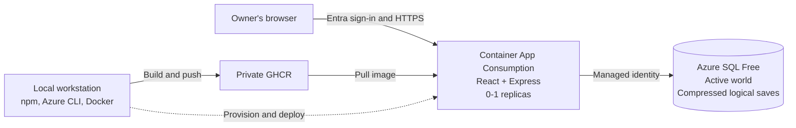

# Touchline

A private football sporting director simulation with one shared world for its owner and invited collaborators. Every new career starts on **1 July 2026**. You run the sporting project; the manager selects the team and plays the matches.

[Development status](REQUIREMENTS.md) | [Contributing](CONTRIBUTING.md) | [MIT License](LICENSE)

## Quickstart

Requires Node.js **22.13 or newer**, npm and a reachable SQL database. Use the Node version in [.nvmrc](.nvmrc). Building and deploying the hosted app also requires Docker, Azure CLI, an Azure subscription and access to the private GHCR package.

**Recorded status (21 September 2026):** Migration to Azure SQL Free in **Sweden Central (`swedencentral`)** completed and passed independent verification: **34 active-world tables, 160,000 players and six imported checkpoints**, with all constraints trusted. Active-world table hashes and original-file checksums matched. The five historical saves received format/digest validation, not individual destination restore certification. The original SQLite files, metadata and checksummed offline archive remain untouched. SQL Free retains `AutoPause` on quota exhaustion and a 32 GiB maximum. Hosted deployment completed: managed-identity SQL startup and public health pass, browsers redirect to Entra sign-in, and anonymous API access is blocked. The owner confirmed successful sign-in. Restricted guest access is deployed; the complete gameplay/browser regression suite has not been rerun for this release.

Hosted game: **[Open Touchline](https://touchline.thankfulgrass-3ef59c98.swedencentral.azurecontainerapps.io/)**. Signed-out browsers redirect to Microsoft Entra; the [direct sign-in link](https://touchline.thankfulgrass-3ef59c98.swedencentral.azurecontainerapps.io/.auth/login/aad) is also available.

```sh
npm ci
```

Configure `SQL_SERVER` and `SQL_DATABASE` in an ignored `.env`. For Azure SQL, sign in locally with Azure CLI to the intended tenant/subscription and grant that identity database access. Leave `SQL_USER` and `SQL_PASSWORD` unset to use Azure identity. Azure subscription access alone does not grant SQL access; the SQL firewall must also permit the connection.

Load your shell-compatible `.env` into the terminal without printing its contents:

```sh
set -a
. ./.env
set +a
```

Review and explicitly apply the schema migrations:

```sh
npm run db:migrate
npm run db:migrate -- --apply --yes
```

For the provisioned Azure target, use the temporary-access wrapper in [Local Deployment](#local-deployment) for SQL commands instead.

**Have an existing career?** Follow [Migrate Legacy Careers](#migrate-legacy-careers), then skip seeding. **Only for a new, empty database**, create the initial world:

```sh
npm run db:seed -- --seed touchline-2026 --expanded --apply --yes
```

Start the local UI and API:

```sh
npm run dev
```

Open **[http://127.0.0.1:5173](http://127.0.0.1:5173)**; the API listens on `127.0.0.1:3001`. Both development listeners bind to loopback, but persistence uses the configured SQL server. Startup neither migrates the schema nor generates a world. Stop if initialization fails; never reseed to repair an existing career.

For the production build:

```sh
npm run build
npm start
```

Open **[http://127.0.0.1:3001](http://127.0.0.1:3001)**. Express serves the built React UI and API together, as it will in the single container. `npm run preview` only serves Vite's static preview; it does not start the game engine.

### Configuration

| Variable                                                           | Purpose                                                                                                   |
| ------------------------------------------------------------------ | --------------------------------------------------------------------------------------------------------- |
| `SQL_SERVER`, `SQL_DATABASE`                                       | SQL host and database name; defaults are `127.0.0.1` and `touchline`, not a SQLite file                   |
| `SQL_PORT`, `SQL_SCHEMA`                                           | Defaults: `1433`, `dbo`; tests select their own isolated schemas                                          |
| `SQL_ENCRYPT`, `SQL_TRUST_SERVER_CERTIFICATE`                      | Defaults: `true`, `false`; remote connections require verified TLS                                        |
| `SQL_USER`, `SQL_PASSWORD`                                         | Optional pair for local SQL Server authentication; omit both for Azure identity                           |
| `AZURE_CLIENT_ID`                                                  | Optional client ID for a user-assigned managed identity                                                   |
| `API_PORT`, `UI_PORT`                                              | Local defaults: `3001`, `5173`; `PORT` takes precedence over `API_PORT`                                   |
| `API_HOST`                                                         | Defaults to loopback locally and `0.0.0.0` inside Container Apps                                          |
| `REQUIRE_AUTH`, `OWNER_OBJECT_ID`, `AZURE_TENANT_ID`, `APP_ORIGIN` | Hosted access requires `REQUIRE_AUTH=true`, the owner's Entra object ID, tenant ID and exact HTTPS origin |

Keep local secret values only in the ignored `.env`, never in Git, command examples, image layers or logs. `GAME_DB` and `SAVE_DIR` are obsolete and rejected. Local SQL Server can use the same full schema for development; it is not a SQLite fallback. For occupied ports: `API_PORT=3011 UI_PORT=5181 npm run dev`.

## Architecture

Approved hobby architecture; SQL is provisioned, but the app is not deployed:

<!-- prettier-ignore -->


One Container App serves both UI and API, with **minimum 0 / maximum 1 replica**. One Azure SQL **Database** on the free offer holds the active world and saved checkpoints; this is not Azure SQL Managed Instance. The app uses managed identity for SQL. The browser uses Container Apps authentication with Microsoft Entra, restricted to the owner and tenant; never expose an unauthenticated game API. Local tools use the owner's Azure CLI login.

Container storage is temporary, not the home of a career. Save slots remain in SQL across container restarts and revisions. There is no separate frontend service, save-storage service or additional Azure test environment.

## Local Deployment

Build, check and deploy from the workstation. **No Terraform, HCP Terraform or GitHub Actions pipeline is part of this plan.** The repository and GHCR image stay private. The workstation needs image push access; the app needs separately scoped image pull access, configured through Container Apps secrets rather than embedded in the image.

The wrappers in [package.json](package.json) are implemented. Their Azure defaults target subscription `3373ab04-1dd1-49b2-8884-3094cfd0ca06`, resource group `rg-touchline`, SQL server `touchline-3373ab04` and database `touchline` in `swedencentral`. Review local `.env` overrides before authorizing changes.

Deployment requires a **single-tenant Entra application**, `AUTH_CLIENT_ID`, `AUTH_CLIENT_SECRET`, and its registered HTTPS web callback `<APP_ORIGIN>/.auth/login/aad/callback`. After provisioning, `npm run azure:auth -- --yes` creates the sign-in application and callback and stores its credential privately in `.env` without printing it. Supply `GHCR_USER`, a `GHCR_TOKEN` with `read:packages`/`write:packages` for image push, and preferably a separate `GHCR_PULL_TOKEN` with only `read:packages` for the app. The deploy wrapper permits `GHCR_TOKEN` as a pull-token fallback. Store secrets locally in the ignored `.env`, never in chat or command arguments. Docker access and production container builds have been verified; public base-image pulls use a temporary Docker configuration rather than modifying global credentials.

| Command                                                             | Purpose                                                                                                                   |
| ------------------------------------------------------------------- | ------------------------------------------------------------------------------------------------------------------------- |
| `npm run verify`                                                    | Run lint, production build, SQL-enabled unit/integration/save tests and browser tests locally                             |
| `npm run image:build`                                               | Build the React + Express container locally                                                                               |
| `npm run azure:provision -- --yes`                                  | Provision SQL Free, Consumption environment and managed identity; `--sql-only` omits the latter two; never imports/seeds  |
| `npm run azure:sql -- -- COMMAND`                                   | Run a command using Azure identity and temporary workstation-IP SQL access; `--tests` opts into isolated remote tests     |
| `npm run azure:deploy -- --yes`                                     | Verify, back up, migrate, authorize SQL and build/push/deploy a private image; `--image` accepts a configured GHCR digest |
| `npm run azure:rollback -- --yes --revision APP--REVISION`          | Select a retained, digest-pinned, schema-compatible revision; `--list` lists candidates; never restores SQL data          |
| `npm run db:migrate -- --apply --yes`                               | Apply explicit versioned schema migrations, never seed; [scripts/db-migrate.ts](scripts/db-migrate.ts)                    |
| `npm run db:seed -- --seed touchline-2026 --expanded --apply --yes` | Seed only a new empty database; [scripts/db-seed.ts](scripts/db-seed.ts)                                                  |
| `npm run data:migrate -- --source FILE --saves DIR`                 | Inventory legacy files; add `--apply --yes` for conversion; [scripts/data-migrate.ts](scripts/data-migrate.ts)            |
| `npm run data:export -- --out new.touchline.gz`                     | Export the active SQL world to a new portable file; [scripts/data-export.ts](scripts/data-export.ts)                      |

For reviewed workstation SQL operations, the wrapper verifies the free-offer settings, sets the Azure SQL host/database and verified TLS, clears `SQL_USER`/`SQL_PASSWORD`, and temporarily permits **only this workstation's IPv4 address**. It removes that firewall rule on exit; cleanup failure is reported as an error. `--tests` sets the remote-test opt-in and matching test database for the child command only:

Provisioning uses SQL's `Redirect` connection policy for direct database-node connections, including from this workstation. This requires outbound TCP 1433 and 11000-11999 to the region's Azure SQL addresses; no inbound firewall range is opened. `AZURE_SQL_CONNECTION_TYPE=Proxy` or `Default` is available for networks that prohibit those outbound ports. Connection policy does not change the database tier or free-limit exhaustion setting.

```sh
npm run azure:sql -- --tests -- npm run verify
```

Schema migration is a separate explicit operation, not an import:

```sh
npm run azure:sql -- -- npm run db:migrate
npm run azure:sql -- -- npm run db:migrate -- --apply --yes
```

Do not reimport or seed over the migrated career. For a new installation, follow [Migrate Legacy Careers](#migrate-legacy-careers). Deployment requires provisioned SQL, a Consumption environment, managed identity and an initialized world; it never seeds. The deploy wrapper runs verification before backup, explicit migration and runtime SQL authorization, then builds/pushes unless given a private digest-pinned `--image`.

Verification defaults to the full suite. `npm run azure:deploy -- --yes --verification smoke` explicitly selects a fresh build plus read-only live API checks for an incremental release; the selected scope is recorded in the deployment report. This does not certify complete gameplay/browser regression. `--stage-only` configures an internal-only maintenance app, with no playable world or public ingress.

For an application-only retry against the already-prepared database, skip further exports, migrations and runtime grants:

```sh
npm run azure:deploy -- --yes --verification smoke --skip-db-prepare
```

This retains the read-only schema compatibility check and records the skipped preparation in the deployment report. Runtime SQL users use the managed identity's application/client ID as their SID, not its object/principal ID.

Private image pull, hosted SQL startup, public health, browser sign-in redirection and anonymous rejection have passed live checks. The owner confirmed sign-in manually. Guest browser gameplay, rejection of an unlisted authenticated user and browser save/restore remain manual acceptance checks; focused API tests cover the authorization decisions. The optional locally supplied `AUTH_SMOKE_TOKEN` enables an authenticated smoke check; without it, the wrapper reports automated owner verification as incomplete. Export before a schema-changing release, retain the previous image, and check schema compatibility before an application rollback.

### Invited Access

Invite collaborators through **Microsoft Entra ID > Users > Invite external user**, then let them accept the email invitation. Tenant membership alone does not grant gameplay access. Configure `ALLOWED_USER_OBJECT_IDS` as a comma-separated list of their guest object IDs **in this tenant**, not email addresses or IDs from their home tenants. `OWNER_OBJECT_ID` always retains access, and the API still requires the configured tenant and a consistent identity claim.

Deploy allowlist changes with `--skip-db-prepare` against the prepared database. Leaving `ALLOWED_USER_OBJECT_IDS` unset preserves the deployed list; explicitly setting it to an empty string removes guest access. Guests have the same game controls as the owner: advancing time, loading saves and starting careers affect the shared world for everyone. There are no separate per-user careers or read-only guest roles.

### Cost And Availability

- **SQL Free:** the published allowance includes 100,000 vCore-seconds per month, 32 GB of data and 32 GB of managed backup storage. Select **Auto-pause the database until next month** (`AutoPause` on free-limit exhaustion), not continued use with additional charges. Exhausting quota can make the game unavailable until the allowance resets. This quota behavior is separate from normal idle auto-pause.
- **Container Apps Consumption:** published subscription-wide monthly grants include 180,000 vCPU-seconds, 360,000 GiB-seconds and two million HTTP requests. Scale-to-zero reduces idle use, but **maximum one replica is not a spending cap or a guarantee of free hosting**. Active play, imports, tests, image traffic and other services can consume allowances or incur charges.
- Expect cold startup from container/image startup and SQL resume. Do not add always-on SQL health probes, keepalive queries or scheduled requests to keep the app warm. The process-only `/api/health` endpoint does not verify SQL availability.
- Do not provision billable default Log Analytics/Application Insights ingestion, ACR, dedicated compute, NAT gateways, private endpoints or extra networking for this hobby plan. Review Azure usage and GHCR allowances; budget alerts notify, but do not impose a hard cap.
- The **32 GB data budget includes active tables, indexes, compressed logical save slots and future growth**. Managed SQL backups have a separate allowance. Measure actual SQL usage after migration, including restore/test headroom; compression does not make snapshot storage unlimited.

Current service terms: [Azure SQL free offer](https://learn.microsoft.com/en-us/azure/azure-sql/database/free-offer) and [Container Apps billing](https://learn.microsoft.com/en-us/azure/container-apps/billing).

## Migrate Legacy Careers

SQLite is supported **only as a one-time importer source**, not by the runtime or the normal save upload. Stop legacy writers first. Keep the original database, snapshots, JSON metadata and any WAL/SHM/journal companions together in an offline backup. **Never delete those originals after conversion.** Choose the correct SQL target and explicitly run schema migration first; do not run the seed command on a legacy career.

Inventory first, substituting your own offline paths:

```sh
npm run data:migrate -- --source /offline/career.sqlite --saves /offline/saves
```

`--source FILE` chooses the active `.sqlite` or `.sqlite.gz` career. Supply at least one `--saves DIR`; repeat `--saves` to include more snapshot directories. Inventory is the default: it only reads/hashes files and sidecars, does not connect to SQL, and does not prove schema compatibility. Investigate reported orphan companions; do not discard them to force an import.

After reviewing the inventory and destination:

```sh
npm run data:migrate -- --source /offline/career.sqlite --saves /offline/saves --apply --yes
```

Apply validates consistent temporary copies, including WAL content, before changing SQL. Each source becomes a SQL checkpoint; `--source` also becomes the active world. Existing SQL save slots remain. A nonempty target is refused unless you additionally supply **`--replace --backup /offline/before-import.touchline.gz`** with a new, writable backup filename. Replacement still requires `--apply --yes`; it is an explicit recovery operation, not the normal setup path.

Conversion checks table counts/digests and unchanged source inventory before committing. Compare the imported club, director, date, balances and retained snapshots, and keep an offline SQL export:

For large careers, an optional local SQL preflight avoids repeated full-world restores across the internet. The first command uses two disposable local databases and schemas and writes a report bound to every source file, converted checkpoint, and schema version. The second uploads the verified archives and still restores and reconciles the active world on Azure before committing. Neither command changes the originals:

```sh
npm run test:local -- npx tsx scripts/data-migrate.ts --source data/career.sqlite --saves data/saves --staging-dir .azure/migration-stage --validate-local --validation-report .azure/reports/migration-local-validation.json
npm run azure:sql -- -- env SQL_REQUEST_TIMEOUT_MS=900000 npm run data:migrate -- --source data/career.sqlite --saves data/saves --staging-dir .azure/migration-stage --validation-report .azure/reports/migration-local-validation.json --apply --yes
```

Create the report's parent directory first. A report path must be new; mismatched reports are rejected. Staging files are revalidated on retry and retained privately under the ignored directory. `SQL_REQUEST_TIMEOUT_MS` is bounded to 1-900 seconds and defaults to 120 seconds; the longer value above applies only to this maintenance command. A failed connection still requires checking rollback before retry, not bypassing the nonempty-target guard.

To explicitly skip the local preflight and avoid restoring every archived world on Azure, use `--archive-format-only` instead of `--validation-report`. This still verifies archive format, values and digests and preserves every snapshot, but does not certify each archive's SQL restore. The active career always receives full destination constraint and table-hash checks:

```sh
npm run azure:sql -- -- env SQL_REQUEST_TIMEOUT_MS=900000 npm run data:migrate -- --source data/career.sqlite --saves data/saves --staging-dir .azure/migration-stage --archive-format-only --apply --yes
```

For an empty, first-time Azure target over an unreliable connection, add `--resumable`. Each checked batch and imported snapshot commits with a source-bound progress record. The active career metadata is withheld until all rows are loaded, all active-world hashes match, and original checksums are rechecked. An interruption retains partial import data, not a playable career. Rerun the identical command to resume; never delete the progress marker or use `--replace`. This mode refuses existing careers and different source fingerprints:

```sh
npm run azure:sql -- -- env SQL_REQUEST_TIMEOUT_MS=900000 npm run data:migrate -- --source data/career.sqlite --saves data/saves --staging-dir .azure/migration-stage --archive-format-only --resumable --apply --yes
```

After the importer reports success, independently verify the committed counts, imported snapshot digests, career identity, and trusted constraints without advancing the game:

```sh
npm run azure:sql -- -- npm run data:export -- --verify-staging .azure/migration-stage
```

After a successful commit, create an offline export:

```sh
npm run data:export -- --out new.touchline.gz
```

The output must not already exist. This exports the **active world**, not the complete saved-career catalog. Temporary conversion files need local disk headroom even though IO is streamed. Successful inventory, conversion code or a local export is not evidence that a live Azure round-trip has been tested.

## The World

The expanded initial world contains **243 country/territory football associations**, **2,647 domestic leagues**, **11,882 clubs**, **261,404 senior players**, **427,752 youth players**, and **106,578 staff**. Every non-national club, including reserve clubs, starts with at least **22 senior, 18 U19 and 18 U17 players**, with two goalkeepers in each squad. Annual intake and roster replenishment scale with missing age-group places. Retired players remain in SQL as career records; active database searches exclude them.

Senior pyramids range from three tiers in small associations to eight in England, with deeper country-specific structures in the larger football nations. Youth leagues use bounded groups rather than one oversized national table. Additional fixtures cover national cups, youth cups, continental tournaments, international youth championships and invitationals. Country policies control reserve entry, promotion ceilings and parent-team separation. Italy and Belgium allow modeled B/U23 participation; England uses a separate development competition. The US development league is professional but has no promotion route to its parents' league.

The country audit distinguishes **15 documented**, **20 historical** and **208 unverified** reserve policies. Historical participation is not treated as proof of current permission. Unknown associations do not automatically receive new professional reserve entrants. Licensing, registration quotas, regional branches and calendars remain simplified; this is not a complete official rulebook for every country. Football confederation is separate from geography, including Turkey, Israel, Australia and the Guianas.

Names, clubs, attributes, biographies and results are procedural, not licensed real player records. Club names use local naming forms and places; family background, birthplace, one to three nationalities and international representation are recorded separately. Heritage never changes ability or personality. The country/territory catalog is broader than FIFA membership.

Historical **SQLite** measurements were approximately **600 MiB for the older unexpanded active world** and **3 GiB for a freshly expanded world before fixtures and match history**. They are not SQL storage estimates. Actual SQL size and cloud generation/advance timings remain to be measured; history, indexes and retained snapshots increase storage over time.

## Playing

- The start screen offers **Continue career**, **New career** and **Load career**. New careers let you choose a name, director background and club, and start on 1 July 2026. Your current career is saved before switching. The selected club is mapped by its country and stable identity when moving from an older world layout.
- The new-career club picker filters by country and division, groups clubs by league, and sorts club names alphabetically within each division. Every row shows the league and tier. Pagination reaches every senior club, and the selected appointment stays visible when filters change.
- The **World browser** pages through every stored team, including senior clubs, B teams and national age-group sides. Filter by association, confederation, team type, tier and reputation. Team profiles contain squads, staff, competitions, fixtures and history.
- Use the player database to combine identity, position, age, ability, potential, attribute, personality, lifestyle, contract, financial and performance filters. All searches and pagination run against SQL.
- Player and team links connect the world browser, squad lists, scouting, loans, transfers, tables and match reports. Every player's **Career & matches** tab lists their simulated appearances by season, with competition filters and pagination. Match links open that player's minutes, rating, attacking, passing, defending and goalkeeping statistics, plus an individual pitch map. Unused substitutes are not counted as appearances; there is no invented pre-career match history.
- Assign scouts, inspect uncertain reports and shortlist players. Transfers progress through **Enquiry > Club talks > Agent talks > Contract review > Medical > Registration > Completed**. Review or revise the draft before signing; club-agreed loan terms stay fixed during personal talks. The buyer handles personal terms for incoming offers on your players. Cash and player registration change only after final clearance.
- **Make an offer** opens a dedicated club-offer page for the fee, loan guarantees and transfer clauses. After club acceptance, a separate **Player contract** page handles salary, bonuses, role, promises and signing. Agreed club terms and negotiation history remain available as collapsed summaries. Both pages resume from their player URL; club offers no longer alter salary proposals in the background.
- **Future transfer at 18** is available for players aged 14-17, including those who cannot currently move internationally. It models a conditional future agreement with guardian consent, not an exemption allowing an early move. The earliest arrival is the 18th birthday or the next registration window. Signing reserves the transfer allocation, but does not pay the fee, change wages or move the player. **Transfers > Future arrivals** shows the commitments. Medical, work-permission and registration checks still apply, failed/cancelled deals release the reservation once, and expiry of the original club contract waives that club's fee rather than paying for an already-free player.
- Player interest now explains sporting ambition, likely minutes, role credibility, development, continental football, language/family adjustment, loyalty, wages, security and promises. The contract page previews changes without submitting an offer. Wage attraction is capped: a large salary does not automatically overcome an unsuitable sporting move.
- Permanent transfers support an upfront percentage, up to eight deferred instalments, a fixed-price buy-back right with expiry, and a percentage of the next sale. Club terms lock once agreed. Incoming offers can be countered with your own fee and clauses. **Transfers > Clauses & payments** lists obligations and lets the beneficiary exercise a buy-back; player dossiers show their active clauses.
- Set squad roles, agree development plans, pair mentors, recruit staff, invest in facilities and answer the board and press. Decisions update finances, trust, morale, expectations and development inputs.
- **Player dossier > Overview > Squad assignment** moves an eligible player between the first team, reserve club, U19 and U17 groups. Assignments are reversible, use birth-date/season cutoffs, and do not change contract ownership, wages or bonuses. Loaned-out players must return before reassignment; a borrowing club cannot send a loanee to a separate reserve club. Squad browsing selects the playing club and age group independently.
- Star a league or tournament in **Competitions**, then choose fixture, result, draw, standings and winner alerts. **Settings > Notifications** controls topic visibility and priority. Inbox filters group topic, competition, priority, read status and archive options; muted messages remain available through **Include muted archive**. Competition and inbox pagination avoid fixed first-page limits. Alerts are generated from saved fixtures and results and are duplicate-safe.
- **Staff > Director assistant** assigns weekly briefings, affordable shortlists, scouting trips, renewal drafts, individual development and loan monitoring. Every club starts with one assistant. Only briefings are enabled initially; other duties are opt-in. A rolling weekly scouting allowance limits spending, and reports record the work done. The assistant never signs contracts, sells players or recalls loans for you. Renewal drafts still need your approval and signature.
- Every club, including reserve clubs, starts with at least one affiliate; national teams are not club affiliates. Agreements appear under **Loans > Club network**, **Boardroom > Affiliate clubs**, and club profiles. Choose Feeder, Friendly, Development, Scouting or Foreign adaptation affiliation, optionally naming a preferred club. A preview explains the other club's willingness for that type. New agreements require both parties' consent; board backing cannot override a refusal. Decisions consider sporting benefits, reputation, direct league competition, existing networks and finances. Funding is paid only on acceptance and reaches the partner club. Board requests take three days and have a 28-day cooldown.
- **Settings > Simulation > Unexpected events** selects Low, Medium or High frequency. Facility problems, transport cancellations, sponsor appearances, agent interviews, community invitations and minor illness create bounded choices on the office desk and in the Boardroom. Each shows its cost and effects, allows one response, and records the outcome. A no-cost default is used after the three-day deadline. Frequency affects probability and cooldowns, not the size of the consequences, and only one unresolved event is allowed at a time.
- AI transfer activity runs daily while the window is open, scales with world size and increases near deadlines. Buyers need squad space, wages, cash and registration eligibility; sellers retain senior depth and goalkeeper cover. Recently transferred players have a cooldown. Your club can receive bids for several listed players and occasional approaches for unlisted prospects, in-form players or expiring contracts. Incoming approaches are capped, and your players are never sold automatically.
- **Media & supporters** contains a searchable club/world news feed, five recurring fictional journalists, source profiles, expandable analysis and saved supporter discussions. Reports cover actual bids, conditional agreements, registered signings, player situations, match statistics and weekly club affairs. Reported deals are distinguished from confirmed registrations. Press questions follow your club's latest story, and your response generates its own coverage and reactions.
- Use the loan desk for nine loan types, detailed guarantees, partnerships, success/pressure reports, recalls and purchase clauses. The negotiation sheet contains the salary-split slider and all agreement terms.
- Advance one, seven, fourteen or twenty-eight days. There is no match-control interface. Completed matches have reproducible event logs, ratings, xG/xA, xPts and eight interactive pitch maps.

The settings screen includes interface, simulation, difficulty, accessibility, gameplay, director, save and experimental preferences. Simulation speed sets the default advance interval. Match detail changes the action-log density without changing results. Persistence is configured by the server; no separate synchronization setting is needed to use the same hosted career from another browser.

**Settings > Appearance** contains Light/Dark/System colour mode, the custom HEX accent editor and **Minimal / Classic** UI themes. Minimal uses quieter sections and smaller headings; Classic retains the earlier presentation. HEX codes accept three or six digits, with or without `#`; Enter/the check button applies a valid code, and reset restores the default. **Settings > Interface** selects GBP, EUR, USD, BRL, JPY, CHF, CAD or AUD. Amounts and large totals use compact `K`, `M` and `B` notation, such as `2.4K` and `1.2M`, while monetary inputs retain exact values.

Currency conversion uses fixed game rates from [shared/rules.ts](shared/rules.ts), not live exchange-rate quotes. The ledger remains in GBP internally; changing currency never rewrites balances, wages or transfer fees. Money inputs convert the chosen currency back into accounting units. Existing historical narrative text and rule-source descriptions are not rewritten.

Instalment dates follow calendar months, with month-end clamping and penny-exact total allocation. The full fee is reserved against the transfer budget at registration, but cash is paid only when due. Future liabilities/receipts appear in **Finances > Transfer payments**. Outstanding payments survive subsequent player moves. Sale profit and acquisition cost use the full agreed consideration; later cash receipts do not count the profit twice. Obligations remain payable even if the club later runs short of cash. Buy-back exercise still requires personal terms, a medical, the registration window and financial/eligibility clearance.

## Saves

The active career is written to SQL transactionally. **Settings > Saves** creates and restores SQL-backed snapshot slots and imports/exports portable **`.touchline.gz`** logical checkpoints. Autosaves run at the selected cadence, including during multi-day advances; the latest three newly created automatic snapshots are retained **per career**. Imported legacy snapshots are protected from automatic pruning. Slots include the career, director, club and in-game date. In the hosted app, imports are uploaded to your authenticated server and persistent saves reside in Azure SQL.

Save compression, upload/download and restore use bounded streaming, temporary staging files and **1 MiB SQL chunks**, not an in-memory copy of the whole world. The save catalog stores metadata and compressed chunks in SQL. Imports validate format, schema, integrity and references before transactional replacement of active-world tables; a failed replacement rolls back. The safeguards are **16 GiB compressed / 64 GiB expanded**, not capacity promises for the 32 GB SQL Free database or container scratch disk. Old `.sqlite` / `.sqlite.gz` files must go through the [one-time importer](#migrate-legacy-careers), never the normal upload control.

**World browser > Expand career world** upgrades an older career after creating a named **Before world expansion** backup. Existing club/player IDs, contracts, football attributes, budgets, career date, results and fixtures remain intact. Missing lower divisions, clubs and squads are added, and display names/backgrounds are localized; the managed club keeps its current name. Existing division sizes are retained to preserve their schedules, so upgraded-career totals differ from a fresh world. Added competitions start in the current season only before 1 August, otherwise next season. The upgrade is idempotent and never requires a new career.

The start menu and Settings group snapshots into one expandable **career folder**, with manual saves and a collapsed **Autosaves** group underneath. Every retained snapshot can still be loaded individually. Grouping is a view over SQL catalog entries, not a move, merge or deletion. Different career IDs remain separate even if their names match; imported legacy snapshots without an ID are not guessed into another career.

The career menu automatically snapshots the current career before starting or loading another. Low-level restore/import in Settings replaces the active world, so make a named save before using those controls. Save slots are separate from active-world tables and are not recursively included in each checkpoint. Offline exports, legacy data, test artifacts and dependencies must stay out of Git.

Under **Load career**, the trash icon deletes an inactive career's SQL snapshot entries and chunks after confirmation. The active career is protected; load another career before deleting it. Older snapshots without career metadata can be deleted individually. Deletion never resets the active world or removes offline SQLite originals.

Older saves rebuild the player-appearance index from stored match snapshots without changing results, including dismissal/injury exit minutes. Historical engines remain versioned. Existing fixture calendars are not destructively redrawn; calendar changes apply when the next season is generated, or from the beginning of a new career. UEFA qualifying now retains every modeled eligible entrant, including Luxembourg, rather than dropping lower-ranked associations beyond a fixed entrant cap. Late qualifying cannot create main-phase fixtures in the past.

Currency settings and transfer-clause tables are additive upgrades available in existing careers. Old agreements without a payment schedule still settle in full; no new clauses or historical debts are invented. No new career or save reset is required for these additions.

The offer page, daily market and journalist coverage also work in existing careers. Media reports and comments are stored in existing news records; old headlines remain readable. New coverage uses current career facts, not invented pre-save matches. Reporter identities and opinions are fictional, locally generated game content, not impersonations of real journalists or live reporting.

Assistants, starter affiliates, delegation records and unexpected events are added to existing careers on startup or load. The upgrade does not regenerate clubs/players or replace contracts, balances or fixtures. Starter affiliates have no annual fee; assistant wages enter the normal staff payroll. The assistant uses a separate seed so introducing the role does not change the original world-generation sequence. Existing events, decisions and reports persist in snapshots.

## Youth Recruitment

International movement of minors is not generally permitted just because parents accompany the player. The modeled exceptions follow [FIFA RSTP January 2025, articles 2, 18-20 and Annexe 4](https://digitalhub.fifa.com/m/696d877ea35ca761/original/Regulations-on-the-Status-and-Transfer-of-Players-January-2025-edition.pdf), alongside the FA's [minor-clearance guidance](https://playerstatus.thefa.com/support/solutions/articles/80001135173-what-is-international-clearance-itc-including-minor-applications) and [evidence requirements](https://playerstatus.thefa.com/support/solutions/articles/80001161435-international-clearance-document-information).

- A 16-17-year-old moving within the EU/EEA may apply with football education, academic/vocational education, accommodation/care, mentoring and guardian commitments. European nationality alone does not qualify a move from elsewhere, and England is not treated as an EU/EEA destination. The same-country/inter-association pathway is modeled for the UK associations.
- A recorded, verified parental relocation for **non-football reasons** can support an application. The user cannot manufacture this exception by ticking a box; generated family circumstances are independent of the requested football move.
- International minor applications have a simulated seven-day review. No registration is completed before approval; the buyer must retain the required youth support. An application does not replace work-permission or other registration checks.
- **Approach to sign (youth)** is only available for an explicitly recorded amateur/non-professional player without an agreed future professional contract. There is no negotiated club transfer fee, but a separately disclosed training-compensation estimate may be due. Missing status in old saves is treated as a protected contract, never automatically downgraded to make a player free. Contract status is filterable in the player database; new worlds/intakes include explicit statuses.
- Contracts agreed while under 18 are capped at three years. Future-at-18 agreements, compensation estimates and review timing are game abstractions. They do not reproduce every association's contract law, civil rules on minors, official training categories, prior training-club history, refugee/exchange-student provisions or cross-border-distance exceptions. The compensation formula is a game estimate, not an official FIFA invoice. The future-agreement mechanism does not assert that signing a 14-year-old's future employment contract is enforceable in every jurisdiction.

## Verification

These are checks to run, not a report that they have all passed after the SQL refactor. Configure SQL first. Integration and browser tests use the **full SQL schema** in isolated `touchline_test_` / `touchline_e2e_` schemas, not SQLite. There is no additional Azure test environment: an approved remote run uses isolated schemas in the configured database and consumes that database's quota.

`npm run verify` runs lint, build, SQL-enabled unit/integration/save tests and the browser suite. Install Playwright Chromium first with `npx playwright install chromium`. For the provisioned Azure target, use `npm run azure:sql -- --tests -- npm run verify` to scope test permission and temporary workstation-IP access to that invocation. Individual checks remain available:

```sh
npm test
npm run lint
npm run build
npm run world:check
npm run simulation:check
npm run simulation:check -- --seasons=3
npx playwright install chromium
npm run test:e2e
```

Remote tests require explicit confirmation: `SQL_ALLOW_REMOTE_TESTS=true` and `SQL_TEST_DATABASE` must equal `SQL_DATABASE`. Do not set these casually in a shared shell. After checking the target, opt in for each invocation, for example:

```sh
SQL_ALLOW_REMOTE_TESTS=true SQL_TEST_DATABASE="$SQL_DATABASE" npm test
SQL_ALLOW_REMOTE_TESTS=true SQL_TEST_DATABASE="$SQL_DATABASE" npm run test:e2e
```

Never point mutation tests at the active-world schema, bypass the guards, or silently skip SQL checks when the database is unavailable. `SQL_TEST_MODE` and isolated schema selection are handled by the test harness. The same remote opt-in applies to SQL-backed world/season checks.

`world:check` checks full-world squads, youth membership, SQL constraints/integrity, reserve-policy evidence coverage and indexed prospect search. Use an isolated initial-world test configuration when checking starting squad minimums. Counts, storage and timings need a fresh SQL run; historical SQLite results do not certify the new backend.

`simulation:check` compares a deterministic 600-match sample against pinned OpenFootball result aggregates and broader statistical sanity bounds. The optional season soak uses an isolated **two-country world**, not the entire world. Earlier multi-season SQLite runs are historical evidence only, not live SQL or full-world balance validation.

Browser tests start a non-watching API and local UI on ports 3002/5180 (`E2E_API_PORT` / `E2E_UI_PORT` override them), with a fresh isolated SQL schema and seeded career. Before mutation they verify the reported test flag, database name and exact schema. The suite covers all screens, career creation/loading/deletion, world/team/player navigation, individual match histories, typed search, desktop/mobile layouts, themes, scouting, transfers, loans/recalls, world advancement and nonblank/distinct pitch-map pixels. `TEST_URL` may target an already-running **test** instance only, never the owner's hosted game. SQL store, save recovery and resumable-import checks have passed on Azure; full gameplay/browser regression remains a separate verification item.

## Implementation

| Area                                           | Location                                                                                                                 |
| ---------------------------------------------- | ------------------------------------------------------------------------------------------------------------------------ |
| Async SQL store, configuration and migrations  | [server/db.ts](server/db.ts), [server/sql-config.ts](server/sql-config.ts), [server/sql-schema.ts](server/sql-schema.ts) |
| Deterministic world and player generation      | [server/world.ts](server/world.ts)                                                                                       |
| Competition formats, schedules and progression | [server/calendar.ts](server/calendar.ts)                                                                                 |
| UEFA draw constraints and qualification        | [server/draw.ts](server/draw.ts), [server/qualification.ts](server/qualification.ts)                                     |
| Versioned match engines and xPts               | [server/match.ts](server/match.ts), [server/match-v3.ts](server/match-v3.ts)                                             |
| Financial accounts and registration evidence   | [server/finance.ts](server/finance.ts), [server/registration.ts](server/registration.ts)                                 |
| Player interest and youth-transfer assessments | [server/recruitment.ts](server/recruitment.ts)                                                                           |
| Daily/weekly simulation and season rollover    | [server/simulation.ts](server/simulation.ts)                                                                             |
| Fictional journalists and event-driven media   | [server/media.ts](server/media.ts)                                                                                       |
| Assistant duties and board affiliate requests  | [server/club-support.ts](server/club-support.ts)                                                                         |
| Unexpected-event generation and choices        | [server/events.ts](server/events.ts)                                                                                     |
| Scouting, deals, loans, staff and consequences | [server/systems.ts](server/systems.ts)                                                                                   |
| Filtered read models and screen queries        | [server/queries.ts](server/queries.ts)                                                                                   |
| HTTP actions and owner authorization           | [server/app.ts](server/app.ts)                                                                                           |
| SQL save catalog, chunks and portable format   | [server/saves.ts](server/saves.ts), [server/save-format.ts](server/save-format.ts)                                       |
| Explicit migration, seeding and export tools   | [scripts/](scripts/)                                                                                                     |
| Shared player model, formulas and settings     | [shared/](shared/)                                                                                                       |
| React screens and canvas pitch analysis        | [src/](src/)                                                                                                             |

Uses React 19, TypeScript, Vite, Express, mssql, Azure Identity, Zod, seedrandom, roundrobin, javascript-lp-solver, simple-statistics, Recharts and Lucide. Node's SQLite driver is restricted to the one-time legacy importer. Match snapshots include an engine version so earlier event streams remain reproducible when the current rules evolve.

Local naming uses [Faker](https://github.com/faker-js/faker) locale data (MIT) and [cities.json](https://github.com/lutangar/cities.json) 1.1.61, derived from [GeoNames](https://www.geonames.org/) under [CC BY 4.0](https://creativecommons.org/licenses/by/4.0/). City names are filtered/grouped by country and combined with fictional club forms; these transformations do not imply real club identities or endorsement. No runtime name or location service is contacted.

## Rules And Calibration

- UEFA senior league phases use 36-club pot draws, distinct opponents, association protection and total home/away quotas. Qualification uses prior domestic results, cup/titleholder paths and simulated five-year association coefficients. Senior UEFA knockouts are two-legged before a neutral single final, with aggregate scores and no away goals.
- Engine version 3 adds autonomous substitutions, injury exits, yellow/red cards, suspensions, stoppage time, extra time and eligible-player shootouts. Shootout goals are kept outside match goals and xG. Earlier versioned snapshots still replay with their original engine.
- Financial monitoring uses recorded periods, player-asset amortization, disposal profit, squad costs, football revenue and equity-supported UEFA loss limits. Forecasts are distinguished from closed accounts. The former fixed-deficit automatic embargo has been removed.
- English registration assesses FA 2026/27 Governing Body Endorsement point tables and simulated participation evidence instead of an ability shortcut. Missing playing history does not create fictitious points. Other associations' full employment/registration systems are not replicated.

Development references: [UEFA competition format](https://www.uefa.com/uefachampionsleague/news/0268-12157d69ce2d-9f011c70f6fa-1000--new-format-for-champions-league-post-2024-everything-you-ne/), [IFAB players](https://www.theifab.com/laws/latest/the-players/) and [match duration](https://www.theifab.com/laws/latest/the-duration-of-the-match/), [Premier League Handbook 2026/27](https://resources.premierleague.pulselive.com/premierleague/document/2026/07/31/8a890ff9-176c-4364-a8ff-e08f995e2c86/TM2040_PL-Handbook-and-Collateral-2026-27_Digital_31.07.pdf), and [FA GBE criteria 2026/27](https://www.thefa.com/-/media/files/thefaportal/governance-docs/registrations/gbe-2026-27/fa-mens-players-gbe-criteria-202627.ashx). These guide the modeled rules, not a claim of complete regulatory equivalence.

Result calibration uses CC0 [OpenFootball](https://github.com/openfootball/football.json/tree/40b3e1b7391932d133287115106304444bf297e1) Premier League 2023/24 and 2024/25 aggregates. The source revision, file hashes and aggregates are in [server/check-simulation.ts](server/check-simulation.ts). Passing and discipline bounds are sanity checks, not statistics derived from that results-only dataset. No SofaScore or proprietary tracking dataset is included. The calibration data is bundled; SQL-backed verification still needs its configured database connection.

## Scope And Limits

This is a playable implementation spanning the requested systems, **not a claim of commercial football-simulation fidelity or literal completion of every realism requirement**. See [REQUIREMENTS.md](REQUIREMENTS.md) for implementation coverage and known gaps.

Important limitations include incomplete official access-list paths and coefficient bonuses, generalized non-UEFA rules, no exhaustive association-specific registration/financial regulations, a custom seeded match model rather than professional event-data calibration, rule-based social/media events, and no long-duration multi-season balance validation at full world scale. Full-world simulation is CPU-heavy and serializes game actions. The browser shows progress while another action waits; SQL/cloud latency and free-tier quotas add constraints that have not yet been benchmarked live.

Apple SF Symbols are not bundled: the cross-platform browser UI uses Lucide icons. Player graphics are faceless silhouettes and custom pitch/crest artwork. Haptic feedback uses the browser vibration API only when available. Weather follows seeded climate/season heuristics, not a meteorological service. The owner and allowlisted guests share one active world and save catalog; there is no per-user career isolation, competitive multiplayer or offline/cloud merge system.

## Contributing

See [CONTRIBUTING.md](CONTRIBUTING.md) for development, local verification and conflict policy. Build/test/deploy automation runs from the workstation; no GitHub Actions pipeline is required by the approved plan. Report bugs and feature requests in [GitHub Issues](https://github.com/CarlosSardo/touchline/issues).

## License

Copyright (c) 2026 Carlos Sardo. Released under the [MIT License](LICENSE). Third-party packages and bundled fonts retain their respective licenses; the MIT grant covers this project's original code and assets.
