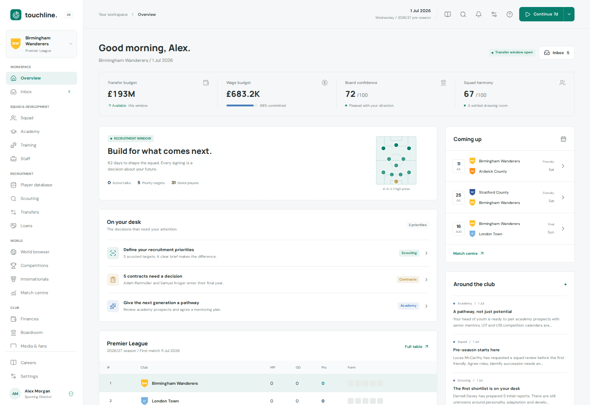
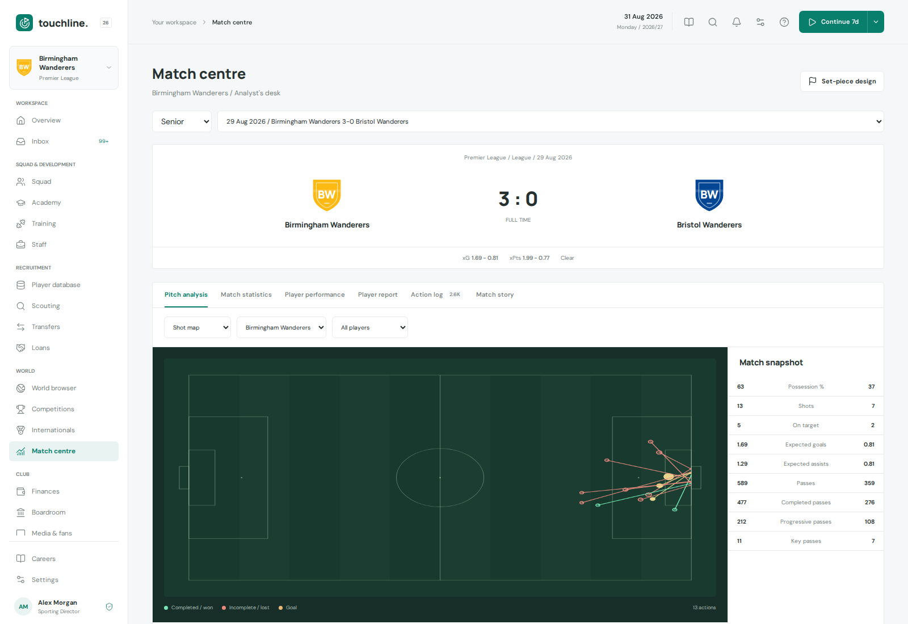
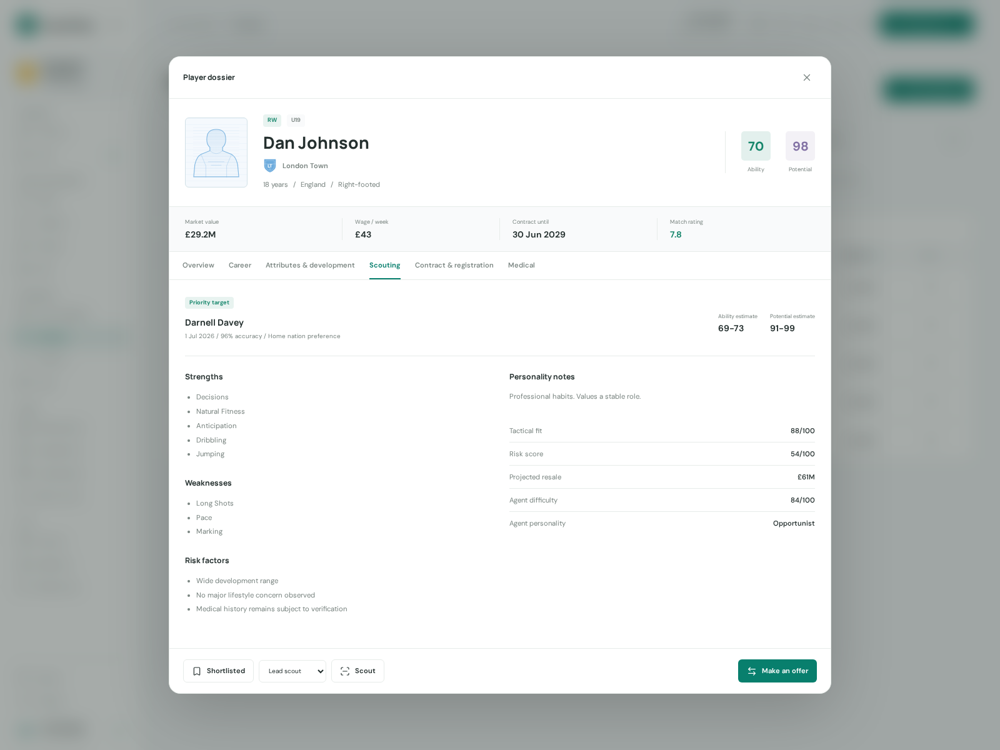
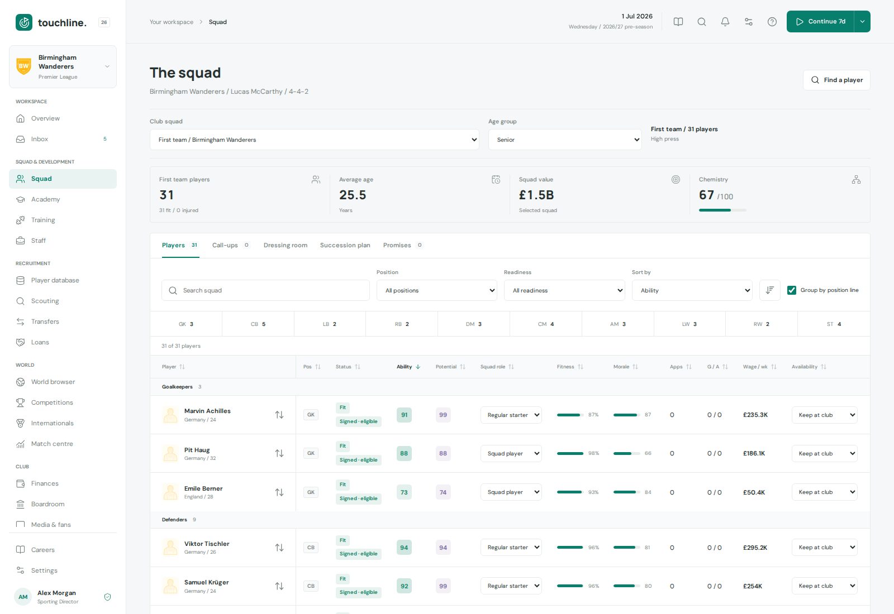
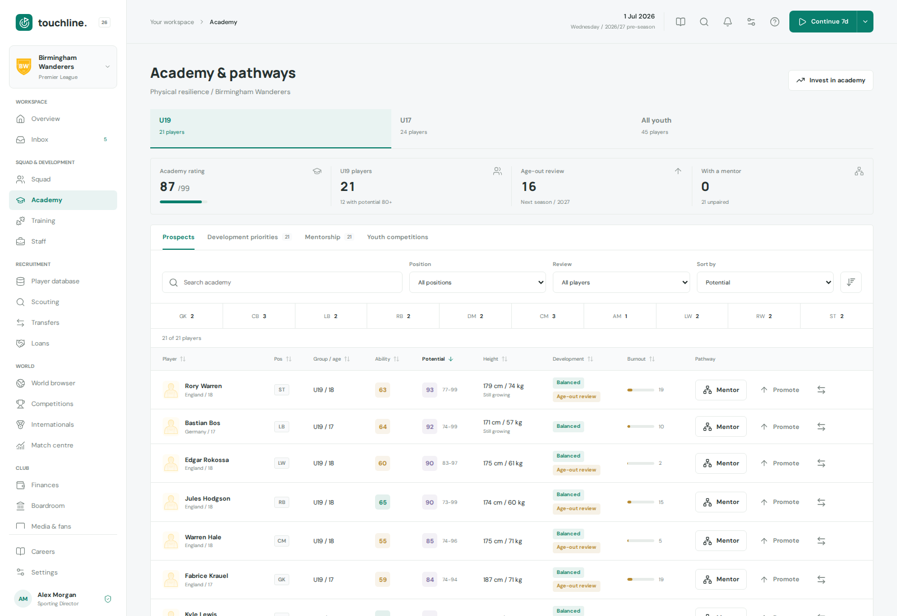
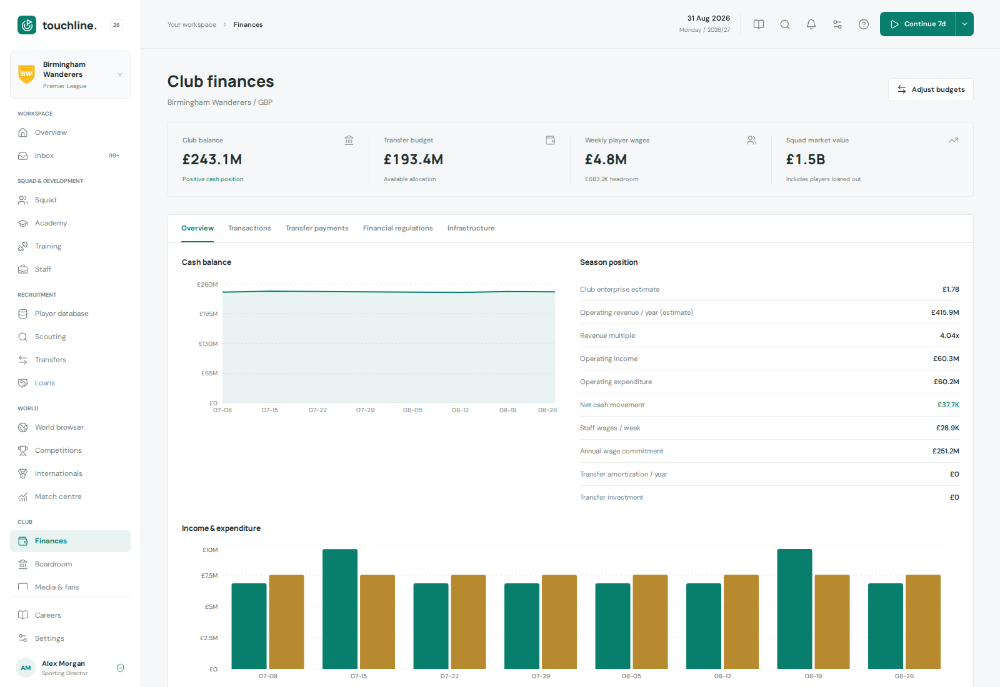

# ⚽ Touchline

### The manager picks the team. You build the club.

**A football sporting-director simulation set in a living, procedurally generated football world.**

 

Your club. Your project. Every decision starts at the director's desk.

**[Player handbook](website/src/content/docs/play/index.md)** · **[Screenshots](#a-look-inside)** · **[Engineering docs](website/src/content/docs/technical/index.md)** · **[Run it yourself](DEVELOPMENT.md)**

📚 **Explore the [Touchline docs site](#documentation)**: a searchable player handbook and engineering guide.

## Your club. Your project.

It is **1 July 2026** and the transfer window is open. You are the new sporting director: the person who decides who joins the building, on what terms and for how long. The manager picks the team and the simulation plays the matches. Whether the club is still competitive and solvent in five seasons is up to you.

Every signing is a bet on uncertain scout reports. Every contract shapes the wage bill for years. Every academy prospect is a choice between a first-team debut, a development loan or a sale. And while you deliberate, rival clubs buy, sell, invest and get taken over around you.

## Why you will keep pressing Continue

| | |
| --- | --- |
| 🌍 **A world that is truly big** | 211 football associations, 107 national league pyramids, B teams, U19/U17 leagues, national cups, continental competitions and international football from U17 to senior level. |
| 🔍 **Recruit with uncertainty** | Scouts estimate ability and potential instead of revealing them. Weigh personality, tactical fit, risk and resale value before you commit. |
| 🤝 **Deals with real moving parts** | Instalments, sell-on and buy-back clauses, loan-backs, release clauses, part-exchange deals, rival bids and best-and-final rounds. |
| 🌱 **Build a pathway** | Run a first team, reserve club, U19 and U17 groups with development plans, mentors, squad roles, call-ups and nine loan types. |
| 📋 **Rules that bite** | Signing a player is not the same as registering him: work permission (including England's GBE points model), foreign quotas and match eligibility all matter. |
| 📈 **Read the match, not the score** | A reproducible match engine with ratings, xG, xA, expected points and interactive shot and pitch maps. |
| 🏟️ **A living football economy** | AI clubs trade every day, invest in facilities, appoint directors and change owners, from local businesses to state-backed funds and multi-club groups, all under FFP. |
| 💾 **Careers that last** | Persistent saves with autosaves, portable exports, themes, colour modes and eight display currencies. |

## A look inside

Every screenshot is captured in the browser from a real, locally generated career. There are no mock-ups.

<table>
<tr>
<td width="50%" valign="top"> See what the scoreline misses with shot maps and expected-goal analysis.</td>
<td width="50%" valign="top"> Look beyond the rating: scout potential, personality, tactical fit and risk.</td>
</tr>
<tr>
<td width="50%" valign="top"> Build a balanced squad, not just a collection of stars.</td>
<td width="50%" valign="top"> Turn academy potential into a first-team pathway.</td>
</tr>
<tr>
<td width="50%" valign="top"> Keep ambition sustainable with a clear view of your club's finances.</td>
<td width="50%" valign="middle" align="center">

### Ready to take the chair?

Start with the **[player handbook](website/src/content/docs/play/index.md)** and your **[first career](website/src/content/docs/play/getting-started.md)**.

</td>
</tr>
</table>

## Documentation

Everything about playing and running Touchline lives in the **Touchline docs site** ([website/](website/)): a searchable static site with a marketing home page, the full player handbook, the engineering section and the operations runbook. It is built with Astro, Tailwind CSS and Pagefind from the same Markdown files linked below, so you can read every page here on GitHub too.

> **Hosted docs:** the site is set up to publish to GitHub Pages at `https://carlossardo.github.io/touchline/`. That address is not live yet; until Pages is enabled, use the links below or [preview the site locally](website/README.md).

| Read this | If you want to |
| --- | --- |
| 📘 [Player handbook](website/src/content/docs/play/index.md) | Learn the game, from your first transfer window to long-term squad strategy. |
| 🏗️ [Engineering docs](website/src/content/docs/technical/index.md) | Understand the architecture, simulation, persistence, identity and delivery. |
| 🛠️ [Engineering guide (DEVELOPMENT.md)](DEVELOPMENT.md) | Run, test, self-host, back up and upgrade Touchline. |
| 🗺️ [REQUIREMENTS.md](REQUIREMENTS.md) | See the current product scope and known gaps. |

Touchline is self-hosted for a small private group: one Docker Compose stack runs on a Raspberry Pi 4 or any 64-bit Linux host, and players sign in through your own OpenID Connect provider. [DEVELOPMENT.md](DEVELOPMENT.md) explains how.

All players, clubs, staff and results are procedurally generated and fictional, not licensed real-world records.

## Credits and data sources

- Names use [Faker](https://github.com/faker-js/faker) locale data (MIT) and [cities.json](https://github.com/lutangar/cities.json) 1.1.61, derived from [GeoNames](https://www.geonames.org/) under [CC BY 4.0](https://creativecommons.org/licenses/by/4.0/). Club names are fictional and imply no endorsement.
- Result calibration uses CC0 [OpenFootball](https://github.com/openfootball/football.json/tree/40b3e1b7391932d133287115106304444bf297e1) Premier League 2023/24 and 2024/25 aggregates; details in [server/check-simulation.ts](server/check-simulation.ts).
- Rules are believable simplifications, not certified replicas. References: [FIFA RSTP (Jan 2025)](https://digitalhub.fifa.com/m/696d877ea35ca761/original/Regulations-on-the-Status-and-Transfer-of-Players-January-2025-edition.pdf), [FA minor clearance](https://playerstatus.thefa.com/support/solutions/articles/80001135173-what-is-international-clearance-itc-including-minor-applications), [FA GBE criteria 2026/27](https://www.thefa.com/-/media/files/thefaportal/governance-docs/registrations/gbe-2026-27/fa-mens-players-gbe-criteria-202627.ashx), [UEFA format](https://www.uefa.com/uefachampionsleague/news/0268-12157d69ce2d-9f011c70f6fa-1000--new-format-for-champions-league-post-2024-everything-you-ne/), IFAB laws on [players](https://www.theifab.com/laws/latest/the-players/) and [duration](https://www.theifab.com/laws/latest/the-duration-of-the-match/), and the [Premier League Handbook 2026/27](https://resources.premierleague.pulselive.com/premierleague/document/2026/07/31/8a890ff9-176c-4364-a8ff-e08f995e2c86/TM2040_PL-Handbook-and-Collateral-2026-27_Digital_31.07.pdf).

## Contributing

Contributions are welcome. Start with [DEVELOPMENT.md](DEVELOPMENT.md) to run Touchline locally, read [CONTRIBUTING.md](CONTRIBUTING.md), and report bugs and ideas in [GitHub Issues](https://github.com/CarlosSardo/touchline/issues).

## License

Copyright (c) 2026 Carlos Sardo. Released under the [MIT License](LICENSE). Third-party packages and bundled fonts keep their own licenses.
