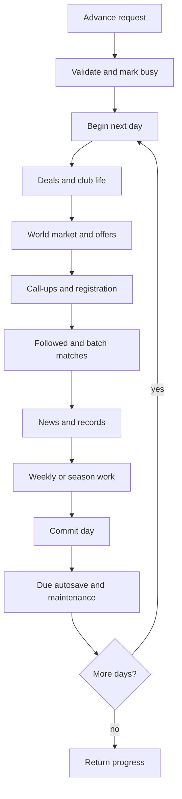

# Simulation architecture

The simulation runs authoritatively in the API's Node process when a player advances time. There is no separate always-on worker, external live-football data feed or wall-clock scheduler progressing a career behind the player's back.

## Creating a world

`shared/world-catalog/` holds the curated association, pyramid, reserve/youth and cross-border structure. `server/world.ts` validates that catalog and generates the world from a seed; `people.ts` builds culturally/geographically informed fictional people, and `calendar.ts` prepares competition schedules.

The current procedural world version is 4. Generation supports a nation subset and test-oriented minimum squads; structure-only generation supports calendar tests. These are generation/tooling controls, not evidence that a legacy world should be regenerated during an upgrade.

Hosted account approval initially creates an empty migrated world schema. Career preparation/start selects and populates that private world through the save/career service; startup itself does not generate it.

## One day at a time

The `/api/advance` route validates a 1-28 day request and calls `advance(store, 1)` repeatedly. Each day is its own database transaction, followed by any due autosave as a separate unit. The HTTP activity guard spans the overall operation, but one SQL transaction does not span an entire month.

See the saved [diagram source](https://github.com/CarlosSardo/touchline/blob/main/docs/src/content/docs/technical/diagrams/advance.mmd).

The exact implementation in `server/simulation.ts` is more detailed than the diagram:

1. Prepare calendar and one-time compatible-world repair paths.
2. Advance the date, recover fitness and resolve minor applications, negotiations, rival transfer battles and payment obligations.
3. Process affiliates, club life, ownership, unexpected events and AI squad maintenance.
4. Run the world market and offers for the director's players, complete scouting, process club call-ups and international duty, then registration.
5. Play due fixtures, update media/loans/competitions/records/notifications, and run any weekly or season-end work.
6. Handle remaining dated events/contract expiries, commit, perform due calendar/GBE maintenance and vacuum outside the transaction.

Weekly work includes development, loan review, set-based finances, staff/board politics, promises, tactical trends and market/GBE refresh. Season rollover handles competition outcomes, movement, population/club updates, historical summaries, retention and next-season preparation.

If a later day fails, the route returns progress with an error explaining the stop; completed days remain committed. A first-day failure uses the normal error path. This is deliberate partial progress, not request-level atomicity; callers must inspect the result rather than equating HTTP success with completion of every requested day.

## Determinism and match detail

World, day, week, season and fixture operations derive random streams from stable seeds. Stable ordering and versioned snapshots matter: reproducibility is not provided merely by replacing `Math.random`.

`match.ts` dispatches by match rules version and retains older behavior for historical snapshots. Current rules version is 4, using `match-v3.ts` for its detailed laws engine. `fast-match.ts` provides a calibrated faster simulation for un-followed fixtures; followed fixtures use the detailed engine. Tests check parity at aggregate level rather than promising identical events between the engines.

Match snapshots capture the participants and inputs needed to interpret or replay a fixture independently of subsequent player changes. Preserve that contract when evolving rules. `retention.ts` intentionally compacts un-followed results, so not every historical match has a full replay.

Ratings, xG, xA, expected points and custom pitch analysis are generated by the simulation. They are model outputs, not licensed real-match observations.

## Shared policy, not duplicated decisions

`club-policy.ts` builds one daily per-world snapshot covering squad depth/needs, surplus, budgets, wage room, FFP headroom, embargo, director policy and ownership. The market mutates its own snapshot as moves happen. World transfers, offers for the user's players, rival bids, clauses and club life reuse this policy rather than repeatedly querying each club for every candidate.

`eligibility.ts` separates **can sign** (transfer rules) from association registration, competition registration and match eligibility. GBE or foreign quotas do not belong in ad-hoc signing checks. Monthly minutes, club outcomes and national-team evidence feed `gbe.ts`; badge presentation belongs to pure shared eligibility helpers.

`world-news.ts` publishes AI activity through batched world-feed writes, distinct from the director's own inbox. `player-history.ts` and `club-transfers.ts` keep transfers separate from squad movement/call-ups. These boundaries prevent presentation from inventing business classifications.

## How changes are checked

World invariant checks validate generated structures and populations. Match checks compare aggregate targets; season soaks expose progression, storage and market behavior over time. Integration tests exercise real PostgreSQL and migrated schemas; browser tests prove player workflows.

Budget enforcement is part of a successful soak. Market metrics may be reported without being enforced, so read the report rather than treating a passing exit code as proof of every realism target. Full-world timings and Pi latency need measurement on their intended hardware; desktop measurements are not hosting guarantees.
