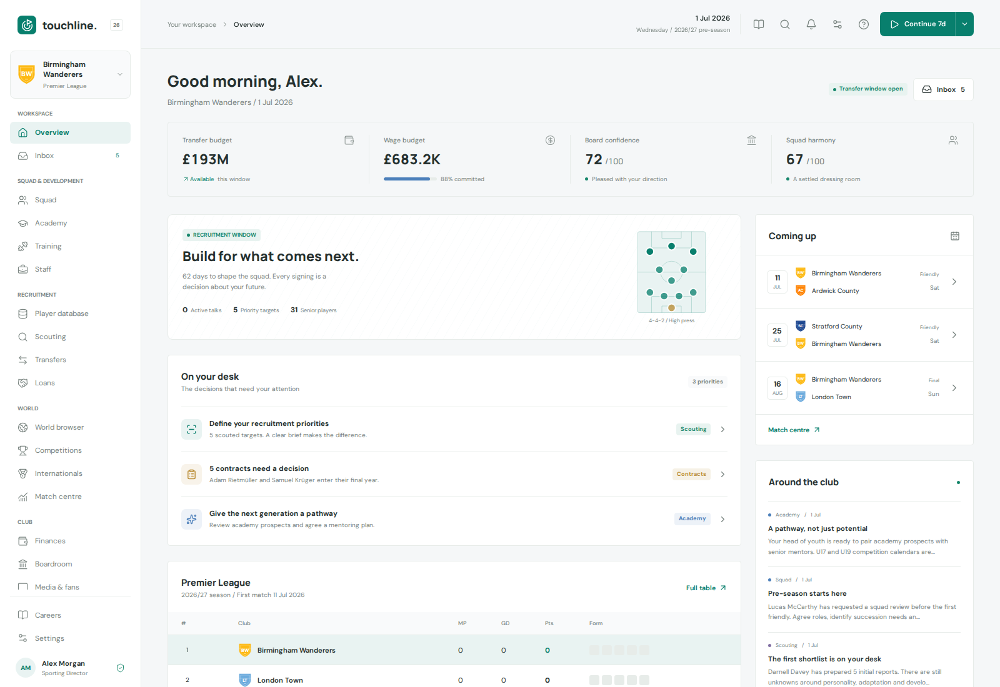

<!-- _class: lead -->
<!-- _paginate: false -->

# Give your agent a map 🗺️

## What a coding agent saves when it stops grepping and starts asking a graph

**224 agent runs · 2 models · 1 compiler-derived ground truth**

Carlos Sardo · Touchline × [Graphify](https://github.com/Graphify-Labs/graphify)

<!--
⏱ 0:00–0:30
Hook: "Who here has watched an agent grep the same 150 KB file five times in a row?"
Promise: a real codebase, a fair benchmark, real numbers. Where a code graph helps, and where it doesn't.
-->

---

# Touchline in 30 seconds ⚽



- A football **sporting-director** sim: you build the club; an AI manager picks the team
- A living, procedurally generated world: transfers, loans, youth, finances and a match engine
- TypeScript end to end: React 19 · Express 5 · PostgreSQL 18, self-hosted on a Raspberry Pi
- **262 TS files · 182k lines**; `server/simulation.ts` alone is **149 KB**

> A perfect agent trap: long call chains, huge files, and everything touches transfers.

<!--
⏱ 0:30–1:15
Keep it light: "It's a football manager game, but you're the person who buys players, not the coach."
The point: big files and deep call chains are exactly where agents burn tokens.
-->

---

# How agents navigate today: the grep relay 🏃

```text
Q: "What can trigger an AI transfer? List every entry point."

turn 1  rg executeMarketTransfer          → decide, settleMarketBids
turn 2  rg "decide\(|settleMarketBids\("   → processTransferBattles   (+ 3 unrelated "decide"s)
turn 3  rg processTransferBattles          → advance                  (simulation.ts, 149 KB)
turn 4  rg "advance\("                      → createWorldRouter, seasonSoak, … and 40 other "advance"s
turn 5  rg createWorldRouter               → createApp
turn 6  rg createApp                       → start, initialize
```

- Every hop is **one model turn**, and every turn re-sends the whole context
- The best hand-written grep recipe needs **6 commands for 78% recall** (homonyms hurt)
- Measured with Sonnet: **11.7 turns, 335k input tokens** for this one question

<!--
⏱ 1:15–2:00
Each hop depends on the previous result, so you can't parallelise it. That's the cost model:
turns × context size. A graph collapses the relay into one hop.
-->

---

<!-- _class: small -->

# Graphify in one slide 🕸️


- Parses the repo (tree-sitter / AST) into `graph.json`: functions, classes and files, linked by `calls`, `imports`, `references`, …
- **No LLM, fully local, 14 s**: Touchline is **5,653 nodes · 18,046 edges · 193 communities**
- Committed and refreshed by a pre-commit hook (union merge driver for branches)

| Question                        | Command                                            |
| ------------------------------- | -------------------------------------------------- |
| What can reach X / what breaks? | `graphify affected "X" --depth N --relation calls` |
| What does X call, who calls X?  | `graphify explain "X"`                             |
| How does A reach B?             | `graphify path "A" "B"`                            |
| Hubs, cycles, communities       | `graphify-out/GRAPH_REPORT.md`                     |

<!--
⏱ 2:00–2:45
The image on the right is Touchline: every dot is a function or file, colours are communities.
Stress: deterministic, local, no tokens spent building it. The agent only pays to read the answer.
-->

---

<!-- _class: small -->

# Live demo 🎬

```bash
# 1. The grep relay from before, as one command (0.4 s)
graphify affected "executeMarketTransfer" --depth 6 --relation calls
```

```text
Affected nodes for executeMarketTransfer()
- decide() [calls] server/transfer-battles.ts:L927
- settleMarketBids() [calls] server/transfer-battles.ts:L1143
- processTransferBattles() [calls] server/transfer-battles.ts:L1052
- advance() [calls] server/simulation.ts:L3422
- createWorldRouter() [calls] server/app.ts:L1793
- seasonSoak() [calls] server/check-simulation.ts:L908
- createApp() [calls] server/app.ts:L1183
- initialize() [calls] scripts/e2e-server.ts:L52
- start() [calls] server/index.ts:L75
```

```bash
# 2. Planning a change: callers, callees, imports with file:line
graphify explain "payReleaseClause"
# 3. The pretty picture
graphify export html --node-limit 7000 && xdg-open graphify-out/graph.html
```

<!--
⏱ 2:45–4:00 (live)
Run 1 and show it's the full chain in under half a second, with file:line for each hop.
Run 2 and point at the callers and callees, plus EXTRACTED vs INFERRED confidence.
Run 3 only if time allows: zoom into the transfer-battles community.
Fallback if the demo fails: the output on this slide is real.
-->

---

# The benchmark: is it worth it, used as designed?

Four arms on the **same commit**, with the **same prompt** (which never mentions Graphify):

| Arm                | What the repo gives the agent                                                           |
| ------------------ | --------------------------------------------------------------------------------------- |
| **A** grep/read    | `rg`, file reads and fair efficient-search tips; `graphify` returns _command not found_ |
| **G** Graphify CLI | the graph plus a short graph-first protocol in `copilot-instructions.md`                |
| **M** Graphify MCP | the same graph through the Graphify MCP server                                          |
| **H** CLI + hook   | G plus a `preToolUse` hook that redirects the first search to the graph                 |

**11 tasks in 5 flavours**: structural (reachability, blast radius, import cycles, unused exports) · change plans · test coverage · controls (_"where is clamp defined?"_) · a known blind spot (URL string → Express route)

**Hypotheses pre-registered** with thresholds before the first run, e.g. _structural: ≥40% fewer turns, ≥30% fewer tokens, accuracy ≥ A − 5 pts_

<!--
⏱ 4:00–4:40
The fairness points: A gets good instructions too, the prompts are identical, and we deliberately included
tasks where we expected the graph to lose or break even (controls, blind spot).
-->

---

<!-- _class: small -->

# The harness (geek mode) ⚙️

```text
index.ts ─▶ prepareArms()   git worktree × 5 at the same commit
            ├─ graph        graphify update + cluster-only → copy graphify-out/ into G, M, H
            ├─ arm-A        PATH shim: graphify = "command not found"
            └─ every arm    the benchmark harness is deleted (no peeking at the answer keys)
         ─▶ runAgents()     copilot -p <prompt> --output-format json --model … --reasoning-effort medium
                            14 concurrent sessions, each with its own COPILOT_HOME
         ─▶ score.ts        final JSON block vs compiler keys (F1 / recall)
         ─▶ report.ts       group ratios, geometric means, 95% bootstrap CIs → REPORT.md
```

- **132 Sonnet runs in 8 minutes**; **224 runs in total** (pilot, Sonnet, Haiku, follow-up)
- Metrics from CLI telemetry: turns, input tokens, cost (AI units), wall time, and
  **task tokens** = input − turns × fixed prefix (system prompt + tool schemas): what the _task_ pulled into context
- Scripted ceilings: the best grep vs graph recipe per task, with no agent involved (H1: **6 vs 1 commands, 78% vs 100% recall**)

<!--
⏱ 4:40–5:15
Parallelism is what made iterating cheap: a full run is 8 minutes, so pilot → fix → rerun was the same afternoon.
Task tokens matter because raw input is dominated by the cached system prompt resent every turn.
-->

---

# Ground truth: the compiler is the referee 🧑‍⚖️

- Answer keys come from the **TypeScript LanguageService** (call hierarchy, references, imports) → `answer-keys.json`
  - a few traced by hand · **never derived from Graphify**
- Agents must finish with a JSON block `{ items: [{ file, symbol }] }`
  - matched by file + symbol · closed sets score **F1**, open tasks **recall** · hallucinated paths and symbols flagged
  - **no LLM judge**
- Every answer is reproducible: saved answers can be re-scored against a new key without re-running any agent

<!--
⏱ 5:15–5:35
Why the compiler: it's independent of both arms. If the keys came from Graphify, the graph arm would be graded by itself.
-->

---

<!-- _class: lead -->

# 📺 VAR overturned my answer key

- H4: _"Which tests exercise `transferProceeds` within 3 call hops?"_ Every arm scored **0.56**. Suspicious…
- **12/12 runs across all 4 arms** independently listed the **same 8 "wrong" test files**
- All 8 were exactly 3 hops from the function the test calls: **my key was one hop short** (off-by-one)
- Fixed the key → `rescore` of the saved answers, with no re-runs → all arms at **100%**

> When every agent disagrees with your key in the same way… check the key. 🧐

<!--
⏱ 5:35–6:00
This is the fun one. When independent agents all disagree with your key in the same way, check the key.
Rescoring is deterministic because answers and keys are both just sets of file#symbol.
-->

---

# Results: where it shines (Sonnet) 🚀

| Question                                       |    Turns A → G |      Input tokens A → G |      Cost | Accuracy A → G |
| ---------------------------------------------- | -------------: | ----------------------: | --------: | -------------: |
| H1 _Who can trigger an AI transfer?_           | 11.7 → **2.7** |  335k → **70k** (0.21×) | **0.41×** | 98% → **100%** |
| H2 _Blast radius of `contractEndDate`, 3 hops_ |  8.7 → **2.0** |  269k → **53k** (0.20×) | **0.31×** |    100% → 100% |
| H4 _Tests exercising `transferProceeds`_       | 11.7 → **4.3** | 346k → **118k** (0.34×) | **0.51×** |    100% → 100% |

Group level (geometric mean of graph ÷ grep, 95% bootstrap CI):

- **Structural**: input tokens **0.63×**, task tokens **0.44×**, cost **0.72×**, accuracy −1 pt (within noise)
- **Test coverage**: input tokens **0.34×**, cost **0.51×**, accuracy equal
- **Change plans**: input tokens **0.80×**, accuracy **+2 pts**

> On graph-shaped questions: **~5× fewer tokens and 2–3× cheaper**, with the same or better answers.

<!--
⏱ 6:00–6:45
H1 and H2: the agent asks one question and is done in two turns. That's the whole pitch.
Cost falls less than tokens because output tokens and the fixed prefix don't shrink.
-->

---

<!-- _class: chart -->

# …and where it doesn't 🧯


<!--
⏱ 6:45–7:15
Green: graph-shaped questions. Grey: a wash. Red: the graph is overhead.
H3 import cycles: GRAPH_REPORT lists a sample of 20 short cycles and misses 5 of 18 files, so the agent writes its own script anyway.
H5: one script already answers "unused exports". T8: the graph can't connect a URL string to its route.
-->

---

<!-- _class: chart -->

# Cheap model + map ≈ expensive model without one 💸


7 graph-heavy tasks × 3 repeats · the graph saves **26% on Sonnet** and **19% on Haiku**
_Haiku once picked the wrong recipe for tests (0.27 on H4) → added a test-coverage recipe to the protocol → 3/3 at 100%. The instructions are part of the tool._

<!--
⏱ 7:15–8:00
AIU = Copilot's AI-unit cost accounting. Haiku with the graph matched Sonnet without it on accuracy at about a tenth of the cost.
Caveats: 7 tasks, 3 repeats, and Haiku's H4 number comes from the post-fix follow-up run.
-->

---

# Delivery matters more than the graph 🚚

| Structural tasks, vs grep    |         Cost | Input tokens |  Task tokens | Accuracy |
| ---------------------------- | -----------: | -----------: | -----------: | -------: |
| **G** CLI + short protocol   |    **0.72×** |    **0.63×** |    **0.44×** |    −1 pt |
| **H** CLI + graph-first hook |        0.72× |        0.64× |        0.46× |    −1 pt |
| **M** MCP server             | 🔴 **1.33×** | 🔴 **1.51×** | 🔴 **2.55×** |   −3 pts |

Why MCP lost in this setup:

- Tools are deferred → every session spends an extra **`tool_search` turn**, and the schemas ride along on every call
- No `affected` equivalent → it walks `get_neighbors` **hop by hop** (25 graph calls on H2 vs 1 for the CLI)
- `at=` shows the call site, not the definition, so the agent guessed files

The hook equalled G on structure but **cost an extra turn** when the graph can't help → **not adopted**

<!--
⏱ 8:00–8:30
The same graph, delivered three ways, gives three different outcomes. The CLI plus 20 lines of instructions won.
-->

---

<!-- _class: small -->

# Prompts where Graphify shines ✨

| Ask your agent…                                       | Vanilla agent                       | With the graph (measured)                                                       |
| ----------------------------------------------------- | ----------------------------------- | ------------------------------------------------------------------------------- |
| _"What can trigger X? List every entry point."_       | grep relay, 1 hop per turn          | `graphify affected "X" --depth 6 --relation calls` · **0.21× tokens**           |
| _"If I change X, what breaks within 3 call hops?"_    | grep + read callers of callers      | `graphify affected "X" --depth 3 --relation calls` · **0.20× tokens**           |
| _"Which tests should I run after touching X?"_        | grep every test file for every name | call chain from the graph → `grep -rlwE` those names in `*.test.ts` · **0.34×** |
| _"Plan a change to X: callers, callees, tests, docs"_ | read 150 KB files                   | `graphify explain "X"` / `affected "X" --depth 1` · **0.80×, +2 pts**           |

**Still a job for plain grep** 🔎

- _"Where is `clamp` defined?"_: one `rg` is already optimal (the graph is neutral, 0.91×)
- _"Which UI component calls `/api/…/advance`?"_: URL strings are invisible to the graph
- _"List every exported function nobody uses"_ or _"every file in an import cycle"_: a 10-line script over the code or `graph.json`

<!--
⏱ 8:30–9:00
Rule of thumb: if the answer is a chain or a set reached through calls, ask the graph.
If the answer is one string, grep it.
-->

---

# Takeaways 🏁

1. **Graph-shaped questions** (reachability, blast radius, test impact): **~5× fewer tokens, 2–3× cheaper**, same or better accuracy
2. **A cheap model with a map ≈ an expensive model without one**: Haiku + graph matched Sonnet + grep at **~1/10 the cost**
3. **Delivery > data**: one CLI command plus a short protocol beat MCP and hooks
4. **Benchmark like a scientist**: compiler ground truth, pre-registered hypotheses, isolated worktrees, and let your agents audit your keys

```bash
uv tool install graphifyy && npm run graph:setup     # graph + pre-commit hook + GRAPH_REPORT.md
graphify affected "yourFunction" --depth 3 --relation calls
```

**Questions?** ⚽🕸️🤖 · full report: `scripts/bench-graphify/REPORT.md`

<!--
⏱ 9:00–9:30, then Q&A. Backup slides follow: pre-registered verdicts and threats to validity.
-->

---

<!-- _class: small -->
<!-- _footer: "Backup · ⚽ Touchline × 🕸️ Graphify" -->

# Backup: pre-registered verdicts (Sonnet, G = CLI arm)

| Hypothesis (fixed before running)                                        | Measured (95% CI)                                        |        Verdict        |
| ------------------------------------------------------------------------ | -------------------------------------------------------- | :-------------------: |
| **P1** structural: ≥40% fewer turns, ≥30% fewer tokens, accuracy ≥ A − 5 | turns 0.65× (0.58–0.76), tokens 0.63× (0.55–0.73), −1 pt | ❌ turn target missed |
| **P2** change plans: accuracy ≥ A − 5                                    | +2 pts, tokens 0.80×                                     |          ✅           |
| **P3** control (_where is clamp?_): tokens within ±15%                   | 0.91×                                                    |          ✅           |
| **P4** coverage: graph arms lose to grep (predicted)                     | +0 pts at 0.34× tokens                                   |   ❌ no loss, a win   |
| **P5** Haiku + graph accuracy ≥ Sonnet + grep                            | 99% vs 98%                                               |          ✅           |

- The thresholds were **not** changed after the fact: P1 missed on turns (0.65 vs ≤0.60) even though the token target was met
- MCP failed P1 and P3; the hook failed P2 (−5 pts) and lost 12 pts on coverage (one bad H4 run)

---

<!-- _class: small -->
<!-- _footer: "Backup · ⚽ Touchline × 🕸️ Graphify" -->

# Backup: method details and threats to validity

**Isolation**: one git worktree per arm at the same commit; the graph is built once (fixed hash seed) and copied; the harness is removed from every arm; arm A has a `PATH` shim so `graphify` is unavailable

**Tokens**: from the CLI's `session.usage_checkpoint` · prefix = tool schemas + system segments · task tokens = input − calls × prefix · retrieved tokens = o200k count of every tool result

**Statistics**: per task, mean(arm) ÷ mean(A); groups use geometric means; 2,000-resample bootstrap of runs within each cell

**Threats**

- 3 repeats per cell → wide CIs on single tasks; group ratios are the headline
- One codebase and one language (TypeScript call extraction); tests reach code inside callbacks the graph doesn't link
- Structural tasks were chosen _because_ they are graph-shaped; controls and the blind spot show the cost elsewhere
- A's protocol is fair but not optimal; the arms compare realistic setups
- Haiku's H4 graph number comes from a post-hoc protocol fix, measured on one task
