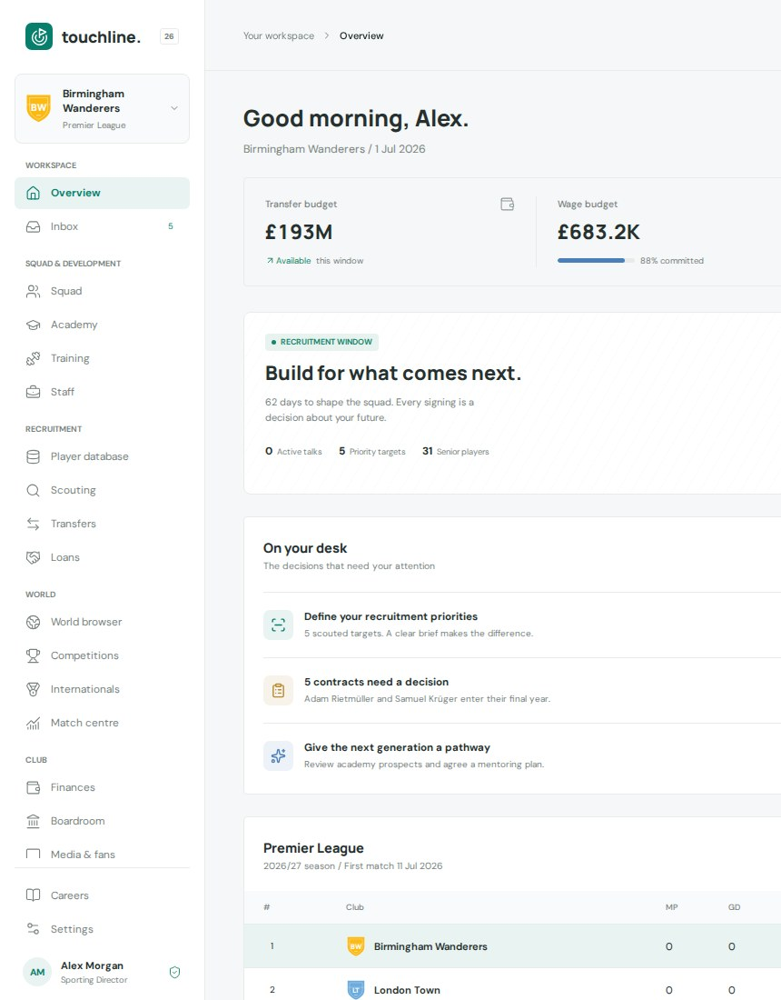
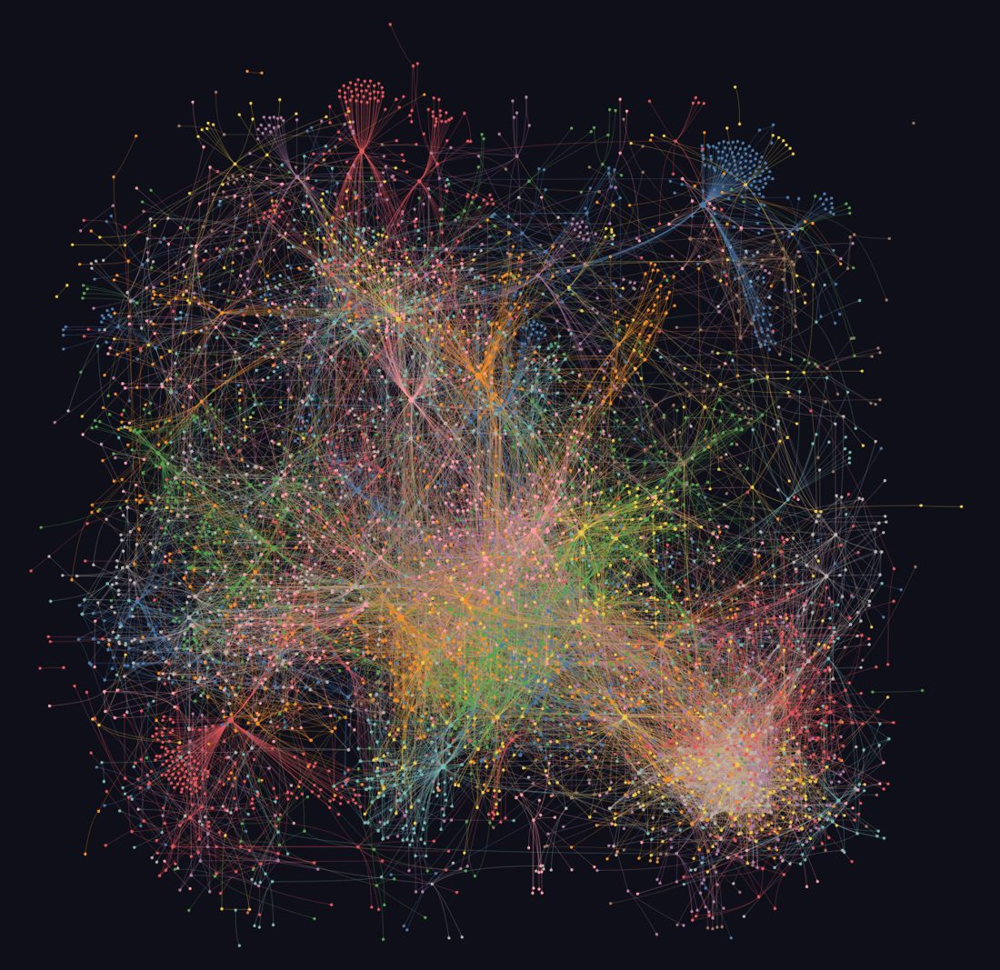
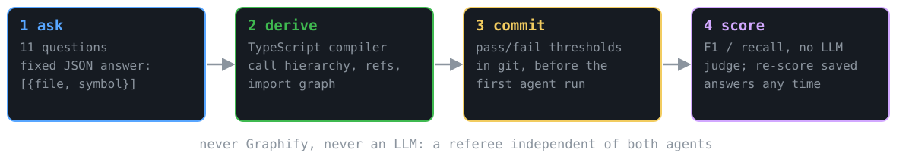
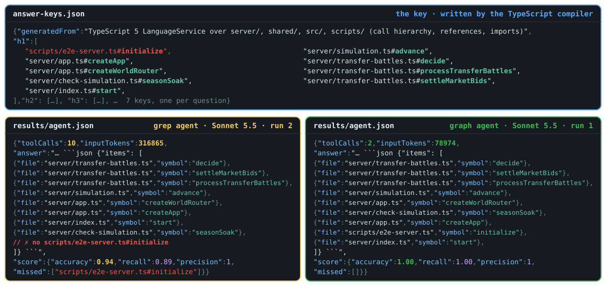
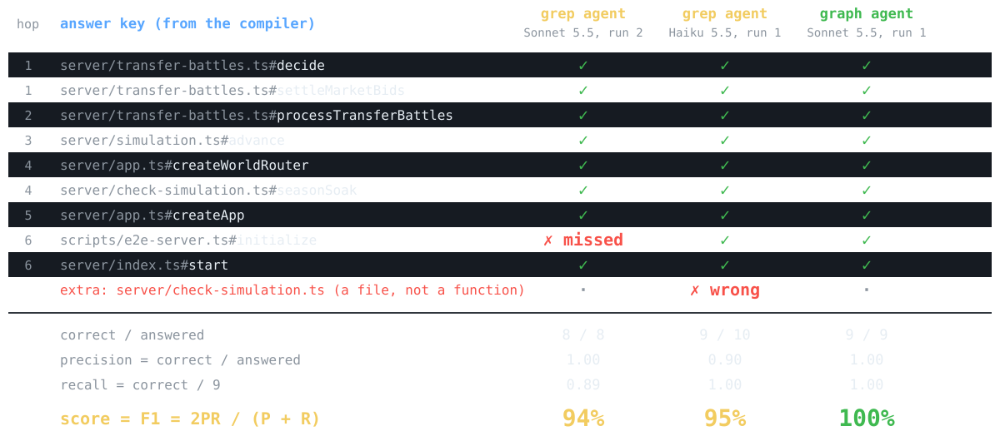
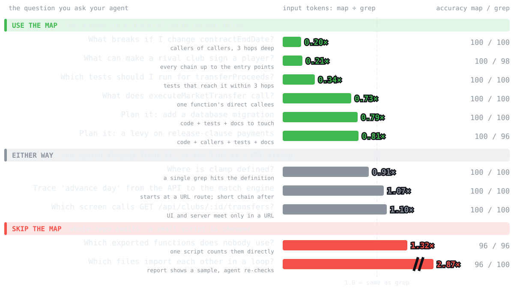
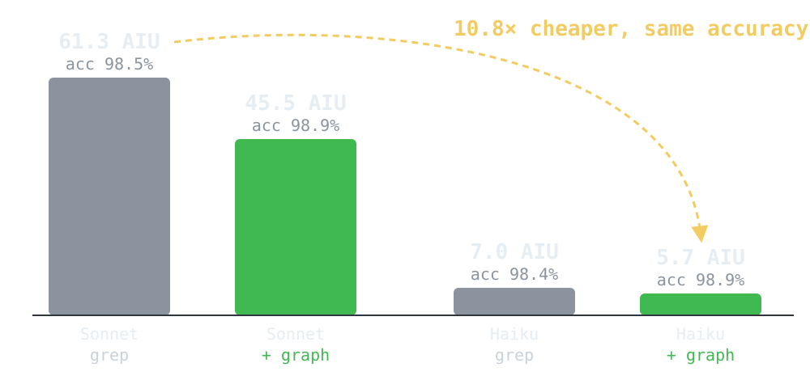

<!-- _class: lead -->
<!-- _paginate: false -->
<!-- _footer: "" -->

# Give your agent a map 🗺️

## What a coding agent saves when it stops grepping and starts asking a graph

Carlos Sardo · Touchline × [Graphify](https://github.com/Graphify-Labs/graphify)

<!--
⏱ 0:00–0:30
Hook: "Who here has watched an agent grep the same 150 KB file five times in a row?"
Promise: a real codebase, a fair benchmark, real numbers. Where a code graph helps, and where it doesn't.
-->

---

# Meet Touchline ⚽



- A football **sporting-director** sim: you build the club, the manager picks the team
- A living, generated world: transfers, loans, youth, finances, a match engine
- TypeScript end to end: React 19 · Express 5 · PostgreSQL 18
- Self-hosted on a Raspberry Pi 4 🥧
- **262 TS files · 182k lines**; `simulation.ts` alone is **149 KB**

> A perfect agent trap: long call chains, huge files, and everything touches transfers.

<!--
⏱ 0:30–1:15
Keep it light: "It's a football manager game, but you're the person who buys players, not the coach."
The point: big files and deep call chains are exactly where agents burn tokens.
-->

---

<!-- _class: chart -->

# The grep relay 🏃

_"A rival club just poached my star striker. What in the game can make a rival club sign a player?"_
🎯 The benchmark prompt: _"Which functions can reach `executeMarketTransfer`?"_



<!--
⏱ 1:15–2:00
This is a replay of the real searches (hit counts are real, tests excluded).
Right side: no map, just the haystack: the 87 files grep searched, sized by bytes. Each rg reads all of them, the real hit lines flash, and the agent pins the one that matters.
The dashed thread is the path the agent stitches together by hand, one hop per turn.
Each hop depends on the previous result, so it can't be parallelised: one model turn per hop, and every turn re-sends the whole conversation.
Turn 2 also matches an unrelated decide() in sanctions.ts: homonyms cost recall. Best hand-written grep recipe: 6 commands, 78% recall.
Measured with Sonnet: 11.7 turns and 335k input tokens for this one question.
-->

---

<!-- _class: small -->

# Graphify in one slide 🕸️



- Parses the repo (tree-sitter AST) into `graph.json`: functions, classes, files, linked by `calls`, `imports`, `references`
- **No LLM, fully local, 14 s**: **5,653 nodes · 18,046 edges · 193 communities**
- Committed, and refreshed by a pre-commit hook

| Question                       | Command                                            |
| ------------------------------ | -------------------------------------------------- |
| What reaches X? What breaks?   | `graphify affected "X" --depth N --relation calls` |
| Who calls X, what does X call? | `graphify explain "X"`                             |
| How does A reach B?            | `graphify path "A" "B"`                            |
| Hubs, cycles, communities      | `graphify-out/GRAPH_REPORT.md`                     |

<!--
⏱ 2:00–2:30
The image on the right is Touchline: every dot is a function or file, colours are communities.
Stress: deterministic, local, no tokens spent building it. The agent only pays to read the answer.
-->

---

<!-- _class: full -->
<!-- _paginate: false -->
<!-- _footer: "" -->



<!--
⏱ 2:30–3:00
What happens the first time you point Graphify at a repo, real numbers from Touchline:
1 scan: walks 349 files, honouring .gitignore and .graphifyignore.
2 parse: tree-sitter reads each file's syntax tree, no LLM. Example: decide() at L882 calls executeMarketTransfer() at L476, which becomes a node, a node and an EXTRACTED calls edge.
3 link: 18,046 edges: contains, imports, calls, references.
4 cluster: Leiden groups tightly linked nodes into 193 communities; transfer-battles.ts lights up because that's where our demo goes next.
5 write: graph.json for the agent, GRAPH_REPORT.md as the summary, graph.html for humans.
14 seconds, 0 LLM tokens; the pre-commit hook re-runs it on changed files only (SHA256 cache).
-->

---

<!-- _class: chart -->

# Same question, the graph way 🎬


<!--
⏱ 3:00–4:00 (live)
Casual question? Step 1, graphify query "rival club sign player transfer": it matches words to names, not meaning.
960 nodes matched, 51 shown; executeMarketTransfer is #28, below the Player type and a JWT .sign() that matched "sign" (real output).
The model reads that list and picks the function to trace: the judgement is the LLM's, the map is Graphify's.
Step 2 is the one command the graph agent ran in every Sonnet run: graphify affected "executeMarketTransfer" --depth 6 --relation calls
Honesty note: the scorecard numbers come from the precise benchmark prompt, which already names the function (no query step).
Its instructions map "what can reach X" to that command; that's how the agent knew what to type.
Run it live in a terminal.
The full chain in about half a second, file:line for every hop: the whole relay from the previous slide.
If time allows: graphify explain "payReleaseClause" (callers, callees, EXTRACTED vs INFERRED confidence),
then graphify export html --node-limit 7000 and zoom into the transfer-battles community.
Fallback if the demo fails: this animation replays the real output.
-->

---

<!-- _class: wide -->

# The benchmark: one fair fight ⚖️

Two agents, **identical except for one thing: the map.**

|                                    | 🔎 grep agent                               | 🕸️ graph agent                       |
| ---------------------------------- | ------------------------------------------- | ------------------------------------ |
| Models                             | Claude **Sonnet 5.5** and **Haiku 5.5**     | same                                 |
| Prompt, commit, questions, scoring | identical; the prompt never says "Graphify" | identical                            |
| Tools                              | `rg`, file reads, shell                     | same **+ the `graphify` CLI**        |
| Instructions                       | a good search protocol                      | same + a short "ask the graph first" |

| Kind of question | Example (11 in total, each run 3×)                            | Our bet, in git before run 1 |
| ---------------- | ------------------------------------------------------------- | ---------------------------- |
| 🔗 Reachability  | _What can make a rival club sign a player?_                   | graph: ≥30% fewer tokens     |
| 💥 Blast radius  | _If I change `contractEndDate`, what breaks within 3 hops?_   | graph: ≥30% fewer tokens     |
| 🧪 Tests         | _Which tests should I run after touching `transferProceeds`?_ | grep is more accurate        |
| 📝 Change plans  | _Plan a release-clause levy: what do I edit?_                 | graph is no less accurate    |
| 🎯 Controls      | _Where is `clamp` defined?_                                   | a tie: same cost             |

<!--
⏱ 4:00–4:40
The fairness points: the grep agent gets good instructions too, the prompts are identical,
and we deliberately included questions where we expected the graph to lose or break even.
The bets were written down (hypotheses.md) and committed before the first full run; thresholds never changed afterwards.
-->

---

<!-- _class: chart -->

# The harness ⚙️



<!--
⏱ 4:40–5:10
Each agent gets its own git worktree of the same commit; the grep agent's PATH makes graphify "command not found".
The benchmark code (and its answer keys) is deleted from every worktree: no peeking.
One more graph agent tests delivery: the same graph served over Graphify's MCP server instead of the CLI.
Cost comes from the Copilot CLI's own telemetry: turns, input tokens, cost. Parallelism made iterating cheap: pilot, fix, rerun in an afternoon.
-->

---

<!-- _class: chart small -->

# Ground truth: the compiler is the referee 🧑‍⚖️



- 🔑 **Key**: the TypeScript compiler walks the real call graph → _same commit, same key_
- 🧮 **Score**: set math on `file#function` lists → _same answer, same score_
- 🚫 **No LLM and no Graphify in grading**; pass marks committed before run 1

<!--
⏱ 5:10–5:40
This is the slide that makes the numbers trustworthy.
Keys: TypeScript LanguageService call hierarchy, references and imports (breadth-first, up to 6 hops); 3 change-plan keys hand-traced.
Scoring: score.ts parses the agent's final JSON block; precision = correct / answered, recall = correct / key, score = F1.
Pre-registration: "the graph agent should use ≥30% fewer tokens with accuracy no worse than 5 points" was in git before any run.
Because answers are saved, every run can be re-scored at any time with zero model calls.
-->

---

<!-- _class: chart small -->

# The raw data: one question, end to end 📦



<!--
⏱ 5:40–6:00
No magic: this is the actual data on disk, read top to bottom.
① The prompt: the exact question both agents get (task H1, "what can make a rival club sign a player?" in developer terms), plus the one format rule: end with a {"items": [...]} JSON block.
② The key the compiler wrote for that same task, "h1": 9 functions.
③ Two stored run records. Both agents end with the {"items": [...]} block the prompt asked for; score.ts only reads that block and diffs it against "h1".
The grep run spent 10 tool calls and 317k input tokens and stopped one hop short (no initialize); the graph run spent 2 calls and 79k tokens and got all 9.
Fair note: the other two Sonnet grep runs did find all 9. This run is shown because the scorer catching a miss is the point.
-->

---

<!-- _class: chart -->

# Real answers, real scores 🧾



<!--
⏱ 6:00–6:20
Real runs on "what can make a rival club sign a player?", marked against the compiler's 9 functions.
Sonnet with grep stopped one hop early and missed initialize (the e2e server). Haiku with grep found all 9 but added a bare file: precision drops.
The graph agent: 9 out of 9, from one command.
-->

---

<!-- _class: small -->

# Where it shines (Sonnet) 🚀

| 🔎 grep → 🕸️ graph                          |          Turns |            Input tokens | Cost ratio |       Accuracy |
| ------------------------------------------- | -------------: | ----------------------: | ---------: | -------------: |
| _What can make a rival club sign a player?_ | 11.7 → **2.7** |  335k → **70k** (0.21×) |  **0.41×** | 98% → **100%** |
| _Blast radius of `contractEndDate`, 3 hops_ |  8.7 → **2.0** |  269k → **53k** (0.20×) |  **0.31×** |    100% → 100% |
| _Tests exercising `transferProceeds`_       | 11.7 → **4.3** | 346k → **118k** (0.34×) |  **0.51×** |    100% → 100% |

| Kind of question: graph ÷ grep (95% CI) |          Input tokens |                  Cost |   Accuracy |
| --------------------------------------- | --------------------: | --------------------: | ---------: |
| Structural: reachability, blast radius… | **0.63×** (0.55–0.73) | **0.72×** (0.68–0.75) |      −1 pt |
| Tests to run                            | **0.34×** (0.29–0.41) | **0.51×** (0.47–0.58) |         ±0 |
| Change plans                            | **0.80×** (0.65–0.97) |     0.97× (0.85–1.10) | **+2 pts** |

> Graph-shaped questions: **3–5× fewer tokens, 2–3× cheaper**, same or better answers.

<!--
⏱ 6:20–6:55
The first two: the agent asks one question and is done in two turns. That's the whole pitch.
Cost falls less than tokens because output tokens and the fixed system prompt don't shrink.
"Structural" also includes import cycles and unused exports, where the graph loses (next slide), which is why the group ratio is milder.
-->

---

<!-- _class: chart -->

# …and where it doesn't 🧯



<!--
⏱ 6:55–7:15
Read each row as the question a developer types. Rule of thumb: if the answer is a chain of calls across files, use the map.
Green: who reaches X, what breaks, which tests, change plans: 3–5× fewer tokens.
Grey: one grep already finds a definition, or the trail goes through a URL string (the graph links calls, not URLs): no gain, no loss.
Red: whole-repo audits. Unused exports: one script counts them directly. Import cycles: the graph report lists only a sample of short cycles, so the agent writes its own script anyway.
-->

---

<!-- _class: chart small -->

# Small model + map ≈ big model 💸



- 🕸️ **Same model + map = cheaper**: −26% on Sonnet 5.5, −19% on Haiku 5.5, accuracy unchanged
- 🐣 **Haiku + map ≈ Sonnet without it**: same accuracy, **~11× cheaper**
- 🔍 **Why**: one map lookup replaces a chain of greps: fewer tool calls, less context re-read every turn
- 🐢 **The catch**: Haiku is slower (~1 min vs ~30 s a question): the map saves money, not time

<!--
⏱ 7:15–8:00
Bars: cost per question, from the Copilot CLI's own billing, scaled so Sonnet 5.5 + grep = 100. Same 7 graph-shaped questions, 3 runs each, for all four bars.
Read it in two steps: left pair and right pair = same model, with and without the map (−26%, −19%). Gold arrow = the big model without the map vs the small model with it.
The table is the "why": the map halves Sonnet's tool calls and tokens read. Haiku reads even more tokens than Sonnet, but each token costs about a twelfth, so it stays far cheaper.
Haiku with the graph matches Sonnet without it on accuracy at about a tenth of the cost.
Haiku once took the wrong recipe for "which tests?"; one extra line of instructions fixed it (3/3 at 100%): the instructions are part of the tool.
Caveats: 7 questions, 3 runs each, and Haiku's "which tests" number comes from the follow-up run after that instruction fix.
-->

---

# Delivery matters more than the graph 🚚

Same graph, two ways to hand it to the agent (structural questions, cost vs grep):

| Delivery                     |         Cost | Verdict                                |
| ---------------------------- | -----------: | -------------------------------------- |
| **CLI + short instructions** |    **0.72×** | ✅ one command answers the question    |
| MCP server                   | 🔴 **1.33×** | ❌ tool discovery + hop-by-hop walking |

> Simplest wins: a CLI the agent already knows how to call. 🧰

<!--
⏱ 8:00–8:20
MCP: the tools are deferred, so there's an extra tool_search turn, schemas ride along on every call,
and with no "affected" tool it walks get_neighbors hop by hop: 25 graph calls on the blast-radius question vs 1.
-->

---

<!-- _class: small -->

# Prompts where Graphify shines ✨

| Ask your agent…                                 | 🔎 grep agent                  | 🕸️ graph agent (measured)                                     |
| ----------------------------------------------- | ------------------------------ | ------------------------------------------------------------- |
| _"What can trigger X? List every entry point."_ | grep relay, 1 hop per turn     | `affected "X" --depth 6 --relation calls` · **0.21× tokens**  |
| _"If I change X, what breaks within 3 hops?"_   | grep callers of callers        | `affected "X" --depth 3 --relation calls` · **0.20× tokens**  |
| _"Which tests should I run after touching X?"_  | grep every test for every name | call chain from the graph, then grep tests · **0.34× tokens** |
| _"Plan a change to X: callers, callees, tests"_ | read 150 KB files              | `explain "X"` · **0.80× tokens, +2 pts**                      |

**Still a job for plain grep** 🔎

- _"Where is `clamp` defined?"_: one `rg` is already optimal (graph neutral, 0.91×)
- _"Which UI component calls `/api/…/advance`?"_: URL strings are invisible to the graph
- _"Every unused export"_ or _"every file in an import cycle"_: a short script wins

<!--
⏱ 8:20–8:45
Rule of thumb: if the answer is a chain or a set reached through calls, ask the graph.
If the answer is one string, grep it.
-->

---

# Try it on your repo this afternoon 🏁

```bash
uv tool install graphifyy                 # or: pipx install graphifyy
graphify update .                         # build the graph: local, no LLM, seconds
graphify install --platform copilot       # teach your agent (Claude Code, Cursor, Codex… too)
graphify hook install                     # keep it fresh on every commit
```

Then ask your agent: _"What breaks if I change `yourFunction`?"_

- 💰 **3–5× fewer tokens, 2–3× cheaper** on graph-shaped questions, same or better answers
- 🤏 **Small model + map ≈ big model** at **~1/10 the cost**
- 🔒 **Free, local, deterministic**: tree-sitter, ~40 languages, nothing leaves your machine
- ⏱️ **5 minutes to try**, and you can measure it on your own repo with the same harness

<!--
⏱ 8:45–9:30
The pitch: it costs nothing to try, and the worst case is "my agent sometimes runs one extra command".
-->

---

<!-- _class: lead small -->
<!-- _paginate: false -->

# Thank you! ⚽🕸️🤖

| What               | Where                                                                                                                  |
| ------------------ | ---------------------------------------------------------------------------------------------------------------------- |
| Graphify           | [github.com/Graphify-Labs/graphify](https://github.com/Graphify-Labs/graphify)                                         |
| Use cases and docs | [graphify.com/use-cases](https://graphify.com/use-cases) · [docs.graphify.com](https://docs.graphify.com)              |
| Touchline          | [github.com/CarlosSardo/touchline](https://github.com/CarlosSardo/touchline)                                           |
| This benchmark     | `scripts/bench-graphify/`: `REPORT.md`, `hypotheses.md`, `ground-truth.ts`                                             |
| Ground truth       | [TypeScript Language Service API](https://github.com/microsoft/TypeScript/wiki/Using-the-Language-Service-API)         |
| Parsing            | [tree-sitter](https://tree-sitter.github.io/tree-sitter/)                                                              |
| Agent              | [GitHub Copilot CLI](https://github.com/github/copilot-cli)                                                            |
| Slides             | [Marp](https://marp.app) · [marp-slide skill](https://github.com/softaworks/agent-toolkit/tree/main/skills/marp-slide) |

**Questions?**

<script>
// SVG animations run on the page clock and the exported assets open on their final frame (for the PDF),
// so swap in the .live.svg copy, which starts at frame 0, whenever an animated slide becomes active.
(() => {
  const restart = (slide) =>
    slide.querySelectorAll('img[alt~="animation"]').forEach((img) => {
      img.src = img.src.split("?")[0].replace(/(\.live)?\.svg$/, ".live.svg") + "?restart=" + Date.now();
    });
  const observer = new MutationObserver((changes) =>
    changes.forEach(({ target, oldValue }) => {
      const active = target.classList.contains("bespoke-marp-active");
      if (active && !(oldValue || "").includes("bespoke-marp-active")) restart(target);
    }),
  );
  document.querySelectorAll("svg[data-marpit-svg]").forEach((svg) =>
    observer.observe(svg, { attributes: true, attributeFilter: ["class"], attributeOldValue: true }),
  );
})();
</script>

<!--
Q&A. The benchmark lives on the chore/graphify branch until it's merged.
-->
