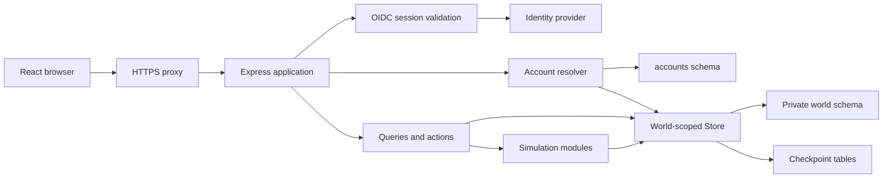

# Solution architecture

Touchline is a modular application, not a collection of microservices. Browser presentation, server domain logic and persistence have clear code boundaries, but the API, simulation, identity integration and static UI hosting share one production application process.

## Runtime overview

The matching [diagram source](https://github.com/CarlosSardo/touchline/blob/main/website/src/content/docs/technical/diagrams/runtime.mmd) is kept with this section.

## Technology stack

Versions here describe the reviewed manifests; use the lockfile and deployment image digest for exact reproducibility.

| Layer | Implementation |
| --- | --- |
| Language/runtime | TypeScript 7, ECMAScript modules, Node.js 24; server executes through `tsx` |
| Browser | React 19 / React DOM, Vite 8 and its React plugin |
| Presentation | Repository CSS, Lucide icons, DM Sans/Manrope fonts, Recharts and custom pitch maps |
| HTTP/application | Express 5, Zod request validation |
| Identity | `openid-client` 6, operator-owned OIDC provider; Authelia is the reference integration |
| Database | PostgreSQL 18 with `pg` connection pools and repository-owned SQL/migrations |
| Procedural simulation | `seedrandom`, Faker, geographic/city data, scheduling/statistics/optimization libraries and domain-specific algorithms |
| Checks | Vitest, Supertest, Playwright, TypeScript build checks, oxlint, Prettier |
| Delivery | Docker multi-stage/multi-architecture images, Compose, optional Caddy, GHCR, GitHub Actions and Dagger |

The gameplay client is not an Astro or Tailwind application. The documentation website is a separate publishing surface, not a replacement game runtime.

## Source boundaries

| Location | Responsibility |
| --- | --- |
| `src/main.tsx`, `src/App.tsx` | Browser entry and application shell |
| `src/game-context.tsx` | Session/bootstrap state, same-origin API requests, mutations, activity handling, resource invalidation and navigation state |
| `src/views/`, player/club sheets and supporting components | Sporting-director screens, resource presentation and interactions |
| `shared/api.ts`, `shared/types.ts` | Shared API/domain shapes |
| `shared/rules.ts`, eligibility/league/competition/GBE helpers | Pure shared calculations and rule definitions |
| `shared/world-catalog/` | Curated generation catalog; shared directory placement does not make it browser runtime data |
| `server/index.ts` | Configuration, HTTP lifecycle, lazy SQL opening, readiness validation and graceful shutdown |
| `server/app.ts` | Route composition, origin/auth guards, account routing, Zod boundaries, world operation coordination and action dispatch |
| `server/queries.ts` and view-specific query modules | SQL-to-API resource projections |
| `server/systems.ts` and focused domain modules | Career actions and football/club business rules |
| `server/world.ts`, `people.ts`, `calendar.ts` | Procedural population and initial schedule construction |
| `server/simulation.ts`, match engines and daily modules | Authoritative time advancement |
| `server/db.ts`, `sql-schema.ts`, `sql-config.ts` | Store, SQL transport/configuration, schema and migration contract |
| `server/accounts.ts`, `auth.ts`, `admin-routes.ts` | Identity, approval and world resolution |
| `server/saves.ts`, `save-format.ts`, `retention.ts` | Checkpoints, portable serialization and storage lifecycle |
| `scripts/`, `deploy/`, `.dagger/` | Explicit provisioning, development verification and deployment automation |

`src/import-boundary.test.ts` checks that the browser never directly imports server code or the world catalog and that the catalog is absent from the runtime import graph. Keep type contracts and pure reusable rules shared without pulling generation/database code into the client bundle.

## Request and mutation flow

The browser uses `fetch` on `/api/...` with same-origin credentials and no-store resource requests. The game context tracks an account/request generation so a late response from a previous identity cannot populate the next identity's screen. Typed error handling distinguishes session/access errors, busy worlds and uncertain mutation outcomes; a failed network response is not proof a write did not happen.

Express applies response security headers, exposes lightweight liveness, mounts authentication/admin routes, enforces API authentication and origin checks, then resolves the account's world router. JSON request bodies are bounded and validated with Zod; administrative and save-upload paths have their own handlers rather than trusting arbitrary JSON.

Read handlers use read-only transactions; mutations receive a named world operation and run the domain action through the appropriate persistence boundary. During a long operation, competing world views/actions receive `409 world_busy` rather than reading a half-replaced world. Session/activity endpoints remain useful for polling.

Per-world routers and caches are process-local. Database locks are the additional concurrency boundary for another connection/process using the same store conventions; process-local activity is not a distributed queue.

## Production and development differ

Development runs Vite and `tsx watch` as two processes; Vite proxies `/api` to the local API. A production build emits the browser bundle into `dist/`, which Express serves alongside the API. The Docker runtime contains production dependencies, server/shared/scripts source and the built UI, and runs as the unprivileged `node` user.

SQL opens lazily on the first request needing data. `/api/health` can succeed without connecting to PostgreSQL, so it is liveness, not proof of a valid registry or career. Hosted startup validates the registry; no-auth development requires an initialized local career. Neither path silently migrates or seeds.

See [identity](identity.md), [persistence](persistence.md) and [delivery](delivery.md) for the corresponding trust, consistency and host boundaries.
