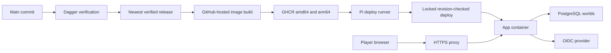

# Delivery and operations

Touchline's engineering workflow keeps application verification portable and deployments conservative: build/test on disposable containers, publish verified multi-architecture images, and run only the deployment step on the host containing real careers.

## Build and verification layers

Development runs Vite plus `tsx watch`; production type-checks and builds the UI, then serves it from Express. The Dockerfile separates the architecture-independent UI build from target-architecture production dependency installation. Runtime code remains root-owned while the process runs as `node`; temporary save files use `/tmp`.

Vitest covers pure calculations and real-SQL integration. Supertest exercises HTTP behavior, Playwright exercises browser workflows, and world/match/season checks cover simulation invariants and storage budgets. `test:local` provisions an isolated PostgreSQL 18 target instead of substituting SQLite or disabling SQL checks.

The authoritative command catalog is in [DEVELOPMENT.md](https://github.com/CarlosSardo/touchline/blob/main/DEVELOPMENT.md#testing-and-verification).

## Dagger and CI

`.dagger/modules/touchline-ci/src/index.ts` is the TypeScript pipeline; `scripts/ci.sh` is its shared local/GitHub entrypoint. The pinned CLI and local Docker engine require no Dagger Cloud account or secret.

The static suite gates lint/build/pure tests and generated-code consistency. Backend tests use three independent PostgreSQL shards; browser specs use two. The world suite runs invariant checks, season progression, footprint and backup/reset smoke. Duration-weighted bin packing balances file shards, and coverage checks prevent silent omissions or accidental empty-list full-suite runs.

A loopback TCP forwarder connects each test container to its private SQL service without weakening the repository's test-host guards. Test databases trade durability for speed only because they are disposable; those flags are not production tuning advice.

Step logs and exit-code files survive failures. The wrapper evaluates those statuses and fails the run, while retaining later diagnostics within a suite. `all` skips expensive remaining suites if static fails, otherwise runs them concurrently.

CI checks PRs, `main` pushes and manual runs. Exact-tree reuse avoids repeating a fully successful PR's verification on an identical merge tree. Workflow path ignores skip Markdown/editor-only changes; they are not a general documentation-site build system.

## Release path

The [diagram source](https://github.com/CarlosSardo/touchline/blob/main/website/src/content/docs/technical/diagrams/delivery.mmd) is saved alongside the pages.

CD follows successful push CI and a six-hour reconciliation schedule. `scripts/ci/cd.sh` selects the newest verified ancestor of main, not simply whichever old workflow happens to finish last. It recomputes the desired release and refuses downgrades.

Publishing runs on GitHub-hosted runners and creates `sha-<commit>`/`latest` images for amd64/arm64. The Pi's outbound-only self-hosted runner uses the `touchline-deploy` label and runs only the protected deployment job. Its job-start guard rejects other workflows/branches/jobs before steps execute. Docker membership is powerful: anyone allowed to alter `main` must be trusted with the host.

Deploy uses an ephemeral GitHub package token rather than a stored deployment credential. The host checks OCI revision labels before switching, serializes deploys with `flock`, provisions/validates registry and world migrations, starts the service and verifies liveness/revision.

## Two supported Compose shapes

The root stack bundles PostgreSQL 18, the app and optional Caddy. PostgreSQL binds only to host loopback, uses a dedicated persistent volume and creates a non-superuser application owner role on initial volume creation. App publication is loopback by default; Caddy can terminate HTTPS.

The external-PostgreSQL variant contains only the app on an existing Docker database network, behind an existing proxy. `scripts/deploy.sh` installs **this variant**. It is not a generic deploy helper for replacing the root bundled database stack.

Both shapes run simulation in the app process, share the same OIDC/account model and need explicit migrations. The reference app has a 2 GB memory limit with a 1536 MB heap cap; root PostgreSQL settings assume an 8 GB host and SSD.

## Recovery and operational limits

Liveness does not equal readiness: `/api/health` works before SQL is opened. Authenticated health details and actual registry/career access are needed to establish data readiness.

Deployment does not automatically back up data. Take a matching backup before migrations. After a failed migration/start, an older image alone is not a safe rollback. The root stack's backup/restore scripts assume its `postgres` Compose service; the external shared database needs its own operator backup procedure.

Portable `.touchline.gz` files and all-world manifests supplement database dumps, but account registry exports contain private identity data. Never commit backups, personal saves, credentials or runtime databases.

The host configuration is also maintained in [CarlosSardo/raspberry-pi-4b-bootstrap](https://github.com/CarlosSardo/raspberry-pi-4b-bootstrap). Pi-related changes must remain represented there rather than becoming undocumented host drift.

Use the [operations runbook](https://github.com/CarlosSardo/touchline/blob/main/DEVELOPMENT.md#hosting-and-first-install) for installation, OIDC configuration, runner setup, backup/restore, upgrades and troubleshooting. No live infrastructure state or Pi performance guarantee is implied by these source-derived topology descriptions.
